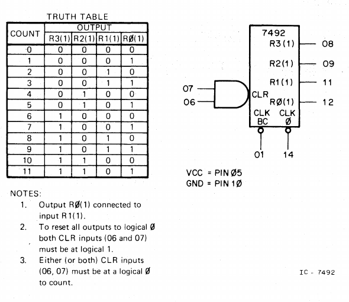
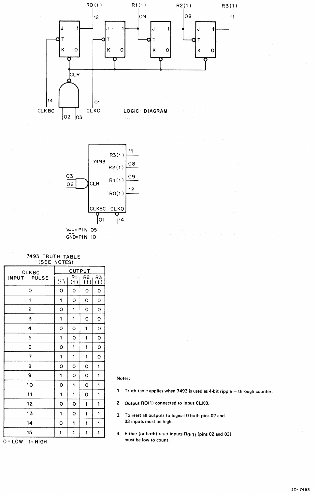
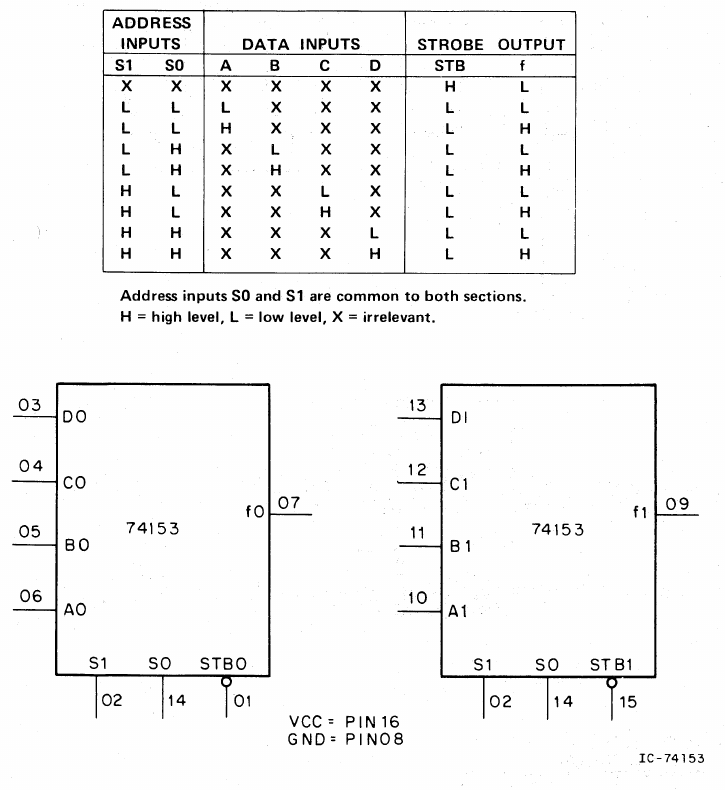
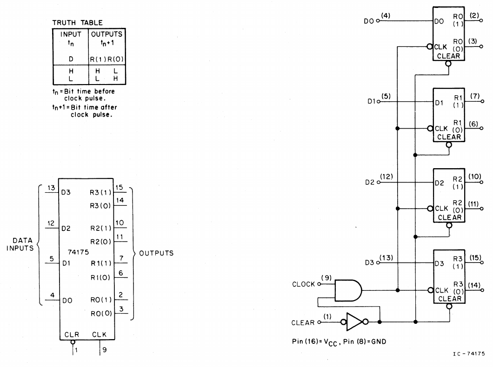

# Appendix A: IC Schematics

This appendix describes the integrated circuits listed below.

- 7492 Divide-By-Twelve Counter (Divide-by-Two and Divide-by-Six)
- 7493 4-Bit Binary Counter
- 74153 Dual 4-Line-to-1-Line Multiplexer
- 74175 Quad D-Type Edge-Triggered Flip-Flop

## 7492 DIVIDE-BY-TWELVE COUNTER (DIVIDE-BY-TWO AND DIVIDE-BY-SIX)

The 7496 is a monolithic 4-bit binary counter consisting of four master slave flip-flops that are internally interconnected to provide a divide-by-two counter and a divide-by-six counter. A gated direct reset line is provided which inhibits the count inputs and simultaneously returns the four flip-flop outputs to a logical 0. As the output from flip-flop R(0) is not internally connected to the succeeding flip-flops, the counter may be operated in two independent modes:

1. When used as a divide-by-twelve counter, output R0(1) must be externally connected to input CLKBC. The input count pulses are applied to input CLK0. Simultaneous divisions of 2, 6, and 12 are performed at the R0(1), R2(1), and R3(1) outputs as shown in the truth table.
2. When used as a divide-by-six counter, the input count pulses are applied to input CLKBC. Simultaneously, frequency divisions of 3 and 6 are available at the R2(1) and R3(1) outputs. Independent use of flip-flop R0 is available if the reset function coincides with reset of the divide-by-six counter.

## 7493 4-BIT BINARY COUNTER

## 74153 DUAL 4-LINE-TO-1-LINE MULTIPLEXER

## 74175 QUAD D-TYPE EDGE-TRIGGERED FLIP-FLOP

