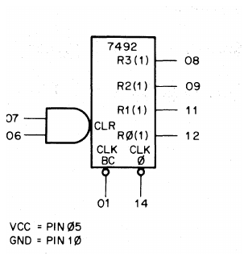
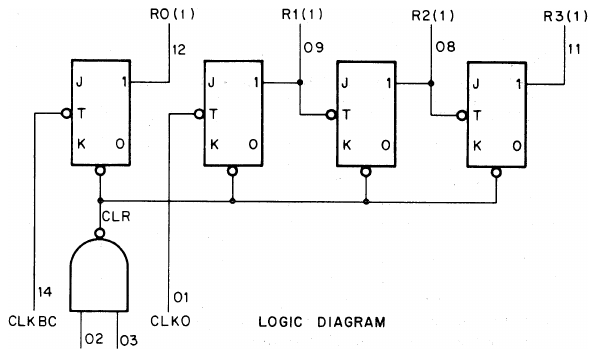
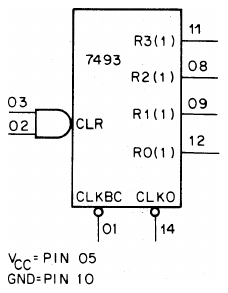
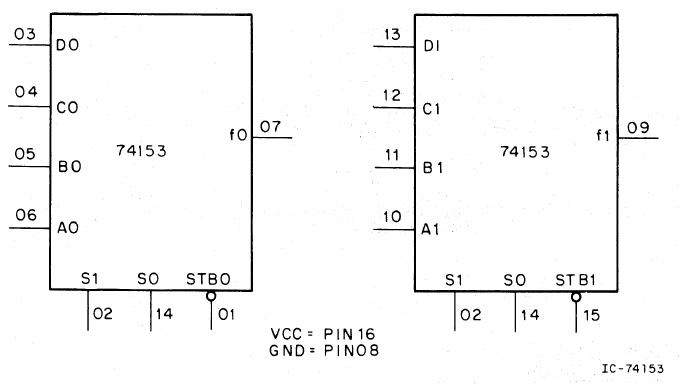
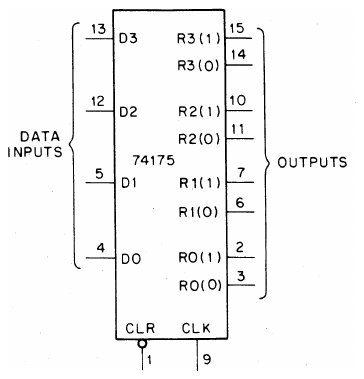
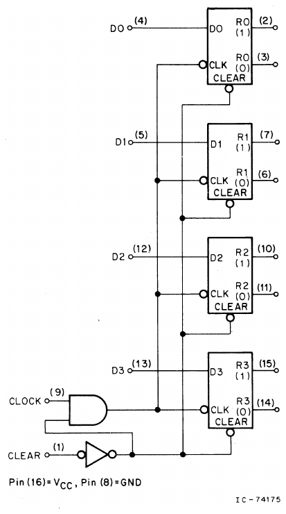

# Appendix A: IC Schematics

[Manual contents](README.md)

<!-- Source PDF page 71; printed page A-1 -->

This appendix describes the integrated circuits listed below.

- 7492 Divide-By-Twelve Counter (Divide-by-Two and Divide-by-Six)
- 7493 4-Bit Binary Counter
- 74153 Dual 4-Line-to-1-Line Multiplexer
- 74175 Quad D-Type Edge-Triggered Flip-Flop

> Transcription note: Tables below are transcribed separately from the cropped circuit diagrams; there are no duplicate table images. R0, R1, R2 and R3 are the source's output names. IC pin numbers and counts are decimal. Several errors in the printed descriptions and clock labels are called out below; consult the applicable manufacturer's data sheet before wiring these parts.

<!-- Source PDF page 72; printed page A-2 -->

## 7492 Divide-By-Twelve Counter (Divide-by-Two and Divide-by-Six)

The 7496 [sic] is a monolithic 4-bit binary counter consisting of four master slave flip-flops that are internally interconnected to provide a divide-by-two counter and a divide-by-six counter. A gated direct reset line is provided which inhibits the count inputs and simultaneously returns the four flip-flop outputs to a logical 0. As the output from flip-flop R(0) is not internally connected to the succeeding flip-flops, the counter may be operated in two independent modes:

1. When used as a divide-by-twelve counter, output R0(1) must be externally connected to input CLKBC. The input count pulses are applied to input CLK0. Simultaneous divisions of 2, 6, and 12 are performed at the R0(1), R2(1), and R3(1) outputs as shown in the truth table.
2. When used as a divide-by-six counter, the input count pulses are applied to input CLKBC. Simultaneously, frequency divisions of 3 and 6 are available at the R2(1) and R3(1) outputs. Independent use of flip-flop R0 is available if the reset function coincides with reset of the divide-by-six counter.

> Source note: The heading, diagram, and appendix contents identify this device as **7492**, but the first sentence prints **7496**. That printed part-number error is retained above.

**7492 truth table**

| Count | R3(1) | R2(1) | R1(1) | R0(1) |
| --- | --- | --- | --- | --- |
| 0 | 0 | 0 | 0 | 0 |
| 1 | 0 | 0 | 0 | 1 |
| 2 | 0 | 0 | 1 | 0 |
| 3 | 0 | 0 | 1 | 1 |
| 4 | 0 | 1 | 0 | 0 |
| 5 | 0 | 1 | 0 | 1 |
| 6 | 1 | 0 | 0 | 0 |
| 7 | 1 | 0 | 0 | 1 |
| 8 | 1 | 0 | 1 | 0 |
| 9 | 1 | 0 | 1 | 1 |
| 10 | 1 | 1 | 0 | 0 |
| 11 | 1 | 1 | 0 | 1 |

**Notes printed with the truth table:**

1. Output R0(1) connected to input R1(1) [sic].
2. To reset all outputs to logical 0 both CLR inputs (06 and 07) must be at logical 1.
3. Either (or both) CLR inputs (06, 07) must be at a logical 0 to count.

> Source note: Note 1's “input R1(1)” disagrees with the operating-mode paragraph, which specifies the **CLKBC** input. R1(1) is labeled as an output in the pin diagram. Do not treat the printed note as a wiring instruction.

<!-- Source PDF page 73; printed page A-3 -->

## 7493 4-Bit Binary Counter

**7493 truth table (see notes)**

| CLKBC input pulse | R0(1) | R1(1) | R2(1) | R3(1) |
| --- | --- | --- | --- | --- |
| 0 | 0 | 0 | 0 | 0 |
| 1 | 1 | 0 | 0 | 0 |
| 2 | 0 | 1 | 0 | 0 |
| 3 | 1 | 1 | 0 | 0 |
| 4 | 0 | 0 | 1 | 0 |
| 5 | 1 | 0 | 1 | 0 |
| 6 | 0 | 1 | 1 | 0 |
| 7 | 1 | 1 | 1 | 0 |
| 8 | 0 | 0 | 0 | 1 |
| 9 | 1 | 0 | 0 | 1 |
| 10 | 0 | 1 | 0 | 1 |
| 11 | 1 | 1 | 0 | 1 |
| 12 | 0 | 0 | 1 | 1 |
| 13 | 1 | 0 | 1 | 1 |
| 14 | 0 | 1 | 1 | 1 |
| 15 | 1 | 1 | 1 | 1 |

0 = LOW; 1 = HIGH.

**Notes:**

1. Truth table applies when 7493 is used as 4-bit ripple-through counter.
2. Output R0(1) connected to input CLK0.
3. To reset all outputs to logical 0 both pins 02 and 03 inputs must be high.
4. Either (or both) reset inputs R0(1) (pins 02 and 03) must be low to count.

> Source note: The logic drawing labels clock pin **14** CLKBC and pin **01** CLK0, while the pin diagram reverses these clock labels. The truth-table heading and Note 2 follow the logic drawing's naming. Both diagrams are retained unchanged; verify clock functions from a data sheet. Note 4's “reset inputs R0(1)” is also the source wording, not an additional output connection.

<!-- Source PDF page 74; printed page A-4 -->

## 74153 Dual 4-Line-to-1-Line Multiplexer

**Truth table**

| Address S1 | Address S0 | Data A | Data B | Data C | Data D | Strobe STB | Output f |
| --- | --- | --- | --- | --- | --- | --- | --- |
| X | X | X | X | X | X | H | L |
| L | L | L | X | X | X | L | L |
| L | L | H | X | X | X | L | H |
| L | H | X | L | X | X | L | L |
| L | H | X | H | X | X | L | H |
| H | L | X | X | L | X | L | L |
| H | L | X | X | H | X | L | H |
| H | H | X | X | X | L | L | L |
| H | H | X | X | X | H | L | H |

Address inputs S0 and S1 are common to both sections.

H = high level; L = low level; X = irrelevant.

<!-- Source PDF page 75; printed page A-5 -->

## 74175 Quad D-Type Edge-Triggered Flip-Flop

**Truth table**

| Input D at tₙ | Output R(1) at tₙ₊₁ | Output R(0) at tₙ₊₁ |
| --- | --- | --- |
| H | H | L |
| L | L | H |

tₙ = bit time before clock pulse. tₙ₊₁ = bit time after clock pulse.

