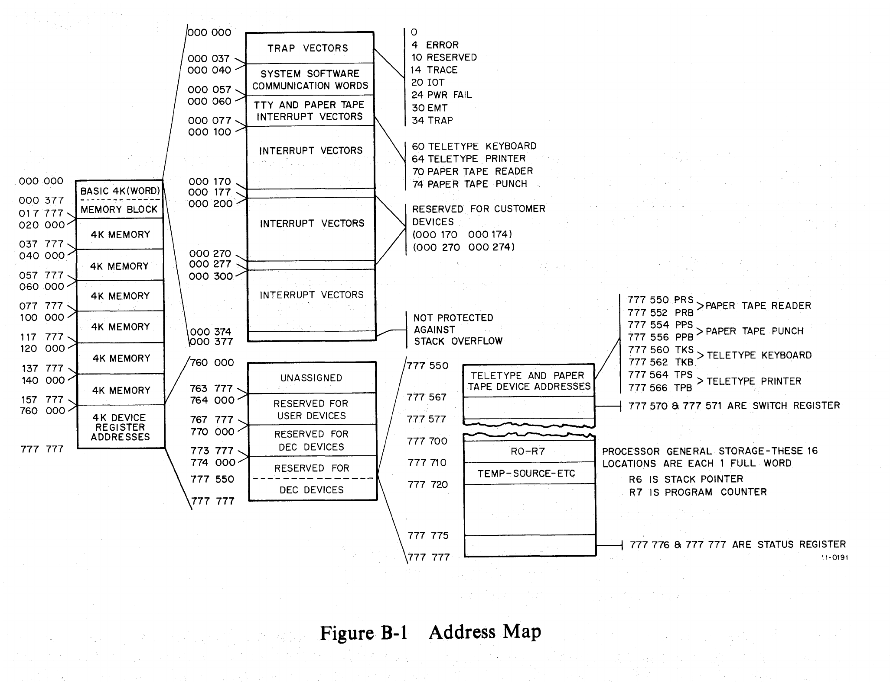
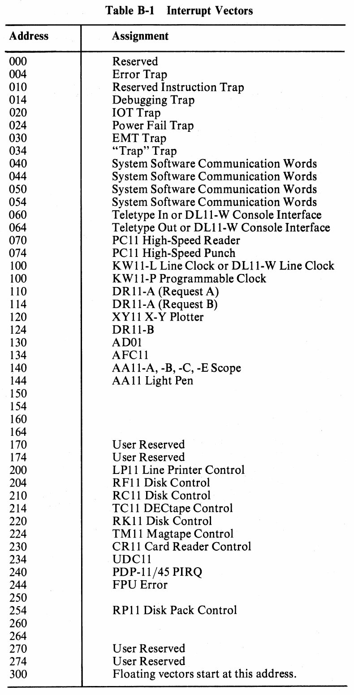
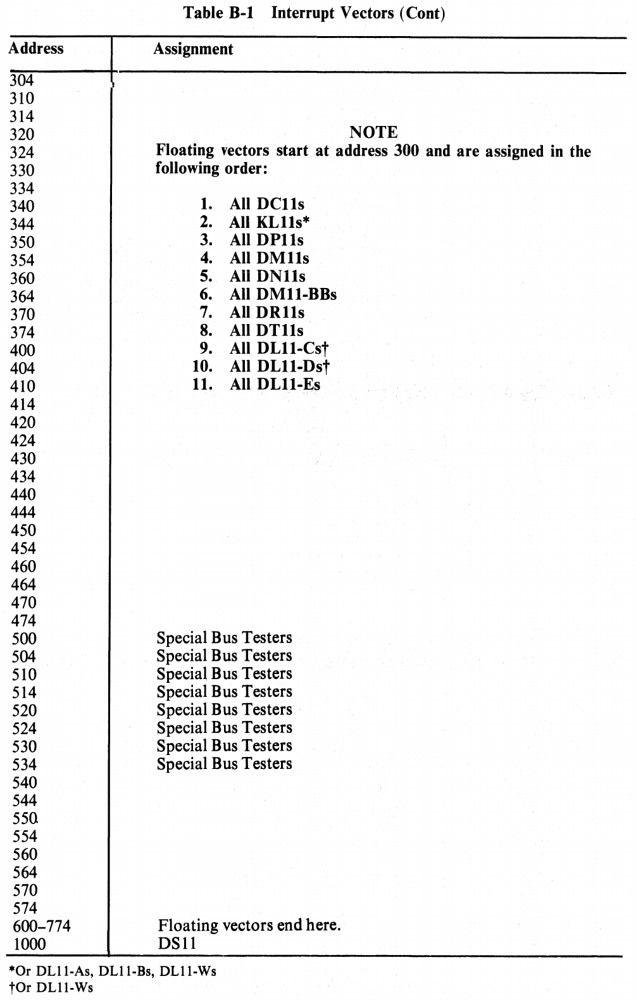

# Appendix B: Vector Addressing

Because the DL11-W SLU/RTC option is basically a communications device, interrupt vectors must be assigned according to the floating vector convention used for all communications devices. These vector addresses are assigned in order from 300 to 777, according to a specific method that ranks the types of devices in a particular PDP-11 system.

The first vector address (300) is assigned to the first DC11 Serial Asynchronous Line Interface in the system. The next DC11 (if used) is then assigned vector address 310, etc. The vector addresses are assigned consecutively to each unit of the second-ranked device type (KL11, DL11-A, DL11-R, or DL11-W), then to the third-ranked device (DB11), and so on in accordance with the following list:

1. DC11 Asynchronous Line Interface
2. KL11 Teletype Control (or DL11-A, DL11-B, or DL11-W)
3. DP11 Synchronous Serial Modem Interface
4. DM11 Asynchronous Serial Line Multiplexer
5. DN11 Automatic Calling Unit
6. DM11-BB Modem Control
7. DR11-A Device Registers
8. DR11-C General Device Interface
9. DT11 Bus Switch
10. DL11-C Asynchronous Line Interface or DL11-W
11. DL11-D Asynchronous Line Interface or DL11-W
12. DL11-E Asynchronous Line Interface

If any of these devices is not included in a system, the vector address assignments move up to fill the vacancy. If a device is added to an existing system, its vector address must be inserted in the normal position and all other addresses must be moved accordingly. If this procedure is not followed, DIGITAL software cannot test the system.

Note that while the floating vectors range from addresses 300 to 777, addresses 500 through 534 are reserved for special bus testers. In addition, address 1000 is used for the DS11 Synchronous Serial Line Multiplexer.

An address map is shown in Figure B-1 and a list of the vector addresses is given in Table B-1. It should be noted that the system Teletype (KL11) is not part of the floating vector scheme and is assigned vector addresses 060 and 064; therefore, if a DL11-W is used as a control for the system Teletype console, it should be assigned addresses 060 and 064. All other DL11-Ws would follow the floating vector conventions

