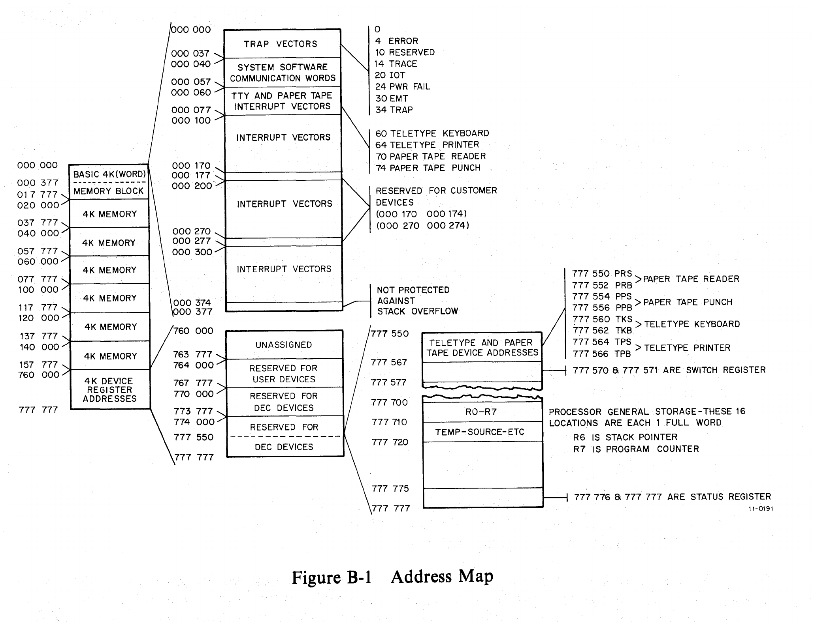

# Appendix B: Vector Addressing

[Manual contents](README.md)

> All addresses in this appendix are octal. Blank assignments in the original table are represented by a dash. This is the historical allocation scheme documented by this manual, not a guarantee of the configuration of a particular machine.

<!-- Source PDF page 77; printed page B-1 -->

Because the DL11-W SLU/RTC option is basically a communications device, interrupt vectors must be assigned according to the floating vector convention used for all communications devices. These vector addresses are assigned in order from `300` to `777`, according to a specific method that ranks the types of devices in a particular PDP-11 system.

The first vector address (`300`) is assigned to the first DC11 Serial Asynchronous Line Interface in the system. The next DC11 (if used) is then assigned vector address `310`, etc. The vector addresses are assigned consecutively to each unit of the second-ranked device type (KL11, DL11-A, DL11-R, or DL11-W), then to the third-ranked device (DB11), and so on in accordance with the following list:

1. DC11 Asynchronous Line Interface
2. KL11 Teletype Control (or DL11-A, DL11-B, or DL11-W)
3. DP11 Synchronous Serial Modem Interface
4. DM11 Asynchronous Serial Line Multiplexer
5. DN11 Automatic Calling Unit
6. DM11-BB Modem Control
7. DR11-A Device Registers
8. DR11-C General Device Interface
9. DT11 Bus Switch
10. DL11-C Asynchronous Line Interface or DL11-W
11. DL11-D Asynchronous Line Interface or DL11-W
12. DL11-E Asynchronous Line Interface

> Source note: The paragraph above really prints “DL11-R” and “DB11”; the numbered list instead gives **DL11-B** and **DP11**. The list and the order repeated with Table B-1 should be consulted rather than those inconsistent names in the paragraph.

If any of these devices is not included in a system, the vector address assignments move up to fill the vacancy. If a device is added to an existing system, its vector address must be inserted in the normal position and all other addresses must be moved accordingly. If this procedure is not followed, DIGITAL software cannot test the system.

Note that while the floating vectors range from addresses `300` to `777`, addresses `500` through `534` are reserved for special bus testers. In addition, address `1000` is used for the DS11 Synchronous Serial Line Multiplexer.

An address map is shown in Figure B-1 and a list of the vector addresses is given in Table B-1. It should be noted that the system Teletype (KL11) is not part of the floating vector scheme and is assigned vector addresses `060` and `064`; therefore, if a DL11-W is used as a control for the system Teletype console, it should be assigned addresses `060` and `064`. All other DL11-Ws would follow the floating vector conventions.

<!-- Source PDF page 78; printed page B-2 -->

<!-- Source PDF page 79; printed page B-3 -->

**Table B-1 — Interrupt Vectors**

| Address | Assignment |
| --- | --- |
| `000` | Reserved |
| `004` | Error Trap |
| `010` | Reserved Instruction Trap |
| `014` | Debugging Trap |
| `020` | IOT Trap |
| `024` | Power Fail Trap |
| `030` | EMT Trap |
| `034` | “Trap” Trap |
| `040` | System Software Communication Words |
| `044` | System Software Communication Words |
| `050` | System Software Communication Words |
| `054` | System Software Communication Words |
| `060` | Teletype In or DL11-W Console Interface |
| `064` | Teletype Out or DL11-W Console Interface |
| `070` | PC11 High-Speed Reader |
| `074` | PC11 High-Speed Punch |
| `100` | KW11-L Line Clock or DL11-W Line Clock |
| `100` [sic] | KW11-P Programmable Clock |
| `110` | DR11-A (Request A) |
| `114` | DR11-A (Request B) |
| `120` | XY11 X-Y Plotter |
| `124` | DR11-B |
| `130` | AD01 |
| `134` | AFC11 |
| `140` | AA11-A, -B, -C, -E Scope |
| `144` | AA11 Light Pen |
| `150` | — |
| `154` | — |
| `160` | — |
| `164` | — |
| `170` | User Reserved |
| `174` | User Reserved |
| `200` | LP11 Line Printer Control |
| `204` | RF11 Disk Control |
| `210` | RC11 Disk Control |
| `214` | TC11 DECtape Control |
| `220` | RK11 Disk Control |
| `224` | TM11 Magtape Control |
| `230` | CR11 Card Reader Control |
| `234` | UDC11 |
| `240` | PDP-11/45 PIRQ |
| `244` | FPU Error |
| `250` | — |
| `254` | RP11 Disk Pack Control |
| `260` | — |
| `264` | — |
| `270` | User Reserved |
| `274` | User Reserved |
| `300` | Floating vectors start at this address. |

> Source note: The source prints `100` twice, including for the KW11-P, and has no `104` row. This duplication is retained for verification against the KW11-P documentation, not resolved by silently assigning a different vector.

<!-- Source PDF page 80; printed page B-4 -->

**Table B-1 — Interrupt Vectors (continued)**

| Address | Assignment |
| --- | --- |
| `304` | — |
| `310` | — |
| `314` | — |
| `320` | — |
| `324` | — |
| `330` | — |
| `334` | — |
| `340` | — |
| `344` | — |
| `350` | — |
| `354` | — |
| `360` | — |
| `364` | — |
| `370` | — |
| `374` | — |
| `400` | — |
| `404` | — |
| `410` | — |
| `414` | — |
| `420` | — |
| `424` | — |
| `430` | — |
| `434` | — |
| `440` | — |
| `444` | — |
| `450` | — |
| `454` | — |
| `460` | — |
| `464` | — |
| `470` | — |
| `474` | — |
| `500` | Special Bus Testers |
| `504` | Special Bus Testers |
| `510` | Special Bus Testers |
| `514` | Special Bus Testers |
| `520` | Special Bus Testers |
| `524` | Special Bus Testers |
| `530` | Special Bus Testers |
| `534` | Special Bus Testers |
| `540` | — |
| `544` | — |
| `550` | — |
| `554` | — |
| `560` | — |
| `564` | — |
| `570` | — |
| `574` | — |
| `600`–`774` | Floating vectors end here. |
| `1000` | DS11 |

> **NOTE** — Floating vectors start at address `300` and are assigned in the following order:
>
> 1. All DC11s
> 2. All KL11s*
> 3. All DP11s
> 4. All DM11s
> 5. All DN11s
> 6. All DM11-BBs
> 7. All DR11s
> 8. All DT11s
> 9. All DL11-Cs†
> 10. All DL11-Ds†
> 11. All DL11-Es
>
> \* Or DL11-As, DL11-Bs, DL11-Ws.
>
> † Or DL11-Ws.

The shorter order printed with this table groups the DR11 entries together; the twelve-entry list on page B-1 lists DR11-A and DR11-C separately.
