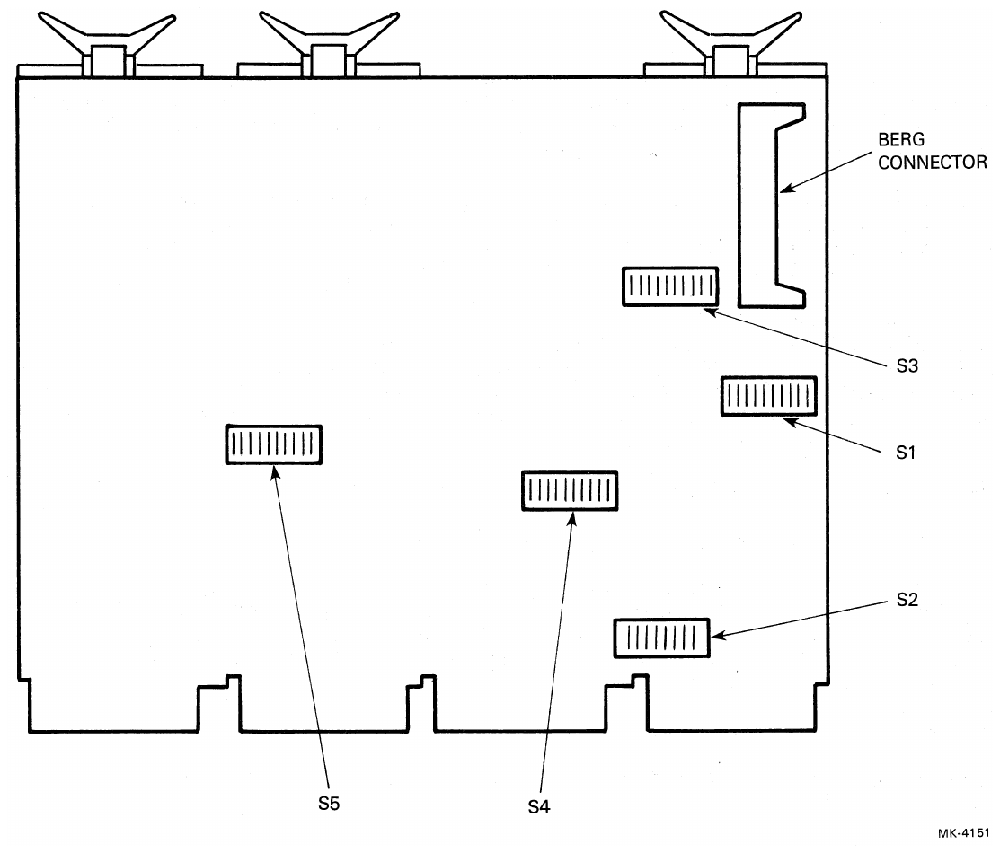
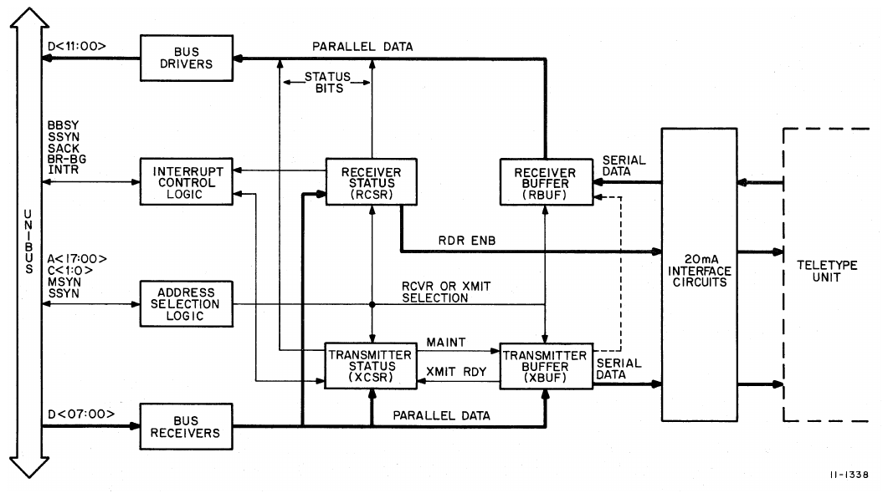
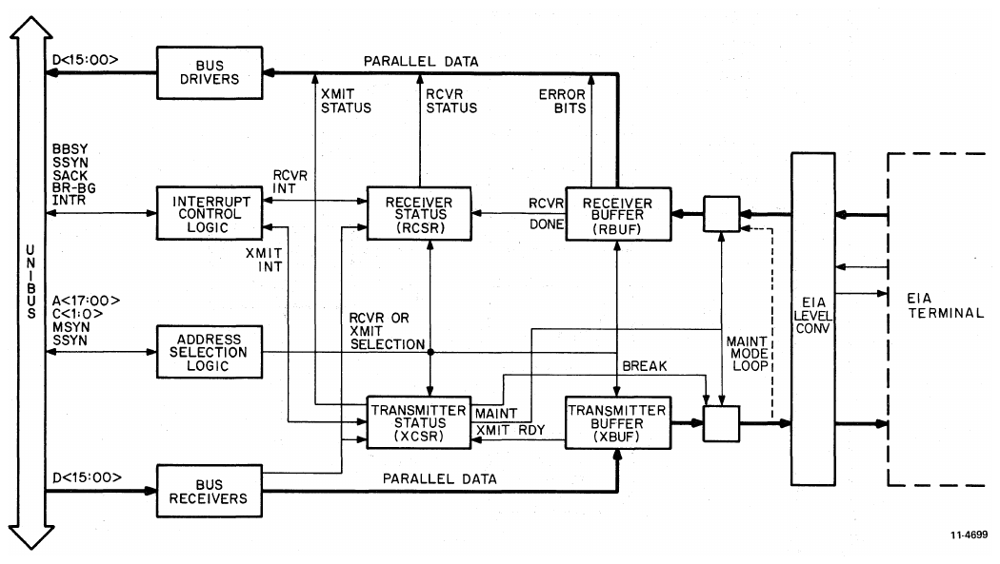
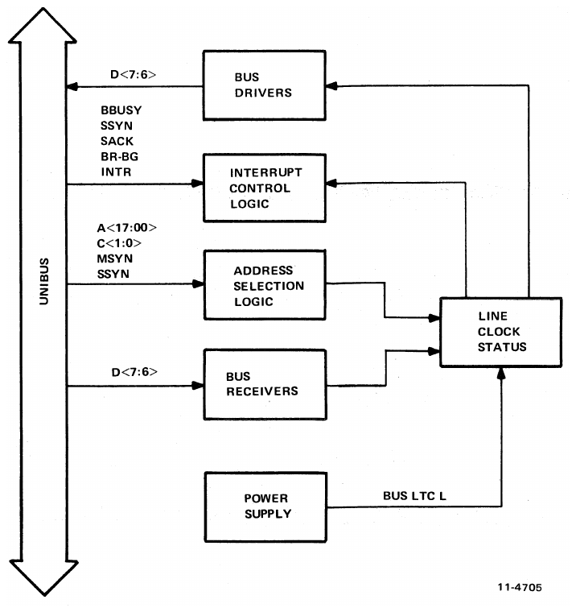

# Chapter 1: Introduction

<!-- Source PDF page 11; printed page 1-1 -->

## 1.1 Scope

This manual is divided into four major chapters: Introduction; Configuration, Installation, and Testing; Programming; and Detailed Description. Although control signals and data are transferred between the interface and the Unibus and between the interface and the communications device, this manual is limited to coverage of the interface itself.

The purpose of this manual is to present the user with information necessary to understand normal system operation of the DL11-W. This information will be useful when analyzing trouble symptoms and determining corrective action. However, presentation of detailed troubleshooting techniques is beyond the scope of the manual.

## 1.2 Engineering Drawings

A complete set of engineering and circuit schematics is provided in a companion volume to this manual entitled _DL11-W SLU/RTC Option Engineering Drawings_. The general logic symbols used on these drawings are described in the _DIGITAL Logic Handbook_. Specific symbols and conventions are also included in certain PDP-11 system manuals. The following paragraphs describe the signal nomenclature convention used on the drawing set.

Signal names in the DL11-W print set are given in the following basic form:

```text
SOURCE    SIGNAL NAME    POLARITY
```

SOURCE indicates the drawing number of the print set where the signal originates. The drawing number of a print is located in the lower right corner of the print title block (DL-1, DL-2, DL-3, etc.). SIGNAL NAME is the proper name of the signal. The names used on the print set are also used in this manual. POLARITY is either H or L to indicate the voltage level of the signal. H means +3 V; L means ground. As an example, the signal:

```text
DL-1 RCVR DONE H
```

originates on sheet 1 of the M7856 module drawing and is read, “When RCVR DONE is true, this signal is at +3 V.”

Unibus signal lines do not carry a SOURCE indicator. These signal names represent a bidirectional wire-ORed bus; as a result, multiple sources for a particular bus signal exist. Each Unibus signal name is prefixed with the word BUS.

<!-- Source PDF page 12; printed page 1-2 -->

## 1.3 General Description

The DL11-W Serial Line Unit/Real-Time Clock Option provides two distinct functions. First, the DL11-W is a character-buffered communications interface designed to assemble or disassemble the serial information required by a communications device for parallel transfer to or from the PDP-11 Unibus. Second, the DL11-W is a line frequency clock which can provide timed interrupts, allowing a program to measure the passage of time. The DL11-W consists of a single integrated circuit quad board (Figure 1-1) containing two independent communications units (receiver and transmitter) that are capable of simultaneous 2-way communication, and an independent line frequency real-time clock. Note that a quad board has four connectors (groups of fingers).



<!-- Source PDF page 13; printed page 1-3 -->

The DL11-W interface provides the logic and buffer registers necessary for program-controlled transfer of data between a PDP-11 system requiring parallel data and an external device requiring serial data. The interface also includes status and control bits that may be controlled by the program, the interface, or an external device for command, monitoring, and interrupt functions.

The DL11-W interface provides the flexibility needed to handle a variety of terminals. For example, the user can use a DL11-W as a Teletype control; or, in conjunction with another serial line interface, the DL11-W can be used as a communications link between two processor systems. The DL11-W provides the user with a choice of line speeds (baud rates), character size, stop code length, parity selection, and status indications.

The DL11-W can replace DL11-A, DL11-B, DL11-C, and DL11-D modules in most applications. However, the DL11-E is still required for use with communications data sets such as Bell Model 103 or 202. All of the features of the DL11-A through DL11-D modules are combined on the DL11-W and are switch-selectable to allow for interchangeability.

As a receiver of serial data, the interface converts an asynchronous serial character from an external device into the parallel character required for transfer to the Unibus. This parallel character can then be gated through the bus to memory, a processor register, or some other device. When the DL11-W is used as a transmitter, a parallel character from the bus is converted to a serial character for transmission to an external device. Because the two data transfer units (receiver and transmitter) are independent, they are capable of simultaneous 2-way communication. The receiver and transmitter each operate through two related registers: a control and status register for command and monitoring functions and a data buffer register for storing data prior to transfer to the bus or external device. The line frequency clock uses a signal derived from the ac input voltage by the power supply to generate timed interrupts. The clock portion utilizes a register for command and monitoring functions.

Typically, the DL11-W is operated in one of two functionally different configurations. The DL11-W used as a Teletype control and the DL11-W used with EIA level converters will be discussed individually in the following paragraphs. The real-time clock functions will also be described.

### 1.3.1 DL11-W Teletype Control

The DL11-W (Figure 1-2) can be used to interface to Model 33, Model 35, and Model 38 Teletypes, and to the LA36.

Serial information read or written by the Teletype unit is assembled or disassembled by the DL11-W interface for parallel transfer to or from the Unibus. When the processor puts an address on the bus, the DL11-W interface decodes the address to determine if the Teletype is the selected external device and, if selected, whether it is to perform an input or output operation.

If, for example, the Teletype has been selected to accept information for printout, parallel data from the Unibus is loaded into the DL11-W transmitter (punch) buffer. At this point, the XMIT RDY flag drops because the transmitter (punch) logic has been activated. (The flag comes back after a fraction of a bit time if the transmitter is not presently active.) The interface generates a START bit, shifts the data from the buffer into the Teletype one bit at a time, resets the XMIT RDY flag (as soon as the holding register of the double-buffer is empty, even though the shift register is active), and then puts out the required number of STOP bits.

> Transcription note: “resets the XMIT RDY flag” is the wording printed on page 1-3. The next paragraph and §3.4.2 explain that the flag is **set** when the holding buffer becomes available; consult those descriptions when implementing transmitter timing.

_Teletype is a registered trademark of Teletype Corporation._

<!-- Source PDF page 14; printed page 1-4 -->



Thus, if the DL11-W is interfaced to a Model 33 Teletype, the 8-bit parallel bus data is converted to the 11-bit serial input required by the Teletype. Note that whenever a series of characters is to be output to the Teletype, the XMIT RDY flag is set prior to generation of the STOP bits and the shifting out of the character in the holding register, thus allowing another character to be loaded from the bus as soon as the transmitter holding buffer is empty. The XMIT RDY flag is used with XMIT INT ENB to initiate an interrupt sequence, informing the processor that the interface is ready to accept another character for transfer to the Teletype for printing.

When receiving data from the Teletype unit, the operation is essentially the reverse. The START bit of the Teletype serial data activates the interface receiver logic, and data is loaded one bit at a time into the reader buffer register. When buffer loading is complete, the buffer contents are transferred to the holding register and the interface sets the RCVR DONE flag, indicating to the program that a character has been assembled and is ready for transfer to the bus. If RCVR INT ENB is also set, the RCVR DONE flag initiates an interrupt sequence, thereby causing a vectored interrupt.

The DL11-W has a reader enable (RDR ENB) bit that can be set to advance the paper tape reader in the Teletype. When set, this bit clears the RCVR DONE flag. As soon as the Teletype sends another character, the START bit clears the RDR ENB bit, thus allowing just one character to be read.

The DL11-W also has a receiver active (RCVR ACT) bit, which indicates that the DL11-W interface is receiving data from the Teletype. This bit is set at the center of the START bit, which is the beginning of the input serial data, and is cleared by the leading edge of the RCVR DONE bit. The DL11-W also has a BREAK bit which can be switch-enabled. This bit can be set by the program to transmit a continuous space to the Teletype.

<!-- Source PDF page 15; printed page 1-5 -->

The DL11-W can be operated in a maintenance mode, which is program-selected by setting the MAINT bit in the transmitter status register. When in this mode, special logic is used to perform a closed loop test of interface logic circuits. A character from the bus is loaded into the transmitter (punch) buffer register. The serial output of the register enters the receiver (reader) buffer register, where it is converted back into parallel data and transferred to the bus. In the maintenance mode, the data is not transmitted to the Teletype. If the DL11-W is functioning properly, the character in the reader buffer (RBUF) is identical to the character loaded into the transmitter buffer (XBUF).

### 1.3.2 DL11-W EIA Terminal Control

The DL11-W also provides the control logic required for interfacing EIA terminals such as the VT06 display or the Model 37 Teletype (Figure 1-3).



Functionally the EIA terminal control configuration is nearly identical to the Teletype control configurations. In the EIA terminal control configuration, EIA level converters on the DL11-W are used to change bipolar serial input data to TTL logic levels and TTL logic level serial output to the bipolar signals required by EIA terminals. EIA level outputs for the signals DATA TERMINAL RDY and REQ TO SEND are permanently strapped on. However, RDR ENB has no EIA level equivalent.

<!-- Source PDF page 16; printed page 1-6 -->

### 1.3.3 Line Time Clock (Figure 1-4)

A signal generated from the ac input line voltage by the power supply is received by the DL11-W. This signal is a square wave identical in frequency to the ac line voltage. A monitor bit (LTC MONITOR) on the line clock status register (LKS) is set once for each cycle by the hardware but must be cleared by the program. By monitoring this bit, the program can count unit time intervals of 16-2/3 ms (60 Hz) or 20 ms (50 Hz). If the LTC INT ENB bit is set, a vectored interrupt will be generated on each cycle.

The terms real-time clock (RTC) and line clock (LTC) are used interchangeably in other contexts, but line clock will be used generally in this manual for consistency.



## 1.4 Physical Description

The DL11-W SLU/RTC option is packaged on a single M7856 quad integrated circuit module that can easily be plugged into a small peripheral controller slot in the processor or one of the slots in a DD11-D peripheral mounting panel.

<!-- Source PDF page 17; printed page 1-7 -->

Power is applied to the logic through the power harness already provided in the BA11 mounting box. The required current is approximately 2.0 A at +5 V and 150 mA at −15 V. If the EIA level outputs are used, then 50 mA of current, at a level between +9 V and +15 V, is also required.

The M7856 module has a Berg connector for all user input/output signals. The specific signals fed to this connector depend on the external device interfaced to, and the specific cable used. Mounting, cabling, and connector information is given in Chapter 2.

Figure 1-1 shows the position of the Berg connector and the five switch packs.

## 1.5 Specifications

Operating and physical specifications for the DL11-W Serial Line Unit/Real-Time Clock are given in Table 1-1.

**Table 1-1 — DL11-W Operating Specifications**

| Specification                      | Description                                                                                                                                                                 |
| ---------------------------------- | --------------------------------------------------------------------------------------------------------------------------------------------------------------------------- |
| Registers                          | Receiver Status Register (RCSR); Receiver Buffer Register (RBUF); Transmitter Status Register (XCSR); Transmitter Buffer Register (XBUF); Line Clock Status Register (LKS). |
| Register addresses, console device | RCSR: `777560`; RBUF: `777562`; XCSR: `777564`; XBUF: `777566`.                                                                                                             |
| Line clock register address        | LKS: `777546`. Valid when SLU is used as console or DL11-W is used as a line clock only. See Table 4-2 for addresses other than console device.                             |
| Interrupt vector address           | `060`: receiver when used as console; `064`: transmitter; `100`: line clock. Floating vectors: Appendix B.                                                                  |
| Priority level                     | BR4: SLU; BR6: RTC.                                                                                                                                                         |
| Interrupt types                    | Transmitter Ready (XMIT RDY); Receiver Done (RCVR DONE); Line Clock Monitor.                                                                                                |

<!-- Source PDF page 18; printed page 1-8 -->

**Table 1-1 — DL11-W Operating Specifications (continued)**

| Specification      | Description                                                                                                                                                                                         |
| ------------------ | --------------------------------------------------------------------------------------------------------------------------------------------------------------------------------------------------- |
| Commands           | Receiver Interrupt Enable (RCVR INT ENB); Transmitter Interrupt Enable (XMIT INT ENB); Line Clock Interrupt Enable (LKS INT ENB); Reader Enable (RDR ENB); Maintenance Mode (MAINT); Break (BREAK). |
| Status indicators  | Receiver Active (RCVR ACT); Transmitter Ready (XMIT RDY); Receiver Done (RCVR DONE); Line Clock Monitor; Error (ERROR); Overrun (OR ERR); Framing Error (FR ERR); Parity Error (P ERR).             |
| Data input/output  | Serial data, 20 mA active current loop; serial data, 20 mA passive current loop; serial data conforming to EIA and CCITT specifications.                                                            |
| Data format        | One START bit; 5-, 6-, 7-, or 8-bit DATA character; PARITY bit (odd, even, or unused); 1 or 2 STOP bits with 6, 7, 8 DATA bits selected; 1 or 1.5 STOP bits with 5 DATA bits selected.              |
| Data rates         | 110, 150, 300, 600, 1200, 2400, 4800, or 9600 baud. Any split speed combination possible (transmitter and receiver speeds may differ).                                                              |
| Bit transfer order | Low-order bit (LSB) first.                                                                                                                                                                          |
| Parity             | Computed on incoming data or inserted on outgoing data, depending on type of parity (odd or even) used. Parity may be odd, even, or unused.                                                         |
| Size               | A single quad module (M7856) occupying a slot in a DD11-C, DD11-D, or DD11-P backplane.                                                                                                             |
| Power required     | 2.0 A at +5 V; 150 mA at −15 V; 50 mA at a level between +9 V and +15 V.                                                                                                                            |
| Temperature range  | 10° to 50° C.                                                                                                                                                                                       |

## 1.6 Cables

The DL11-W comes in a package with a 7008360-9 cable and an H3009 panel assembly for use when interfacing via a 20 mA current loop. This kit is called the DL11-WA. The DL11-W also comes with a BC27C cable/panel assembly and a BC22E cable for interfacing to EIA devices. This kit is called the DL11-WB. The Berg connector on the M7856 module accepts the 7008360-9 cable and the BC27C cable.
