# Chapter 2: Configuration, Installation, and Testing

## 2.1 Configuration

The DL11-W includes an M7856 quad module, either of two distribution panels (BC27C or H3009), and associated interconnecting cables. Also included is an adaptor bracket for use in cabinets which do not require compliance with FCC regulations for electromagnetic interference (EMI) suppression. Table 2-1 lists the option specific components. Figure 2-1 shows all of the parts associated with the DL11-W interface.

The M7856 quad module includes five dip-mounted switch packs. Each pack contains either eight or ten individual slide or toggle switches. The packs are labeled S1 through S5 on the board; each switch on the packs is numbered 1 through 8 or 10. Positions for on and off are clearly indicated on the hardware. “SX-Y” is the convention used in this manual to refer to specific switches where X indicates the switch pack number and Y indicates the particular switch on that switch pack. For example, “S2-9” refers to switch number 9 on switch pack 2.

Switch selections on the DL11-W interface provide the flexibility needed to handle a variety of functions. For example, the user can set up switches so that the DL11-W can interface to a Teletypewriter or to a high-speed CRT terminal. The user has a choice of speeds, character size, stop code length, parity, error detection, 20 mA current loop or EIA, addresses and vectors, active or passive modes, and the specific type of interface which the DL11-W is to replace.

### 2.1.1 Baud Rates

Table 2-2 lists the eight different baud rates available on the DL11-W. Completely independent split-speed operation is provided so that the receiver and transmitter may operate at different rates. The user should be careful to set the correct speeds when replacing other interface modules (DL11-A, DL11-B, and so on).

### 2.1.2 Address and Vector Selection

The DL11-W interface is addressed through the address selection logic, and its interrupt vector is determined by the interrupt control logic. Each DL11-W interface within a system has a unique address and a unique vector. These are determined by the switches on the module. However, the line clock address and vector are fixed at 777546 and 100, respectively. Figure 2-2 shows the relation of specific switches to the address and vector of the device used (Teletypewriter and so on).

Thus, for address selection, switch S5-3 corresponds to address bit 10, and it indicates a logical 1 when turned off. For vector selection, on the other hand, switch S2-3 corresponds to vector bit 5, and it indicates a logical 1 when it is on.

All PDP-11 systems have enough I/O addresses reserved to handle up to 47 devices. Each one of these devices could be a DL11-W. However, only one DL11-W per system is allowed to have the LTC enabled. The LTC sections of other DL11-Ws can be disabled by turning switches S5-9 on S5-10 off. See Table 4-2 for more specific address configuration information.

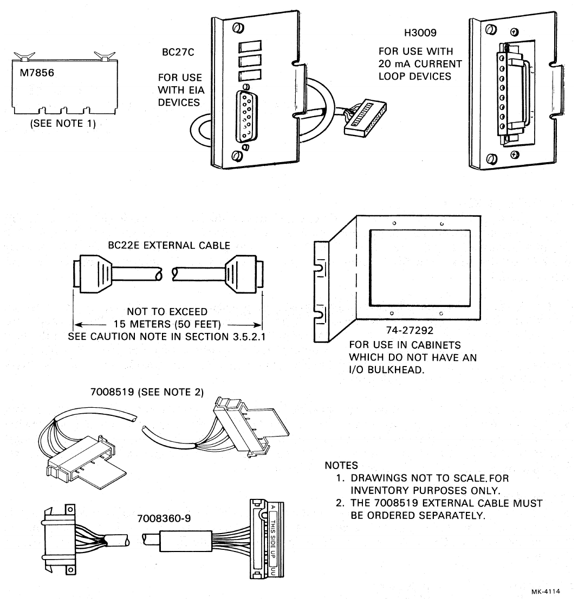

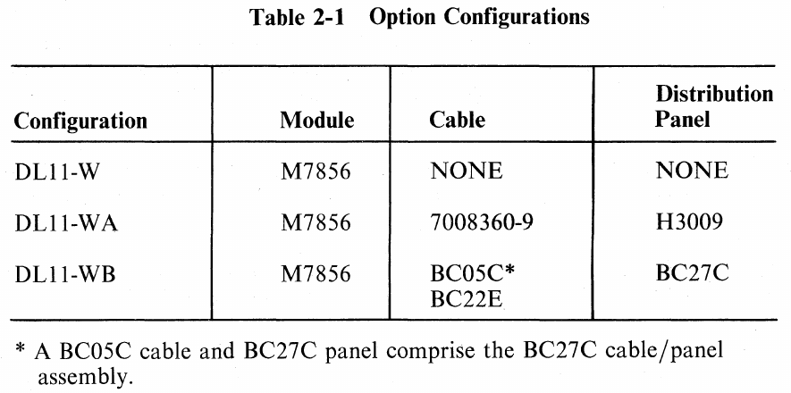

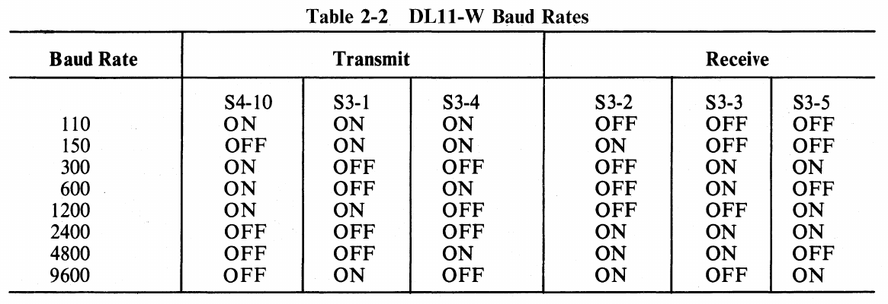

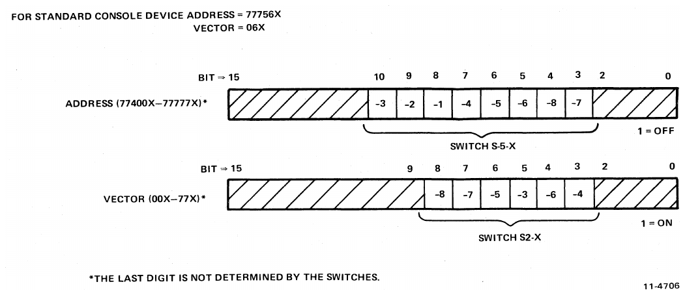

### 2.1.3 Address Selection Modes

The DL11-W can be operated in any of three different address selection modes. Normally, a DL11-W used as console terminal control would operate in the first mode, whereas additional DL11s would be operated in the second mode. The third mode is not normally used, but is discussed here for completeness.

**Mode 1:** Both the serial line unit and the line clock sections can be addressed. Due to common address selection logic, operation in this mode requires that the serial line unit addresses be restricted to 77756X. The line clock address is 777546.

**Mode 2:** Only the serial line unit section can be addressed. Address selection ranges from 774000 to 777776. The line clock is disabled and does not respond to address 777546.

**Mode 3:** Only the line clock section can be addressed at 777546. The serial line unit section does not respond to any address.

Table 2-3 indicates the correct switch setting for selection of the desired address and address mode.

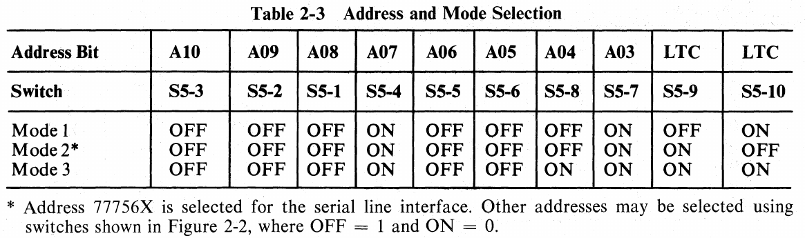

### 2.1.4 Active and Passive Modes

Two switch-selectable modes of operation are available for the 20 mA current loop. In the active mode, the DL11-W is the source for the 20 mA of current; in the passive mode, the external device must provide the current. As an example, two processing systems could be connected using two DL11-Ws via the 20 mA current loop. One DL11-W would be the active device. The other DL11-W would be passive. Table 2-4 shows the appropriate switch settings. Normal configuration is in the active mode.

### 2.1.5 Data Format

The data format (Figure 2-3) consists of a START bit, five to eight DATA bits, a PARITY bit or no PARITY bit, and one, one and one-half, or two STOP bits.

When less than eight DATA bits are selected, the hardware justifies the bits into the least significant bit positions for characters received by the interface. When transmitting characters, the program provides the justification into the least significant bits. The PARITY bit may be either on or off; when on, it can be selected for checking either odd or even parity when receiving and for providing an extra PARITY bit during transmission.

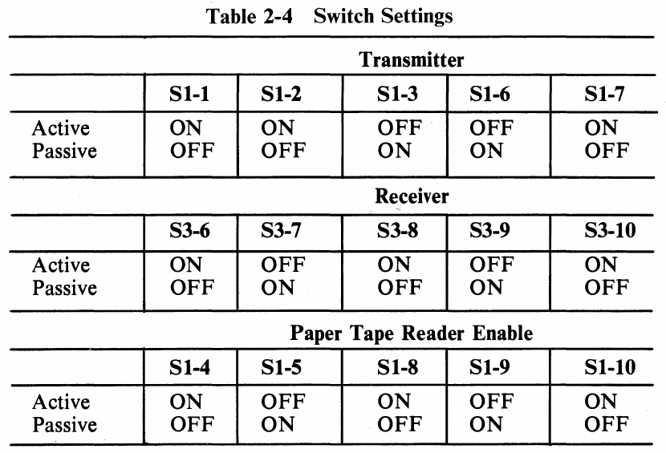

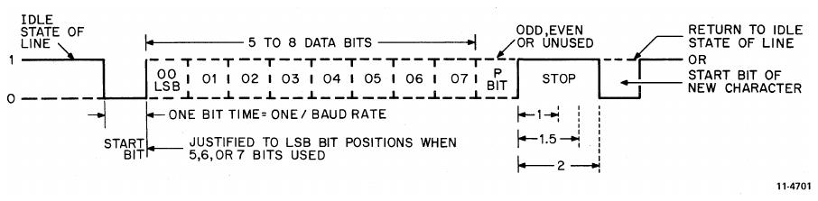

All variable items within any data format are selected by switches on the DL11-W module. None of the variables can be controlled by the program. These switches are listed in Table 2-5 and described more fully in Chapter 4.

Figure 2-4 shows typical switch settings for a DL11-W when interfacing with a standard DIGITAL terminal (console device only).

Table 2-6 gives a complete listing of the switches and their functions.

### 2.1.6 Cabling

Figure 2-5 illustrates the proper cabling configuration for selecting and connecting cables between the DL11-W and various peripheral devices.

## 2.2 Preinstallation and Set-Up Procedures

Before installing the DL11-W, assign device and vector addresses in accordance with Section 2.1.2.

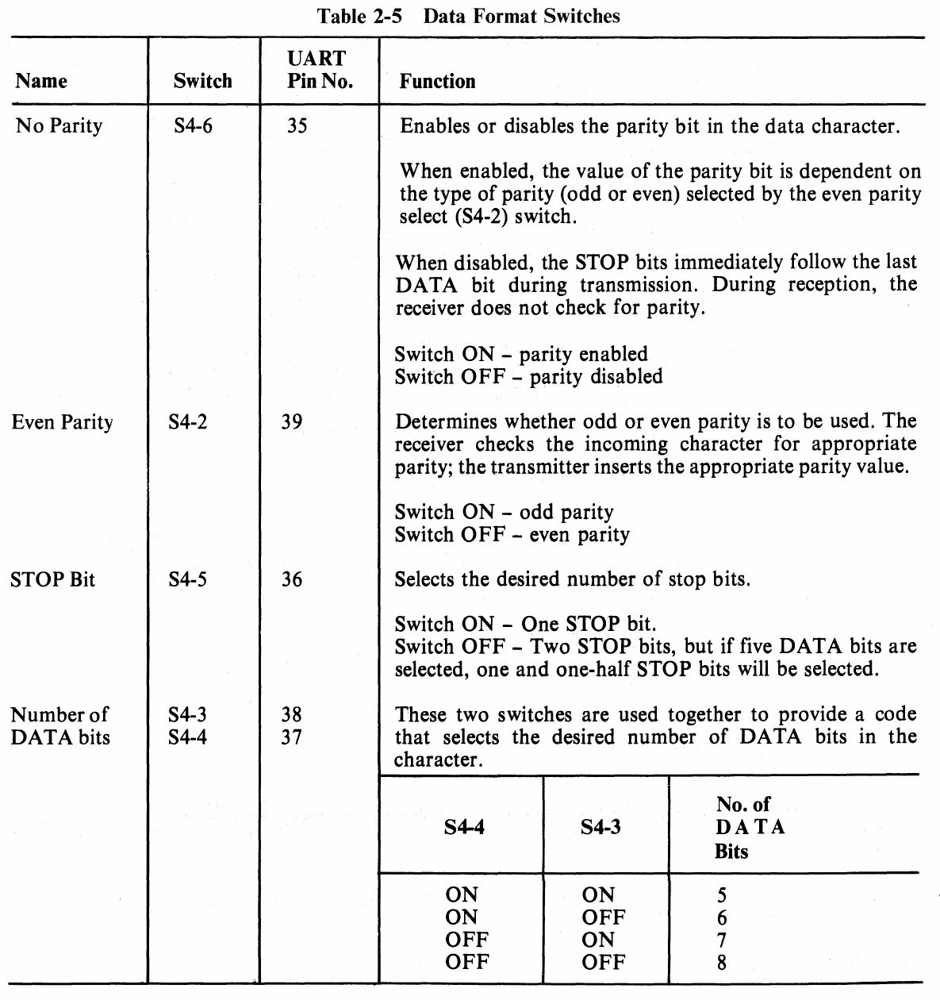

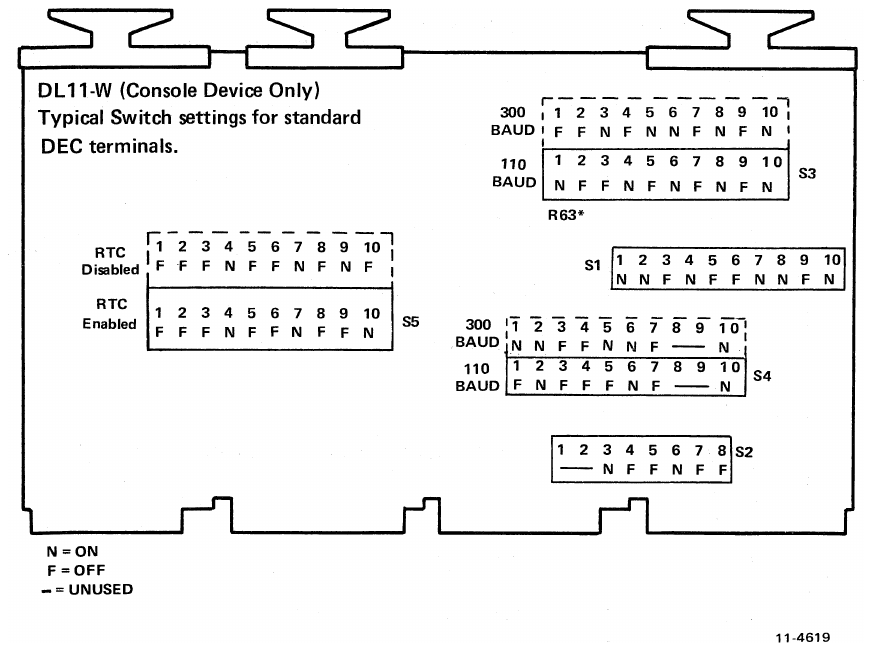

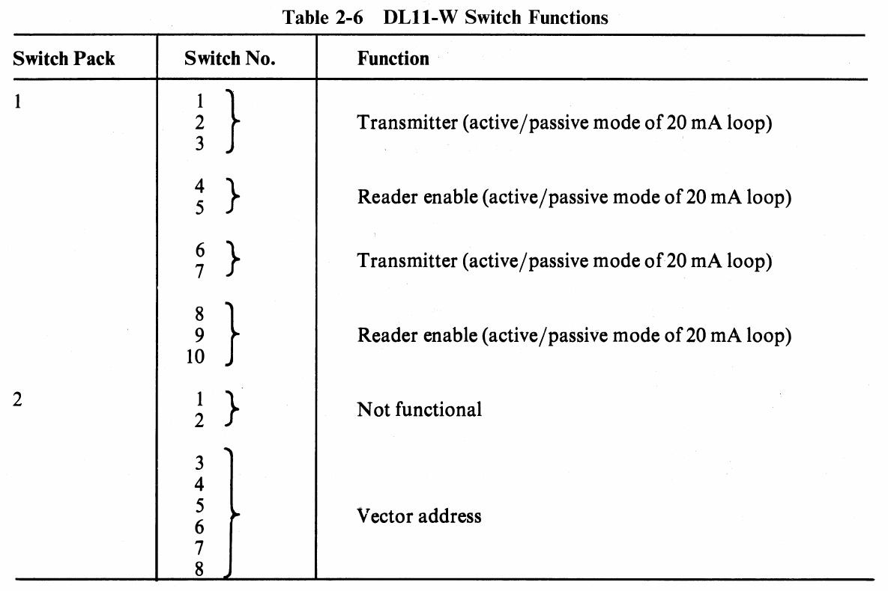

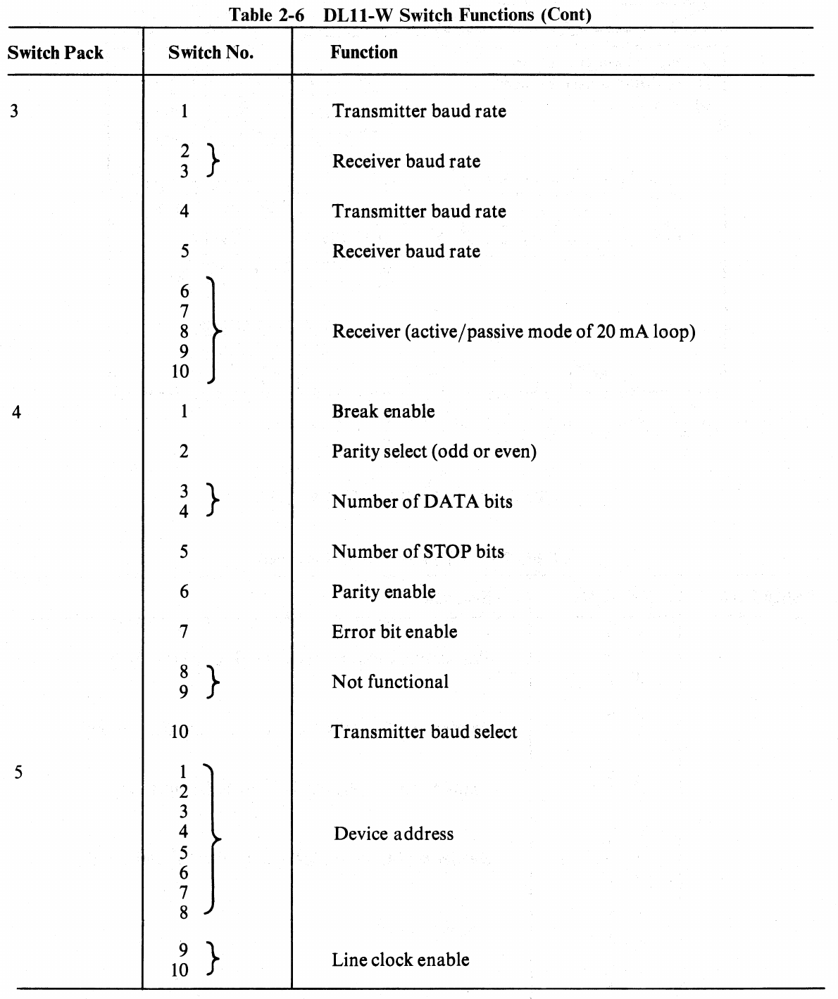

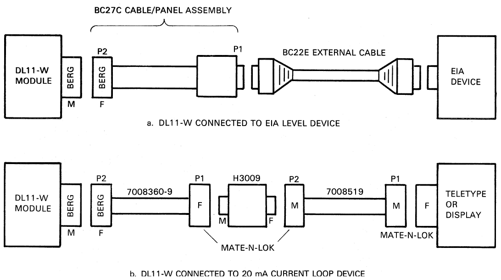

## 2.3 Installation

This section identifies the installation procedures for the DL11-W. Installation is broken down into M7856 module installation and distribution panel installation.

> **WARNING**
>
> When performing any installation procedures, turn all power OFF.

### 2.3.1 M7856 Module Installation

The DL11-W can be installed in any small peripheral controller (SPC) slot of the PDP-11 processor. Figure 2-6 illustrates a typical 9-slot backplane configuration (DD11-D).

1. Plug the female Berg connector (P-1) of the desired internal cable (see Figure 2-5) into the Berg connector (J1) of the M7856 module. The Berg connector is shown in Figure 1-1.
2. Install the M7856 module into the system unit.
3. Perform resistance checks between the backplane voltage sources and ground to ensure that no short circuit conditions exist on the M7856 module. Refer to the engineering print set _DL11-W SLU/RTC Option Engineering Drawings_ for pin assignments.
4. Proceed to Section 2.3.2.

### 2.3.2 Distribution Panel Installation

Because the installation procedures for installing the BC27C and H3009 distribution panels are similar, the following instructions pertain to both panels.

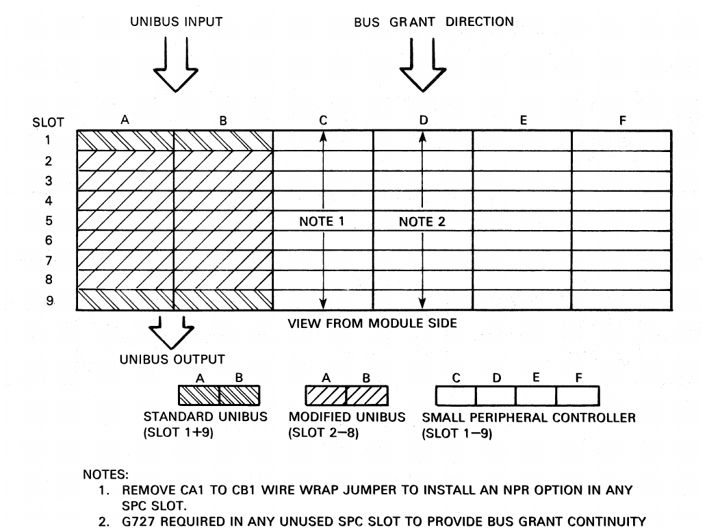

Two different approaches for installing distribution panel assemblies are included in this manual.

Most new installations utilize I/O bulkheads to comply with FCC regulations limiting EMI leakage. For installations utilizing an I/O bulkhead, follow the steps outlined in Section 2.3.2.1.

Alternate instructions are included for those cabinets that do not require I/O bulkheads and thus require a slightly modified installation procedure. If the system does not incorporate an I/O bulkhead, follow the steps outlined in Section 2.3.2.2.

#### 2.3.2.1 Installation in Cabinets with an I/O Bulkhead

Though there may be differences in the positioning of the I/O bulkheads of the PDP-11 kernel cabinet, the universal expansion cabinet, and other cabinets, the installation concept is the same. Once the BC27C or H3009 distribution panel is installed, there should be no openings left (panels omitted) in the I/O frame on the rear of the cabinet which could permit EMI leakage. For this reason, it is important to tighten all mounting screws in the distribution panel. Figures 2-7 and 2-8 show the various I/O bulkhead types and illustrate the correct approach to each.

**1.** Gain access to the I/O bulkhead through the door on the rear of the system cabinet and remove one of the 4.57 cm (2 in) wide panels from the bulkhead. This is where the distribution panel is mounted.

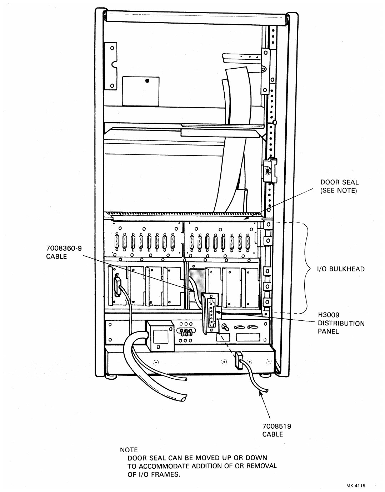

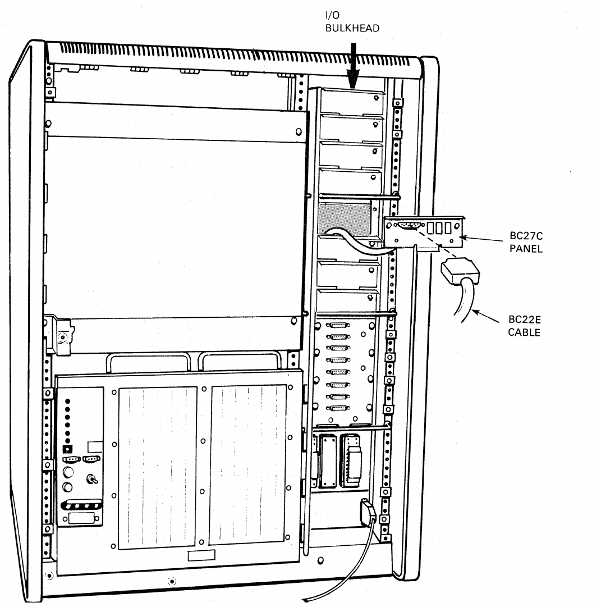

**2.** When using the 7008360-9 cable and H3009 panel, plug the connector (P-2) of the free end of the cable into the male connector on the rear of the H3009 panel. When using the BC27C cable/panel assembly, this step may be omitted since the cable and panel are already connected.

**3.** Route the remaining internal cable and distribution panel through the cabinet and through the opening in the I/O bulkhead at the rear of the cabinet. Keep in mind that the cable must be routed and dressed in a manner compatible with existing cabinet cabling.

**4.** Install the distribution panel into the opening of the I/O bulkhead (see Figures 2-7 and 2-8) in place of the 4.57 cm (2 in) wide panel that was removed in Step 1.

> **NOTE**
>
> It is necessary to maintain an interference-free environment outside the cabinet enclosure. Any additional panels that may have been removed to facilitate easier installation of the distribution panel must be replaced.

**5.** Connect the correct external cable to the connector on the rear of the distribution panel (see Section 2.1.6). The cable should exit the cabinet with the other signal cables.

> **CAUTION**
>
> BC22E cable lengths in excess of 7.62 m (25 feet) may violate the maximum capacitance allowed by the RS-232-C specification. Note, however, that up to 15 m (50 feet) provides satisfactory DL11-W performance levels.

**6.** Connect the other end of the external cable to the connector on the peripheral device.

**7.** Turn the power ON.

#### 2.3.2.2 Installation in Cabinets Without an I/O Bulkhead

**1.** Gain access to the rear of the system cabinet and mount the adaptor bracket (Part No. 74-27292) to one of the rear vertical mounting rails as shown in Figure 2-9. Mounting the bracket on either side of the cabinet is permissible.

**2.** When using the 7008360-9 cable and H3009 panel, plug the connector (P-2) of the free end of the cable into the male connector on the rear of the H3009 panel. When using the BC27C cable/panel assembly, this step may be omitted since the cable and panel are already connected.

**3.** Route the remaining internal cable and distribution panel through the cabinet and through the adaptor bracket at the rear of the cabinet. Keep in mind that the cable must be routed and dressed in a manner compatible with existing cabinet cabling.

**4.** Connect the external cable to the connector on the rear of the distribution panel (see Section 2.1.6). The cable should exit the cabinet with the other signal cables.

> **CAUTION**
>
> BC22E cable lengths in excess of 7.62 m (25 feet) may violate the maximum capacitance allowed by the RS-232-C specification. Note, however, that up to 15 m (50 feet) provides satisfactory DL11-W performance levels.

**5.** Connect the other end of the external cable to the connector on the peripheral device.

**6.** Turn the power ON.

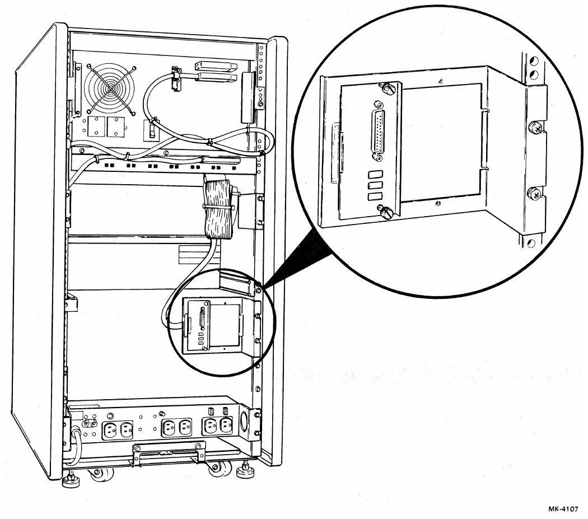

## 2.4 Pin Interconnection

Table 2-7 lists the signal names and associated pins on the Berg connector mounted on the M7856 module. This table also lists the signals supplied on the 7008360-9/H3009 and BC27C cables.

Table 2-8 provides a quick reference of M7856 input/output signals for TTL, EIA, and 20 mA current loop devices.

Table 2-9 lists connector pin numbers and signals for the 7008360-9 cable.

Table 2-10 lists connector pin numbers and signals for the 7008519 external cable which is used in conjunction with the 7008360-9/H3009 assembly cable.

Table 2-11 lists connector pin numbers for the BC27C cable connectors.

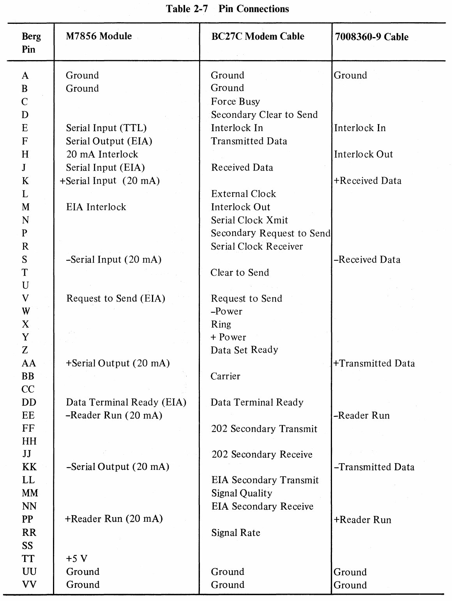

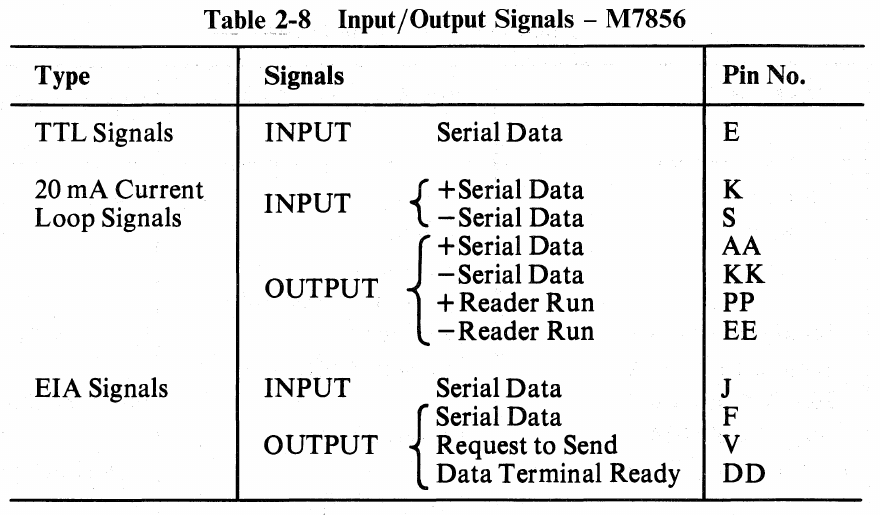

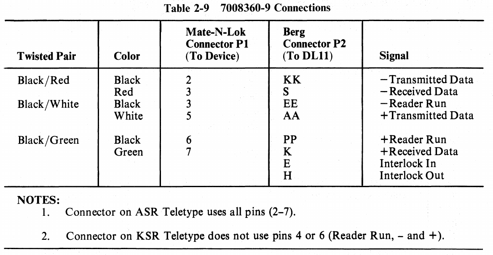

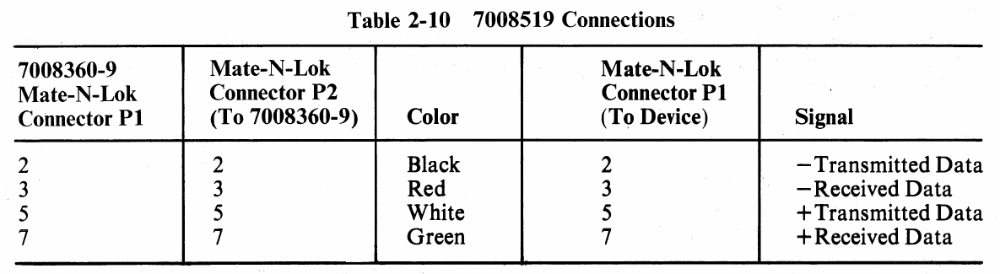

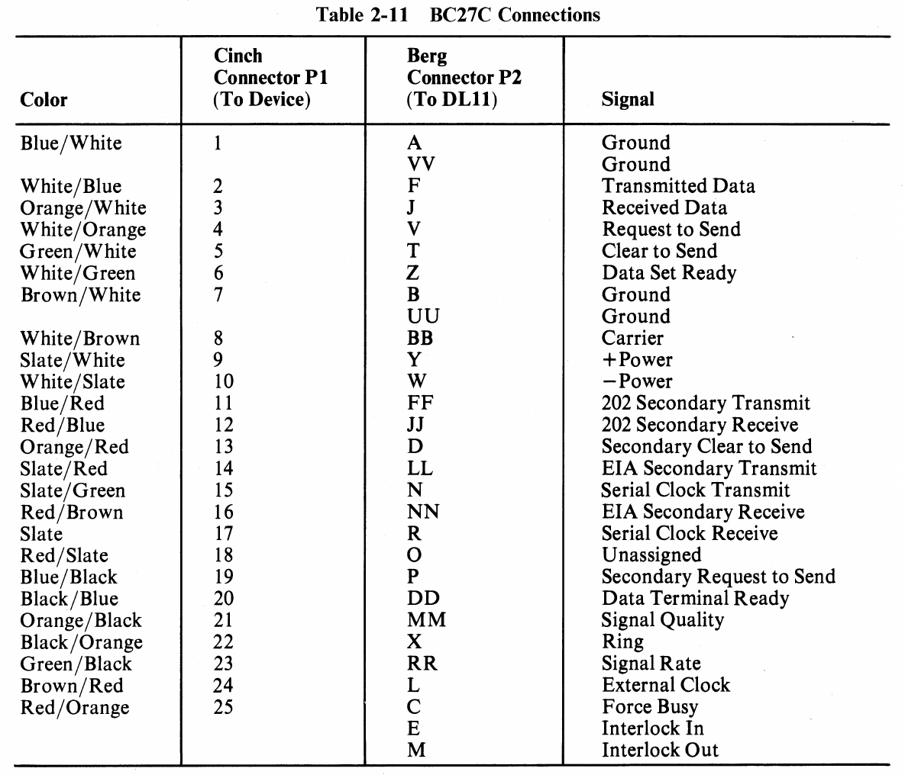

## 2.5 Installation Testing

Installation testing is performed by running the diagnostic programs after the DL11-W interface has been completely installed. The diagnostic programs and their operating instructions are supplied with the DL11-W interface.

The diagnostics supplied with the interface are:

1. `MD-11-CZDLA**`
2. `MD-11-CZDLB**`
3. `DEC/X11-CXDLA**`

Make three error-free passes of each diagnostic to ensure proper DL11 operation.
