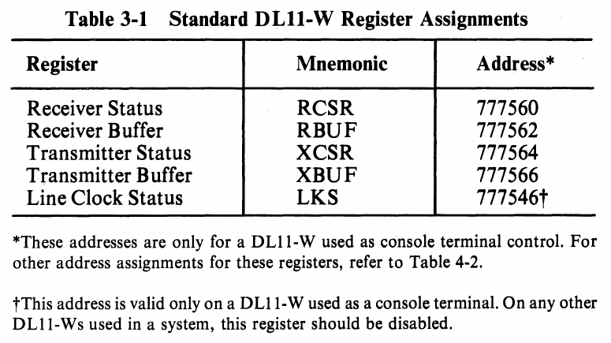
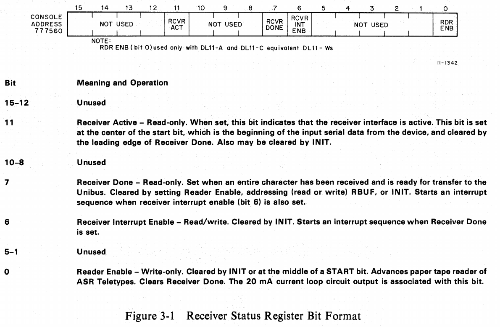
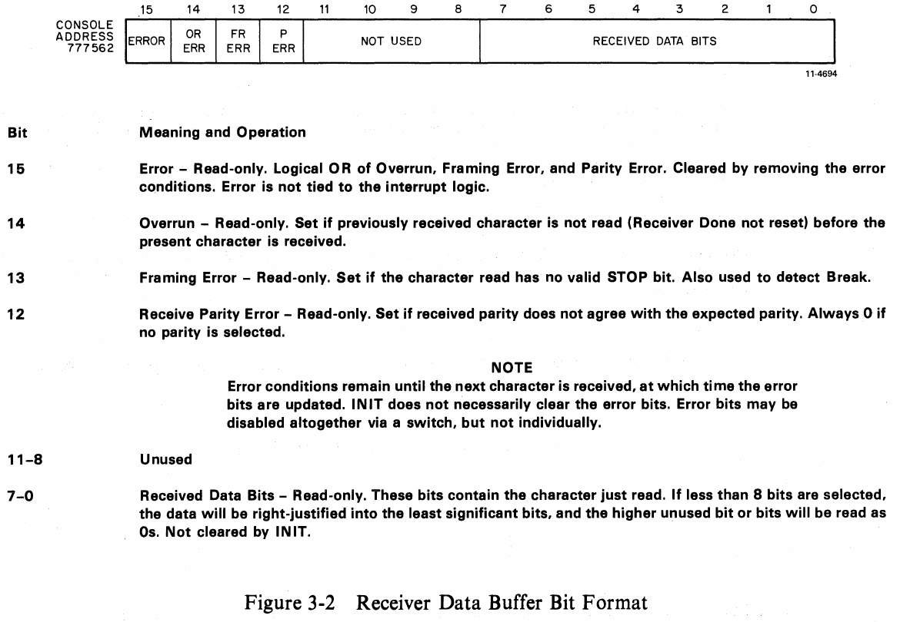
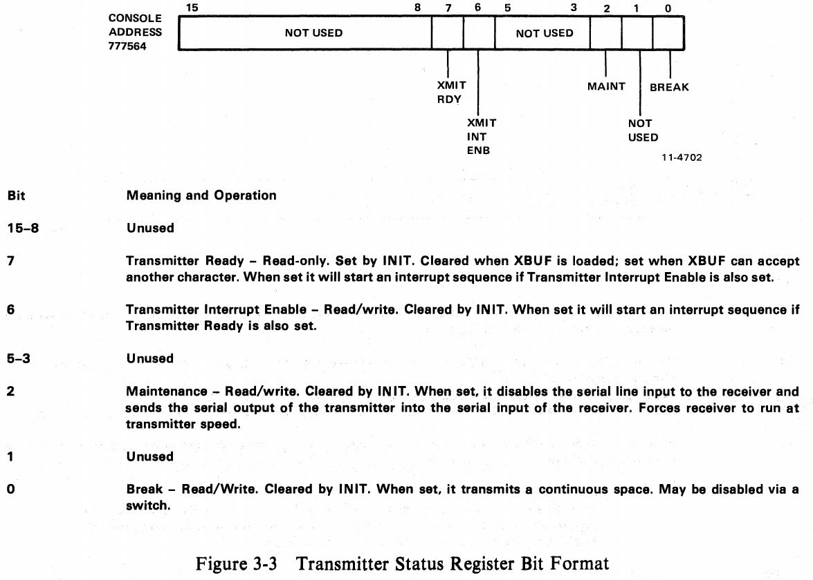
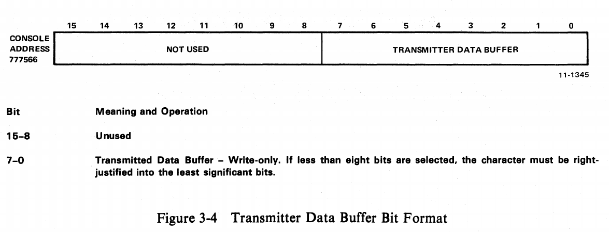
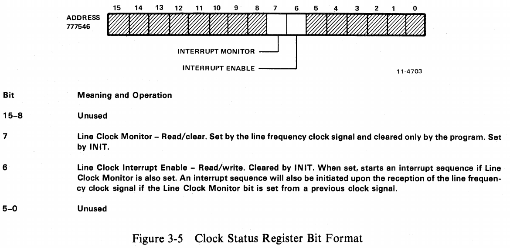

# Chapter 3: Programming Information

## 3.1 Scope

This chapter presents general programming information for software control of the DL11-W Serial Line Unit/Real-Time Clock Option. For more detailed information on programming in general, refer to the _Paper-Tape Software Programming Handbook_ (DEC-11-GGPB-D).

This chapter is divided into three major portions: device registers, interrupts, and timing considerations.

## 3.2 Device Registers

All software control of the DL11-W SLU/RTC Option is performed by means of five device registers. These registers have been assigned bus addresses and can be read or loaded (with the exceptions noted) using any PDP-11 instruction which refers to their addresses. Address assignments can be changed by altering the setting of switches on the address selection logic to correspond to any address within the range of 774000 to 777777. However, register addresses for the DL11-W normally fall within the range of 775610 to 776176 or 776500 to 776670. An explanation of the addressing scheme is offered in Chapter 4 of this manual. For the remainder of this discussion, it is assumed that the DL11-W is being used as a console terminal control.

The five device registers and associated bus addresses are listed in Table 3-1.

Figures 3-1 through 3-5 show the bit assignments for the device registers. The unused and write-only bits are always read as 0s. Writing unused or read-only bits has no effect on the bit position but is not considered good programming practice. The mnemonic INIT refers to the initialization signal issued by the processor. Initialization is caused by one of the following: issuing a programmed RESET instruction, pressing the START switch on the processor console, or the occurrence of a power-up or power-down condition on the processor power supply.

In the descriptions accompanying the figures, “transmitter” refers to those registers and bits involved in accepting a parallel character from the Unibus for serial transmission to the external device. “Receiver” refers to those registers and bits involved with receiving serial information from the external device for parallel transfer to the Unibus.

## 3.3 Interrupts

The DL11-W interface uses BR interrupts to gain control of the bus to perform a vectored interrupt, thereby causing transfer of control to a handling routine. The DL11-W has three interrupt channels: one for the receiver section, one for the transmitter section, and one for the line clock section. These three channels operate independently. However, if simultaneous interrupt requests occur, the line clock has highest priority, followed by the receiver. The transmitter is last.

A line clock interrupt can occur only if the LKS interrupt enable bit (bit 6) in the line clock status register is set. With LKS interrupt enable set, falling edges of the signal LTC IN L will generate interrupt requests. The signal LTC IN L is derived from the ac power input by the power supply and is a square wave of the same frequency as the ac input voltage.

A transmitter interrupt can occur only if the interrupt enable (XMIT INT ENAB) bit in the transmitter status register is set. With XMIT INT ENAB set, setting the transmitter ready (XMIT RDY) bit initiates an interrupt request. When XMIT RDY is set, it indicates that the transmitter buffer is empty and ready to accept another character from the bus for transfer to the external device.

A receiver interrupt can occur only if the interrupt enable (RCVR INT ENB) bit in the receiver status register is set. Setting the receiver done (RCVR DONE) bit initiates an interrupt request. When RCVR DONE is set, it indicates that an entire character has been received and is ready for transfer to the bus.

The interrupt priority level is 6 for the line clock and 4 for the receiver and transmitter.

The vector address for the line clock is fixed at 100, whereas floating vector addresses are used for the receiver and transmitter of nonconsole DL11-Ws. The receiver vector is XX0 and the transmitter vector is XX4, where XX is assigned according to Table 4-2. If the DL11-W is used as console terminal interface, then the receiver and transmitter vector addresses will be 60 and 64, respectively. The vector address can be changed by resetting switches in the interrupt control logic.

All DIGITAL programs and other software which refer to the standard vector addresses must also be changed if the vector addresses are changed.

## 3.4 Timing Considerations

When programming the DL11-W SLU/RTC option, it is important to consider the timing of certain functions in order to use the system in the most efficient manner. Timing considerations for the receiver, transmitter, break generation logic, and line clock are discussed in the following paragraphs.

### 3.4.1 Receiver

The RCVR DONE flag (bit 7 in the RCSR) sets when the universal asynchronous receiver/transmitter (UART) has assembled a full character. This occurs at the middle of the first STOP bit. Because the UART is double-buffered, data remains valid until the next character is received and assembled. This permits one full character time for servicing the RCVR DONE flag.

### 3.4.2 Transmitter

The transmitter section of the UART is also double-buffered. The XMIT RDY flag (bit 7 in the XCSR) is set after initialization. When the buffer (XBUF) is loaded with the first character from the bus, the flag clears but then sets again within a fraction of a bit time. A second character can then be loaded which clears the flag again. The flag then remains cleared for nearly one full character time.

### 3.4.3 Break Generation Logic

When the BREAK bit (bit 0 in the XCSR) is set, it causes transmission of a continuous space. Because the XMIT RDY flag continues to function normally, the duration of a break can be timed by the pseudo-transmission of a number of characters. However, because the transmitter section of the UART is double-buffered, a null character (all 0s) should precede transmission of the break to ensure that the previous character clears the line. In a similar manner, the final pseudo-transmitted character in the break should be null.

### 3.4.4 Line Clock

An initial synchronization period will be required when the LKS interrupt is initially turned on. In other words, the interval from setting LKS interrupt enable to the first interrupt will be some fraction of an ac power cycle period. All subsequent interrupts will occur at the proper intervals, depending on the ac power frequency.
