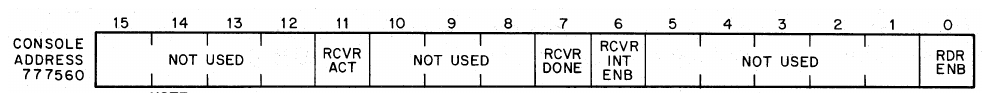
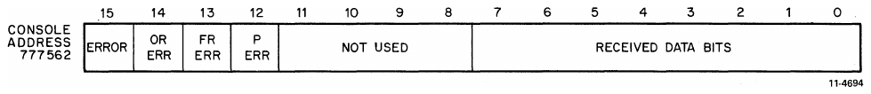
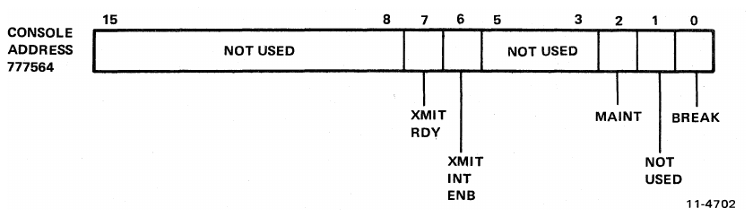
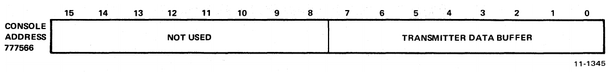
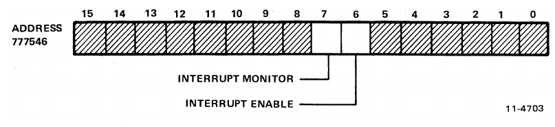

# Chapter 3: Programming Information

> Addresses and interrupt vectors below are octal. Register bit numbers are decimal. Bit assignments and register descriptions have been checked against the scanned figures; no OCR text from the diagrams is reproduced as prose.

<!-- Source PDF page 37; printed page 3-1 -->

## 3.1 Scope

This chapter presents general programming information for software control of the DL11-W Serial Line Unit/Real-Time Clock Option. For more detailed information on programming in general, refer to the _Paper-Tape Software Programming Handbook_ (DEC-11-GGPB-D).

This chapter is divided into three major portions: device registers, interrupts, and timing considerations.

## 3.2 Device Registers

All software control of the DL11-W SLU/RTC Option is performed by means of five device registers. These registers have been assigned bus addresses and can be read or loaded (with the exceptions noted) using any PDP-11 instruction which refers to their addresses. Address assignments can be changed by altering the setting of switches on the address selection logic to correspond to any address within the range of `774000` to `777777`. However, register addresses for the DL11-W normally fall within the range of `775610` to `776176` or `776500` to `776670`. An explanation of the addressing scheme is offered in Chapter 4 of this manual. For the remainder of this discussion, it is assumed that the DL11-W is being used as a console terminal control.

The five device registers and associated bus addresses are listed in Table 3-1.

**Table 3-1 — Standard DL11-W Register Assignments**

| Register           | Mnemonic | Address*  |
| ------------------ | -------- | --------- |
| Receiver Status    | RCSR     | `777560`  |
| Receiver Buffer    | RBUF     | `777562`  |
| Transmitter Status | XCSR     | `777564`  |
| Transmitter Buffer | XBUF     | `777566`  |
| Line Clock Status  | LKS      | `777546`† |

_These addresses are only for a DL11-W used as console terminal control. For other address assignments for these registers, refer to Table 4-2._

† This address is valid only on a DL11-W used as a console terminal. On any other DL11-Ws used in a system, this register should be disabled.

> Source note: The footnote above is transcribed as printed. Table 1-1 also permits `777546` when a DL11-W is used as a line clock only; the important configuration constraint is to avoid multiple enabled line clocks at the same address.

<!-- Source PDF page 38; printed page 3-2 -->

Figures 3-1 through 3-5 show the bit assignments for the device registers. The unused and write-only bits are always read as 0s. Writing unused or read-only bits has no effect on the bit position but is not considered good programming practice. The mnemonic INIT refers to the initialization signal issued by the processor. Initialization is caused by one of the following: issuing a programmed RESET instruction, pressing the START switch on the processor console, or the occurrence of a power-up or power-down condition on the processor power supply.

In the descriptions accompanying the figures, “transmitter” refers to those registers and bits involved in accepting a parallel character from the Unibus for serial transmission to the external device. “Receiver” refers to those registers and bits involved with receiving serial information from the external device for parallel transfer to the Unibus.

### Receiver Status Register (RCSR)

_RDR ENB (bit 0) is used only with DL11-A and DL11-C equivalent DL11-Ws._

| Bit   | Meaning and operation                                                                                                                                                                                                                                                                                |
| ----- | ---------------------------------------------------------------------------------------------------------------------------------------------------------------------------------------------------------------------------------------------------------------------------------------------------- |
| 15–12 | Unused.                                                                                                                                                                                                                                                                                              |
| 11    | **Receiver Active — Read-only.** When set, this bit indicates that the receiver interface is active. This bit is set at the center of the start bit, which is the beginning of the input serial data from the device, and cleared by the leading edge of Receiver Done. Also may be cleared by INIT. |
| 10–8  | Unused.                                                                                                                                                                                                                                                                                              |
| 7     | **Receiver Done — Read-only.** Set when an entire character has been received and is ready for transfer to the Unibus. Cleared by setting Reader Enable, addressing (read or write) RBUF, or INIT. Starts an interrupt sequence when receiver interrupt enable (bit 6) is also set.                  |
| 6     | **Receiver Interrupt Enable — Read/write.** Cleared by INIT. Starts an interrupt sequence when Receiver Done is set.                                                                                                                                                                                 |
| 5–1   | Unused.                                                                                                                                                                                                                                                                                              |
| 0     | **Reader Enable — Write-only.** Cleared by INIT or at the middle of a START bit. Advances paper tape reader of ASR Teletypes. Clears Receiver Done. The 20 mA current loop circuit output is associated with this bit.                                                                               |

<!-- Source PDF page 39; printed page 3-3 -->

### Receiver Data Buffer (RBUF)

| Bit  | Meaning and operation                                                                                                                                                                                                                                          |
| ---- | -------------------------------------------------------------------------------------------------------------------------------------------------------------------------------------------------------------------------------------------------------------- |
| 15   | **Error — Read-only.** Logical OR of Overrun, Framing Error, and Parity Error. Cleared by removing the error conditions. Error is not tied to the interrupt logic.                                                                                             |
| 14   | **Overrun — Read-only.** Set if previously received character is not read (Receiver Done not reset) before the present character is received.                                                                                                                  |
| 13   | **Framing Error — Read-only.** Set if the character read has no valid STOP bit. Also used to detect Break.                                                                                                                                                     |
| 12   | **Receive Parity Error — Read-only.** Set if received parity does not agree with the expected parity. Always 0 if no parity is selected.                                                                                                                       |
| 11–8 | Unused.                                                                                                                                                                                                                                                        |
| 7–0  | **Received Data Bits — Read-only.** These bits contain the character just read. If less than 8 bits are selected, the data will be right-justified into the least significant bits, and the higher unused bit or bits will be read as 0s. Not cleared by INIT. |

> **NOTE** — Error conditions remain until the next character is received, at which time the error bits are updated. INIT does not necessarily clear the error bits. Error bits may be disabled altogether via a switch, but not individually.

<!-- Source PDF page 40; printed page 3-4 -->

### Transmitter Status Register (XCSR)

| Bit  | Meaning and operation                                                                                                                                                                                                                         |
| ---- | --------------------------------------------------------------------------------------------------------------------------------------------------------------------------------------------------------------------------------------------- |
| 15–8 | Unused.                                                                                                                                                                                                                                       |
| 7    | **Transmitter Ready — Read-only.** Set by INIT. Cleared when XBUF is loaded; set when XBUF can accept another character. When set it will start an interrupt sequence if Transmitter Interrupt Enable is also set.                            |
| 6    | **Transmitter Interrupt Enable — Read/write.** Cleared by INIT. When set it will start an interrupt sequence if Transmitter Ready is also set.                                                                                                |
| 5–3  | Unused.                                                                                                                                                                                                                                       |
| 2    | **Maintenance — Read/write.** Cleared by INIT. When set, it disables the serial line input to the receiver and sends the serial output of the transmitter into the serial input of the receiver. Forces receiver to run at transmitter speed. |
| 1    | Unused.                                                                                                                                                                                                                                       |
| 0    | **Break — Read/write.** Cleared by INIT. When set, it transmits a continuous space. May be disabled via a switch.                                                                                                                             |

### Transmitter Data Buffer (XBUF)

| Bit  | Meaning and operation                                                                                                                                  |
| ---- | ------------------------------------------------------------------------------------------------------------------------------------------------------ |
| 15–8 | Unused.                                                                                                                                                |
| 7–0  | **Transmitted Data Buffer — Write-only.** If less than eight bits are selected, the character must be right-justified into the least significant bits. |

<!-- Source PDF page 41; printed page 3-5 -->

### Line Clock Status Register (LKS)

| Bit  | Meaning and operation                                                                                                                                                                                                                                                                                          |
| ---- | -------------------------------------------------------------------------------------------------------------------------------------------------------------------------------------------------------------------------------------------------------------------------------------------------------------- |
| 15–8 | Unused.                                                                                                                                                                                                                                                                                                        |
| 7    | **Line Clock Monitor — Read/clear.** Set by the line frequency clock signal and cleared only by the program. Set by INIT.                                                                                                                                                                                      |
| 6    | **Line Clock Interrupt Enable — Read/write.** Cleared by INIT. When set, starts an interrupt sequence if Line Clock Monitor is also set. An interrupt sequence will also be initiated upon the reception of the line frequency clock signal if the Line Clock Monitor bit is set from a previous clock signal. |
| 5–0  | Unused.                                                                                                                                                                                                                                                                                                        |

> Source note: Figure 3-5 above specifies **set by INIT** for bit 7. The original's detailed description in [§4.3.5.1](chapter-04-detailed-description.md#4351-line-clock-monitor-bit-7) instead says INIT clears it. This is an unresolved source contradiction, not a verified choice of initialization behavior.

## 3.3 Interrupts

The DL11-W interface uses BR interrupts to gain control of the bus to perform a vectored interrupt, thereby causing transfer of control to a handling routine. The DL11-W has three interrupt channels: one for the receiver section, one for the transmitter section, and one for the line clock section. These three channels operate independently. However, if simultaneous interrupt requests occur, the line clock has highest priority, followed by the receiver. The transmitter is last.

A line clock interrupt can occur only if the LKS interrupt enable bit (bit 6) in the line clock status register is set. With LKS interrupt enable set, falling edges of the signal LTC IN L will generate interrupt requests. The signal LTC IN L is derived from the ac power input by the power supply and is a square wave of the same frequency as the ac input voltage.

A transmitter interrupt can occur only if the interrupt enable (XMIT INT ENAB) bit in the transmitter status register is set. With XMIT INT ENAB set, setting the transmitter ready (XMIT RDY) bit initiates an interrupt request. When XMIT RDY is set, it indicates that the transmitter buffer is empty and ready to accept another character from the bus for transfer to the external device.

A receiver interrupt can occur only if the interrupt enable (RCVR INT ENB) bit in the receiver status register is set. Setting the receiver done (RCVR DONE) bit initiates an interrupt request. When RCVR DONE is set, it indicates that an entire character has been received and is ready for transfer to the bus.

The interrupt priority level is 6 for the line clock and 4 for the receiver and transmitter.

The vector address for the line clock is fixed at `100`, whereas floating vector addresses are used for the receiver and transmitter of nonconsole DL11-Ws. The receiver vector is `XX0` and the transmitter vector is `XX4`, where `XX` is assigned according to Table 4-2. If the DL11-W is used as console terminal interface, then the receiver and transmitter vector addresses will be `60` and `64`, respectively. The vector address can be changed by resetting switches in the interrupt control logic.

All DIGITAL programs and other software which refer to the standard vector addresses must also be changed if the vector addresses are changed.

<!-- Source PDF page 42; printed page 3-6 -->

## 3.4 Timing Considerations

When programming the DL11-W SLU/RTC option, it is important to consider the timing of certain functions in order to use the system in the most efficient manner. Timing considerations for the receiver, transmitter, break generation logic, and line clock are discussed in the following paragraphs.

### 3.4.1 Receiver

The RCVR DONE flag (bit 7 in the RCSR) sets when the universal asynchronous receiver/transmitter (UART) has assembled a full character. This occurs at the middle of the first STOP bit. Because the UART is double-buffered, data remains valid until the next character is received and assembled. This permits one full character time for servicing the RCVR DONE flag.

### 3.4.2 Transmitter

The transmitter section of the UART is also double-buffered. The XMIT RDY flag (bit 7 in the XCSR) is set after initialization. When the buffer (XBUF) is loaded with the first character from the bus, the flag clears but then sets again within a fraction of a bit time. A second character can then be loaded which clears the flag again. The flag then remains cleared for nearly one full character time.

### 3.4.3 Break Generation Logic

When the BREAK bit (bit 0 in the XCSR) is set, it causes transmission of a continuous space. Because the XMIT RDY flag continues to function normally, the duration of a break can be timed by the pseudo-transmission of a number of characters. However, because the transmitter section of the UART is double-buffered, a null character (all 0s) should precede transmission of the break to ensure that the previous character clears the line. In a similar manner, the final pseudo-transmitted character in the break should be null.

### 3.4.4 Line Clock

An initial synchronization period will be required when the LKS interrupt is initially turned on. In other words, the interval from setting LKS interrupt enable to the first interrupt will be some fraction of an ac power cycle period. All subsequent interrupts will occur at the proper intervals, depending on the ac power frequency.
