# Chapter 4: Detailed Description

> Addresses and vectors are octal; bit and IC pin numbers are decimal. Source inconsistencies are retained and flagged. In particular, do not use the conflicting UART pin references or LKS initialization descriptions below as an unverified hardware specification.

<!-- Source PDF page 43; printed page 4-1 -->

## 4.1 Introduction

This chapter provides a detailed description of the DL11-W Serial Line Unit/Real-Time Clock Option. The complete DL11-W may be divided into 12 functional areas. Table 4-1 lists these areas and explains the general purpose of each.

**Table 4-1 — DL11-W Functional Units**

| Functional unit                                    | Purpose                                                                                                                                                                                                                                                                    |
| -------------------------------------------------- | -------------------------------------------------------------------------------------------------------------------------------------------------------------------------------------------------------------------------------------------------------------------------- |
| Selection Logic                                    | Determines if the DL11-W interface has been selected for use and what type of operation (transmitter, receiver, or clock) has been selected. Permits selection of one of five internal registers and determines if the register is to perform an input or output function. |
| Register Logic                                     | Five internal registers, addressable by the program, provide data transfer, command and control, and status monitoring functions for the interface.                                                                                                                        |
| Interrupt Request Logic                            | The line clock, receiver, or transmitter can request control of the Unibus for a vectored interrupt.                                                                                                                                                                       |
| Interrupt Logic                                    | Permits the DL11-W to gain control of the bus for a vectored interrupt.                                                                                                                                                                                                    |
| Transmitter Control Logic                          | Provides necessary input control signals for the UART when it is used to convert parallel data from the Unibus to serial data required by the external device.                                                                                                             |
| Receiver Control Logic                             | Provides necessary input control signals for the UART when it is used to convert serial data to parallel data required for transmission to the bus.                                                                                                                        |
| Universal Asynchronous Receiver/Transmitter (UART) | Performs the necessary serial-to-parallel or parallel-to-serial conversion on the data, and supplies control and error detecting bits.                                                                                                                                     |

<!-- Source PDF page 44; printed page 4-2 -->

**Table 4-1 — DL11-W Functional Units (continued)**

| Functional unit          | Purpose                                                                                                                                                                                                               |
| ------------------------ | --------------------------------------------------------------------------------------------------------------------------------------------------------------------------------------------------------------------- |
| Baud Rate Logic          | Determines the clock frequencies and, therefore, the baud rates for the transmitter and receiver sections of the UART. Eight baud rates are derived from a single oscillator and are independently switch-selectable. |
| Maintenance Mode Logic   | Performs a closed-loop test of the serial line unit control logic by tying the serial output of the transmitter into the receiver input, forcing the receiver clock to the same frequency as the transmitter clock.   |
| Break Generation Logic   | Permits the transmission of a continuous space or “break.” The duration of the break can be timed by the pseudo-transmission of a specific number of characters.                                                      |
| 20 mA Current Loop Logic | Provides active or passive 20 mA current loops for use with 20 mA current loop devices.                                                                                                                               |
| EIA Logic                | Provides necessary level converters for use with EIA level devices.                                                                                                                                                   |

## 4.2 Address Selection

The address selection logic (drawings DL-4 and DL-7) decodes the incoming address information from the bus to determine if the DL11-W has been selected for use, and provides the signals that determine which register has been selected and whether it is to perform an input or output function. Switches on the logic can be altered so that the module responds to any address within the range of `774000` to `777777`. However, standard address assignments for the DL11-W normally fall within the ranges of `775610` to `776177` or `776500` to `776677`.

The standard address assignments for DL11-W modules are listed in Table 4-2.

When the DL11-W is to be used as a console terminal control, switches are arranged so that the serial line section responds only to the standard device register addresses `777560`, `777562`, `777564`, `777566`, and, if the LTC is enabled, `777540` [sic]. Although these addresses have been selected by DIGITAL as the standard assignments for the DL11-W when used as a console terminal control, the user may change the switches to assign any address desired, within the range of the address switches. However, the serial line address must be `77756X` in order for the LTC and the SLU to both be used on the same DL11-W. Any MAINDEC program or other software that references the DL11-W standard assignments must be modified accordingly if other than the standard assignments are used.

> Source note: Printed page 4-2 says `777540`; the line clock register is consistently assigned `777546` in Chapters 1–3, the mode descriptions below, and Figure 4-8.

<!-- Source PDF page 45; printed page 4-3 -->

**Table 4-2 — DL11-W Standard Address Assignments**

| Device class / unit                        | RCSR           | RBUF           | XCSR           | XBUF           |
| ------------------------------------------ | -------------- | -------------- | -------------- | -------------- |
| Console                                    | `777560`       | `777562`       | `777564`       | `777566`       |
| DL11-A/-B equivalent, unit 1               | `776500`       | `776502`       | `776504`       | `776506`       |
| DL11-A/-B equivalent, unit 2               | `776510`       | `776512`       | `776514`       | `776516`       |
| DL11-A/-B equivalent, unit 16 (as printed) | `777670` [sic] | `777672` [sic] | `777674` [sic] | `777676` [sic] |
| DL11-C/-D equivalent, unit 1               | `775610`       | `775612`       | `775614`       | `775616`       |
| DL11-C/-D equivalent, unit 31              | `776170`       | `776172`       | `776174`       | `776176`       |

**Notes from the original table:**

- Address space in the range `776500`–`776676` is reserved for DL11-A and -B equivalent devices.
- Unit numbers are only for showing address sequencing. DL11-A, -B, -C, and -D equivalent DL11-Ws may be mixed in any manner as long as they remain in their respective address space.

> Source note: The unit 16 row really prints `77767x`, inconsistent with both the stated `776500`–`776676` range and the address sequence. The expected sequence would end at `776670`, `776672`, `776674`, `776676`; verify before configuration. The original also labels `776502` “RSUF unit 1”; the register name is normalized to RBUF here.

<!-- Source PDF page 46; printed page 4-4 -->

Discussion of the three address selection modes is included here as well as in Chapter 2 for the sake of completeness. Normally, a DL11-W used as console terminal control would operate in the first mode, whereas additional DL11s would be operated in the second mode. While the third mode is a possibility, it is not normally used.

- **Mode 1:** Both the serial line unit and the line clock sections can be addressed. Due to common address selection logic, operation in this mode requires that the serial line unit addresses be restricted to `77756X`. The line clock address is `777546`.
- **Mode 2:** Only the serial line unit section can be addressed. Address selection ranges from `774000` to `777776`. The line clock is disabled and does not respond to address `777546`.
- **Mode 3:** Only the line clock section can be addressed at `777546`. The serial line unit section does not respond to any address.

Table 4-3 indicates the correct switch settings for selection of the desired address and address mode.

**Table 4-3 — Address and Mode Selection**

| Mode | A10 S5-3 | A09 S5-2 | A08 S5-1 | A07 S5-4 | A06 S5-5 | A05 S5-6 | A04 S5-8 | A03 S5-7 | LTC S5-9 | LTC S5-10 |
| ---- | -------- | -------- | -------- | -------- | -------- | -------- | -------- | -------- | -------- | --------- |
| 1    | OFF      | OFF      | OFF      | ON       | OFF      | OFF      | OFF      | ON       | OFF      | ON        |
| 2*   | OFF      | OFF      | OFF      | ON       | OFF      | OFF      | OFF      | ON       | ON       | OFF       |
| 3    | OFF      | OFF      | OFF      | ON       | OFF      | OFF      | ON       | ON       | ON       | ON        |

_Address `77756X` is selected for serial line interface. Other addresses may be selected using the switches shown. Note that OFF = 1 and ON = 0._

The following discussions assume that the DL11-W is operated as a console terminal control with the line clock enabled (mode 1).

The first five octal digits of address `77756X` indicate that the serial line unit has been selected. The final octal digit (X), consisting of address lines A02, A01, and A00, determines which register has been selected and whether a word or byte operation is to be performed. To select the line clock register, `777546`, the first 17 binary bits are decoded, and A00 is used to distinguish between a word and a byte operation. In both cases, the two mode control lines C00 and C01 determine whether the selected register is to perform an input or output operation (provided that the selected register is a read/write register).

The address decoding is performed by a series of logic gates that provide inputs to two 32 × 8 read-only memory (ROM) IC chips (DL-7). Basically, the state of the five input lines defines 1 of 32 unique addresses. The contents of the ROM corresponding to that unique address are then available at the output of the ROM. Each ROM provides 8 outputs for a total of 16, although only 14 of the 16 available outputs are used.

<!-- Source PDF page 47; printed page 4-5 -->

One input to the ROMs is address bit A04. This bit selects either the line clock or the serial line unit. When the line clock is disabled, this line is always high. Two inputs, address bits A02 and A01, are used to select one of the four registers in the serial line unit and are also used in decoding the line clock address; the fourth input is a combination of A00, C00, and C01, providing necessary decoding of word or byte and input or output operations. The fifth input is an address enable which must be true for the ROMs to decode the other inputs. This address enable signal is derived from a series of gates that are true when MSYN is present and when the address line conditions indicate that one of the valid addresses is true on the bus.

### 4.2.1 Inputs

A simplified block diagram of the address selection logic is shown in Figure 4-1. Note that IN and OUT are always used with respect to the master (controlling) device. Thus, when the DL11-W is used, an OUT transfer is a transfer of data out of the master (the processor) and into the interface. Similarly, an IN transfer is the operation of the interface furnishing data to the processor.

The address selection lines (drawing DL-7) consist of 18 address lines on the bus (A17–00), bus control lines C1 and C0, and a master synchronization (MSYN) line. The address selection logic decodes the address on the bus as described below. This address format is shown in Figure 4-2. Note that all input gates are standard bus receivers.

1. Address lines A17–11 must be all 1s. This specifies an address within the top 4K addresses for device registers.
2. Decoding of address lines A10–05 and A03 is determined by switches. When a given line switch is ON, the address logic searches for a 0 on that line. If the switch is OFF, the logic searches for a 1. If only the serial line unit is to be enabled, then decoding of A04 will also be determined by a switch.
3. Lines A01, A02, and A04 are decoded to select one of the five addressable device registers.
4. Line C1 is used to select either an input (DATI) or output (DATO) function. When C1 is false, an input (read) operation is selected. When it is true, an output (write or load) operation is selected.
5. Line A00 is used for byte control in such a manner that no register control signals are generated when a byte operation (DATOB) is performed on the high-order byte of any register.

### 4.2.2 Outputs

The address selection logic output signals are used to permit selection of five 16-bit registers, and determine whether information is to be gated into or out of the master device. All of these output signals are listed in Table 4-4.

RCSR CLK ENB L and XCSR CLK ENB L are ANDed with BMSYN DEL L to provide the register loading pulses RCSR CLK H and XCSR CLK H (drawing DL-4).

LD XBUF H is used to trigger a 500 ns one-shot multivibrator to generate the transmitter buffer loading signal, LD X DEL L (drawing DL-4).

RBUF → BUS H triggers a 1 µs one-shot multivibrator to produce the signal SEL 2 L, which clears R DONE (drawing DL-4).

SSYN EN L is ANDed with BMSYN DEL L and delayed to produce BUS SSYN L (drawing DL-4).

<!-- Source PDF page 48; printed page 4-6 -->

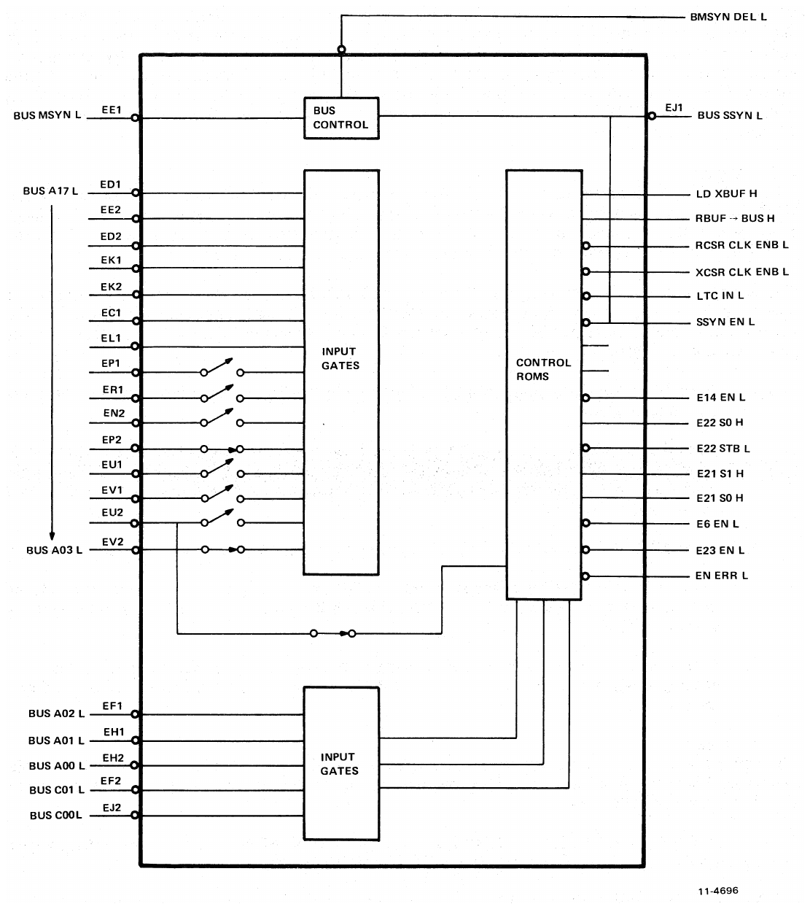

<!-- Source PDF page 49; printed page 4-7 -->

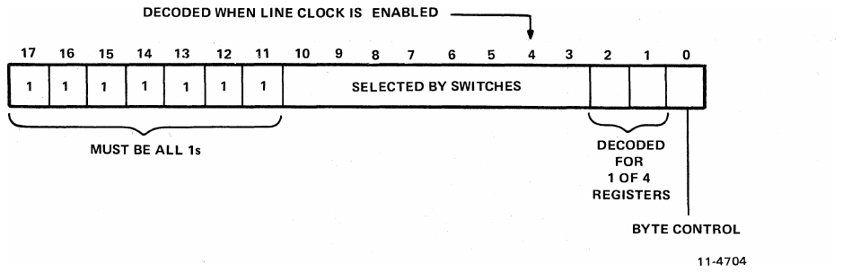

**Table 4-4 — Address Selection Logic Output Signals**

| Signal         | Function selected                                                         | Bus cycle                    |
| -------------- | ------------------------------------------------------------------------- | ---------------------------- |
| LD XBUF H      | Bus to transmitter buffer                                                 | DATO or DATOB*               |
| RBUF BUS H     | Receiver buffer to bus                                                    | DATI or DATIP                |
| RCSR CLK ENB L | Bus to receiver status                                                    | DATO or DATOB*               |
| XCSR CLK ENB L | Bus to transmitter status                                                 | DATO or DATOB*               |
| LTC IN L       | Bus to line clock status                                                  | DATO or DATOB                |
| SSYN EN L      | Returns BUS SSYN on a valid address selection                             | DATO, DATOB*, DATI, or DATIP |
| E14 EN L       | Enables bus drivers 001, 003, 004 and 005 (as printed)                    | DATI or DATIP                |
| E22 S0 H       | Selects either buffer (H) or transmitter status (L) to bus (bits 0 and 2) | DATI or DATIP                |
| E22 STB L      | Enables bits 0 and 2 (above) to bus drivers                               | DATI or DATIP                |

<!-- Source PDF page 50; printed page 4-8 -->

**Table 4-4 — Address Selection Logic Output Signals (continued)**

| Signal             | Function selected                                                                                                                                                | Bus cycle     |
| ------------------ | ---------------------------------------------------------------------------------------------------------------------------------------------------------------- | ------------- |
| E21 S1 H; E22 S0 H | Bits 6 and 7 to bus: receiver buffer (S0 = L, S1 = L); receiver status (S0 = L, S1 = H); transmitter status (S0 = H, S1 = L); line clock status (S0 = H, S1 = H) | DATI or DATIP |
| E6 EN L            | Enables bus drivers D00, D02, D06, and D07                                                                                                                       | DATI or DATIP |
| E23 EN L           | Receiver status (bit 11) to bus                                                                                                                                  | DATI or DATIP |
| EN ERR L           | Receiver buffer (bits 15, 14, 13, and 12) to bus                                                                                                                 | DATI or DATIP |

_DATOB to low byte only._

> Source note: Table 4-4 prints “001, 003, 004 and 005” where bus lines D01, D03, D04 and D05 are intended. Its continued select-signal row says **E22 S0 H**, while Figure 4-1 labels the corresponding 4-to-1 select output **E21 S0 H**. These source labels are retained for comparison with the engineering drawings.

## 4.3 Register Logic

### 4.3.1 Receiver Status Register (RCSR)

The receiver status register (Figure 4-3) is used to monitor the status of receiver logic operations when the DL11-W accepts a character. It is also used to initiate interrupt sequences.

Each of the bits in the receiver status register is discussed separately in the following paragraphs, beginning with the most significant bit.

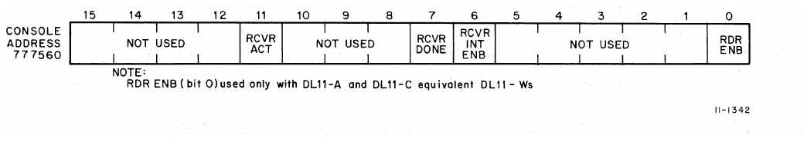

<!-- Source PDF page 51; printed page 4-9 -->

#### 4.3.1.1 Receiver Active (Bit 11)

The receiver active (RCVR ACT) flag indicates that the receiver logic is in the process of receiving and assembling an incoming character. This bit is read-only and is normally set and cleared by the receiver logic.

The RCVR ACT flag is set at the center of an incoming START bit. It is clocked on the eighth RCVR CLK period from the beginning of a START bit. (XMIT CLK and RCVR CLK frequencies are 16 times the respective baud rates.) RCVR ACT will remain set until the receiver done (RCVR DONE) flag is set. The RCVR ACT flip-flop is also cleared by B INIT L.

#### 4.3.1.2 Receiver Done (Bit 7)

This is a read-only bit. The receiver done (RCVR DONE) flag indicates that a full character has been received. This bit, when set, clears the receiver active (RCVR ACT) flag and initiates an interrupt sequence provided the associated interrupt enable bit (RCVR INT ENB) is also set.

Once an entire character has been received and is stored in the UART holding register, the UART issues a received data available (R DONE) signal (drawing DL-1, C3), which is buffered, inverted, and fed to the direct clear input of the RCVR ACT flip-flop to clear it; this indicates that the receiver is no longer in use and is capable of receiving a new character.

The buffered R DONE signal, which becomes RCVR DONE H, is ANDed with RCVR INTR ENB (1) H to produce a clock signal to set the receiver interrupt request flip-flop. The setting of this flip-flop will initiate an interrupt sequence as described in Paragraph 4.5. The RCVR DONE H signal is gated to the Unibus (drawing DL-4) through a 4-to-1 multiplexer and through a bus driver enabled by the signals E6 EN L and BMSYN DEL L. This allows the status of the RCVR DONE bit to be read by the program from bus data line BUS D07 L.

The RCVR DONE bit can be cleared by B INIT L or by the occurrence of CLR R DONE. CLR R DONE occurs under two conditions.

1. Whenever the receiver buffer (RBUF) is addressed, indicating that a new character may be loaded into the receiver, SEL 2 L is true and passes through an OR gate to produce CLR R DONE on the UART.
2. If the reader enable (RDR ENB) flip-flop is set, indicating that the tape reader in a Teletype unit is being advanced, then the 0 side is low and passes through the same OR gate as before to reset CLR R DONE.

#### 4.3.1.3 Receiver Interrupt Enable (Bit 6)

This is a read/write bit. The receiver interrupt enable bit (RCVR INT ENB) permits an interrupt sequence to be initiated when the RCVR DONE bit sets to indicate that a character has been received and is ready for transfer to the bus. This bit is set by using the RCSR CLK H signal as a load pulse to load a 1 from bus line BUS D06 L. This line is buffered to BBD 6 H (drawing DL-4), the D input of the RCVR INTR ENB flip-flop (drawing DL-1).

The output of the flip-flop, RCVR INTR ENB (1) H, ANDed with RCVR DONE H, clocks the receiver interrupt request flip-flop, setting it.

The RCVR INT ENB bit can be read onto the Unibus via the 4-to-1 multiplexer (drawing DL-4, C-3) and through the bus driver enabled by E6 EN L and BMSYN DEL L onto bus data line BUS D06 L.

The RCVR INTR ENB flip-flop is cleared by B INIT L.

<!-- Source PDF page 52; printed page 4-10 -->

#### 4.3.1.4 Reader Enable (Bit 0)

The reader enable (RDR ENB) bit, when set, advances the paper tape reader in ASR Teletype units via a 20 mA output circuit. The BBD 0 H signal, which is derived from receiving BUS D00 L, is applied to the data input of the RDR ENB flip-flop (drawing DL-1, C-6). The clock input receives the loading signal RCSR CLK H. When the flip-flop is set, the 0 side, which is low, is applied to the 20 mA circuit (drawing DL-8), which advances the paper tape reader in the Teletype via pin PP on the Berg connector. The 0 side of the flip-flop is also gated through an OR gate (drawing DL-1) to reset the RCVR DONE bit via CLR R DONE as described in Paragraph 4.3.1.2.

The RDR ENB bit is a write-only bit; it cannot be read by the program.

Whenever the Teletype starts sending data to the interface, the RDR ENB bit is cleared so that the reader does not advance another frame while it is transmitting information to the DL11-W.

The RDR ENB flip-flop is cleared when the RCVR ACT flip-flop becomes set, which is at the middle of a START bit as explained in Paragraph 4.3.1.1. The RDR ENB flip-flop can also be cleared by B INIT L.

### 4.3.2 Receiver Buffer Register (RBUF)

The receiver buffer register (Figure 4-4) is an 8-bit read-only register in the UART (drawing DL-1, C-4). Serial information is converted to parallel data by the UART and then gated to the Unibus. The RBUF consists of gating logic rather than a flip-flop register. Therefore, the data output lines from the UART must be held until read onto the bus. Because the UART is double-buffered, data on these output lines is valid until the next character is received and assembled. The RBUF register is read by a DATI sequence and the data is transmitted to the Unibus for transfer to the processor or some other PDP-11 device.

If less than eight data bits are selected, the buffer is justified into the least significant bit positions. This justification is performed by the UART. The data loaded into the buffer is coded so that binary 0s correspond to spaces and binary 1s correspond to marks (or holes).

The four most significant bits in the high-order byte of the register are used for error indications. The error bits and the data portion of the receiver buffer register are covered separately in the following paragraphs.

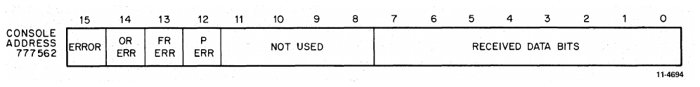

<!-- Source PDF page 53; printed page 4-11 -->

#### 4.3.2.1 Receiver Error Bits (Bits 15, 14, 13, 12)

The high-order byte of the receiver buffer register (RBUF) contains four error bits that set to indicate improper receiver operation. These bits are read-only and can be disabled by having switch S4-7 in the OFF position.

Three of the four error bits are generated in the UART as follows:

1. **OR ERROR (overrun error, bit 14):** Indicates that R DONE was not reset (previously received character was not read) prior to receiving a new character. When this condition exists, the UART generates an OR ERR H signal.
2. **FR ERROR (framing error, bit 13):** Indicates that a framing error exists because the character read had no valid STOP bit. When this condition exists, the UART generates a FR ERR H signal.
3. **P ERROR (parity error, bit 12):** Indicates that the parity received does not agree with the expected parity. If parity has been selected and this condition exists, the UART generates a P ERR H signal.

Bit 15, which is the error (ERROR) bit, is the inclusive-OR of the OR ERROR, FR ERROR, and P ERROR bits (DL-1, C-2). Whenever one of these errors occurs, the appropriate signal from the UART [OR ERR H, FR ERR H (DL-4, B-4), or P ERR H] passes through a buffer and qualifies an OR gate (drawing DL-1). The output of the OR gate is ERROR H. Each of the four error signals (drawing DL-4) qualifies one leg of a 2-input NAND gate (DL-4, B-4). The other leg is qualified by BMSYN DEL L ANDed with EN ERR L. The output of each NAND gate is tied to an associated bus data line (BUS D15 L, BUS D14 L, BUS D13 L, and BUS D12 L) so that the status of each error bit can be monitored by the program. Note that the enabling signal EN ERR L is applied via switch S4-7 and if this switch is off the error bits cannot be read onto the bus.

It should be noted that none of the error bits is tied to the interrupt logic. Therefore, occurrence of a receiver error does not cause the program to be interrupted for a branch to a handling routine. However, these flags are updated each time a character is received, at which point an interrupt may occur by means of R DONE.

The initialize signal (B INIT H) may have an effect on these bit positions depending on the UART used. A bit is cleared by clearing the error-producing condition. When the next character is received by the UART, the error bits are updated and the new status is available when the receiver buffer register is read.

#### 4.3.2.2 Receiver Data Bits (Bits 7 through 0)

These bits are read-only bits. The receiver buffer register is not a flip-flop register, but consists simply of gates that strobe data from the output lines of the UART onto the Unibus. The UART receives the incoming serial data from the external device, converts it to parallel data, and places it on eight parallel output lines. Each of these lines (RD0 through RD7) is fed to one leg of a NAND gate as shown on drawing DL-4 (RD0 and RD2 through the 2-to-1 multiplexer; RD6 and RD7 through the 4-to-1 multiplexer). When the receiver buffer is addressed for reading, E14 EN L and E6 EN L will also be true, and, ANDed with BMSYN DEL L, will gate the receiver buffer levels to bus data lines BUS D07 L through BUS D00 L.

Figure 4-5 is a simplified diagram of both receiver and transmitter gating logic showing a single bit position. When the receiver gating is used, the output of the UART is gated through to the Unibus. When the transmitter is used, data from the Unibus is gated through to the transmitter inputs of the UART.

The receiver buffer can only be read by the program. It is loaded by the UART. Note that the initialize signal (B INIT L) has no effect on this register.

<!-- Source PDF page 54; printed page 4-12 -->

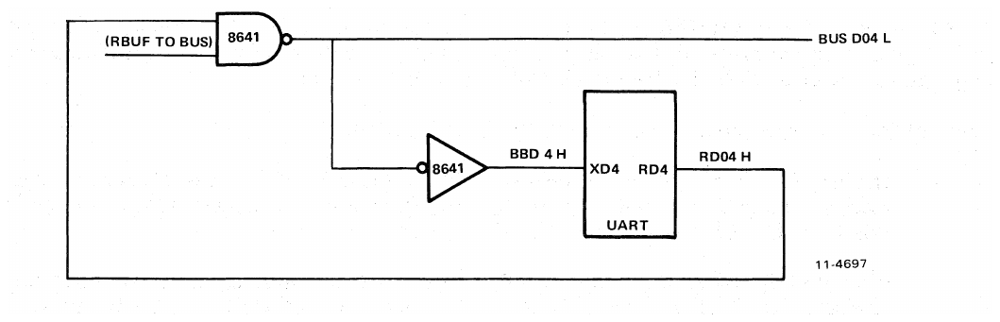

### 4.3.3 Transmitter Status Register (XCSR)

The transmitter status register (Figure 4-6) consists of control and status monitoring bits for the transmitter portion of the DL11-W. The register contains two bits associated with transmitter operation: a transmitter ready flag to indicate that the transmitter buffer can be loaded, and an interrupt enable to allow the transmitter to initiate an interrupt sequence. Both of these bits are described in subsequent paragraphs.

A maintenance (MAINT) bit is also provided so that a closed loop test of the serial line unit operation can be performed. The maintenance function is covered in detail in Paragraph 4.10.

A BREAK bit (bit 0) is provided and permits transmission of a continuous space to the external device. This bit may be disabled via switch S4-1. The associated logic is described in Paragraph 4.6.

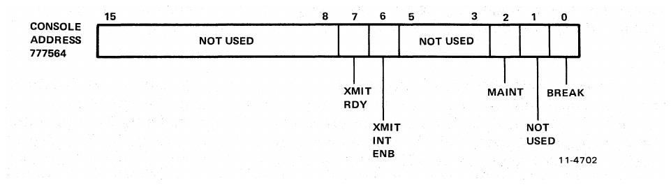

<!-- Source PDF page 55; printed page 4-13 -->

#### 4.3.3.1 Transmitter Ready (Bit 7)

The transmitter ready (XMIT RDY) flag indicates that the transmitter buffer (XBUF) is ready to accept another character from the Unibus for transfer to the external device. This bit, when set, initiates an interrupt sequence, provided the associated interrupt enable bit (XMIT INT ENB — bit 6) is also set.

The flag is controlled by the XRDY output of the UART, which indicates that the transmitter buffer is empty. It is set by the initialize signal (B INIT H) to indicate that the data bit holding register within the UART may be loaded with another character. It is also set whenever the holding register is empty. Once loading of the transmitter buffer begins, the bit is cleared. The XRDY output of the UART is buffered to produce the XMIT RDY H flag.

As shown in drawing DL-1, the XMIT RDY H signal is ANDed with XMIT INTR ENB (1) H, which is true if bit 6 is set, to clock the 7474 flip-flop, setting it. The 0 side of this flip-flop, which is now low, is ANDed with XMIT INTR ENB (1) L, and the output of this gate initiates an interrupt sequence. The interrupt sequence allows the program to branch to a handling routine for loading a character for transmission to the external device.

The XMIT RDY flag can be read by the program from bus data line BUS D07 L via the 4-to-1 multiplexer and associated bus driver.

#### 4.3.3.2 Transmitter Interrupt Enable (Bit 6)

The transmitter interrupt enable bit (XMIT INT ENB) is a read/write bit that permits an interrupt sequence to be initiated when the XMIT RDY bit sets to indicate that the transmitter buffer can accept another character from the Unibus. This bit is set by using XCSR CLK H as a load pulse to load a 1 from bus line BBD 6 H into the XMIT INTR ENB flip-flop (DL-1).

The output of flip-flop XMIT INTR ENB (1) H is applied to one leg of a 2-input AND gate. The other input of this AND gate is the XMIT RDY H signal, which is produced when the transmitter buffer is clear and capable of receiving a character from the bus. When both inputs are true, the output clocks the 7474 flip-flop, initiating an interrupt sequence.

As shown on drawing DL-4, the XMIT INTR ENB (1) H signal is applied to an input of the 4-to-1 multiplexer, which can be read onto bus data line BUS D06 L (DL-4, C-2) so that the program can read the status of this bit.

The XMIT INT ENB flip-flop is cleared by B INIT L.

#### 4.3.3.3 Maintenance (Bit 2)

This read/write bit is cleared by B INIT L. It is read onto the bus through the 2-to-1 multiplexer E22 (DL-4). The program can set the bit through bus line BUS D02 L. When set, the maintenance bit disables the serial line input to the receiver and sends the serial output of the transmitter into the serial input of the receiver. The receiver is forced to run at transmitter speed.

#### 4.3.3.4 Break (Bit 0)

The break flip-flop, together with the maintenance flip-flop and the interrupt enable flip-flop, is located on E8 on drawing DL-1. It is a read/write bit that is cleared by B INIT L. The output is gated to Unibus line BUS D00 L through the 2-to-1 multiplexer on drawing DL-4. When set it transmits a continuous space. It may be disabled via switch S4-1.

<!-- Source PDF page 56; printed page 4-14 -->

### 4.3.4 Transmitter Buffer Register (XBUF)

The transmitter buffer (Figure 4-7) is an 8-bit write-only register that receives the parallel character from the Unibus and loads it into the UART for serial conversion and transmission.

Some switch selections may cause the UART to be operated with a data format of less than eight data bits. In these cases, the data character must be justified into the least significant bit positions by the program. Bit positions within the UART itself are enabled or disabled according to the format code selected (Table 2-4). Thus, for example, if a 5-bit code is selected, bit positions 5, 6, and 7 are disabled. If the program does not justify the character and the character is loaded into the most significant bit positions, data loaded into bits 5, 6, and 7 will be lost.

> Source note: The original's format-code reference is Table 2-4; the data-bit selection table is actually Table 2-5.

When the interface is initialized, the XMIT RDY flag (DL-1, C-4) is set to indicate that the XBUF can be loaded. When the buffer is loaded with the first character, the flag clears and then sets again within a fraction of a bit time. A second character can then be loaded because the UART transmitter section is double-buffered. When the second character is loaded, the flag clears again, but this time remains clear for nearly a full character time.

The transmitter buffer (drawing DL-1) is not a flip-flop register, but consists of bus data buffers and a strobe pulse to load data from the Unibus to the input lines of the UART. Transfer of data is accomplished by a DATO or DATOB bus cycle.

The character to be transmitted to the device is loaded onto the bus data lines BUS D00 L through BUS D07 L and gated to the UART input lines as BBD 0 through BBD 7. Once on the input lines, the data is strobed into the UART by the LD X DEL L signal. (See Figure 4-5.)

Loading of the transmitter buffer is such that a logic 1 causes a mark (or hole) to be transmitted, and a logic 0 causes a space.

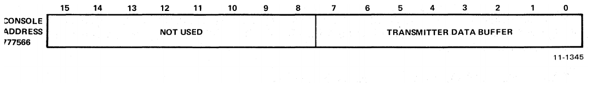

### 4.3.5 Line Clock Status Register (LKS)

The line clock status register (Figure 4-8) consists of control and status monitoring bits for the line clock portion of the DL11-W.

The line clock status register contains two bits associated with line clock operation: a line clock monitor bit to provide noninterrupt mode timing information and an interrupt enable bit to allow the line clock to initiate an interrupt sequence. Both of these bits are described in subsequent paragraphs.

<!-- Source PDF page 57; printed page 4-15 -->

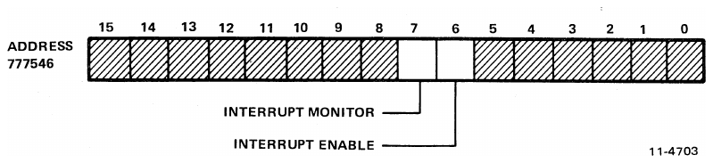

#### 4.3.5.1 Line Clock Monitor (Bit 7)

The line clock monitor read-only bit provides the software with a means of measuring a time interval in a noninterrupt mode. The line clock monitor bit is set once for each cycle of the ac power. The program must clear the bit after noting that it was set each time.

As shown in drawing DL-2, the LTC flip-flop (LKS bit 7) is set when clocked by BUS LTC L. BUS LTC L is a square wave with the same frequency as the ac power, and it is generated in the power supply.

This flip-flop is cleared only by the program. This occurs when bus data line BUS D07 L has a logic 0 and is loaded into the line clock monitor bit (BIT 07). The inverted bus data line (BBD 7 H) is again inverted (drawing DL-2) and is ANDed with LTC IN L, BMSYN DEL L, and BSSYN L to generate a pulse which direct-clears flip-flop LTC BIT 07. Note that if bus data line BUS D07 L were a logical 1, the monitor bit would not be cleared by the program. This bit can be read by a program via the 4-to-1 multiplexer and bus driver in drawing DL-4. LKS BIT 07 is cleared by B INIT L.

> Source note: This subsection calls bit 7 “read-only” but then describes clearing it by writing 0, and says INIT clears it. Figure 3-5 instead specifies **read/clear** and **set by INIT**. Both statements are printed in the source; initialization behavior must be checked against the DL-2 engineering drawing rather than inferred from this contradiction.

#### 4.3.5.2 Line Clock Interrupt Enable (Bit 6)

The line clock interrupt enable read/write bit allows the line clock portion of the DL11-W to generate timed interrupt sequences. Interrupt sequences will occur at time intervals of 16-2/3 ms (60 Hz) or 20 ms (50 Hz), depending on the frequency of the ac input voltage.

A logical 1 on bus data line BUS D06 L is inverted and applied to the data input of the LKS BIT 06 flip-flop (DL-2, D-7). The 1 is then loaded into the flip-flop, using the ANDed combination of BMSYN DEL L and LTC IN L as a load pulse.

With LKS BIT 06 set, the direct-clear signal would normally be removed from the interrupt request flip-flop. The next falling edge of BUS LTC L from the power supply would clock the interrupt request flip-flop, initiating an interrupt sequence.

LKS BIT 06 H can be read onto bus data line BUS D06 L via the 4-to-1 multiplexer and bus driver (drawing DL-6).

Line clock interrupt enable (LKS BIT 06) will be cleared by B INIT L.

## 4.4 Interrupt Request Logic

The DL11-W contains two separate interrupt request logic circuits. One initiates interrupt sequences for the line clock portion and the other initiates interrupt sequence for the serial line portion.

<!-- Source PDF page 58; printed page 4-16 -->

### 4.4.1 Line Clock

The line clock interrupt request logic consists of an interrupt request flip-flop and a bus driver (DL-2). The interrupt request flip-flop is set on the falling edge of signal BUS LTC L. When set, the 1 side output enables one leg of a 2-input bus driver gate. The other input is enabled until the processor acknowledges the interrupt request. The bus driver enables the Unibus signal BUS BR 6 L, which initiates the interrupt sequence. The interrupt request flip-flop can be cleared by obtaining control of the bus (RTC MASTER L), by writing a 0 into LKS BIT 07, or by clearing LKS BIT 06.

### 4.4.2 Serial Line Unit

The interrupt request logic for the serial line unit consists of two interrupt request flip-flops (one for the receiver and one for the transmitter), an arbitrator circuit, and a bus driver.

The receiver interrupt request flip-flop is shown on drawing DL-1 in an inverted manner. Note that pin 6 is used as the true output. The flip-flop is set by the ANDed conditions of RCVR DONE H and RCVR INTR ENB (1) H. The 1 side of this flip-flop is ANDed with RCVR INTR ENB (1) H to generate an interrupt request signal, which is applied to the arbitrator circuit. The receiver interrupt request flip-flop can be cleared by one of the following conditions: B INIT L; RCVR becoming bus master (MASTER H ANDed with REC SEL H, E68-5 on drawing DL-3); or CLR R DONE.

The transmitter interrupt request flip-flop (DL-1) is also shown as inverted. It is set by XMIT RDY H ANDed with XMIT INTR ENB (1) H or by B INIT L. When set, the 0 side output, which is low, is ANDed with XMIT INTR ENB (1) L to generate an interrupt request signal, which is applied to the arbitrator circuit. This flip-flop can be cleared if the transmitter becomes bus master (MASTER H ANDed with XMIT SEL H, E68-6 on drawing DL-3) or if the transmit buffer is loaded (LD X DEL L).

The function of the arbitrator circuit is to arbitrate simultaneous interrupt requests from both the receiver and transmitter. The arbitrator circuit has two inputs and two outputs. The two inputs are the gated outputs of the receiver interrupt request flip-flop and the transmitter interrupt request flip-flop. The outputs of the arbitrator circuit are the two signals RCVR INTR RQST H and XMIT INTR RQST H. Only one output is true at one time; generally the flip-flop which sets first generates the interrupt request. In the normal state of this flip-flop, both the set and clear inputs are held low. This forces the Q and Q̅ outputs both high. Then, when either the clear or the set input goes high, the other input is enabled. For example, if the set input signal goes high first (requesting a receiver interrupt), then the flip-flop will reset, enabling the receiver interrupt request low signal and thus RCVR INT REQ H.

## 4.5 Interrupt Control Logic

The interrupt control logic permits the DL11-W to gain control of the bus (become bus master) and perform an interrupt operation. The DL11-W contains two separate interrupt controls, one for the line clock and one for the serial line unit. The vector for the line clock is fixed at `100` but the serial line unit vector may be altered via switches so that the logic has a normal address within the range of `000` to `776`. However, the specific vector used with a particular DL11-W depends on its use within a system.

The standard vector addresses for the DL11-W, when used as a console interface, are `060` and `064`. Other DL11-Ws in the system are assigned “floating” vectors according to the addressing scheme given in Appendix B.

> **NOTE** — The final octal digit of the vector address is not affected by the switches; therefore, regardless of the vector address selected by the switches, the final octal digit is always 0 for the receiver and 4 for the transmitter.

<!-- Source PDF page 59; printed page 4-17 -->

Since both the line clock and serial line unit interrupt controls are basically the same, only the serial line unit interrupt control logic will be discussed in subsequent paragraphs. Figure 4-9 is a simplified diagram of the interrupt control logic.

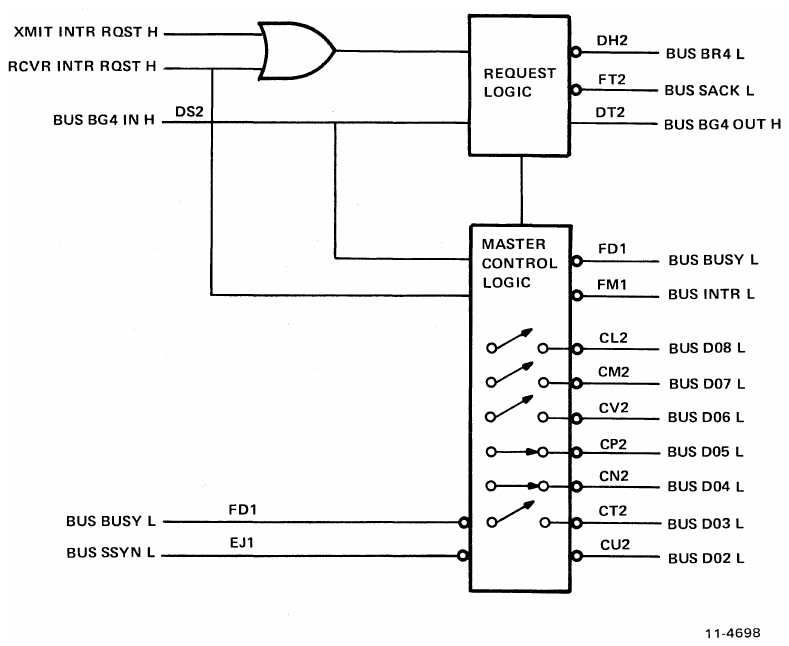

The serial line unit interrupt control logic is shown on drawing DL-3. If either a receiver interrupt request or transmitter interrupt request, or both, is generated, the arbitrator circuit in the interrupt request logic (Paragraph 4.4) will generate one of the two signals: RCVR INTR RQST H or XMIT INTR RQST H. These two signals are ORed and applied to one leg of the bus request driver on BUS BR4 L. The other leg is enabled if the interrupt control logic is not currently master (BUSY) or already the next master (SACK).

The processor will arbitrate the request and send a bus grant if no device of higher priority is making a request. Normally, the processor will continue the interrupt sequence by the issuance of BUS BG4 IN H. Because bus grants are “daisy-chained” from device to device, the DL11-W must decide either to accept the bus grant signal or to pass it on to the next device.

<!-- Source PDF page 60; printed page 4-18 -->

This decision is made by another arbitrator circuit shown in the simplified diagram in Figure 4-10. Basically, if the serial line unit generates an interrupt request before the reception of the bus grant, the DL11-W will accept the grant and, if the request is raised after the grant, pass it on. The arbitrator will decide one way or the other when both events occur simultaneously. If the grant is passed on, then the bus driver on BUS BG4 OUT H will be enabled. If the arbitrator circuit accepts the bus grant, then the grant accept signal is ANDed with bus grant to generate a set signal for the SACK R-S flip-flop. The SACK flip-flop enables the BUS SACK driver and, ORed with the BUSY flip-flop, disables the BUS BR4 driver. The processor will respond to the signal BUS SACK L by unasserting BUS BG4 IN H.

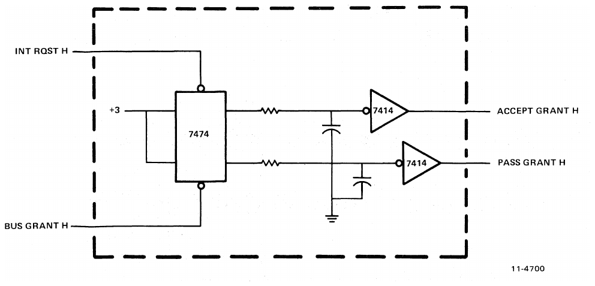

With the assertion of BUS SACK L, the DL11-W is prepared to become bus master when the bus becomes free. The data input of the BUSY flip-flop is primed with the 1 side of the SACK flip-flop. A clock edge is generated when the bus becomes free by the ANDed condition of BUS BUSY, BUS SSYN, and BUS BG4 IN. When the BUSY flip-flop is set, the 1 side output is applied to the BUS BUSY driver to indicate that the bus is in use. The 0 side of the flip-flop, which is now low, is used as MASTER L, indicating that the interrupt control logic is now master of the bus.

MASTER L is inverted and used to place the vector address on the Unibus and to assert BUS INTR L. The processor responds to BUS INTR L by asserting BUS SSYN L, which, after being inverted by the bus receiver, clears the BUSY flip-flop.

B INIT H also clears both the SACK flip-flop and the BUSY flip-flop.

Note that any vector address switch is ON for a 1 and OFF for a 0.

<!-- Source PDF page 61; printed page 4-19 -->

## 4.6 Transmitter Control Logic

The transmitter control logic provides the necessary input, control, and output logic for the UART when it is used to convert parallel data from the Unibus to the serial data required for output. This logic may be divided into three functional areas: control and input, format selection, and data output.

Control and input signals to the UART are described in Table 4-5.

**Table 4-5 — Transmitter Control and Input Logic**

| Signal mnemonic | Signal name             | Description                                                                                                    |
| --------------- | ----------------------- | -------------------------------------------------------------------------------------------------------------- |
| XRDY            | Transmitter Ready       | The XMIT RDY flag indicates that the buffer is empty and may be loaded with another character from the Unibus. |
| LD XD           | Load Transmitter Data   | The signal that strobes data from the bus into the UART when the XBUF is addressed for loading.                |
| XCLK            | Transmitter Clock Pulse | Provides the required transmitter clock rate. This rate is 16 times the selected baud rate.                    |
| XD0–XD7         | Data Buffer             | Represents the character (five to eight bits) loaded from the Unibus into the UART.                            |

The format selection logic basically consists of switches that are arranged to select the number of DATA bits, STOP bits, and type of parity. Format selection is covered in Table 2-4 [source reference; see Table 2-5].

The output logic of the transmitter is described in the following paragraphs.

Once the UART has converted the parallel character from the Unibus (UART operation is described in Paragraph 4.8), it shifts the character out, one bit at a time, onto the serial output (SERIAL OUT) line. The first bit shifted out is the START bit, followed by the DATA bits (LSB first), then the PARITY bit (if selected), and finally the STOP bits. The output of the line passes through a NAND gate to produce SERIAL OUT L. This gate is used to generate a space when the BREAK bit is used.

SERIAL OUT L is connected to a circuit that converts the signal to the bipolar levels required by the 20 mA current loop (drawing DL-2). The resultant positive serial data is applied to pin AA of the Berg connector and the negative serial data is applied to pin KK.

SERIAL OUT L passes through an inverter and is applied to an EIA level converter which drives pin F of the Berg connector.

<!-- Source PDF page 62; printed page 4-20 -->

The selection of the 20 mA current loop or the EIA level converter depends on the type of cable used at the Berg connector. A kit containing the quad board and a cable (7008360) for the 20 mA current loop is called a DL11-WA. The DL11-WB kit contains the cable (BC05C) for the EIA level converter.

The inverter output SERIAL OUT H is also applied to the MAINT multiplexer circuit for use during maintenance mode as described in Paragraph 4.10.

## 4.7 Receiver Control Logic

The receiver control logic provides the necessary input, output, and control logic for the UART when it is used to convert serial data to the parallel data required by the Unibus. This logic may be divided into three functional areas: status and control, format selection, and data input.

The status and control portion of the logic consists of both input control and output status signals, a clock frequency, and an output data character. These signals are listed in Table 4-6.

**Table 4-6 — Receiver Status and Control Logic**

| Signal mnemonic | Signal name          | Description                                                                                                                                  |
| --------------- | -------------------- | -------------------------------------------------------------------------------------------------------------------------------------------- |
| R DONE          | Reader Done          | The R DONE flag indicates that a full character has been received from the device and is ready for transfer to the Unibus.                   |
| P ERR           | Parity Error         | A status signal indicating that the received character has a parity error. Can be read by the program.                                       |
| FR ERR          | Framing Error        | A status signal indicating that the received character has no valid stop code. Can be read by the program.                                   |
| OR ERR          | Overrun Error        | A status signal indicating that the character was not read prior to receiving another character from the device. Can be read by the program. |
| RCLK            | Receiver Clock Pulse | Provides the required receiver clock rate. This rate is 16 times the selected baud rate.                                                     |
| RD7–RD0         | Receiver Data Buffer | Represent the character (five to eight data bits) transferred from the UART to the Unibus after serial-to-parallel conversion.               |

<!-- Source PDF page 63; printed page 4-21 -->

The format selection is basically the same as that used for the transmitter control, and is described in Table 2-4 [source reference; see Table 2-5].

The input logic of the receiver is described in the following paragraphs.

Regardless of the device used, the serial input from the device is loaded into the DL11-W one bit at a time, beginning with the START bit, then the DATA bits (LSB first), the PARITY bit (if used), and the STOP bits.

The bipolar levels of the serial data are applied to pins K (+) and S (−) of the Berg connector. The bipolar level is converted to a TTL level (DL-5) and fed to pin H. EIA level serial data is received on pin J of the connector and converted to a TTL level which is presented at pin H. Either pin M or pin H is connected to pin E (depending upon the type of interface to the external device) and becomes the signal TTL SERIAL DATA IN. The serial data is connected to a 2-to-1 multiplexer which, when the interface is not in the maintenance mode, passes the TTL SERIAL DATA IN signal through to the output, which is then applied to the input (SERIAL IN) of the UART (as shown in DL-1). The output of the multiplexer is also inverted and fed to a counter used to detect the center of a START bit.

> Source note: The EIA converter output is printed as pin H here and again in §4.12, but the EIA cable interlock connects **M to E** (Table 2-11), whereas the current-loop cable connects **H to E** (Table 2-9). Check the engineering drawings to resolve this source inconsistency.

## 4.8 Universal Asynchronous Receiver/Transmitter (UART)

The universal asynchronous receiver/transmitter (UART) is an LSI subsystem that accepts binary characters from either a terminal device or a computer, and receives or transmits this character with appended control and error detecting bits. In order to make this subsystem universal, the baud rate, bits per word, parity mode, and number of stop bits are selected by external logic circuits.

The UART is a full duplex receiver/transmitter. The receiver section accepts asynchronous serial binary characters and converts them to a parallel format for transmission to the Unibus. The transmitter section accepts parallel binary characters from the bus and converts them to a serial asynchronous output with START and STOP bits added.

All UART characters contain a START bit, five to eight DATA bits, one, one and one-half, or two STOP bits, and a PARITY bit which may be odd, even, or turned off. The STOP bits are opposite in polarity to the START bit.

Both the receiver and transmitter are double-buffered. The UART internally synchronizes the START bit with the clock input to ensure a full 16-element (clock periods) START bit independent of the time of data loading. Transmitter distortion (assuming perfect clock input) is less than 3 percent on any bit up to 10 kilobaud. The receiver strobes the input within ±8 percent of the theoretical center of the bit. The receiver also rejects any START bit that lasts less than one-half of a bit time.

The UART input and output lines are shown on drawing DL-1. A description of the receiver is given in Paragraph 4.8.1 and a description of the transmitter is given in Paragraph 4.8.2. Note that in the following discussions the mnemonics and pin numbers of UART input and output lines are given in parentheses.

### 4.8.1 Receiver Operation (UART)

A block diagram of the UART receiver is shown in Figure 4-11. When the receiver is in the idle state, it samples the serial input line (SERIAL IN, pin 20) at the selected clock edges (R CLK, pin 17) after the first mark-to-space transition of the serial input line. If the first sample is a mark (high), the receiver returns to the idle state and is ready to detect another mark-to-space transition. If, however, the first sample is a space (low), then the receiver enters the data entry state.

<!-- Source PDF page 64; printed page 4-22 -->

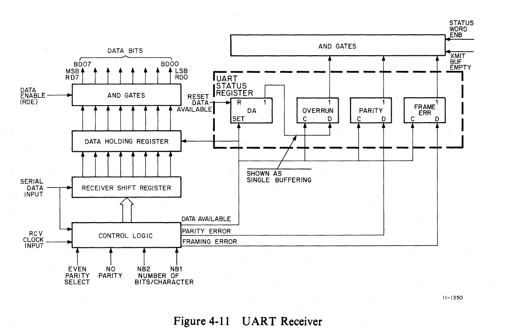

If the receiver control logic has not been conditioned to the no parity state (a low on pin 35), then the receiver checks the parity of the DATA bits plus the PARITY bit following the DATA bits and compares it with the parity sense on the parity select line (pin 30). If the parity sense of the received character differs from the parity of the UART control logic, then the receiver parity error line (P ERR, pin 13) goes high and causes the P ERR bit in the RBUF register to set.

If the receiver control logic has been conditioned to the no parity state (a high on pin 35), then the receiver takes no action with respect to parity and maintains the parity error line (P ERR, pin 13) in the false (low) state. When the control logic senses a parity error, it generates a P ERR signal. The DATA AVAILABLE signal updates the parity error indicator.

The receiver samples the first STOP bit, which occurs either after the PARITY bit or after the DATA bits (if no parity is selected). If a valid (high) STOP bit exists, no further action is taken. If, however, the STOP bit is false (low), indicating an invalid STOP code, then the UART control logic provides a framing error indication (a high on FR ERR, pin 13). The status of the framing error bit can also be read from the RBUF if enabled.

> Source note: This page prints parity select as **pin 30**, while Table 2-5 and Figure 4-12 identify it as **39**. It also assigns **pin 13** to both P ERR and FR ERR. Those are source pin-reference errors, not OCR substitutions; consult the UART data sheet and DL-1 drawing before using these pin numbers.

Because the serial input from the external device is shifted into the UART a bit at a time (SERIAL IN, pin 20), occurrence of a STOP code indicates that the entire data character has been received and shifted into the receiver shift register. After the STOP bit has been sampled, the receiver control logic parallel transfers the contents of the shift register into the receiver data holding register, and then sets the data available (R DONE) flag.

<!-- Source PDF page 65; printed page 4-23 -->

The data available signal also functions as the clock input to the FRAME ERR, PARITY, and OVERRUN flip-flops in the UART status register. At this point, the data available (DA) flip-flop is set, the OVERRUN flip-flop is cleared but has a high on the data input because of the output from the DA flip-flop, and the PARITY and FRAME ERR flip-flops are set or cleared depending on the signal (true or false) strobed in from the control logic.

An overrun condition indicates that another data character is being sent to the UART before the previous character has been transferred to the DL11-W receiver buffer register. If the DA flip-flop is set, indicating that a character is stored in the holding register, and the UART control logic attempts to set the DA flip-flop again (indicating that a new character has been shifted into the shift register), the DA signal from the control logic provides a clock input to the OVERRUN flip-flop. This flip-flop then sets because the data input is high (DA flip-flop was already set by the previous DA signal).

During normal operation (no overrun condition), the character in the receiver data holding register is strobed onto the Unibus by a reading of RBUF which produces SEL 2 L. This signal is applied to the UART reset data available line (pin 18) to clear the flip-flop.

Whenever the serial input line goes from a mark (high) to a space (low) and remains at the low level, the receiver shifts in one character, which is all spaces, then sets the FR ERR indicator and waits until the input line goes high (marking) before shifting in another character.

### 4.8.2 Transmitter Operation (UART)

A block diagram of the UART transmitter is shown in Figure 4-12. When the UART transmitter is in the idle state, the serial output line (pin 15) is a mark (high). When it is desired to transmit data, a parallel character is placed on bus data lines BUS D00 through D07 and strobed into the UART transmitter data buffer (lines connected to pins 26–33) by means of the data strobe signal (pin 12). The time between the low-to-high transition of data strobe and the corresponding mark-to-space transition of the serial output line is within one clock cycle (1/16 of a bit time) if the transmitter has been idle. The data strobe signal is LD XD DEL L, which is used to load a character from the Unibus into the transmitter buffer register (XBUF).

> Source note: The original paragraph prints **pin 15** for serial output and **pin 12** for data strobe. Figure 4-12 instead shows serial output at **25** and data strobe at **23**; the final paragraph of this subsection also says **23**. The conflicting prose is retained for source traceability.

When the data has been loaded into the UART data buffer, it is next transferred to the transmitter shift register under control of signals from an encoder which selects the format determined by the control logic. This permits selection of parity or no parity (pin 35), the type of parity (pin 39), the number of STOP bits (pin 36), and the number of DATA bits per character (pins 37 and 38).

The transmitter logic converts the parallel character from the Unibus into a serial output that is in a format selected by the control logic.

The clock input to the timing generator (pin 40) is derived from the DL11-W baud rate circuits (Paragraph 4.9). The other input to the timing generator is the end-of-character (pin 24) signal from the output logic. This line goes high each time a full character (including STOP bits) is transmitted. If this line goes low, it prevents the timing generator from loading another character into the shift register. The line is normally high when data is not being transmitted and goes low at the start of transmission of the next character.

Whenever the transmitter data buffer is loaded while the previous character is being shifted through to the output line, the START bit of the new character immediately follows the last STOP bit of the previous character.

When the data strobe (pin 23) signal loads the UART data buffer, the DL11-W transmitter buffer (XBUF) is unloaded. Therefore, the data strobe signal sets the transmitter buffer empty (TRMT) flip-flop to provide a signal that becomes XRDY (transmitter ready). This XRDY signal can be read by the program and indicates that a new character can be loaded into the DL11-W transmitter buffer.

<!-- Source PDF page 66; printed page 4-24 -->

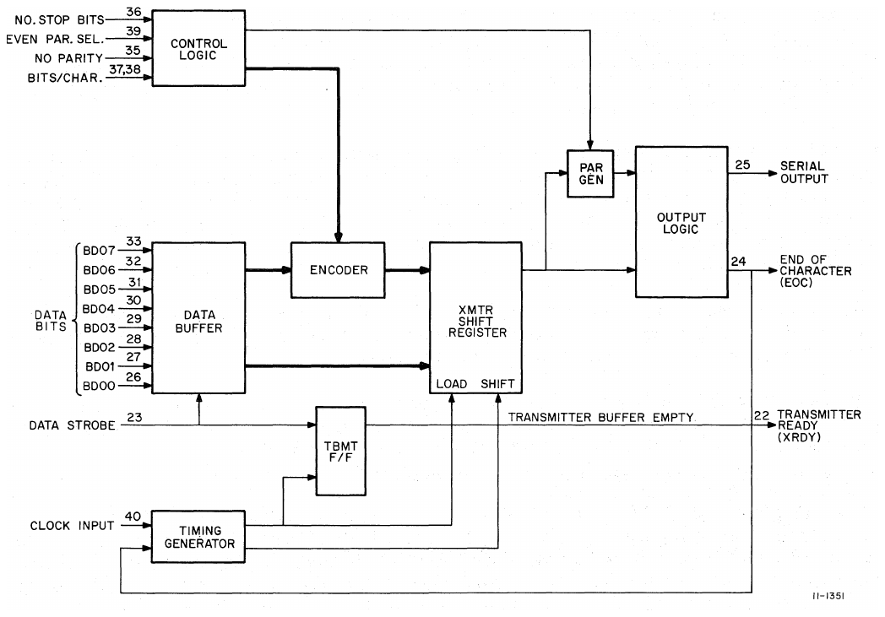

## 4.9 Baud Rate Logic

The baud rate logic provides the clock frequencies and, therefore, the baud rates for both the receiver and transmitter sections of the DL11-W interface. The switch-selected baud rates on the DL11-W are all generated by a single crystal-controlled oscillator applied to two frequency divider circuits. Since all eight baud rates are simultaneously generated, any one of the eight baud rates may be selected for the receiver and transmitter sections. (Note that the frequencies required by the UART are 16 times the desired baud rates.)

The master oscillator operates at a frequency of 5.0688 MHz (DL-6). The output of this oscillator supplies two divider circuits. One divider circuit divides the oscillator output into seven frequencies which are multiples of 2400 Hz. The frequency of 2400 Hz is divided by 16 in the UART to provide a baud rate of 150. Thus, the seven baud rates put out by the first divider circuit are 150, 300, 600, 1200, 2400, 4800, and 9600. The other divider circuit produces a frequency of 1760 Hz, providing a baud rate of 110 at the UART.

The eight different baud rates are applied to two 8-to-1 multiplexers, one for the receiver clock and one for the transmitter clock.

Each of the multiplexers is controlled by three switches so that the RCVR CLK signal and XMIT CLK signal can be independently controlled. The switch settings for the various baud rate selections are shown in Table 2-1 [source reference; see Table 2-2].

<!-- Source PDF page 67; printed page 4-25 -->

## 4.10 Maintenance Mode Logic

The maintenance mode is used to check operation of the DL11-W control logic. Figure 4-13 is a simplified diagram of both the normal and maintenance modes. During normal operation, data from the bus is converted by the transmitter and sent to the external device, or data from the external device is converted by the receiver and sent to the bus.

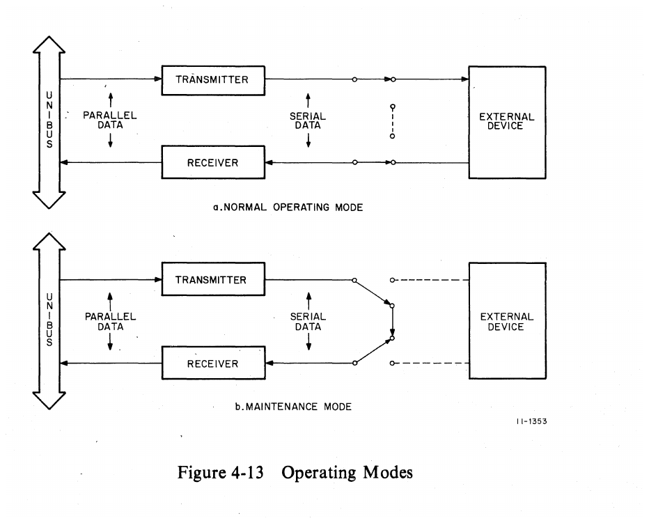

During the maintenance mode, a character is loaded into the transmitter buffer (XBUF) from the Unibus. This parallel character is then converted to a serial output by the UART transmitter section. However, the serial data is fed back into the receiver, which converts it back to parallel data and places it on the bus. If the character received by the bus is identical to the character sent out on the bus, then both the transmitter and the receiver are functioning properly. In the maintenance mode, no data is sent to the external device.

Before the maintenance loop can be used, the transmitter must be selected for use and the transmitter buffer (XBUF) loaded with a character. The program selects the maintenance mode by setting bit 2 (MAINT bit) in the transmitter status register (XCSR). This sets the MAINT flip-flop in the transmitter logic (drawing DL-1, B-5).

<!-- Source PDF page 68; printed page 4-26 -->

The MAINT (1) H output of the flip-flop is used as an enabling level for a 4-to-1 multiplexer (a 74157 on drawing DL-1). A simplified version of this multiplexer is shown in Figure 4-14. Normally, the gates shown enabled by the MAINT (1) H signal in the figure are inhibited, and the serial output from the transmitter, as well as the clock signals, are fed to the logic used during the normal operating mode. However, when MAINT (1) H is present, the gates are qualified and perform two basic functions.

> Source note: “4-to-1” is printed in the source. A 74157 is a quad 2-to-1 multiplexer; Figure 4-14 shows the two-input selection paths for data and clock.

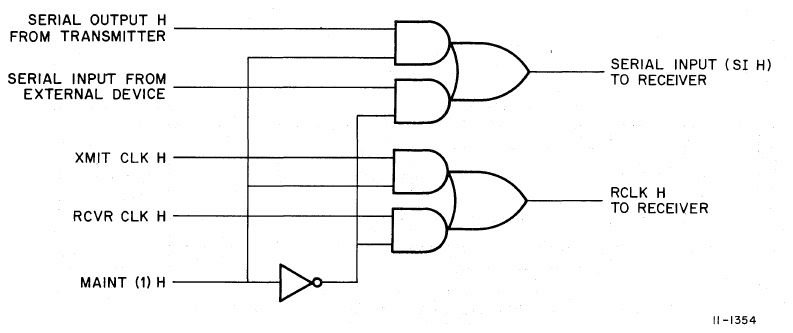

The first function is to gate the serial output of the transmitter (SERIAL OUT H) to the serial input line (SERIAL IN) of the receiver. The second function is to force the RCVR CLK pulse to be the same as the XMIT CLK, regardless of the switch position of the RCVR CLK. When MAINT (1) H is present, the gate receiving RCVR CLK H is inhibited and the XMIT CLK H pulse is gated through to the RCLK H line of the receiver. Although not shown in the figure, XMIT CLK H is also applied to the clock line of the transmitter.

Because the receiver logic is activated by a START bit (regardless of where the START bit comes from), the receiver is activated as soon as it receives the first input from the transmitter. After the receiver assembles the data, the program can compare the received character with the transmitted character to determine if the DL11-W interface is functioning properly.

## 4.11 20 mA Current Loop Logic

The 20 mA current loop circuits are provided for the serial data transmitter and receiver and for the paper tape reader control. Two modes of operation are available for the 20 mA current loop circuits: active and passive. In active mode, the DL11-W is the source of the 20 mA of current which is switched on or off, depending on the level of the SERIAL OUT line. In passive mode, the current loop circuit switches on or off current which is sourced by the external device. Figures 4-15 and 4-16 show simplified diagrams of the receiver and transmitter circuits in active and passive modes.

See Table 2-3 [source reference; see Table 2-4] and Paragraph 2.1.4 for active and passive mode switch selection in connection with the transmitter, receiver, and paper tape reader enable circuits.

<!-- Source PDF page 69; printed page 4-27 -->

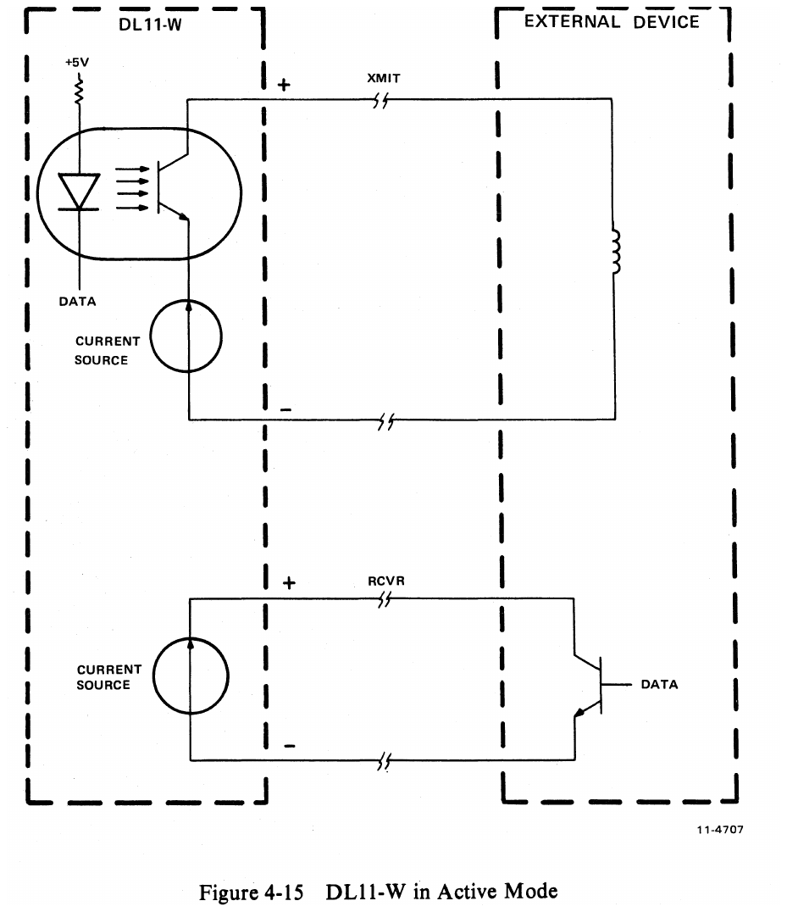

<!-- Source PDF page 70; printed page 4-28 -->

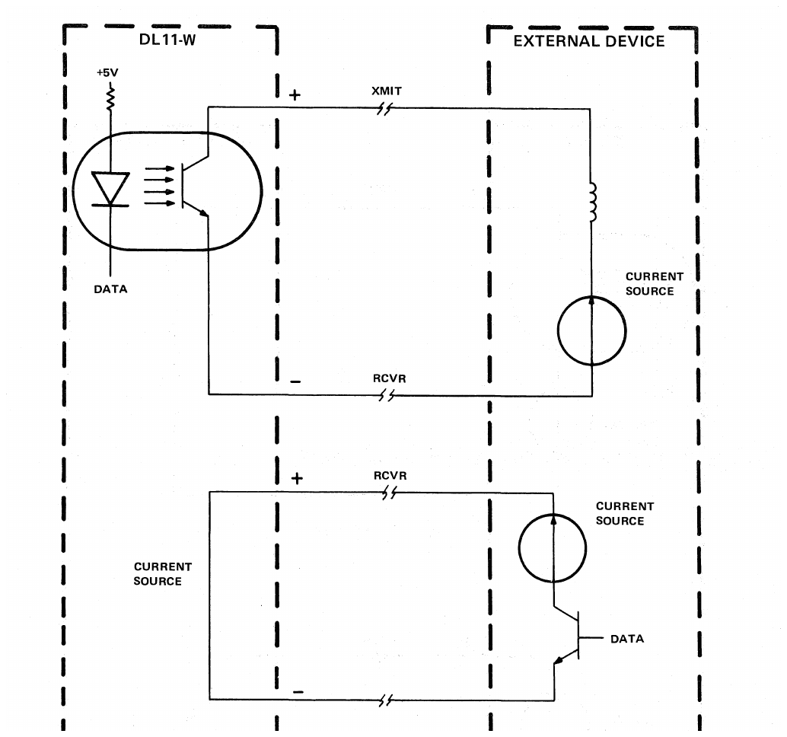

## 4.12 EIA Level Converter Logic

Bipolar EIA level converters are provided for serial data out and serial data in interfacing. Serial output data, SERIAL OUT H, is applied to an EIA level converter and the output, which is a bipolar signal (approximately ±10 V), is available at pin F on the Berg connector. Bipolar EIA level input serial data is received at pin J on the Berg connector and converted to a TTL level signal, which is then available at pin H on the Berg connector. If EIA level interfacing is being used, pin M must be connected to pin E of the Berg connector. This is normally done by the connector on the cable used to interface the DL11-W and the external device.

The signals DATA TERMINAL RDY and RQT TO SEND are permanently strapped on (high) and are available at pins DD and V of the Berg connector, respectively.

> Source note: See §4.7 for the unresolved H/M converter-output discrepancy. “RQT TO SEND” is the spelling printed here; Chapter 1 uses “REQ TO SEND.”
