# FP11-A Floating-Point Processor Technical Manual

Source: `EK-FP11A-TM-002`, first edition, May 1978.

## Chapter 1 — Introduction

### 1.1 GENERAL

The FP11-A Floating-Point Processor is a hardware option that enables the PDP-11/34A central processor to execute floating-point arithmetic operations. The FP11-A performs all floating-point arithmetic operations and converts data between integer and floating-point formats. Floating-point representation permits a greater range of number values than is possible with the conventional integer mode. Thus, the FP11-A option provides a speedier alternative to the use of software floating-point routines, and system speed is increased without complex arithmetic coding routines that consume valuable CPU time. The FP11-A features both single- and double-precision (32- or 64-bit) capability _and floating-point modes.

The FP11-A is an integral part of the central processor. It operates using similar address modes, and the same memory management facilities as the central processor. Floating-point processor instructions can reference the floating-point accumulators, the central processor’s general registers, or any location in memory.

### 1.2 FEATURES

The following paragraphs summarize the features of the PDP-11/34A floating-point instruction set and the FP11-A.

#### 1.2.1 Floating-Point Instruction Set Features

- 32-bit (single-precision) and 64-bit (double-precision) data modes.
- Addressing modes compatible with existing PDP-11 addressing modes.
- Special instructions that can improve input/output routines and mathematical
  subroutines.
- In-line execution: floating-point and other instructions may appear in any
  desired sequence.
- Multiple accumulators for ease of data handling.
- Conversion of 32- or 64-bit floating-point numbers to 16- or 32-bit integers
  during Store-class instructions.
- Conversion between 32- and 64-bit floating-point numbers during Load- or
  Store-class instructions.

#### 1.2.2 FP11-A Features

- Performs medium-speed, floating-point operations on single- and double-precision data

- Has 17 (decimal) digit accuracy

- Contains its own microprogrammed control store

- Contains six 64-bit floating-point accumulators

- Contains error recovery aids

### 1.3 ARCHITECTURE

The FP11-A contains scratchpad registers, a floating exception address pointer (FEA), status and error registers, and six general-purpose accumulators (AC0-AC5).

Each accumulator is interpreted to be 32 or 64 bits long depending on the instruction and the status of the floating-point processor. For 32-bit instructions, only the left-most bits are used. The remaining bits are unaffected.

The six general-purpose accumulators are used in numeric calculations and interaccumulator data transfers. The first four registers (AC0-AC3) are also used for all data transfers between the FP11-A and the central processor’s general registers or memory.

### 1.4 PHYSICAL DESCRIPTION

The FP11-A consists of a single hex board [M8267 for the PDP-11/34A (KD11-EA)] and modifications to the M7265 and M7266 boards used in the PDP-11/34 central processor. (The modified boards are designated M8265 and M8266, and the modified processor is designated as the KD11-EA). Figure 1-1 shows the basic signal paths between the central processor and the FP11-A. The bidirectional data bus transfers instructions and data between the processors. An expanded control store in the KD11-EA accommodates floating-point requirements.

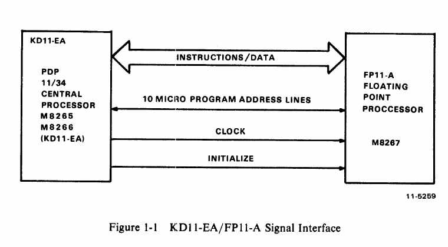

### 1.5 RELATED DOCUMENTATION

```text
The following documents supplement this user’s guide on the FP11-A Floating-Point Processor.
      Manual                                             Document Number
```

```text
      BA11-K Mounting Box Manual                    ~    EK-BAIIK-MM
      BA11-L Mounting Box Manual                         EK-BAI1L-MM
      DL11-W Maintenance Manual                          EK-DL11W-MM
      KD11-E Processor Manual (PDP-11/34)                EK-KD11E-TM
      M9301 Bootstrap Terminator Maintenance Manual      EK-M9301-MM
      MMI11-C/CP Core Memory Manual                      EK-MM11B-TM
      MMI11-D/DP Core Memory Manual                      EK-MM11D-TM
      MS11-E-J MOS Memory Maintenance Manual             EK-MS11E-MM
      PDP-11 Peripherals Handbook                        EP-PDP11-HB
      PDP-11/04, 34, 45, 55 Processors Handbook          EP-PDP1!1/04-HB
      PDP-11/34 Processor Handbook                       EP-11034-HB
      KD11-EA Processor Manual (PDP-11/34A)              EK-KD1EA-MM
```

## Chapter 2 — Review Of Floating-Point Numbers

### 2.1 INTRODUCTION

This chapter briefly reviews the fundamentals of floating-point arithmetic. Readers already familiar with floating-point numbers and arithmetic may continue to Chapter 3, which describes FP11-A data formats.

### 2.2 INTEGERS

All data in a computer system can be represented as integers. An unsigned 16-bit word ranges from `000000₈` to `177777₈`, or from 0 to 65,535 in decimal. Integer representation cannot directly express a value between 1 and 2, or a value greater than 65,535, so it imposes both accuracy and range limitations.

These limitations result from the fixed position of the radix point—the decimal point in base 10 or the binary point in base 2. An integer’s radix point is normally omitted because it always follows the least significant digit. There are no digits to its right; for this reason, an integer is also called a fixed-point number.

Floating-point notation overcomes these limitations by allowing the radix point to move.

### 2.3 FLOATING-POINT NUMBERS

Floating-point numbers do not have a fixed radix-point position. A common representation is scientific notation, in which a basic value is multiplied by the radix raised to an exponent.

Example:

```text
1,000,000₁₀ = 1 × 10⁶
```

A number can have many equivalent scientific-notation forms:

```text
512 = 51200 × 10⁻²
    =  5120 × 10⁻¹
    =   512 × 10⁰
    =  51.2 × 10¹
    =  5.12 × 10²
    = 0.512 × 10³
```

The FP11-A convention places the radix point immediately to the left of the
most significant digit; the resulting basic value, such as `0.512`, is called
the fraction.

| Value | Decimal scientific notation | Octal scientific notation | Binary scientific notation |
| ----: | --------------------------- | ------------------------- | -------------------------- |
|    64 | `0.64 × 10²`                | `0.1 × 8³`                | `0.1 × 2⁷`                 |
|    33 | `0.33 × 10²`                | `0.41 × 8²`               | `0.100001 × 2⁶`            |
|   1/2 | `0.5 × 10⁰`                 | `0.4 × 8⁰`                | `0.1 × 2⁰`                 |
|  1/16 | `0.625 × 10⁻¹`              | `0.4 × 8⁻¹`               | `0.1 × 2⁻³`                |

Note that in each of the examples above, only significant digits are retained in the final result and the radix point is always (by convention) to the left of the most significant digit. Establishing the radix point in a number whose basic value is greater than or equal to 1 is accomplished by shifting the number to the right until the most significant digit is to the right of the radix point. Each right shift causes the exponent to be incremented by 1. Similarly, establishing the radix point in a number whose basic value is between 1 and 0 (i.e., a fraction) is accomplished by shifting the number to the left until all leading zeros are eliminated. Each left shift causes the exponent to be decremented by 1.

To summarize, the value of the number remains constant if its exponent is incremented for each right shift of the basic value and decremented for each left shift. The representation for floating-point fractions in the FP11-A is one in which all nonsignificant leading zeros have been removed. The process used to obtain this representation is called normalization, which is explained in more detail in Paragraph 2.4.

### 2.4 NORMALIZATION

In digital computers, the number of bits in a fraction is limited. Retention of nonsignificant leading zeros decreases accuracy by taking places that could be filled by significant digits. For this reason, a process called normalization is used in the FP11-A. The normalization process consists of testing the fraction for leading zeros and left-shifting it until it is in the form 0.1 .... The exponent is accordingly decremented by the number of left shifts of the fraction. This ensures that the normalized number retains equivalence with the original number. Since digits to the right of the binary point are weighted with inverse powers of 2 (i.e., 1/2, 1/4, 1/8 . . .), the smallest normalized fraction is 1/2 (0.10000 . . .). The largest normalized fraction is 0.11111... . Figure 2-1 shows an unnormalized fraction that must be left-shifted six places to be normalized. The exponent is decremented by six to maintain equivalence with the original number.

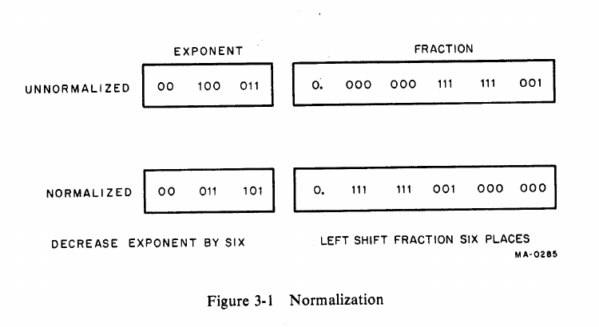

**Problem A — Represent 75₁₀ as a normalized binary floating-point number.**

```text
75₁₀ = 1001011₂
1001011.0 × 2⁰ = 0.1001011 × 2⁷
Fraction = 0.1001011
Exponent = 111₂
```

**Problem B — Represent 0.25₁₀ as a normalized binary floating-point number.**

```text
0.25₁₀ = 0.01₂
0.01 × 2⁰ = 0.1 × 2⁻¹
Fraction = 0.1
Exponent = −1
```

### 2.5 FLOATING-POINT ADDITION AND SUBTRACTION

To add or subtract floating-point numbers, their exponents must first be made
equal. The fraction with the smaller exponent is shifted right, incrementing
its exponent once for each shift. The fractions can then be added or
subtracted. The common exponent determines where the binary point lies in the
integer representation.

The following example adds 7₁₀ to 40₁₀:

```text
0.101000000000000 × 2⁶ = 50₈ = 40₁₀
0.111000000000000 × 2³ =  7₈ =  7₁₀
```

Shift the second fraction right three places to align its exponent, then add:

```text
  0.101000000000000 × 2⁶
+ 0.000111000000000 × 2⁶
  -----------------
  0.101111000000000 × 2⁶ = 57₈ = 47₁₀
```

Moving the binary point six places right gives `101111₂`, or 47₁₀.

### 2.6 FLOATING-POINT MULTIPLICATION AND DIVISION

For floating-point multiplication, the fractions are multiplied and the
exponents are added. For division, the fractions are divided and the exponents
are subtracted. Exponent alignment is not required.

**Multiplication example: 7₁₀ × 40₁₀**

```text
0.1110000 × 2³ =  7₈ =   7₁₀
0.1010000 × 2⁶ = 50₈ =  40₁₀

0.1110000 × 0.1010000 = 0.1000110000000
2³ × 2⁶ = 2⁹

Result: 0.1000110000000 × 2⁹ = 430₈ = 280₁₀
```

**Division example: 15₁₀ ÷ 5₁₀**

```text
0.1111000 × 2⁴
---------------- = 1.100000 × 2¹
0.1010000 × 2³

Normalized result: 0.1100000 × 2² = 3₈ = 3₁₀
```

## Chapter 3 — Data Formats

### 3.1 INTRODUCTION

The FP11-A requires its input data (operands) to be formatted. Formatting allows the FP11-A to process operands in a meaningful way and produce correct results. There are four different formats for operands input to the FP11-A: short-integer format (I), long-integer format (L), single-precision format (F), and double-precision format (D).

Output data from the FP11-A is also formatted. This output data is in the form of:

```text
        1.     FP11-A status information and FP11-A exception information required by the CPU
        2.     Data sent to memory (via the CPU), which must be in I, L, F, or D format.
```

This chapter describes the FP11-A data formats. It is assumed that the reader is familiar with 2’s complement notation.

### 3.2 FP11-A INTEGER FORMATS

There are two integer formats, short (I) and long (L). The short-integer format is 16 bits long and the long-integer format is 32 bits long. Data words (operands) in integer format are represented in 2’s complement notation. In both I and L formats, the most significant bit of the data word is the sign bit.

**Figure 3-1 shows the integers 5 and -5 in both I and L formats.**

**Figure 3-2 illustrates the formats in which integers are arranged in memory. Integers sent to memory**

must be in one of these formats. Integers received by the FP11-A are arranged and manipulated according to the type of instruction being executed. Refer to Paragraphs 5.3.11 and 5.3.12 for descriptions of the ways in which incoming integers are manipulated during the load exponent and load convert integer-to-floating instructions, respectively.

### 3.3 FP11-A FLOATING-POINT FORMATS

There are two floating-point formats, single-precision (F) and double-precision (D). The single-precision format is 32 bits long and the double-precision format is 64 bits long. Figure 3-2 shows that the most significant bit is the sign of the fraction (and the floating-point number being represented). The next 8 bits contain the value of the exponent, expressed in excess 200 notation (Paragraph 3.3.1.2). The remaining bits (23 for single-precision, 55 for double-precision) contain the fraction. The fraction and its associated sign bit are expressed in sign and magnitude notation (Paragraph 3.3.1.1).

#### 3.3.1 FP11-A Floating-Point Data Word

**Figure 3-3 illustrates the formats in which floating-point numbers are arranged in memory. Floating-**

point numbers sent to memory must be in one of these formats. Floating-point numbers received by the FP11-A are arranged as illustrated in Figure 3-4.

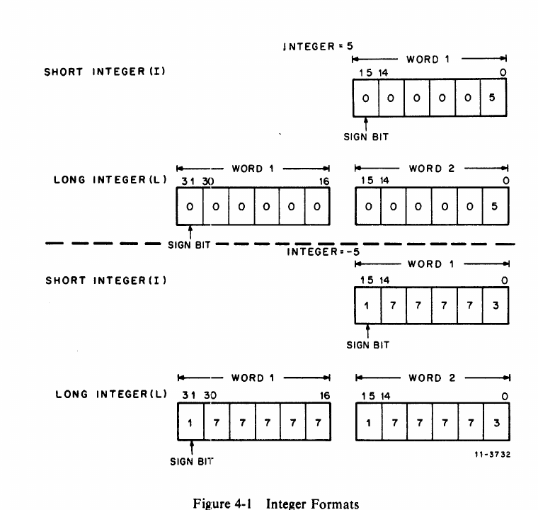

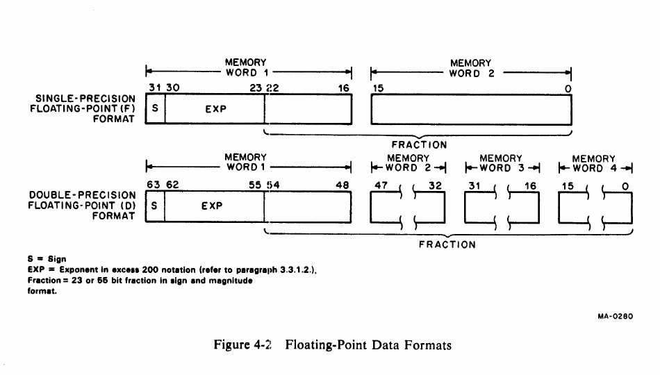

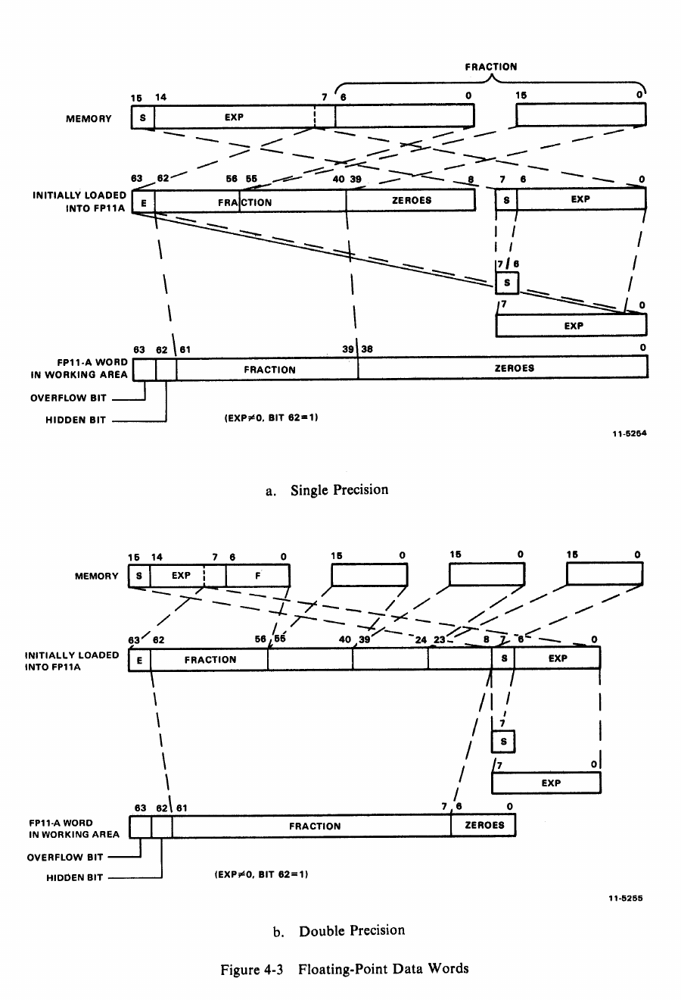

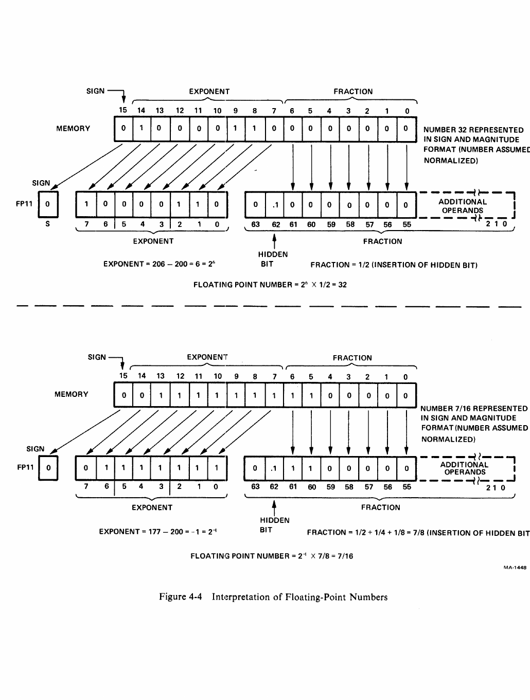

The sign bit, exponent bits, and fraction bits in the FP11-A data word have the same values as the data word in memory. Note, however, that the FP11-A data word has more bits than its counterpart in memory. This is because the FP11-A has provisions for generating an overflow bit and a “hidden” bit. For purposes of discussion, the FP11-A data word can be thought of as being divided into two major parts:

1. A fraction, with its associated sign bit, hidden bit, and overflow bit.

2. An exponent.

##### 3.3.1.1 Floating-Point Fraction

The fraction is expressed in sign-and-magnitude notation. The following simple example illustrates the representation.

| Value | 2’s complement | Sign and magnitude |
| ----: | :------------: | :----------------: |
|    +2 |    `000010`    |      `000010`      |
|    −2 |    `111110`    |      `100010`      |

Only a change of sign bit is required to change the sign of a number in sign and magnitude notation. Note that a positive number is the same in both notations.

Unnormalized floating-point fractions have a range from approximately 0 through 2 as shown in Figure 3-5. The FP11-A, however, normalizes all unnormalized fractions. That is, the fractions are adjusted such that there is a 0 to the left of the binary point (bit 63) and a 1 to the right of the binary point (bit 62). Thus, normalized fractions range in magnitude from 0.1000... to 0.1111 or from 1/2 to approximately 1.

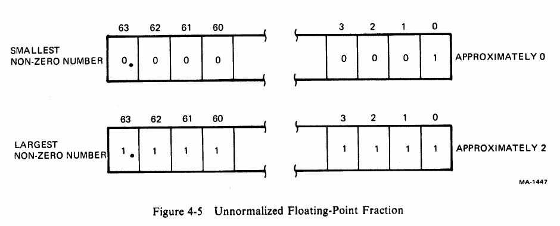

The fraction overflow bit (bit 63) is set during certain arithmetic operations. For example, during addition, certain sums will produce an overflow such as 0.1000... + 0.100... which yields 1.000.... This result must be normalized, so the FP11-A right-shifts the fraction one place and increases the exponent by one.

Bit 62 is called the hidden bit. Recall that since fractions are normalized by the FP11-A, the bit immediately to the right of the binary point (bit 62) is always a 1. This bit is dropped when a fraction is sent to memory and appended when a fraction is received from memory. This procedure allows one extra bit of significance in floating-point fraction representation.

##### 3.3.1.2 Floating-Point Exponent

The 8-bit floating-point exponent is expressed in excess-200 notation. The following table shows its relationship to 8-bit two’s-complement notation; all values in the encoded columns are octal.

| Meaning                           | Two’s complement | Excess 200 |
| --------------------------------- | :--------------: | :--------: |
| Most positive exponent            |      `177`       |   `377`    |
| Zero (least nonnegative exponent) |      `000`       |   `200`    |
| −1 (least negative exponent)      |      `377`       |   `177`    |
| Most negative exponent            |      `200`       |   `000`    |

An excess-200 exponent is obtained by adding octal 200 to its two’s-complement value. The range is therefore octal 000 through 377, corresponding to −200₈ through +177₈. An exponent of −200₈ is treated as zero by the FP11-A.

For example, binary `0.1 × 2⁰` has a zero exponent, encoded as `10000000` (octal 200). Figure 3-5 illustrates the FP11-A floating-point range with a three-bit fraction.

### 3.4 FP11-A PROGRAM STATUS REGISTER

The FP11-A contains a resident program status register that contains the floating-point condition codes (carry, overflow, zero, and negative) that can be copied into the central processor. In other words, FN, FZ, FV, and FC can be copied into the CPU’s N, Z, V, and C condition codes, respectively. The program status register also contains 3 mode bits and additional bits to enable various interrupt conditions. Figure 3-6 shows the layout of the program status register. Each bit shown in the figure is described in Table 3-1. |

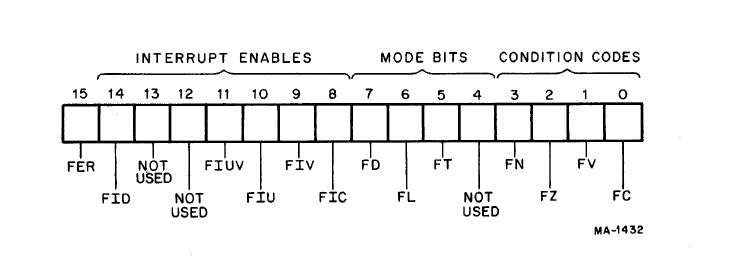

**Table 3-1 FP11-A Status Register**

Bit Name Function

15 FER This bit indicates an error condition of the FP11-A.

```text
      14     FID                  Floating Interrupt Disable - All interrupts by the FP11-A are disabled
                                  when this bit is on. Primarily for maintenance use. Normally clear.
```

13 Not Used

12 Not Used

```text
      11     FIUV                 Floating Interrupt on Undefined Variable - When this bit is set and a
                                  -0 is obtained from memory, an interrupt occurs. If the bit is not set, -0
                                  can be loaded and stored; however, any arithmetic operation treats it as
                                  if it were a positive 0.
```

```text
      10     FIU                  Floating Interrupt on Underflow - When this bit is set, an underflow
                                  condition causes a floating underflow interrupt. The result of the oper-
                                  ation causing the interrupt is correct except for the exponent, which is
                                  off by 400s. If the FIU is not set and underflow occurs, the result is set
                                  to zero.
```

**Table 3-1 FP11-A Status Register (Cont)**

Bit Name Function

```text
              FIV               Floating Interrupt on Overflow — When this bit is set, floating overflow
                                causes an interrupt. The result of the operation causing the interrupt is
                                correct except for the exponent, which is off by 400₈. If the FIV bit is
                                not set, the result of the operation is the same; the only difference is that
                                the interrupt does not occur.
```

```text
              FIC               Floating Interrupt on Integer Conversion Error - When this bit is set
                                and the store convert floating-to-integer instruction causes FC to be set
                                (indicating a conversion error), an interrupt occurs. When a conversion
                                occurs, the destination register is cleared and the source register is un-
                                touched. When FIC is reset, the result of the operation is the same;
                                however, no interrupt occurs.
```

```text
              FD                Double-Precision Mode Bit - This bit, when set, specifies double-preci-
                                sion format and, when reset, specifies single-precision format.
```

```text
              FL                Long-Precision Integer Mode Bit - This bit is employed during con-
                                version between integer and floating-point format. If set, double-preci-
                                sion 2’s complement integer format of 32 bits is specified; if reset,
                                single-precision 2’s complement integer format of 16 bits is specified.
```

```text
             FT                 Truncate Bit - This bit, when set, causes the result of any floating-point
                                operation to be truncated rather than rounded.
```

Not Used

```text
             FN, FZ, FV,        These bits are the four floating-point condition codes, which can be
             and FC             loaded in the CPU’s N, Z, V, and C condition codes, respectively. This
                                is accomplished by the copy floating condition codes (CFCC) instruc-
                                tion. To determine how each instruction affects the condition codes,
                                refer to Table 5-1.
```

### 3.5 PROCESSING OF FLOATING-POINT EXCEPTIONS

Location 244 is the interrupt vector used to handle all floating-point interrupts. A total of six possible interrupts can occur. These possible interrupt exceptions are encoded in the FP11-A exception code (FEC) register. The interrupt exception codes represent an offset into a dispatch table, which routes the program to the right error handling routine. The dispatch table is a function of the software. The FEC for each exception is briefly described in Table 3-2.

Refer to the PDP-11/04, 34, 45, 45 Processor Handbook for further details concerning FP11-A exceptions.

In addition to the FEC register, the CPU contains a 16-bit floating exception address (FEA) register, which stores the address of the last floating-point instruction that caused a floating-point exception.

**Table 3-2 FP11-A Exception Codes**

```text
FP11-A
Exception
Code          Definition
```

```text
 2            Floating Op Code Error - The FP11-A causes an interrupt
              for an erroneous op code
```

```text
 4            Floating Divide by Zero - Division by zero causes an inter-
              rupt if FID is not set
```

6 Floating (or Double) Integer Conversion Error

10 Floating Overflow

12 Floating Underflow

14 Floating Undefined Variable

```text
                                  NOTE
            The traps for exception codes 6, 10, 12, and 14, can
            be enabled in the FP11-A program status register.
            All traps are disabled if FID is set.
```

## Chapter 4 — Floating-Point Instructions

### 4.1 FLOATING-POINT ACCUMULATORS

The FP11-A contains six general-purpose accumulators (AC0-AC5). These accumulators are 64-bit read/write scratchpad memories with non-destructive readout.

Each accumulator is interpreted as being either 32 or 64 bits long, depending on the instruction and the FP11-A status (Chapter 4). If an accumulator is interpreted as being 64 bits long, 64 bits of data occupy the entire accumulator. If an accumulator is interpreted as being 32 bits long, 32 bits of data occupy only the left-most 32 bits of an accumulator as shown in Figure 4-1.

The floating-point accumulators are used in numeric calculations and interaccumulator data transfers. AC0-AC3 are used for all data transfers between the FP11-A and the CPU or memory.

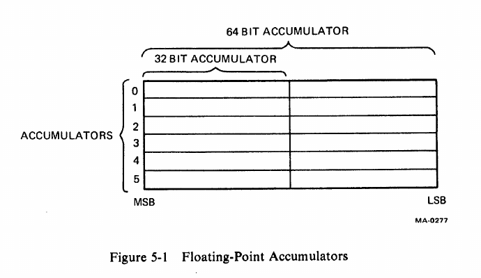

### 4.2 INSTRUCTION FORMATS

An FP11-A instruction must be in one of five formats. These formats are summarized in Figure 4-2. The 2-bit AC field (bits 6 and 7) allows selection of scratchpad accumulators 0 through 3 only. If address mode 0 is specified with formats F1 or F2, bits 2-0 are used to select a floating-point accumulator. Only accumulators 5-0 can be specified in mode 0. If 6 or 7 is specified in bits 2-0 in mode 0, the FP11-A traps if floating-point interrupts are enabled (FID = 0). The FEC will indicate an illegal op code error (exception code 2).

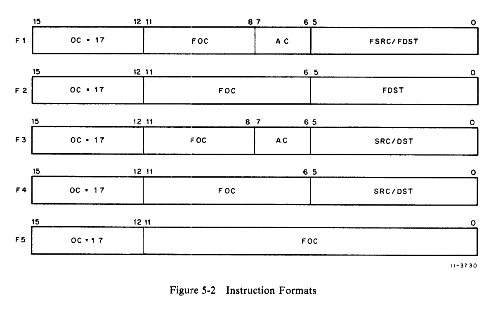

The fields of the various instruction formats (as summarized in Table 4-1) are interpreted as follows.

Mnemonic Description

```text
     OC                          Operation Code - All floating-point instructions are designated by a 4-bit op
                                 code of 173.
```

```text
     FOC                         Floating Operating Code - The number of bits in this field varies with the
                                 format; the code is used to specify the actual floating-point operation.
```

SRC Source - A 6-bit source field identical to that in the PDP-11 instruction.

```text
     DST                         Destination — A 6-bit destination field identical to that in a PDP-11 instruc-
                                 tion.
```

```text
     FSRC                        Floating Source - A 6-bit field used only in format F1. It is identical to SRC,
                                 except in mode 0 when it references a floating-point accumulator rather than
                                 a CPU general register.
```

```text
    FDST                         Floating Destination - A 6-bit field used in formats F1 and F2. It is identical
                                 to DST, except in mode 0 when it references a floating-point accumulator
                                 instead of a CPU general register.
```

```text
    AC                           Accumulator - A 2-bit field used in formats F1 and F3 to specify FP11-A
                                 scratchpad accumulators 0-3.
```

**Table 4-1 — Format of FP11-A Instructions**

| Format | Instruction                       | Mnemonic                                                           |
| :----: | --------------------------------- | ------------------------------------------------------------------ |
|   F2   | Absolute                          | `ABSF FDST`, `ABSD FDST`                                           |
|   F1   | Add                               | `ADDF FSRC, AC`, `ADDD FSRC, AC`                                   |
|   F2   | Clear                             | `CLRF FDST`, `CLRD FDST`                                           |
|   F1   | Compare                           | `CMPF FSRC, AC`, `CMPD FSRC, AC`                                   |
|   F5   | Copy Floating Condition Codes     | `CFCC`                                                             |
|   F1   | Divide                            | `DIVF FSRC, AC`, `DIVD FSRC, AC`                                   |
|   F1   | Load                              | `LDF FSRC, AC`, `LDD FSRC, AC`                                     |
|   F1   | Load Convert                      | `LDCFD FSRC, AC`, `LDCDF FSRC, AC`                                 |
|   F3   | Load Convert Integer              | `LDCIF SRC, AC`, `LDCID SRC, AC`, `LDCLF SRC, AC`, `LDCLD SRC, AC` |
|   F3   | Load Exponent                     | `LDEXP SRC, AC`                                                    |
|   F4   | Load FP11-A's Program Status      | `LDFPS SRC`                                                        |
|   F1   | Modulo                            | `MODF FSRC, AC`, `MODD FSRC, AC`                                   |
|   F1   | Multiply                          | `MULF FSRC, AC`, `MULD FSRC, AC`                                   |
|   F2   | Negate                            | `NEGF FDST`, `NEGD FDST`                                           |
|   F5   | Set Double Mode                   | `SETD`                                                             |
|   F5   | Set Floating Mode                 | `SETF`                                                             |
|   F5   | Set Integer Mode                  | `SETI`                                                             |
|   F5   | Set Long-Integer Mode             | `SETL`                                                             |
|   F1   | Store                             | `STF AC, FDST`, `STD AC, FDST`                                     |
|   F1   | Store Convert                     | `STCFD AC, FDST`, `STCDF AC, FDST`                                 |
|   F3   | Store Convert Floating to Integer | `STCFI AC, DST`, `STCFL AC, DST`, `STCDI AC, DST`, `STCDL AC, DST` |
|   F3   | Store Exponent                    | `STEXP AC, DST`                                                    |
|   F4   | Store FP11-A's Program Status     | `STFPS DST`                                                        |
|   F4   | Store FP11-A's Status             | `STST DST`                                                         |
|   F1   | Subtract                          | `SUBF FSRC, AC`, `SUBD FSRC, AC`                                   |
|   F2   | Test                              | `TSTF FDST`, `TSTD FDST`                                           |

### 4.3 INSTRUCTION SET

Table 4-2 contains the FP11-A instruction set. The notation used in the table
is defined below.

1. The floating-point flip-flop `FD` selects single- or double-precision
   floating-point format. `FD = 0` selects single precision (F), and `FD = 1`
   selects double precision (D). Examples include `NEGF`, `NEGD`, and `SUBD`.

   > **Note:** Only the assembler or compiler differentiates between such
   > mnemonic pairs as `NEGF`/`NEGD` and `LDCID`/`LDCLD`. The FP11-A uses the
   > values of `FD` and `FL`, normally controlled by `SETD`, `SETF`, `SETL`,
   > and `SETI`. For example: `LDCID` → `SETI` → `SETD` → `LDCLD`.

2. The integer flip-flop `FL` selects short- or long-integer format. `FL = 0`
   selects a short integer (I), and `FL = 1` selects a long integer (L).
   Examples are `SETI` and `SETL`.

3. Convert instructions use the following notation:

   - `C_IL,FD`: convert integer to floating point.
   - `C_FD,IL`: convert floating point to integer.
   - `C_F,D` or `C_D,F`: convert single to double floating point or double to
     single floating point.

4. `UPLIM` is the largest representable floating-point number. It has an
   exponent of 377 in excess-200 notation and a fraction of all ones; its value
   depends on the selected format. `LOLIM` is the smallest nonzero number. It
   has an exponent of 001 and a fraction of all zeros except for the hidden bit.

5. Address notation is as follows:

   ```text
   (xxxx)       contents of the location specified by xxxx
   ABS(address) absolute value of (address)
   EXP(address) exponent of (address) in excess-200 notation
   ```

6. Some octal instruction codes are mathematical expressions. For example,
   `LDFPS` with mode 3 and register 7 has `SRC = 37`, so its code is:

   ```text
   170100 + SRC = 170100 + 37 = 170137
   ```

   For `LDF` with AC2, mode 2, and register 6, `AC = 2` and `FSRC = 26`:

   ```text
   172400 + AC*100 + FSRC
   = 172400 + 2*100 + 26
   = 172626
   ```

7. `AC ∨ 1` means that the two-bit accumulator field is logically ORed with
   `01`. For AC2, the field is `10`, so `10 ∨ 01 = 11` (AC3).

The information in Table 4-2 is expressed symbolically as a quick reference
to each instruction. The following paragraphs provide additional detail.

**Table 4-2 — FP11-A Instruction Set**

In the descriptions below, `←` denotes assignment and `∨` denotes logical OR.
All constants and instruction codes are octal. In the printed Add entry, the
low-limit test appears as `|AC| + (FSRC) ≤ LOLIM`; it is rendered below as a
test on the result against `LOLIM`, consistent with the Divide, Multiply, and
Subtract entries and with the stated `otherwise AC ← 0` behavior.

**ABSF FDST / ABSD FDST — Absolute**  
Octal code: `170600 + FDST` (F2 format)

```text
FDST ← −(FDST) if FDST ≤ 0; otherwise FDST ← (FDST)
FC ← 0
FV ← 0
FZ ← 1 if exp(FDST) = 0; otherwise FZ ← 0
FN ← 0
```

**ADDF FSRC, AC / ADDD FSRC, AC — Floating Add**  
Octal code: `172000 + AC*100 + FSRC` (F1 format)

```text
AC ← (AC) + (FSRC) if |(AC) + (FSRC)| ≥ LOLIM;
     otherwise AC ← 0
FC ← 0
FV ← 1 if |AC| ≥ UPLIM; otherwise FV ← 0
FZ ← 1 if (AC) = 0; otherwise FZ ← 0
FN ← 1 if (AC) < 0; otherwise FN ← 0
```

**CLRF FDST / CLRD FDST — Clear**  
Octal code: `170400 + FDST` (F2 format)

```text
FDST ← 0
FC ← 0
FV ← 0
FZ ← 1
FN ← 0
```

**CMPF FSRC, AC / CMPD FSRC, AC — Floating Compare**  
Octal code: `173400 + AC*100 + FSRC` (F1 format)

```text
FC ← 0
FV ← 0
FZ ← 1 if (FSRC) − (AC) = 0; otherwise FZ ← 0
FN ← 1 if (FSRC) − (AC) < 0; otherwise FN ← 0
```

**CFCC — Copy Floating Condition Codes**  
Octal code: `170000` (F5 format)

```text
C ← FC
V ← FV
Z ← FZ
N ← FN
```

**DIVF FSRC, AC / DIVD FSRC, AC — Floating Divide**  
Octal code: `174400 + AC*100 + FSRC` (F1 format)

```text
AC ← (AC)/(FSRC) if |(AC)/(FSRC)| ≥ LOLIM;
     otherwise AC ← 0
FC ← 0
FV ← 1 if |AC| ≥ UPLIM; otherwise FV ← 0
FZ ← 1 if EXP(AC) = 0; otherwise FZ ← 0
FN ← 1 if (AC) < 0; otherwise FN ← 0
```

**LDF FSRC, AC / LDD FSRC, AC — Floating Load**  
Octal code: `172400 + AC*100 + FSRC` (F1 format)

```text
AC ← (FSRC)
FC ← 0
FV ← 0
FZ ← 1 if (AC) = 0; otherwise FZ ← 0
FN ← 1 if (AC) < 0; otherwise FN ← 0
```

**LDCDF FSRC, AC / LDCFD FSRC, AC — Load Convert
Double-to-Floating or Floating-to-Double**  
Octal code: `177400 + AC*100 + FSRC` (F1 format)

```text
AC ← C_F,D(FSRC) or C_D,F(FSRC)
FC ← 0
FV ← 1 if |AC| ≥ UPLIM; otherwise FV ← 0
FZ ← 1 if (AC) = 0; otherwise FZ ← 0
FN ← 1 if (AC) < 0; otherwise FN ← 0
```

`F,D` specifies single-precision to double-precision floating-point;
`D,F` specifies double-precision to single-precision floating-point. If the
current format is single-precision floating-point (`FD = 0`), the source is
assumed to be a double-precision number and is converted to single precision.
If the floating-truncate bit is set, the number is truncated; otherwise, it is
rounded. If the current format is double precision (`FD = 1`), the source is
assumed to be a single-precision number and loaded left-justified in the AC.
The lower half of the AC is cleared.

**LDCIF SRC, AC / LDCID SRC, AC / LDCLF SRC, AC / LDCLD SRC, AC —
Load and Convert from Integer to Floating**  
Octal code: `177000 + AC*100 + SRC` (F3 format)

```text
AC ← C_IL,FD(SRC)
FC ← 0
FV ← 0
FZ ← 1 if (AC) = 0; otherwise FZ ← 0
FN ← 1 if (AC) < 0; otherwise FN ← 0
```

- `LDCIF`: single integer to single float.
- `LDCID`: single integer to double float.
- `LDCLF`: long integer to single float.
- `LDCLD`: long integer to double float.

`C_IL,FD` specifies conversion from a two's-complement integer with precision
I or L to a floating-point number with precision F or D. If `IL = 0`, a 16-bit
integer (I) is specified; if `IL = 1`, a 32-bit integer (L) is specified. If
`FD = 0`, a 32-bit floating-point number (F) is specified; if `FD = 1`, a
64-bit floating-point number (D) is specified. If a 32-bit integer is specified
and addressing mode 0 or immediate mode is used, the 16 bits of the source
register are left-justified and the remaining 16 bits are zeroed before the
conversion.

**LDEXP SRC, AC — Load Exponent**  
Octal code: `176400 + AC*100 + SRC` (F3 format)

```text
AC SIGN ← (AC SIGN)
AC EXP ← (SRC) + 200 only if ABS(SRC) < 177
AC FRACTION ← (AC FRACTION)
FC ← 0
FV ← 1 if (SRC) > 177; otherwise FV ← 0
FZ ← 1 if EXP(AC) = 0; otherwise FZ ← 0
FN ← 1 if (AC) < 0; otherwise FN ← 0
```

**LDFPS SRC — Load FP11-A's Program Status Word**  
Octal code: `170100 + SRC` (F4 format)

```text
FPS ← (SRC)
```

**MODF FSRC, AC / MODD FSRC, AC — Floating Modulo**  
Octal code: `171400 + AC*100 + FSRC` (F1 format)

```text
AC ∨ 1 ← integer part of (AC)*(FSRC)
AC ← fractional part of (AC)*(FSRC) − (AC ∨ 1)
     if |(AC)*(FSRC)| ≥ LOLIM or FIU = 1;
     otherwise AC ← 0
FC ← 0
FV ← 1 if |AC| ≥ UPLIM; otherwise FV ← 0
FZ ← 1 if (AC) = 0; otherwise FZ ← 0
FN ← 1 if (AC) < 0; otherwise FN ← 0
```

The product of AC and FSRC is 48 bits in single-precision floating-point
format or 59 bits in double-precision floating-point format. The integer part
of the product, `(AC)*(FSRC)`, is found and stored in `AC ∨ 1`. The fractional
part is then obtained and stored in AC. Multiplication by 10 can be done with
zero error, allowing decimal digits to be stripped off without loss of
precision.

**MULF FSRC, AC / MULD FSRC, AC — Floating Multiply**  
Octal code: `171000 + AC*100 + FSRC` (F1 format)

```text
AC ← (AC)*(FSRC) if |(AC)*(FSRC)| ≥ LOLIM;
     otherwise AC ← 0
FC ← 0
FV ← 1 if |AC| ≥ UPLIM; otherwise FV ← 0
FZ ← 1 if (AC) = 0; otherwise FZ ← 0
FN ← 1 if (AC) < 0; otherwise FN ← 0
```

**NEGF FDST / NEGD FDST — Negate**  
Octal code: `170700 + FDST` (F2 format)

```text
FDST ← −(FDST) if EXP(FDST) ≠ 0; otherwise FDST ← 0
FC ← 0
FV ← 0
FZ ← 1 if EXP(FDST) = 0; otherwise FZ ← 0
FN ← 1 if (FDST) < 0; otherwise FN ← 0
```

**SETD — Set Floating Double Mode**  
Octal code: `170011` (F5 format)

```text
FD ← 1
```

**SETF — Set Floating Mode**  
Octal code: `170001` (F5 format)

```text
FD ← 0
```

**SETI — Set Integer Mode**  
Octal code: `170002` (F5 format)

```text
FL ← 0
```

**SETL — Set Long-Integer Mode**  
Octal code: `170012` (F5 format)

```text
FL ← 1
```

**STF AC, FDST / STD AC, FDST — Floating Store**  
Octal code: `174000 + AC*100 + FDST` (F1 format)

```text
FDST ← (AC)
FC ← FC
FV ← FV
FZ ← FZ
FN ← FN
```

**STCFD AC, FDST / STCDF AC, FDST — Store Convert from
Floating-to-Double or Double-to-Floating**  
Octal code: `176000 + AC*100 + FDST` (F1 format)

```text
FDST ← C_F,D(AC) or C_D,F(AC)
FC ← 0
FV ← 1 if |AC| ≥ UPLIM; otherwise FV ← 0
FZ ← 1 if (AC) = 0; otherwise FZ ← 0
FN ← 1 if (AC) < 0; otherwise FN ← 0
```

`F,D` specifies single-precision to double-precision floating-point;
`D,F` specifies double-precision to single-precision floating-point. With
`FD = 0`, `STCFD` converts the single-precision value in the source accumulator
to double precision by appending a zero low-order half, then stores it in the
destination. With `FD = 1`, `STCDF` converts the double-precision source to
single precision; the result is truncated when `FT = 1` and rounded when
`FT = 0`. The printed summary's statement that the value is “loaded
left-justified in the AC” is inconsistent with the store direction and appears
to have been copied from the `LDCFD` entry.

**STCFI AC, DST / STCFL AC, DST / STCDI AC, DST / STCDL AC, DST —
Store Convert from Floating to Integer**  
Octal code: `175400 + AC*100 + DST` (F3 format)

The destination receives the converted AC if the resulting integer can be
represented in 16 bits (short integer) or 32 bits (long integer). Otherwise,
the destination is zeroed and the C bit is set.

- `STCFI`: single float to single integer.
- `STCFL`: single float to long integer.
- `STCDI`: double float to single integer.
- `STCDL`: double float to long integer.

```text
FV ← 0
FZ ← 1 if (DST) = 0; otherwise FZ ← 0
FN ← 1 if (DST) < 0; otherwise FN ← 0
C ← FC
V ← FV
Z ← FZ
N ← FN
```

When conversion is to a long integer (32 bits) and address mode 0 or immediate
mode is specified, only the most significant 16 bits are stored in the
destination register.

**STEXP AC, DST — Store Exponent**  
Octal code: `175000 + AC*100 + DST` (F3 format)

```text
DST ← AC EXPONENT − 200
FC ← 0
FV ← 0
FZ ← 1 if (DST) = 0; otherwise FZ ← 0
FN ← 1 if (DST) < 0; otherwise FN ← 0
C ← FC
V ← FV
Z ← FZ
N ← FN
```

**STFPS DST — Store FP11-A's Program Status Word**  
Octal code: `170200 + DST` (F4 format)

```text
DST ← (FPS)
```

**STST DST — Store FP11-A's Status**  
Octal code: `170300 + DST` (F4 format)

```text
DST ← (FEC)
DST + 2 ← (FEA) if not mode 0 or immediate mode
```

**SUBF FSRC, AC / SUBD FSRC, AC — Floating Subtract**  
Octal code: `173000 + AC*100 + FSRC` (F1 format)

```text
AC ← (AC) − (FSRC) if |(AC) − (FSRC)| ≥ LOLIM;
     otherwise AC ← 0
FC ← 0
FV ← 1 if |AC| ≥ UPLIM; otherwise FV ← 0
FZ ← 1 if (AC) = 0; otherwise FZ ← 0
FN ← 1 if (AC) < 0; otherwise FN ← 0
```

**TSTF FDST / TSTD FDST — Test Floating**  
Octal code: `170500 + FDST` (F2 format)

```text
FC ← 0
FV ← 0
FZ ← 1 if EXP(FDST) = 0; otherwise FZ ← 0
FN ← 1 if (FDST) < 0; otherwise FN ← 0
```

#### 4.3.1 Arithmetic Instructions

The arithmetic instructions (Add, Subtract, Multiply, Divide) require one operand in a source (a floating-point accumulator in mode 0, a memory location otherwise) and one operand in a destination accumulator. The instruction is executed by the FP11-A and the result is stored in the destination accumulator.

The Compare instruction also requires one operand in a source and one operand in a destination accumulator. However, the two operands remain in their respective locations after the instruction is executed by the FP11-A, and there is no transfer of the result.

#### 4.3.2 Floating-Modulo Instruction

The Floating-Modulo (MOD) instruction causes the FP11-A to multiply two floating-point operands, separate the product into integer and fractional parts, and store one or both parts as floating-point numbers. The whole-number portion goes into an odd-numbered accumulator and the fraction goes into an even-numbered accumulator.

The whole-number portion of the number, when expressed as a floating-point number, contains an exponent greater than 201 in excess 200 notation, which means that the whole number has a decimal value of some number greater than one and less than UPLIM, where UPLIM is the greatest possible number that can be represented by the FP11-A.

The fractional portion of the number, when expressed as a floating-point number, contains an exponent less than or equal to 201 in excess 200 notation. This means that the fraction has a value less than one and greater than LOLIM, where LOLIM is the smallest possible number that can be represented by the FP11-A.

#### 4.3.3 Load Instruction The Load instruction causes the FP11-A to take an operand from a source and copy it into a destination accumulator. The source is a floating-point accumulator in mode 0 and a memory location otherwise.

#### 4.3.4 Store Instruction

The Store instruction causes the FP11-A to take an operand from a source accumulator and transfer it to a destination. This destination is a floating-point accumulator in mode 0 and a memory location otherwise.

#### 4.3.5 Load Convert (Double-to-Floating, Floating-to-Double) Instructions

The Load Convert Double-to-Floating (LDCDF) instruction causes the FP11-A to assume that the source specifies a double-precision floating-point number. The FP11-A then converts that number to single-precision, and places this result in the destination accumulator. If the floating-truncate (FT) status bit is set, the number is truncated. If the FT bit is not set, the number is rounded by adding a 1 to the single-precision segment if the MSB of the double-precision segment is a 1 depending on the prior conditions set up by the FD bit (Figure 4-3). If the MSB of the double-precision segment is 0, the single-precision word remains unchanged after rounding.

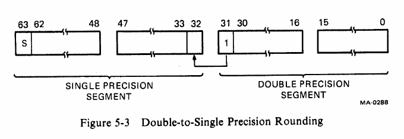

The Load Convert Floating-to-Double (LDCFD) instruction causes the FP11-A to assume that the source specifies a single-precision number. The FP11-A then converts that number to double-precision by appending 32 zeros to the single-precision word, and places this result in the destination accumulator.

Note that for both Load Convert instructions, the number to be converted is originally in the source (a floating-point accumulator in mode 0, a memory location otherwise) and is transferred to the destination accumulator after conversion.

#### 4.3.6 Store Convert (Double-to-Floating, Floating-to-Double) Instructions

The Store Convert Double-to-Floating (STCDF) instruction causes the FP11-A to convert a double-precision number located in the source accumulator to a single-precision number. The FP11-A then transfers this result to the specified destination. If the floating-truncate (FT) bit is set, the floating-point number is truncated. If the FT bit is not set, the number is rounded. If the MSB (bit 31) of the double-precision segment of the word is a 1, 1 is added to the single-precision segment of the word, depending on the prior conditions set up by the FD bit (Figure 4-3); otherwise, the single-precision segment remains unchanged.

The Store Convert Floating-to-Double (STCFD) instruction causes the FP11-A to convert a single-precision number located in the source accumulator to a double-precision number. The FP11-A then transfers this result to the specified destination. The single-to-double precision is obtained by appending zeros equivalent to the double-precision segment of the word (Figure 4-4).

Note that for both Store Convert instructions, the number to be converted is originally in the source accumulator and is transferred to the destination (a floating-point accumulator in mode 0, a memory location otherwise) after conversion.

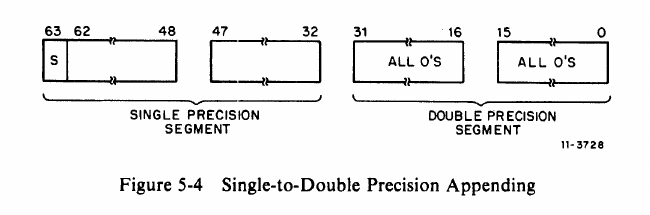

#### 4.3.7 Clear Instruction

The Clear instruction causes the FP11-A to clear a floating-point number by setting all its bits to 0.

#### 4.3.8 Test Instruction

The Test instruction causes the FP11-A to test the sign and exponent of a floating-point number and update the FP11-A status accordingly. The number tested is obtained from the destination (a floating-point accumulator in mode 0, a memory location otherwise). The FC and FV bits are cleared. The FN bit is set only if the destination is negative. The FZ bit is set only if the exponent of the destination is zero. If the FIUV status bit is set, a trap occurs (after the test instruction is executed) if a minus zero is encountered.

#### 4.3.9 Absolute Instruction

The Absolute instruction causes the FP11-A to take the absolute value of a floating-point number by forcing its sign bit to 0. If mode 0 is specified, the sign of the number in the floating-point destination accumulator is forced to 0. The exponent of the number is tested, and if it is 0, zeros are written into the accumulator. If the exponent is non-zero, the accumulator is unaffected.

If mode 0 is not specified, the sign bit of the specified data word in memory is zeroed. The exponent of this word is tested, and if it is 0, the entire data word in memory is zeroed. If the exponent is non-zero, the integer exponent is restored to memory.

Absolute and Negate instructions are the only instructions that can read and write a memory location.

#### 4.3.10 Negate Instruction

The Negate instruction causes the CPU (or the FP11-A, in mode 0) to complement the sign of an operand. If mode 0 is specified, the sign of the number in the floating-point destination accumulator is complemented. The exponent of the number is tested, and if it is 0, zeros are written into the accumulator. If the exponent is non-zero, the accumulator is unaffected.

If mode 0 is not specified, the sign bit of the specified data word in memory is complemented. This word is then transferred from memory to a floating-point accumulator. The exponent of this word is tested, and if it is 0, the entire data word is zeroed and transferred back to memory. If the exponent is non-zero, the original fraction and exponent are restored to memory.

#### 4.3.11 Load Exponent Instruction

The Load Exponent instruction causes the floating-point processor (FPP) to load an exponent from the source (a floating-point accumulator in mode 0, a memory location otherwise) into the exponent field of the destination accumulator. In order to do this, the 16-bit, 2’s complement exponent from the source must be converted to an 8-bit number in excess 200 notation. This process is described further below.

Assume that the 16-bit two’s-complement exponent comes from memory. Legal
source values fall into two octal ranges:

1. Positive exponents `000000` through `000177`. Adding `200` produces a legal
   excess-200 exponent from `200` through `377`.
2. Negative exponents `177601` through `177777`. Adding `200` produces a legal
   excess-200 exponent from `001` through `177`.

All legal positive exponents have nine zero high-order bits; all legal negative
exponents have nine one high-order bits. Values outside these ranges produce an
overflow or underflow trap.

**Example 1 — `LDEXP 000034`:** `034 + 200 = 234`. The high-order nine bits
are zero, so this is a legal positive exponent; `234` is loaded into the
accumulator’s exponent field.

**Example 2 — `LDEXP 000201`:** `201 + 200 = 401`. The result does not fit in
the 8-bit exponent field, so an overflow occurs.

**Example 3 — `LDEXP 100200`:** this is an illegal negative exponent. Adding
`200` produces a value more negative than the 8-bit exponent field can
represent, so an underflow occurs.

**Example 4 — `LDEXP 177600`:** this source represents an exponent of `−200₈`.
Although adding `200` produces zero and its nine high-order bits are equal, the
exponent is reserved as zero and is treated as an underflow.

#### 4.3.12 Load Convert Integer-to-Floating Instruction

The Load Convert Integer instruction takes a 2’s complement integer from memory and converts it to a floating-point number in sign and magnitude format. If short-integer mode is specified, the number from memory is 16 bits and is converted to a 24-bit fraction (single-precision) or a 56-bit fraction (double-precision), depending on whether floating or double mode is specified. If long-integer mode is specified, the number from memory is 32 bits and is converted to a single- or double-precision number, depending on whether floating or double mode is specified. The integer is loaded into bits 55-40 if short integer is specified or into bits 55-24 if long integer is specified. It is then left-shifted eight places so that bit 55 is transferred to bit 63 (Figure 4-5).

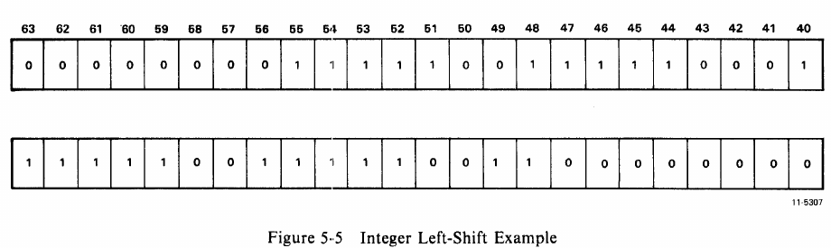

The integer is then assigned an exponent of 217₈ in short-integer mode. This is the result of adding 200₈ (since the exponent is expressed in excess 200 notation) to 17₈, which represents 15₁₀ shifts. This number of shifts is the maximum number required to normalize a number. If long-integer mode is specified, the integer is assigned an exponent of 237₈, which represents 31₁₀ shifts.

The 2’s complement integer is tested by examination of bit 63 to see if it is a positive or negative number. The number is then normalized by left-shifting until bit 63 becomes a 1. If bit 63 is 1 (negative number), the integer is negative, the sign bit is set, the number is 2’s complemented, and then normalized.

To normalize a number, bit 63 (MSB) of the fraction must be equal to 0 and bit 62 must be made equal to 1. To do this, the integer is shifted the required number of places to the left and the exponent value is decreased by the number of places shifted (Figure 4-6).

```text
        EXP= 217:                          Shift integer 15 places to the left to normalize.
                    -173                   Bit 59 = 0, bit 58 = 1
                    2008                   Decrease exponent by 1549 which is 17.
```

When loading a long integer with an FD = 0, if the long integer contains more than 24 significant digits, then less significant digits will be truncated with some loss of accuracy.

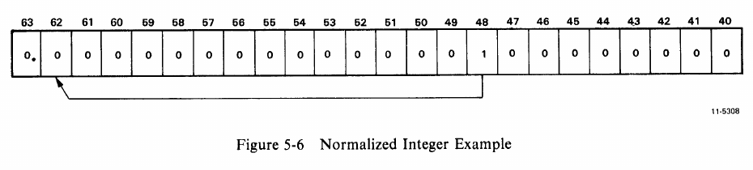

#### 4.3.13 Store Exponent Instruction

The Store Exponent (STEXP) instruction causes the CPU to access a floating-point number in the FP11-A, extract the 8-bit exponent field from this number, and subtract a constant of 200 (since the exponent is expressed in excess 200 notation). The exponent is then stored in the destination as a 16-bit, 2’s complement, right-justified number with the sign of the exponent (bit 07) extended through the 8 high-order bits.

The legal range of exponents is from 0 to 377, expressed in excess 200 notation. This means that the number stored ranges from -200 to 177 after the constant of 200 has been subtracted. The subtraction of 200 is accomplished by taking the 2’s complement of 200 and adding it to the exponent field (Figures 5-7 and 5-8).

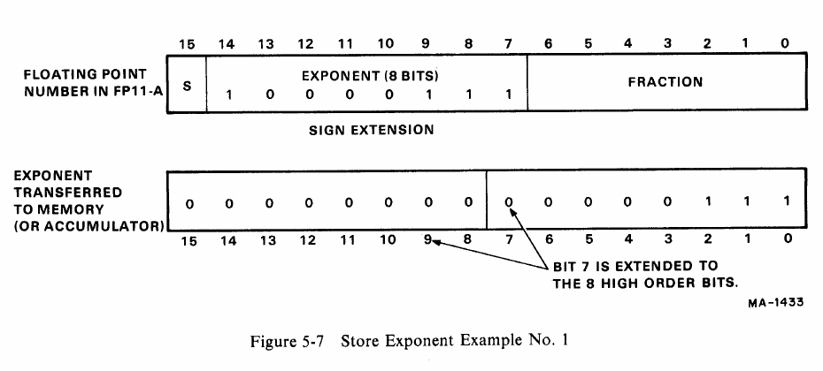

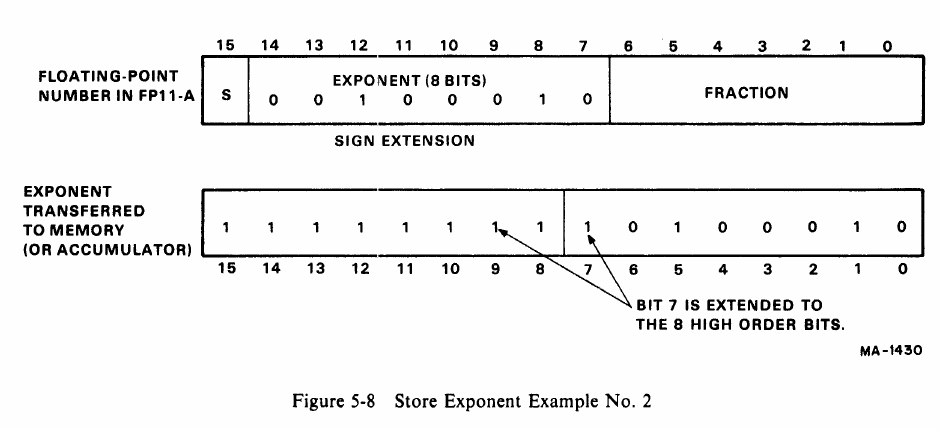

Two examples that illustrate the process follow: one using an exponent greater than 200 and the next using an exponent less than 200.

Example 1: Exponent = 207

```text
             Exponent of 207                                         10000111
             2’s Complement of 200                                 + 10000000
```

Result = 7 00000111

Sign Bit “ 7

Example 2: Exponent = 42

```text
             Exponent of 42                                         00100010
             2’s Complement of 200                                 + 10000000
             Result = -42                                            10100010
```

Sign Bit ~ 4 2

#### 4.3.14 Store Convert Floating-to-Integer Instruction

The Store Convert Floating-to-Integer instruction causes the FPP to take a floating-point number and convert it to an integer for transfer to a destination.

The four classes of this instruction are as follows.

```text
                STCFI - Convert single-precision, 24-bit fraction to a 16-bit integer (short-integer mode).
                STCFL - Convert single-precision, 24-bit fraction to a 32-bit integer (long-integer mode).
                STCDI - Convert double-precision, 56-bit fraction to a 16-bit integer (short-integer mode).
     BYwN>      STCDL - Convert double-precision, 56-bit fraction to a 32-bit integer (long-integer mode).
```

The (normalized) floating-point number to be converted is transferred to the FPP. The FPP works with the sign bit and one of the following.

```text
     1.      The 15 MSBs of the fraction for Floating-to-Integer and Double-to-Floating conversion
     2.      The 31 MSBs of the fraction for Double-to-Long conversion
     3.      The entire fraction for Floating-to-Long conversion.
```

The FPP subtracts 201 from the exponent to determine if the floating-point number is a fraction. If the result of the subtraction is negative, the exponent is less than 201, and the absolute value of the floating-point number is less than 1. When converted to an integer, the value of this number is 0; a conversion error occurs, the FZ bit is set, and zeros are sent to the destination. If the result of the subtraction is positive (or zero), it indicates that the exponent is greater than (or equal to) 201, and the floating-point number can be converted to a non-zero integer (Figure 4-9).

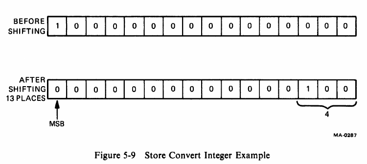

A second test is made by the FPP to determine if the floating-point number to be converted is within the range of numbers that can be represented by a 16-bit integer (I-format) or 32-bit integer (Lformat).

Consider the range of integers that can be represented in I and L formats and their floating-point equivalents.

```text
                            I-Format                 Floating-Point         L-Format                    Floating-Point
                            (16 bits)                Equivalent             (32 bits)                   Equivalent
```

```text
   Most Positive            077777                   +.1111...x 215         17777777777                 +.1111...x 23!
   Integer
```

```text
   Least Positive           000001                   +.100...x 2!           0000000000 1                +.100...% 2!
   Integer
```

```text
   Least Negative           177777                   —.1111...x 216         37777777777                 —.1111...x 232
   Integer
```

```text
   Most Negative            100000                   —.1000...x 216         20000000000                 —.100...x 232
   Integer
```

```text
                                                          NOTE
                                           MSB of integer = sign of integer.
```

Thus, the exponent of a positive floating-point number to be converted must be less than 16₁₀ (220 in excess 200 notation) to convert to I-format or 32₁₀ (240 in excess 200 notation) to convert to L-format. The exponent of a negative number to be converted must be less than or equal to 16₁₀ or 32₁₀ to convert to I- or L-formats, respectively.

The FPP tests whether the floating-point number to be converted is within the range of integers that can be represented in I- or L-format by subtracting a constant of 20₈ (for short integers) or 40₈ (for long integers) from the result of the first test (result of first test = biased exponent − 201₈ = unbiased exponent − 1). If the result of the subtraction is positive or 0, it indicates that the floating-point number is too large to be represented as an integer. In that case, a conversion error occurs and zeros are sent to the destination. If the result of the subtraction is a negative number other than -1, the floating-point number can be represented as an integer without causing an overflow condition. If the result of the subtraction is -1, the exponent of the floating-point number is either 220 (short) or 240 (long), and conversion proceeds. However, the floating-point number is within range only if its sign is negative and its fraction is .100. . . (i.e., if it is the most negative integer; see table above). If, in this case, the number is not the most negative integer, it will be detected by a third conversion error test (see below) after conversion.

To convert the fraction to an integer, the FPP shifts it right a number of places as specified by the following algorithms.

```text
     Short integer:          No. of right shifts = 20₈ + 201₈ — biased exponent - 1
     Long integer:           No. of right shifts = 40₈ + 201₈ — biased exponent − 1
```

Regardless of the condition of the FT bit, the fractional part of the number is always truncated during this shifting process.

If the floating-point number is positive, the integer conversion is complete after shifting, and the number is transferred to the appropriate destination. If, however, the floating-point number is negative, the integer must be 2’s complemented before being sent to its destination.

After conversion, the FPP performs a third test for a conversion error by comparing the MSB of the (converted) integer with the sign bit of the original (unconverted) number. If these signs are not equal, there has been a conversion error and the FPP traps if the FIC bit is set. This test is performed to detect a floating-point number with an exponent of 220 (short) or 240 (long) that has not been converted to the most negative integer.

Example 1: Store Convert Floating-to-Integer (STCFI)

```text
                         Exponent = 203
                             Sign = 0
               Fraction (24 bits) = .100000000000000000000000
            15 MSBs of fraction = .100000000000000
                203 (excess 200) = 2
                         Fraction = 1/2           Integer to be stored = 1/2X 2=4
```

1. Test 1: Is the number to be converted a fraction?

```text
                 Exponent:                 2038
                                          -201__
```

```text
                 No                           2          Since this result is positive, the given floating-point
                                                         number is not a fraction and conversion may pro-
                                                         ceed without error.
```

```text
         Test 2: Is the floating-point number to be converted within range? (We are working with a
         positive short integer.)
```

```text
              Result of Test 1:            2
                                         -20
```

```text
              Yes                        -16     Indicates that the number to be converted is within
                                                 range and can be represented as a 16-bit integer.
                                                 No conversion error occurs.
```

How many right shifts? Use algorithm:

203 + 201₈- 203₈ - 1 = 20₈- 3₈ = 15₈ = 13₁₀

= 13 right shifts

```text
         This example involves a positive number, so conversion is complete after 13 right shifts. If
         the number had been negative, the integer would have been 2’s complemented.
```

```text
         Test 3: The MSB of the converted integer and the sign bit of the original floating-point
         number are compared. Since they are equal, no conversion error occurs.
```

Example 2: Store Convert Floating-to-Integer (STCDL)

```text
                    Exponent = 2408
                        Sign = 0
         31 MSBs of fraction = .1000000000000000000000000000000
```

Test 1: Is the number to be converted a fraction?

```text
              Exponent:                  2408
                                        -201
```

```text
              No             .            378    Since this result is positive, the given floating-point
                                                 number is not a fraction, and conversion may pro-
                                                 ceed (i.e., no conversion error occurs).
```

```text
         Test 2: Is the floating-point number to be converted within range? (We are working with a
         positive long integer.)
```

```text
              Result of Test 1:            37
                                         -40
```

```text
                                           -1     We know the number is out of range by examining
                                                  the sign bit (in fact, this number is one greater than
                                                  the most positive integer that can be represented).
                                                  However, the FPP does not know this yet, and con-
                                                  version proceeds without error at this point.
```

How many right shifts? Use algorithm:

40₈ + 201₈- 240₈ - 1 = 0

= No right shifts

Converted 32-bit integer = 20000000000,

```text
         Since the number is positive, conversion is now complete (i.e., no need for 2’s com-
         plementing).
```

```text
     3.     Test 3: The most significant bit of the converted integer (which is 1) and the sign bit of the
            original floating-point number (which is 0) are compared. Since they are not equal, a con-
            version error occurs, which we predicted in Step 2.
```

#### 4.3.15 Load FP11’s Program Status

This instruction causes the FPP to transfer 16 bits from the location specified by the source to the floating-point status (FPS) register. These 16 bits contain status information for use by the FP11-A in order to enable and disable interrupts, set and clear mode bits, and set condition codes (Paragraph 4.4).

#### 4.3.16 Store FP11’s Program Status

This instruction causes the FPP to transfer the 16 bits of the FPS register to the specified destination.

#### 4.3.17 Store FP11’s Status

The Store FP11’s Status (STST) instruction causes the FPP to read the contents of the floating exception code (FEC) and floating exception address (FEA) registers when a floating-point exception (error) occurs.

If mode O addressing is enabled, only the FEC is sent to the destination accumulator. If mode 0 addressing is not enabled, the FEC is stored in memory followed by the FEA. In memory, the FEA data occupies all 16 bits of its memory location, while the FEC data occupies only the lower 4 bits of its location.

When an error occurs and the interrupt trap in the CPU is enabled, the CPU traps to interrupt vector 244 and issues the STST instruction to determine the type of error.

```text
                                               NOTE
                           The STST instruction should be used only after an
                           error has occurred, since in all other cases the in-
                           struction contains irrelevant data or contains the
                           conditions that occurred after the last error.
```

#### 4.3.18 Copy Floating Condition Codes

The Copy Floating Condition Codes (CFCC) instruction causes the FPP to copy the four floating condition codes (FC, FZ, FV, FN) into the CPU condition codes (C, Z, V, N).

#### 4.3.19 Set Floating Mode

The Set Floating Mode (SETF) instruction causes the FPP to clear the FD bit (bit 07 of the FPS register) and indicate single-precision operation.

#### 4.3.20 Set Double Mode

The Set Double Mode (SETD) instruction causes the FPP to set the FD bit (bit 07 of the FPS register) and indicate double-precision operation.

#### 4.3.21 Set Integer Mode

The Set Integer Mode (SETI) instruction causes the FPP to clear the IL bit (bit 06 of the FPS) and indicate that short-integer mode (16 bits) is specified.

#### 4.3.22 Set Long-Integer Mode

The Set Long-Integer Mode (SETL) instruction causes the FPP to set the IL bit (bit 06 of the FPS) and indicate that long-integer mode (32 bits) is specified.

### 4.4 FP11-A PROGRAMMING EXAMPLES

This paragraph contains two programming examples using the FP11-A instruction
set. In example 1, A is added to B, D is subtracted from C, the quantity
`(A + B)` is multiplied by `(C − D)`, the product is divided by X, and the
result is stored. Example 2 calculates `DX³ + CX² + BX + A` with a three-pass
loop.

**Example 1: `[(A + B) * (C − D)] / X`**

```text
        SETF
        LDF     A,AC0       ; Load AC0 from A
        ADDF    B,AC0       ; AC0 contains A + B
        LDF     C,AC1       ; Load AC1 from C
        SUBF    D,AC1       ; AC1 contains C − D
        MULF    AC1,AC0     ; AC0 contains (A + B)*(C − D)
        DIVF    X,AC0       ; AC0 contains (A + B)*(C − D)/X
        STF     AC0,Y       ; Store (A + B)*(C − D)/X in Y
```

The expressions evaluated on the three passes of example 2 are:

```text
AC0 = [(D*X + C)*X + B]*X + A
AC0 = [D*X² + C*X + B]*X + A
AC0 = D*X³ + C*X² + B*X + A
```

**Example 2: `DX³ + CX² + BX + A`**

```text
        SETF
        MOV     #3,%0       ; Set up loop counter
        MOV     #D+4,%1     ; Set up pointer to coefficients
        LDF     (%6)+,AC1   ; Pop X from stack
        CLRF    AC0         ; Clear AC0
LOOP:   ADDF    -(%1),AC0   ; Add next coefficient to partial result
        MULF    AC1,AC0     ; Multiply partial result by X
        SOB     %0,LOOP     ; Repeat three times
        ADDF    -(%1),AC0   ; Add A to obtain the result
        STF     AC0,-(%6)   ; Push result on stack
```

## Chapter 5 — Processor Organization

### 5.1 INTRODUCTION

The FP11-A Floating-Point Processor connects to the KD11-EA central processor via a tri-state bus (Figure 5-1). This interface allows addressing of floating-point memory utilizing the memory management option.

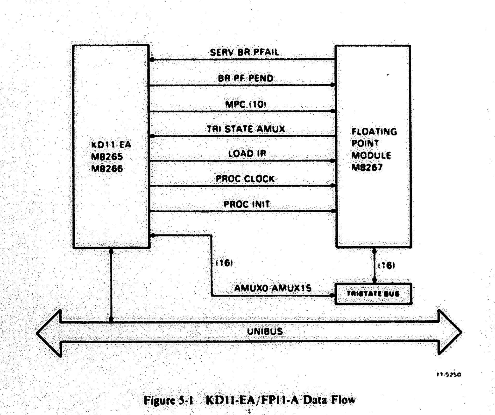

The CPU software must initiate floating-point operation and originate addresses and data since control of the FP11-A resides in the CPU.

The FP11-A depends on the CPU to fetch instructions and data from memory in order to initiate floating-point operations. If the instruction is not a floating-point instruction, it is ignored by the FP11-A. If the decoded instruction is a floating-point instruction (i.e., contains an op code of 17XXXX), the FP11-A causes the CPU to branch to the FP11-A ROM (read-only memory) microstates associated with floating-point instructions.

The simplified block diagram illustrated in Figure 5-2 shows the major functions of the FP11-A.

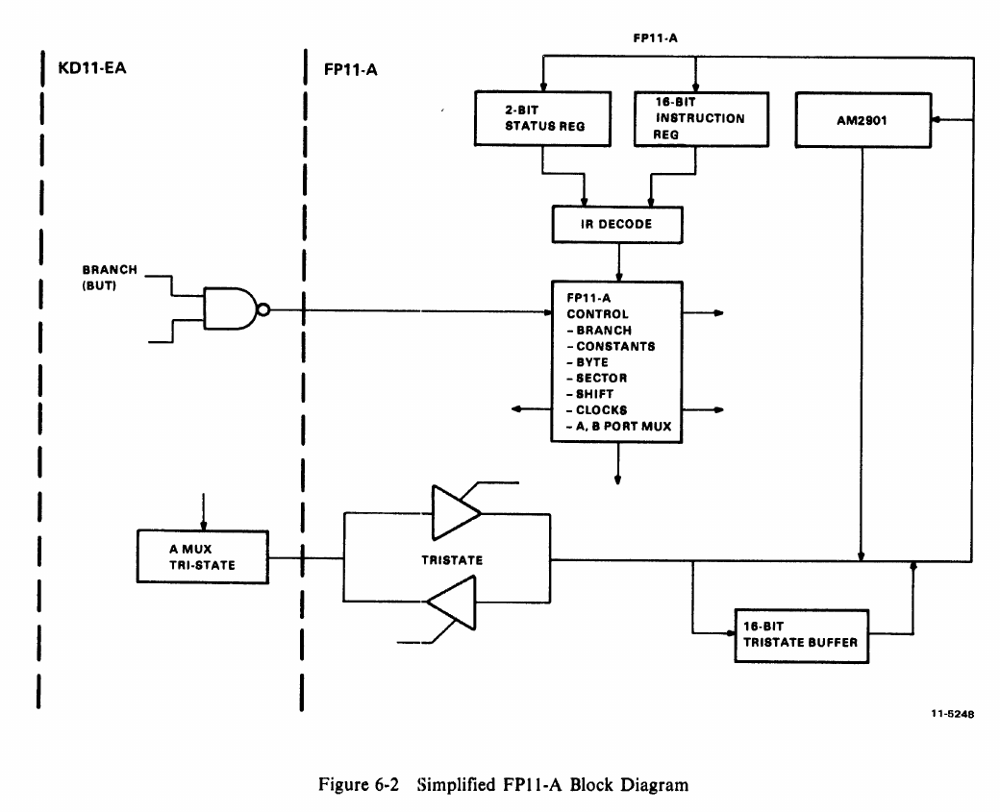

### 5.2 MICROPROCESSOR DESCRIPTION

The principal data manipulation element in the floating-point processor is the AM2901 microprocessor (Figure 5-3). The basic microprocessor is 4 bits wide and 16 of these units are cascaded to make up a 16 by 64-bit word for the FP11-A. A general discussion of the microprocessor followed by a description of its integration into the overall floating-point processor is given in the following paragraphs.

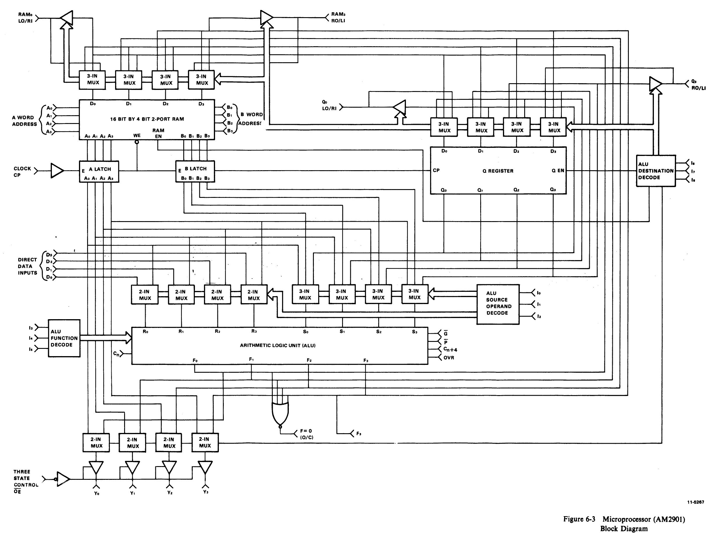

#### 5.2.1 Microprocessor Organization

As shown in Figure 5-3, the major components of the microprocessor are the RAM, the arithmetic logic unit (ALU), and the Q-register.

Information contained in any of the 16 64-bit words of the RAM may be read from the A-port as controlled by the 4-bit A-word address (Ag-A3) field. Similarly, data in any of the 16 words of the RAM as defined by the B-address (Bo-B3) field input may be simultaneously read from the B-port of the RAM. It is also possible to apply the same address code to both the A and B select fields, in which case the identical file data will appear at both the RAM A-port and B-port simultaneously.

New data is always written into the file word specified by the B-address field of the RAM. The RAM data input field is driven by a 3-input multiplexer which permits shifting of the ALU output. The 3-input multiplexer allows data to be shifted right 1 bit position, left 1 bit position, or not shifted in either direction.

#### 5.2.2 Arithmetic/Logical Operations

The arithmetic logic unit (ALU) is capable of performing three arithmetic and five logical operations on the two 4-bit input words R0–R3 and S0–S3. The R-input field to the ALU receives its input from a 2-input multiplexer while S receives its signals from a 3-input multiplexer. The 2- and 3-input multiplexers both have an inhibit capability. This is the equivalent of a “0” source operand.

If the five data inputs to the ALU are combined into pairs, 10 combinations of registers are possible, i.e., AB, DA, AQ, 0A, 0B, BQ, BD, D0, DQ, and 0Q, as illustrated in Table 5-1. The microprocessor uses eight of these operand pairs. Selection of the ALU source operand pairs is accomplished by the microinstruction inputs I0, I1, and I2.

**Table 5-1 — ALU Source Operand Control**

| I2  | I1  | I0  | Octal |  R  |  S  |
| :-: | :-: | :-: | :---: | :-: | :-: |
|  L  |  L  |  L  |   0   |  A  |  Q  |
|  L  |  L  |  H  |   1   |  A  |  B  |
|  L  |  H  |  L  |   2   |  0  |  Q  |
|  L  |  H  |  H  |   3   |  0  |  B  |
|  H  |  L  |  L  |   4   |  0  |  A  |
|  H  |  L  |  H  |   5   |  D  |  A  |
|  H  |  H  |  L  |   6   |  D  |  Q  |
|  H  |  H  |  H  |   7   |  D  |  0  |

The direct-data (D) source-operand input port is used to insert all data into the working registers inside the 2901 microprocessor. The D-input can also be used by the ALU to modify any of the internal data files of the RAM via the F outputs of the ALU.

The Q-register is a separate 4-bit register intended primarily for multiplication and division routines, This register can also be used as an accumulator or buffer register for certain applications.

The ALU performs three arithmetic and five logical functions as directed by the three control bits I3, I4, and I5 (Table 5-2).

**Table 5-2 — ALU Function Control**

| I5  | I4  | I3  | Octal | ALU function      | Symbol     |
| :-: | :-: | :-: | :---: | ----------------- | ---------- |
|  L  |  L  |  L  |   0   | R plus S          | `R + S`    |
|  L  |  L  |  H  |   1   | S minus R         | `S − R`    |
|  L  |  H  |  L  |   2   | R minus S         | `R − S`    |
|  L  |  H  |  H  |   3   | R OR S            | `R ∨ S`    |
|  H  |  L  |  L  |   4   | R AND S           | `R ∧ S`    |
|  H  |  L  |  H  |   5   | NOT R AND S       | `¬R ∧ S`   |
|  H  |  H  |  L  |   6   | R exclusive-OR S  | `R ⊕ S`    |
|  H  |  H  |  H  |   7   | R exclusive-NOR S | `¬(R ⊕ S)` |

ALU output data may be routed to one of eight possible destinations as defined by control bits I6, I7, and I8. ALU output data may be a data output from the device or it may be stored in the RAM or the Q-register.

The data output of the microprocessor uses a 2:1 multiplexer whose inputs are the A-port of the RAM or the ALU outputs (F). Selection of these outputs is controlled by bits I6, I7, and I8 of the microinstruction control input (Table 5-3). Note that the left- and right-shift functions in Table 5-3 are reversed for the FP11-A application.

The FP11-A uses 16 AM2901 units connected in cascade with 3 levels of look-ahead carry logic. This configuration results in a 64-bit word. Carry generate (G), and carry propagate (P), are unit outputs for use with a look-ahead carry generator. Carry out (Cn+4) is also generated by the microprocessor and is available as an output carry flag in a status register. Cn and Cn+4 are both active high.

Three additional outputs are generated by the ALU. These are F3, F = 0, and overflow (OVR). F3 represents the most significant bit (sign) of the ALU and can be used to determine positive or negative results without enabling the three-state outputs or while enabling the A-port to output. F3 is non-inverted with respect to the sign bit output Y3. F = 0 output is used for zero detect and is an open-collector output that can be wire-ORed between microprocessor slices. F = 0 is high when all F outputs are low. OVR is a flag indicating an arithmetic operation exceeds the available range and is high when the overflow condition exists, i.e., when Cn and Cn+4 are not of the same polarity.

Inputs to the RAM are via a 3-input multiplexer. The multiplexer allows input data to be entered into the RAM in three modes:

```text
   e Shifted left one place
   e Shifted right one place
   © Unshifted.
```

```text
    The shifting is accomplished by two ports: RAM-LO/RI and RAM-RO/LI. Both ports consist of a
    buffer driver with a tri-state output and an input to the multiplexer. In the shift-up (×2) mode, the RO
    buffer is enabled and the RI multiplexer input   is enabled. In the shift-down (-2) mode, the LO buffer
    and LI input are enabled. In the no-shift mode, both the LO and RO buffers are in the high-impedance
    state and the multiplexer inputs are not selected. The microinstruction control bits I6, I7, and I8 oper-
    ate the shifter as shown in Table 5-3.
```

**Table 5-3 — ALU Destination Control**

| I8 I7 I6 | Octal | RAM function                 | Q-register function          |  Y  | RAM0 LO/RI | RAM3 LI/RO | Q0 LO/RI | Q3 LI/RO |
| :------: | :---: | ---------------------------- | ---------------------------- | :-: | :--------: | :--------: | :------: | :------: |
|  L L L   |   0   | No load                      | Load ALU (`Fi`)              |  F  |     X      |     X      |    X     |    X     |
|  L L H   |   1   | No load                      | No load                      |  F  |     X      |     X      |    X     |    X     |
|  L H L   |   2   | Load ALU (`Fi`), no shift    | No load                      |  A  |     X      |     X      |    X     |    X     |
|  L H H   |   3   | Load ALU (`Fi`), no shift    | No load                      |  F  |     X      |     X      |    X     |    X     |
|  H L L   |   4   | Shift left/down; load `Fi+1` | Shift left/down; load `Qi+1` |  F  |     F0     |    IN3     |    Q0    |   IN3    |
|  H L H   |   5   | Shift left/down; load `Fi+1` | No load                      |  F  |     F0     |    IN3     |    Q0    |    X     |
|  H H L   |   6   | Shift right/up; load `Fi−1`  | Shift right/up; load `Qi−1`  |  F  |    IN0     |     F3     |   IN0    |    Q3    |
|  H H H   |   7   | Shift right/up; load `Fi−1`  | No load                      |  F  |    IN0     |     F3     |    X     |    Q3    |

`X` means don't care. Electrically, the shift pin is a TTL input internally
connected to a three-state output in the high-impedance state.

The Q-register is also driven by a 3-input multiplexer. In no-shift mode, the multiplexer enters ALU data into the Q-register. Shift-up and shift-down operation is the same as for RAM, as shown in the table.

The RAM, Q-register, and the A and B data latches are controlled by the clock input. When enabled, data latches are also controlled by the clock input and data is clocked into the Q-register on the positive-going transition of the clock. When the clock input is high, the A and B data latches are open and will pass any data that is present at the RAM outputs. When the clock is low, the latches are closed and will retain the last data entered. If the RAM-EN is enabled, new data is entered into the RAM file (word) defined by the B-address field when the clock input is low.

#### 5.2.3 RAM

The FP11-A RAM register usage is shown in Figure 5-4. This unit, located in the microprocessor, is the scratchpad area where the results of arithmetic and logical operations are temporarily stored. The contents of the RAM are read into the ALU under control of the FP11-A microcode. It consists of 16 64-bit words (each of the 16 microprocessors (AM2901) contains a 16 × 4-bit RAM).

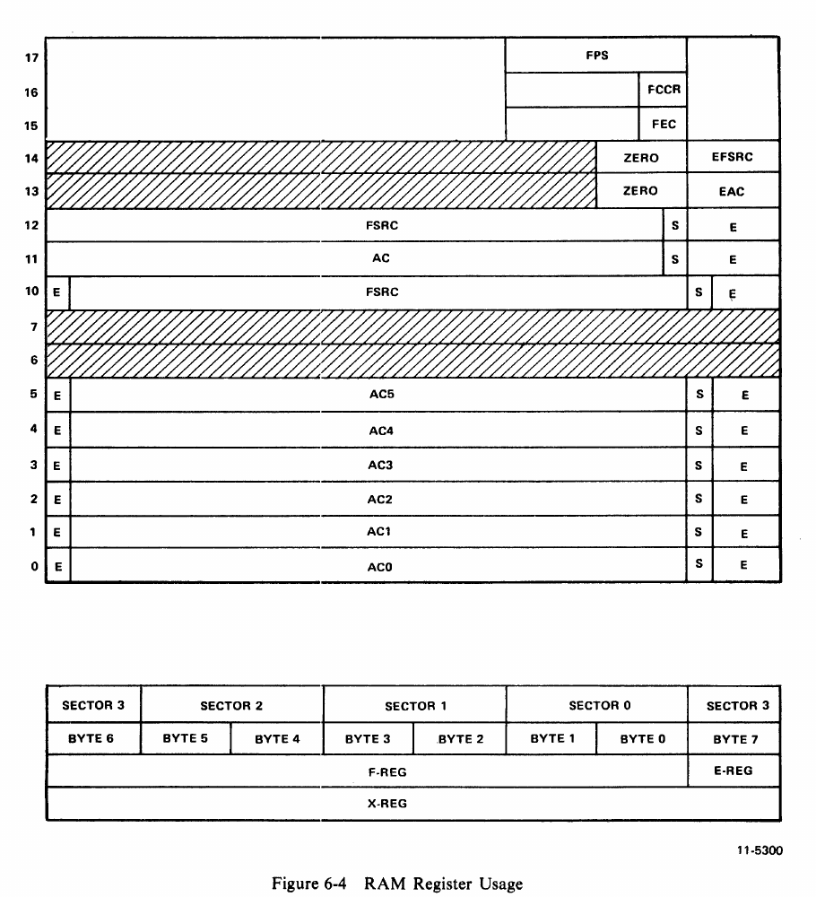

Six of the 64-bit registers are allocated for the accumulators and are accessible to the programmer via the FP11-A instruction register. Registers 6 and 7 are unused while registers 10-17 are set aside for special functions. Registers 10-17 are accessed only by the control ROM. Registers 10-14 constitute a working storage area for the FP11-A microcode. Other functions included are the floating-point status register, condition codes, and exception codes.

#### 5.2.4 Arithmetic Logic Unit (ALU)

The ALU is the data path component that actually performs the arithmetic/logical operation under command of the microcode (Table 5-4). R-inputs are fed in via a 2-input multiplexer whose inputs are the direct data (D) inputs and the output of the A-port of the RAM. The S-inputs include the A- and B-ports of the RAM and the Q-register outputs.

**Table 5-4 — Source Operand and ALU Function Matrix**

| Function          | Carry | 0: A,Q   | 1: A,B   | 2: 0,Q | 3: 0,B | 4: 0,A | 5: D,A   | 6: D,Q   | 7: D,0 |
| ----------------- | :---: | -------- | -------- | ------ | ------ | ------ | -------- | -------- | ------ |
| R plus S          |   L   | `A+Q`    | `A+B`    | `Q`    | `B`    | `A`    | `D+A`    | `D+Q`    | `D`    |
| R plus S          |   H   | `A+Q+1`  | `A+B+1`  | `Q+1`  | `B+1`  | `A+1`  | `D+A+1`  | `D+Q+1`  | `D+1`  |
| S minus R         |   L   | `Q−A−1`  | `B−A−1`  | `Q−1`  | `B−1`  | `A−1`  | `A−D−1`  | `Q−D−1`  | `−D−1` |
| S minus R         |   H   | `Q−A`    | `B−A`    | `Q`    | `B`    | `A`    | `A−D`    | `Q−D`    | `−D`   |
| R minus S         |   L   | `A−Q−1`  | `A−B−1`  | `−Q−1` | `−B−1` | `−A−1` | `D−A−1`  | `D−Q−1`  | `D−1`  |
| R minus S         |   H   | `A−Q`    | `A−B`    | `−Q`   | `−B`   | `−A`   | `D−A`    | `D−Q`    | `D`    |
| R OR S            |   —   | `A∨Q`    | `A∨B`    | `Q`    | `B`    | `A`    | `D∨A`    | `D∨Q`    | `D`    |
| R AND S           |   —   | `A∧Q`    | `A∧B`    | `0`    | `0`    | `0`    | `D∧A`    | `D∧Q`    | `0`    |
| NOT R AND S       |   —   | `¬A∧Q`   | `¬A∧B`   | `Q`    | `B`    | `A`    | `¬D∧A`   | `¬D∧Q`   | `0`    |
| R exclusive-OR S  |   —   | `A⊕Q`    | `A⊕B`    | `Q`    | `B`    | `A`    | `D⊕A`    | `D⊕Q`    | `D`    |
| R exclusive-NOR S |   —   | `¬(A⊕Q)` | `¬(A⊕B)` | `¬Q`   | `¬B`   | `¬A`   | `¬(D⊕A)` | `¬(D⊕Q)` | `¬D`   |

ALU output data (F) may be routed to the Q-register or RAM, or may be multiplexed with the A-port output data from the RAM as Y0–Y3. The ALU function decode determines the arithmetic or logical function to be performed, while the ALU destination decode determines which of the indicated registers the data is routed to or whether it will be a data output of the device itself.

The ALU source operand decode performs the actual register selection. All three of these functions are controlled by bits I0–I8 of the control word.

#### 5.2.5 Q-Register

The Q-register is used primarily during multiply and divide operations to store multiplier or product operators. Its contents may be shifted left or right or remain unshifted and the register may route data to the ALU or receive input from that device.

#### 5.2.6 Source Operands and ALU Functions

This paragraph summarizes the arithmetic and logic functions performed by the ALU and presents ALU logic and arithmetic functions in separate tabulations.

##### 5.2.6.1 Logical and Arithmetic Functions

The ALU performs five logical and three arithmetic functions on eight source-operand pairs. ALU logic functions and appropriate control bit values (I0-I5) are shown in Table 5-5. The carry input (Cn) has no effect in logic mode but does affect operations in arithmetic mode (Table 5-6). Both carry-in LOW (Cn = 0) and carry-in HIGH (Cn = 1) are defined.

##### 5.2.6.2 Logical Functions for G, P, Cn+4, and OVR

The four signals G, P, Cn+4, and OVR, as described in Paragraph 5.2 are designed to indicate carry and overflow conditions when the microprocessor is in the add or subtract mode. Table 5-7 indicates the logic equations for these four signals for each of the eight ALU functions. The R- and S-inputs are the two inputs selected according to

**Table 5-5 — ALU Logic Mode Functions**

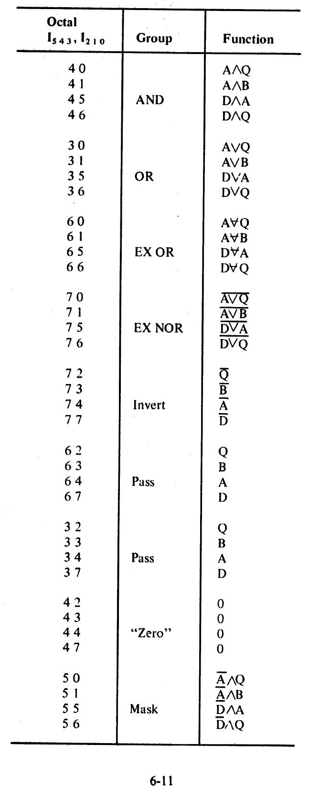

**Table 5-6 — ALU Arithmetic Mode Functions**

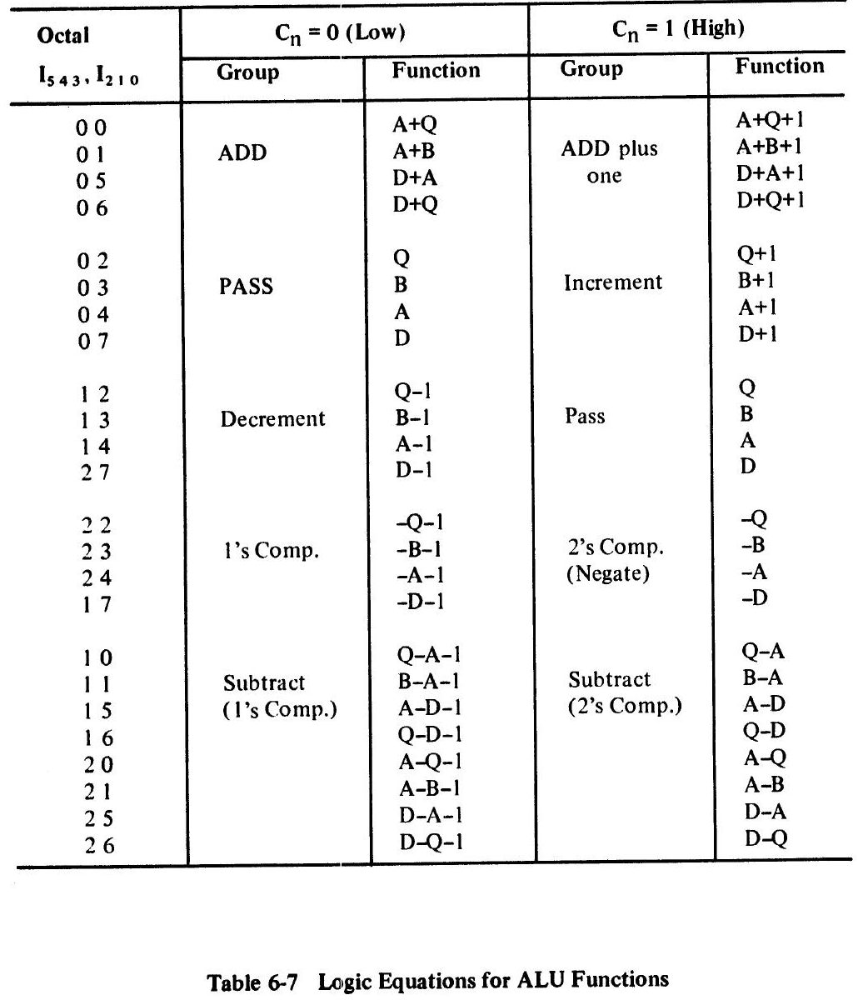

**Table 5-7 — Logic Equations for ALU Functions**

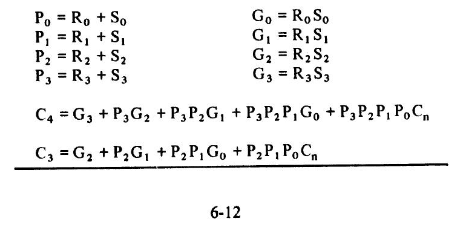

**Table 5-8 — P, G, Cn+4, and OVR Functions**

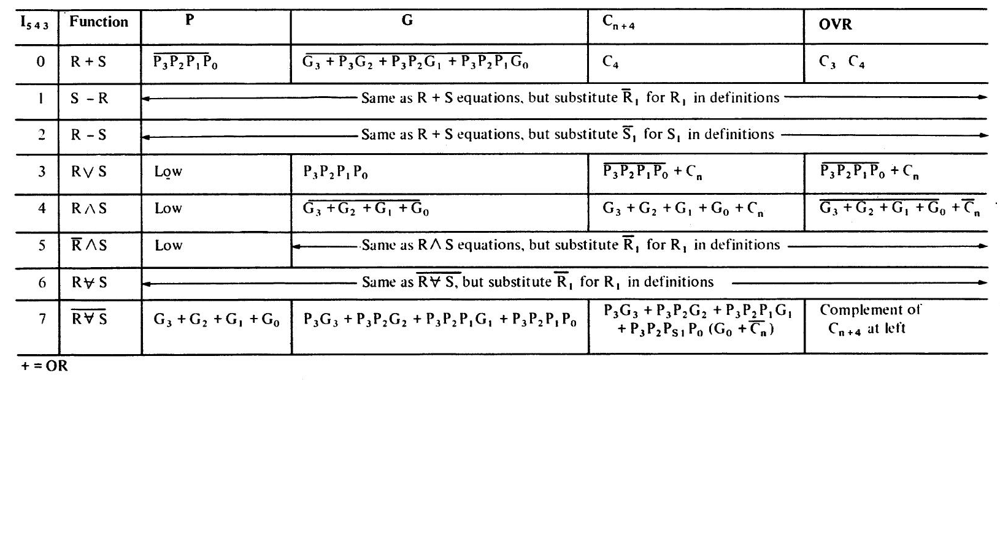

#### 5.2.7 Summary of Pin Definitions

Pin assignments for the AM2901:40-pin dual in-line package are shown in Figure 5-5.

### 5.3 INSTRUCTION STATUS REGISTERS AND DECODE

The FP11-A contains a 12-bit instruction register and two flip-flops that are bits of the status registers (FD and FL). The possible FP11-A instruction formats are presented in Chapter 4. One bit of the status register (FD) specifies double- or single-precision format and the other (FL) designates single- or double-precision integer format. The outputs of these registers are fed to the floating-point instruction decode register which consists of two 512×4-bit ROMs. The ROM outputs then generate microprocessor control (MPC) outputs to control the microprogram.

### 5.4 TRI-STATE TRANSCEIVERS AND BUFFER

The 8097 tri-state status gates are arranged as tri-state transceivers to communicate between the AMUX bus (KD11-EA) and the T-bus (FP11-A), which are 16-bit tri-state buses.

74S173s, which are tri-state flip-flops, are used to buffer UNIBUS data being passed to the AM2901s.

### 5.5 BRANCH LOGIC AND TRI-STATE CONTROL

This logic is controlled by condition code and T-bus branch ROMs in the FP11-A. Branch (BUT) bits are routed to the ROMs whose outputs condition a group of gates. These gates are enabled by the various branch conditions that may arise during floating-point operations and direct (point) the microprogram counter to the appropriate code in the microprogram to service the branch function. The BUT conditions include the condition codes, exponent negative, exponent zero, carry, overflow, and T-bus bits 0, 1, 5, 6, 8, 9, 10, 11, and 14. These functions include items such as fraction Z-bit, fraction negative, bus request, and the like.

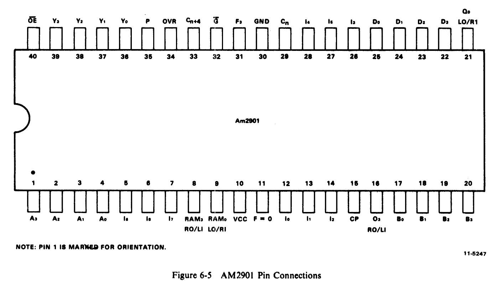

### 5.6 CONSTANTS, BYTE AND SECTOR CONTROL, SHIFT CONTROL

The constant ROMs contain the fixed-value numbers required for certain floating-point functions. The magnitude of some of the constants depends on whether the floating-point numbers are single- or double-precision and short or long integer. Thus, FD and FL are used as ROM-gating signals for proper constant selection.

The BYTE control lines enable AM2901 outputs onto the T-bus by 8-bit bytes. Any high-byte/lowbyte combination may be enabled.

Sector control is used to independently select one of four 16-bit sectors of the AM2901. Each sector clock clocks four AM2901 slices (16 bits) which are used internally to load the RAM or Q-register.

Shift and rotate signals are generated to operate the input multiplexers to the RAM and Q-registers of the AM2901. These registers may be left and right shifted and controls are provided for injection of ones or zeros into the bit stream as shifts are carried out.

## Chapter 6 — FP11-A Logic Descriptions

### 6.1 AM2901 Organization — General

The 16 AM2901 microprocessor slices in the FP11-A are organized as illustrated in Figure 6-1.

The slices are connected in parallel to form a 64-bit processor. E90 processes the four most significant bits and E61 processes the four least significant bits. The slices are grouped in three ways:

- eight bytes of two slices each, individually enabled on the output;
- four sectors of four slices each, with a common clock per sector;
- a floating-point exponent and fraction.

For example, `BYTE 6 ENB L` enables byte 6. `SECTOR 2 CLK H` clocks E86, E85, E83, and E88. E62 and E61 hold the exponent; the remaining slices hold the fraction. The `I0-I8` lines for the fraction slices are controlled separately from those for the exponent slices.

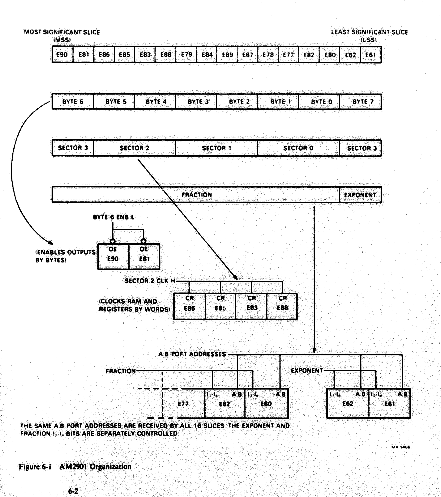

### 6.2 Data Path Bytes 0–7 [CS-M8267-0-1 (FP1–FP4)]

These schematics show the 16 AM2901 bipolar microprocessor units that make up the principal FP11-A data path. They are connected in parallel as a single 64-bit word (Figure 6-2). The word is divided into four 16-bit sectors and eight 8-bit bytes, allowing the control word to manipulate selected portions independently.

Chapter 7 explains how the RAM input and Q-register of each slice can be shifted. Shifting across slices requires RAM0 to be connected to RAM3 and Q0 to Q3. The added gates provide the basic RAM rotate and shift functions, Q-register shifts, rotation of a complete 64-bit input word during setup, and insertion of ones or zeros into the bit stream (Figure 6-3). The Q-register cannot rotate.

A right rotate wraps through the LSB; a left rotate wraps through the MSB. `F INSERT 0` inserts zero into the fraction LSB during fraction-only left shifts. Shifting the Q-register also shifts the RAM; the RAM can be shifted by itself, but the Q-register cannot. `COUT H` is inserted during division, according to whether the operation is single- or double-precision.

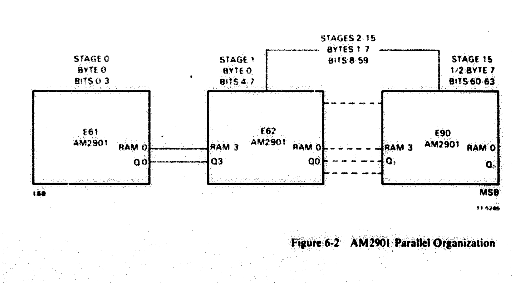

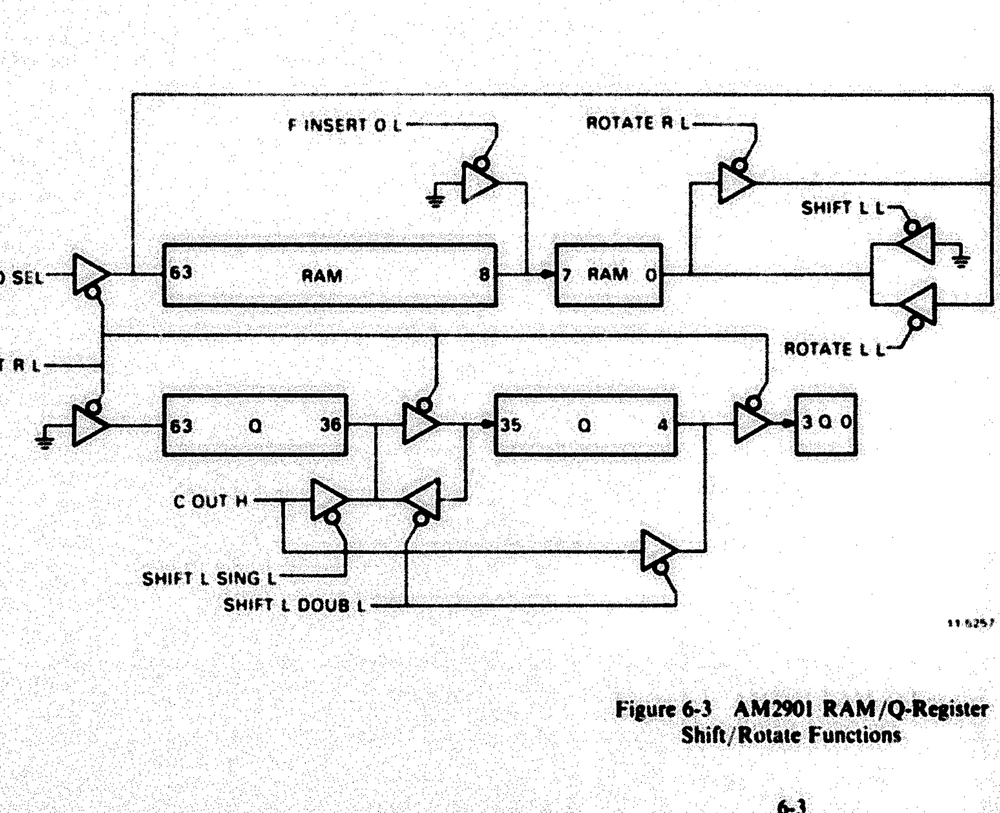

The stages are connected identically except for the rotate and shift paths, and for the exponent source, ALU function, and destination controls of byte 0 (bits 0–7), which holds the exponent [CS-M8267-0-1 (FP1)]. Separate exponent controls let the microcode operate independently on the exponent and fraction. This is required, for example, when an add or subtract aligns exponents and adjusts a fraction. Since the RAM addressing cannot select two registers at once, an operation on the exponent of a register may have to ignore its fraction, or vice versa.

#### Table 6-1 — FP11-A AM2901 Signal Interface

| Signal                      |  Lines | Function                           |
| --------------------------- | -----: | ---------------------------------- |
| A Port 0–3                  |      4 | Selects RAM A-port address         |
| B Port 0–3                  |      4 | Selects RAM B-port address         |
| F SRC 0–2                   |      3 | Fraction source bits               |
| EX SRC 0–2                  |      3 | Exponent source bits               |
| F ALU 0–2                   |      3 | Fraction arithmetic/logic function |
| EX ALU 0–2                  |      3 | Exponent arithmetic/logic function |
| F I6–I8                     |      3 | Fraction destination field         |
| EX I6–I8                    |      3 | Exponent destination field         |
| T-Bus 0–15                  |     16 | Tri-state input/output             |
| Byte 0 EN – Byte 7 EN       | 1 each | Enables the corresponding byte     |
| Sector 0 CLK – Sector 3 CLK | 1 each | Enables the corresponding sector   |

#### 6.2.1 Carry Lookahead

Two levels of carry lookahead are used for maximum addition and subtraction performance (Figure 6-4).

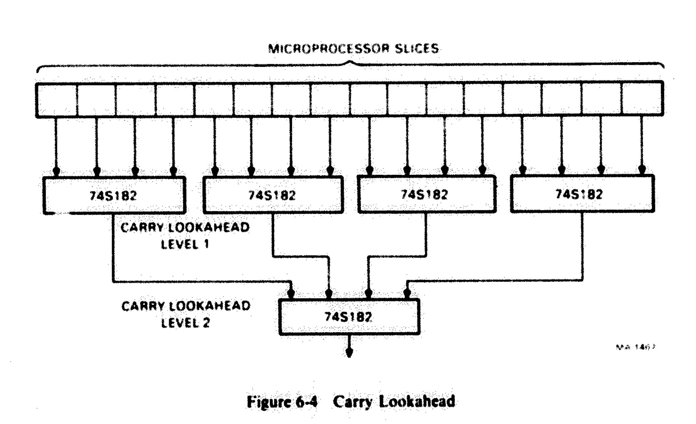

### 6.3 Tri-State Transceivers [CS-M8267-0-1 (FP5, FP6)]

The transceivers are built from 8097 tri-state gates. They either drive the T-bus from the AMUX bus or drive the AMUX bus from the T-bus.

#### 6.3.1 74S173 Buffer

The 74S173 is a quad D-type bus flip-flop (Figure 6-5). Its output is high-impedance when disabled and actively driven when enabled. With both input and output enabled, the output follows the data input when clocked. If the input is disabled while the output remains enabled, the previous state is retained.

The floating condition codes occupy the lower four bits of the 74S173 buffer and can be loaded separately from the upper 12 bits. The devices either buffer UNIBUS data during floating-point instructions or retain the floating-point status between instructions. The floating condition code in RAM (`FCCR`) is distinct from the one in the 74S173.

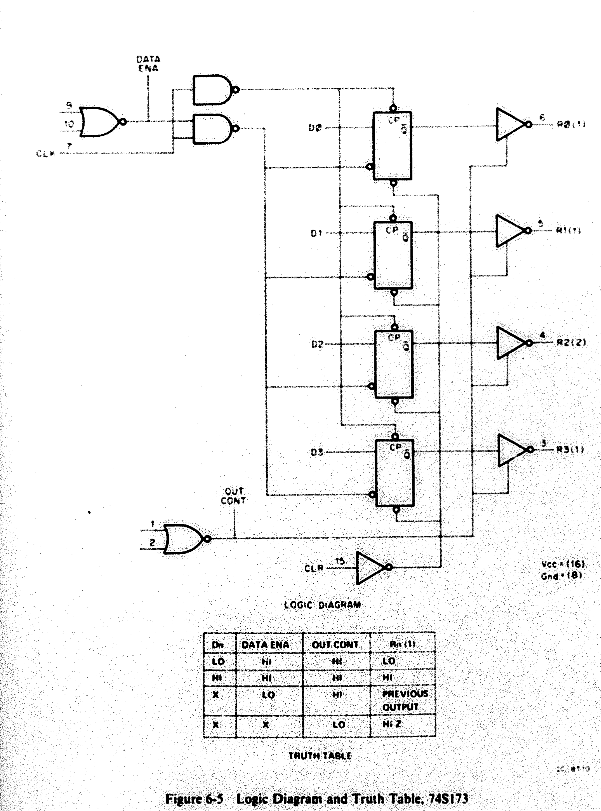

#### 6.3.2 AMUX Line

`FP7 IN L ENB L`, `FP7 IN H ENB L`, and `FP7 OUT ENB L`, generated by E17, control the 74S173s. `FP7 AMUX IN L`, also from E17, transfers the AMUX to the T-bus. `FP9 T BUS OUT H`, from ROM E53, is inverted to produce `FP7 T BUS OUT L`, which transfers the T-bus to the AMUX. E93-10 also turns off the KD11-EA AMUX drivers with `TRI-STATE AMUX L`.

The FP9 delay circuit prevents the KD11-EA and FP11-A from driving an AMUX line simultaneously. It delays the assertion of `T BUS OUT L` and the release of `TRI-STATE AMUX L` (Figure 6-6).

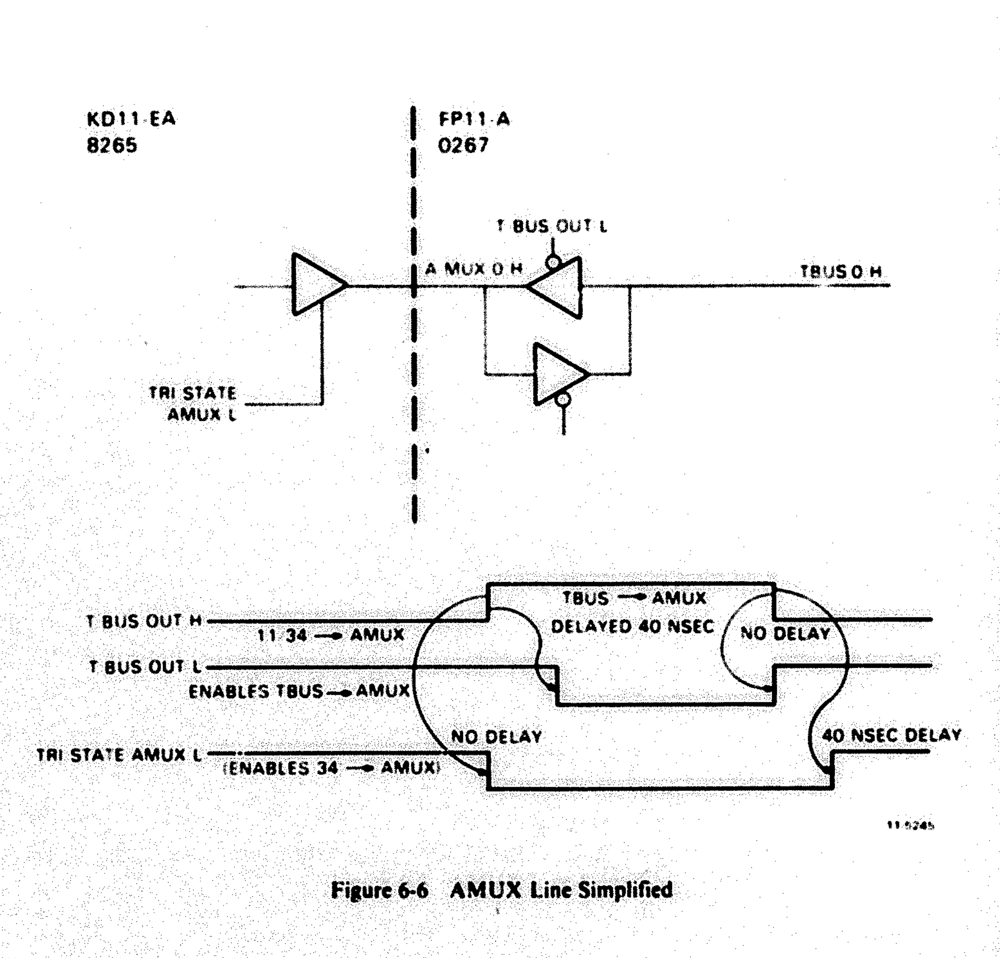

### 6.4 IR Register and Decode, Branch Logic [CS-M8267-0-1 (FP7)]

This group contains:

- miscellaneous field ROM E17;
- instruction register E65/E67;
- condition-code ROM E21;
- T-bus branch ROM E19;
- OP2 ROM E64;
- OP1 ROM E66;
- condition and status gates E32, E23, E11, and E20.

Its functions are instruction-register decode, branch control (`BUT`), and miscellaneous control.

#### 6.4.1 Instruction Register (FIR) Decode

`LOAD IR L` from the KD11-EA clocks T-bus data into the instruction register E65/E67. The upper part of the FIR goes to the OP2 ROM and the lower part to OP1. `FP9 BUT 5` enables OP1 when low.

The AMUX-to-T-bus transfer primes the data path to load the 12-bit FIR. E10 on FP8 decodes floating-point instruction bits `D15-D12 = 17`. Combined with `LOAD IR`, this loads E27, which asserts MPC09 and MPC08 and selects microaddress 1400. Further instruction decoding is controlled by the `BUT` field. FIR fields also select accumulator addresses in the AM2901 RAM.

#### 6.4.2 Branch Control (BUT)

The six `FP9 BUT 0-5` bits come from the E31 field latches on FP9. They feed four primary decode ROMs: condition code, T-bus/branch, OP1, and OP2. OP1 and OP2 use the FIR outputs to generate MPC0–MPC3.

The condition-code and T-bus ROM outputs are combined with floating-point condition and status bits to assert MPC lines. Two E13 flip-flops on FP8 retain `FL` and `FD`, allowing hardware decisions without microcode tests.

#### 6.4.3 Miscellaneous Control

ROM E17 controls input and output functions and generates `FP7 SERVICE BR PFAIL`. This asks the processor to service a bus request or power-fail interrupt during the `BUT SERVICE` state.

| Signal           | Function                           |
| ---------------- | ---------------------------------- |
| `FP7 AMUX IN L`  | Transfers AMUX to T-bus            |
| `FP7 IN L ENB L` | Loads the low 74S173s              |
| `FP7 IN H ENB L` | Loads the high 74S173s             |
| `FP7 OUT ENB L`  | Enables the 74S173s onto the T-bus |

#### 6.4.4 Shift Control

ROM E54 controls the fraction and exponent destination fields, including AM2901 shifts. ROM E55 controls the shift gates shown in Figure 6-2. Both decode the shift-control field. E55 also receives `FD` to select single- or double-precision behavior.

#### 6.4.5 A-Port and B-Port Multiplexers

The A-port multiplexer is a quad 2:1 device. The B-port multiplexer is a dual 4:1 device. The A-port selects the control-store A field or FIR bits IR6–IR7 (`AC`). The B-port selects the control-store B field, IR6–IR7 (`AC`), IR0–IR2 (`FSRC/FDST`), or `AC OR 1`.

| A-port S0 | Input selected                     |
| --------: | ---------------------------------- |
|         1 | AREG0–AREG2 from the control store |
|         0 | IR6–IR7 (`AC`)                     |

| B-port S1 | B-port S0 | Input selected                     |
| --------: | --------: | ---------------------------------- |
|         0 |         0 | `AC OR 1`                          |
|         0 |         1 | IR0–IR2 (`FSRC/FDST`)              |
|         1 |         0 | IR6–IR7 (`AC`)                     |
|         1 |         1 | BREG0–BREG2 from the control store |

The resulting RAM ranges are 10–17 for the control-store address, 0–3 for `AC OR 1` and `AC`, and 0–5 for `FSRC/FDST`.

#### 6.4.6 Constant ROMs and Byte Control

The byte-control ROM E76 and constant ROMs E68/E75 are on FP10. They share a field because either the constant ROMs or AM2901 byte outputs are enabled, never both. Byte control can enable any high-byte/low-byte combination onto the T-bus.

`FD` and `FL` select constants for single or double precision and short or long integer operation. E68 also receives `A1`, the NAND of IR0–IR2, to select a special constant when general register 7 is used.

#### 6.4.7 Sector Clock Control (E49, E60)

Any combination of the four sector clocks can be selected. Each clocks the RAM or Q-register in four AM2901 slices.

#### 6.4.8 Control Store

The floating-point control-store ROMs track the MPC address while the KD11-EA is executing base-machine microcode. `FPX L` holds the floating-point control-store latches clear so that this unrelated microcode is not loaded.

When a floating-point instruction is decoded and control moves to MPC location 1400, `FPX L` is released and the latches load the FP11-A ROM outputs (Figure 6-7).

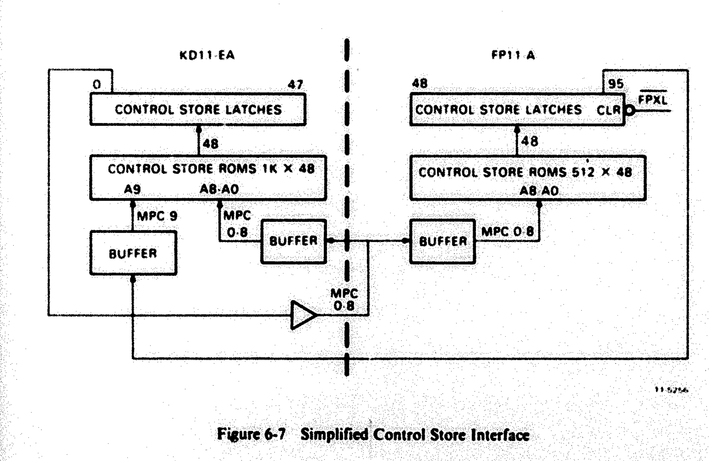

## Chapter 7 — Floating-Point Processor Control

### 7.1 Introduction

Figure 7-1 shows the FP11-A and KD11-EA. The principal FP11-A components are:

- AM2901 bipolar microprocessor;
- 12-bit instruction register;
- two-bit floating-point status register;
- floating-point IR decode, using two 512×4 ROMs;
- 256×8 constant-store ROM;
- control store, using twelve 512×4 ROMs;
- branch and tri-state control;
- tri-state buffers.

The diagram also shows the main KD11-EA elements and their connection to the FP11-A.

#### 7.1.1 AM2901 Bipolar Microprocessor

Chapter 5 describes this unit in detail. The control-store microprogram controls its data-path functions.

#### 7.1.2 Instruction Register

This 12-bit register receives floating-point instructions from memory through the tri-state bus. Its outputs and the floating-point status (`FPS`) bits feed the IR-decode ROMs.

#### 7.1.3 FD and FL Bits

This two-bit part of the floating-point status register selects single or double floating-point format (`FD`) and short or long integer format (`FL`). Together with the instruction register, these bits feed the IR-decode ROMs and generate control-store commands. The rest of `FPS` is held in either the AM2901 RAM or the 74S173 buffer.

#### 7.1.4 Floating-Point IR Decode

Two 512×4 ROMs decode the instruction register and `FPS`. Their outputs generate commands for the control store.

#### 7.1.5 Constant ROMs

Two 256×8 ROMs contain constants used by floating-point operations, including the octal value 200 added to or subtracted from exponents.

#### 7.1.6 Control Store

Twelve 512×4 ROMs contain the FP11-A microprogram.

#### 7.1.7 Branch and Tri-State Control

This logic handles `BUT` conditions by changing the MPC lines. It also controls the T-bus during input and output.

#### 7.1.8 Tri-State Buffers

Sixteen 8097 elements buffer 16-bit words from the FP11-A to the KD11-EA. Four 74S173 devices form the internal 16-bit register in the opposite direction.

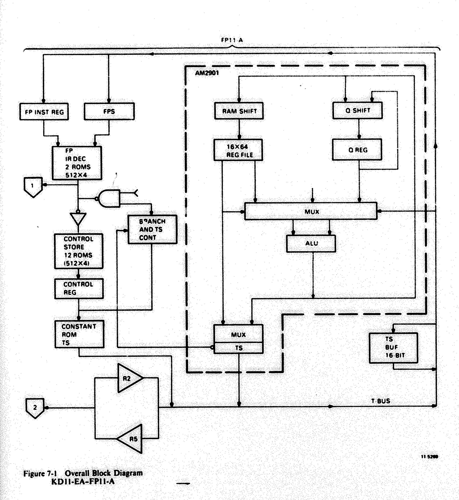

### 7.2 FP11-A Signal Interface

The board receives these signals through J1–J5. J2–J5 form one physical connector with four sections.

#### Table 7-1 — FP11-A Signal Interface

| Signal               | Direction                                                  | Function                                                                                                                                                  |
| -------------------- | ---------------------------------------------------------- | --------------------------------------------------------------------------------------------------------------------------------------------------------- |
| `MPC <00:09> L`      | CPU to FP11-A; MPC09 is also supplied by FP11-A to the CPU | Microprogram address. Normally derived from CPU microcode, but either processor can alter it.                                                             |
| `AMUX <00:15> L`     | Bidirectional                                              | Transfers instructions, operands, and FP11-A status between the KD11-EA and FP11-A.                                                                       |
| `PROC CLK L`         | CPU to FP11-A                                              | KD11-EA clock used to load FP11-A registers and RAM.                                                                                                      |
| `PROC INIT L`        | CPU to FP11-A                                              | Initializes FP11-A status registers.                                                                                                                      |
| `LOAD IR L`          | CPU to FP11-A                                              | Loads the FP11-A instruction register from the AMUX lines.                                                                                                |
| `TRI-STATE AMUX L`   | FP11-A to CPU                                              | Removes KD11-EA drivers from AMUX and allows the FP11-A to drive it.                                                                                      |
| `SERVICE BR PFAIL L` | FP11-A to CPU                                              | Requests service of a bus request or power-fail interrupt in the `BUT SERVICE` state. Used when aborting a floating `MUL`, `MOD`, `DIV`, `ADD`, or `SUB`. |
| `PFAIL BR PEND H`    | CPU to FP11-A                                              | Indicates a pending interrupt. The FP11-A uses it to abort long operations and keep interrupt latency below 20 μs.                                        |

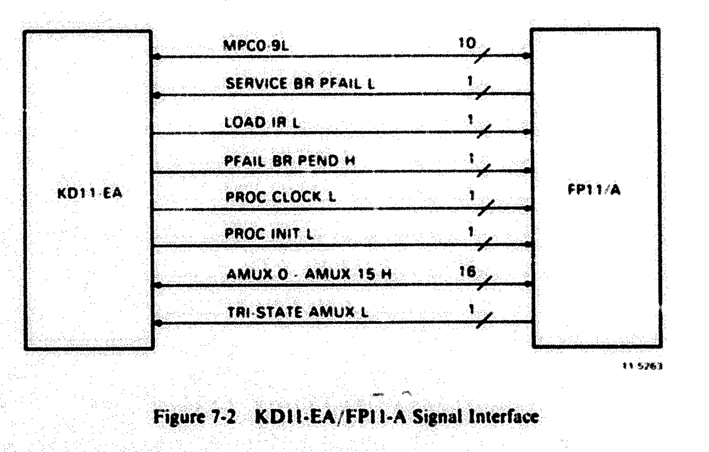

### 7.3 FP11-A RAM

Before describing the control logic, this section explains the AM2901 RAM transforms used at the start of arithmetic and data-move operations.

A normal FP11-A word contains a sign bit, an eight-bit exponent, and a 55-bit fraction. During setup, it is rearranged so that the exponent occupies the low-order end of the ALU. This lets operations such as `ADD` inspect the exponent before aligning the fractions (Figure 7-3).

Setup loads an operand into a working register, rotates it, removes the sign and exponent, and inserts the hidden and guard bits. Registers X10–X14 provide working storage for fraction, exponent, and sign processing. Accumulator data normally goes to X11 and the source operand to X12. The transformation is reversed before the result is sent over the T-bus to the KD11-EA.

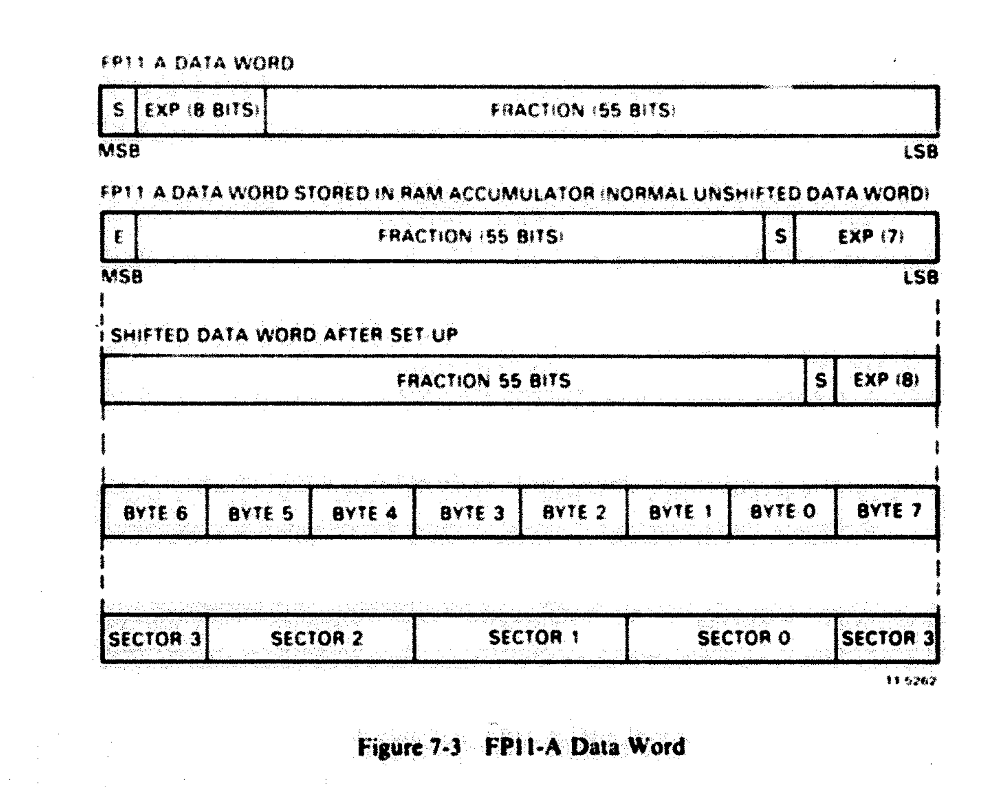

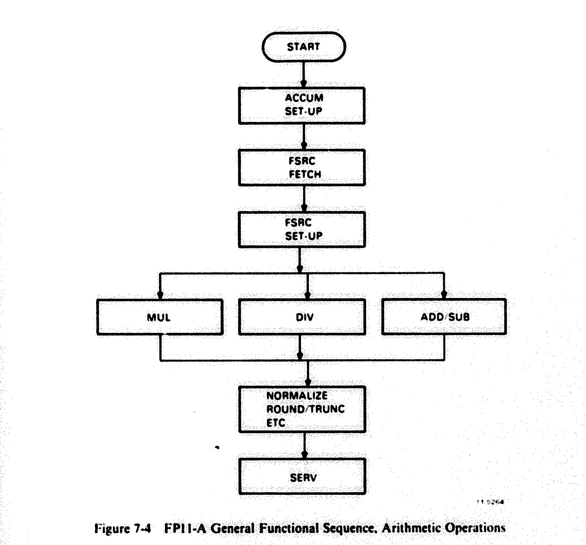

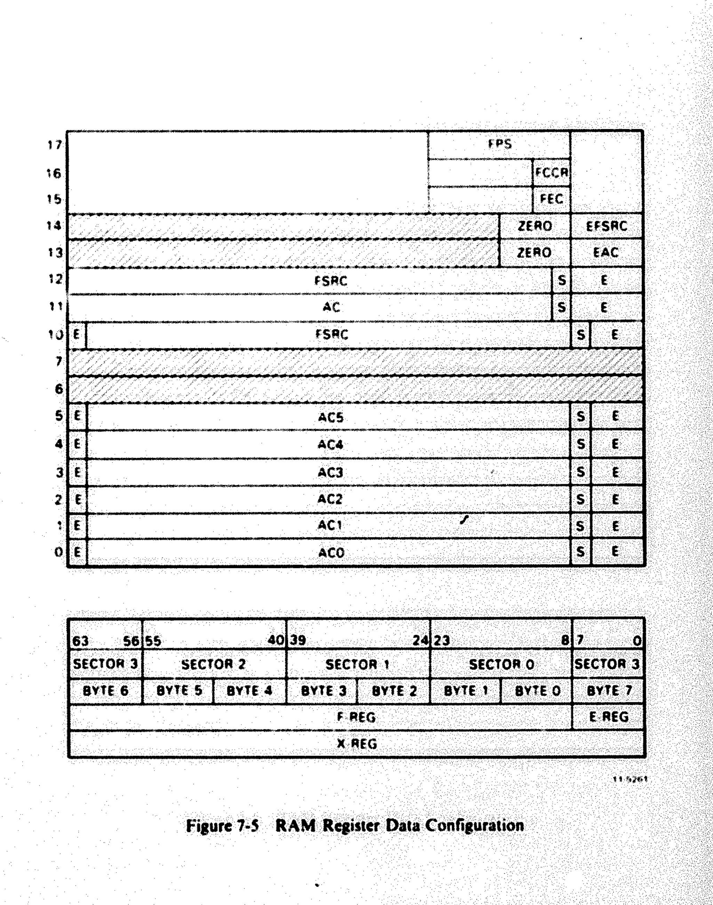

### 7.4 FP11-A Control Word

A complete KD11-EA/FP11-A control word is 96 bits: the normal 48-bit CPU word plus 48 FP11-A bits. The flow diagrams therefore show both halves together.

The FP11-A control store contains twelve 512×4 ROMs. The KD11-EA store contains twelve 1K×4 ROMs. Both produce 48-bit words and run in parallel. During a floating-point operation, control can move between the base-machine and floating-point control stores as required.

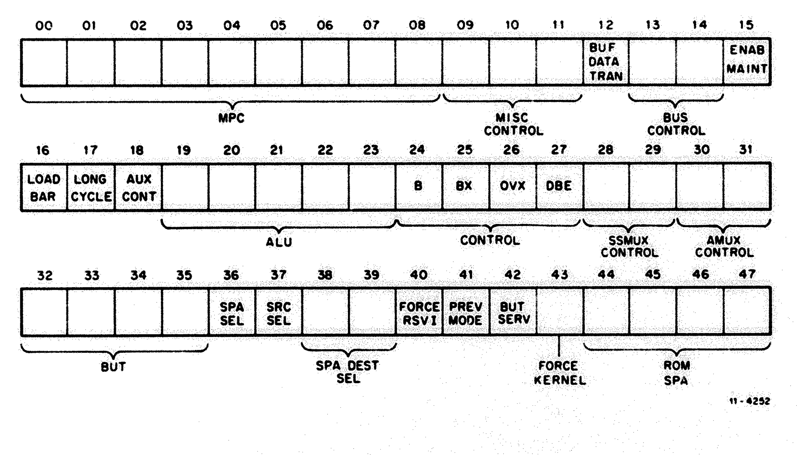

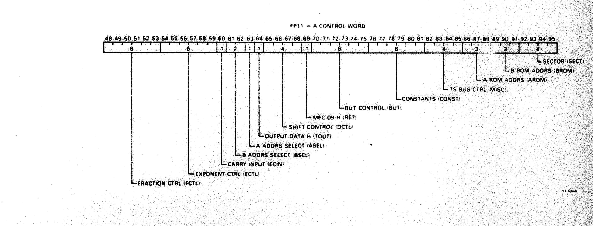

Floating-point and normal instructions are sent to both instruction decoders. For a floating-point instruction, the FP11-A forces MPC address 1400, the start of its microcode. Without the FP11-A, the KD11-EA treats the instruction as reserved and enters service address 000 to trap.

Tables 7-2 through 7-11 define the FP11-A control word. Table 7-3 defines the fraction and exponent source/ALU fields. Tables 7-4 and 7-5 define the shift and destination ROMs.

For example, `SLALU0Q` is octal 15. It applies to both the fraction and exponent and performs:

```text
B ← SL0(ALU)
F ← Y
Q ← SLC63(Q)
```

The B-port receives the ALU result shifted left with zero inserted at its LSB. The ALU result goes to Y. The Q-register shifts left and receives the carry-out bit at its LSB.

Table 7-5 gives the ROM outputs for each destination-control field. For `SLALU0Q`, `FDST=6` and `EX DST=6` select a left shift and load of RAM and Q in both data paths. High levels on `ROTATE R L`, `SHIFT R L`, `ROTATE L L`, and `F INSERT 0 L` disable those gates. `SHIFT L L` inserts zero into the RAM LSB. Depending on `FD`, either `SHIFT L DOUB L` or `SHIFT L SING L` inserts carry-out into the Q-register path.

Table 7-6 defines the `BUT` field. A mnemonic such as `EZBT.Y8.Y9` (octal 62) branches simultaneously on exponent zero and two T-bus bits, selecting one of eight destinations. A T-bus test mnemonic reflects the value currently enabled onto the bus; Table 7-14 lists these assignments.

Table 7-7 selects either constants or AM2901 bytes for the T-bus. Codes of 240 or more select the constant ROMs. `FD` and `FL` choose between paired constant values. `FDFLBAR` denotes the complemented `FD` and `FL` bits. Some constants also depend on immediate mode (`GR7`).

Tables 7-9 and 7-10 define the A- and B-port ROM addresses. Hardware supplies the fourth address bit when a ROM address is selected. `FEC`, `FCCR`, and `FPS` name RAM registers 15, 16, and 17.

#### Table 7-2 — ROM Control Word Definitions

| Bits  | Field                                | Setting                                                                             | Definition                            |
| ----- | ------------------------------------ | ----------------------------------------------------------------------------------- | ------------------------------------- |
| 48–53 | Fraction control (`FCTL`)            | Table 7-3                                                                           | Fraction source and ALU function      |
| 54–59 | Exponent control (`ECTL`)            | Table 7-3                                                                           | Exponent source and ALU function      |
| 60    | Carry input (`ECIN`)                 | 0: no carry; 1: carry in                                                            | Carry control                         |
| 61–62 | B-address select (`BSEL`)            | 00: `AC OR 1`; 01: `FDST/FSRC`; 10: `AC`; 11: B-ROM address                         | Selects the RAM B-port address        |
| 63    | A-address select (`ASEL`)            | 0: `AC`; 1: A-ROM address                                                           | Selects the RAM A-port address        |
| 64    | T-bus output (`TOUT`)                | 0: disabled; 1: asserted, with KD11-EA AMUX drivers disabled                        | T-bus control                         |
| 65–68 | Shift control (`DCTL`)               | Table 7-4                                                                           | Destination and shift control         |
| 69    | `MPC09 H`                            | 0: leave the FP11-A store after the next instruction; 1: remain in the FP11-A store | MPC high bit                          |
| 70–75 | Branch control (`BUT`)               | Table 7-6                                                                           | Branch/test enables                   |
| 76–81 | Constants and byte enables (`CONST`) | Table 7-7                                                                           | Constant or AM2901 byte output enable |
| 82–85 | Tri-state bus (`MISC`)               | Table 7-8                                                                           | T-bus control                         |
| 86–88 | A-ROM address (`AROM`)               | Table 7-9                                                                           | RAM A-port address                    |
| 89–91 | B-ROM address (`BROM`)               | Table 7-10                                                                          | RAM B-port address                    |
| 92–95 | Sector (`SECT`)                      | Table 7-11                                                                          | Sector clocks                         |

#### Table 7-3 — Fraction and Exponent Control Fields

All codes are octal.

| ALU function | Code | ALU function | Code |
| ------------ | ---: | ------------ | ---: |
| `A AND Q`    |   40 | `DBAR`       |   77 |
| `A AND B`    |   41 | `QPASS`      |   62 |
| `D AND A`    |   45 | `BPASS`      |   63 |
| `D AND Q`    |   46 | `APASS`      |   64 |
| `A OR Q`     |   30 | `DPASS`      |   67 |
| `A OR B`     |   31 | `ZERO`       |   42 |
| `D OR A`     |   35 | `ABAR AND Q` |   50 |
| `D OR Q`     |   36 | `ABAR AND B` |   51 |
| `A XOR Q`    |   60 | `ABAR AND A` |   55 |
| `A XOR B`    |   61 | `ABAR AND Q` |   56 |
| `D XOR A`    |   65 | `A PLUS Q`   |   00 |
| `D XOR Q`    |   66 | `A PLUS B`   |   01 |
| `A XNOR Q`   |   70 | `D PLUS A`   |   05 |
| `A XNOR B`   |   71 | `D PLUS Q`   |   06 |
| `D XNOR A`   |   75 | `Q PLUS`     |   02 |
| `D XNOR Q`   |   76 | `B PLUS`     |   03 |
| `QBAR`       |   72 | `A PLUS`     |   04 |
| `BBAR`       |   73 | `D PLUS`     |   07 |
| `ABAR`       |   74 | `Q-1`        |   12 |
|              |      | `B-1`        |   13 |
|              |      | `A-1`        |   14 |
|              |      | `D-1`        |   17 |
|              |      | `-Q-1`       |   22 |
|              |      | `-B-1`       |   23 |
|              |      | `-A-1`       |   24 |
|              |      | `-D-1`       |   27 |
|              |      | `Q-A-1`      |   10 |
|              |      | `B-A-1`      |   11 |
|              |      | `A-D-1`      |   15 |
|              |      | `Q-D-1`      |   16 |
|              |      | `A-Q-1`      |   20 |
|              |      | `A-B-1`      |   21 |
|              |      | `D-A-1`      |   25 |
|              |      | `D-Q-1`      |   26 |

The source scan prints `ABAR AND Q` for both codes 50 and 56.

#### Table 7-4 — Shift and Destination Control ROM Outputs

All codes are octal. `F ← Y` routes the ALU F output to Y.

| Function      | Code | Path     | Data transfer                                                   |
| ------------- | ---: | -------- | --------------------------------------------------------------- |
| `NOP`         |   00 | Both     | —                                                               |
| `LDBT`        |   01 | Both     | `B ← ALU`, `T ← Y`                                              |
| `LDBE`        |   02 | Both     | `B ← ALU`, `F ← Y`                                              |
| `LDQI`        |   03 | Both     | `Q ← ALU`, `F ← Y`                                              |
| `ROTL`        |   04 | Both     | `B ← ROTL(ALU)`, `F ← Y`                                        |
| `ROTR`        |   05 | Both     | `B ← ROTR(ALU)`, `F ← Y`                                        |
| `SLALU0`      |   06 | Both     | `B ← SL0(ALU)`, `F ← Y`                                         |
| `SR0ALU`      |   07 | Both     | `B ← SR0(ALU)`, `F ← Y`                                         |
| `SR1ALU`      |   10 | Both     | `B ← SR1(ALU)`, `F ← Y`                                         |
| `SLALU0.LDBE` |   11 | Fraction | Fraction: `B ← SL1(ALU)`, `F ← Y`; exponent: `B ← ALU`, `F ← Y` |
| `SR1ALU.LDBF` |   12 | Fraction | Fraction: `B ← SR1(ALU)`, `F ← Y`; exponent: `B ← ALU`, `F ← Y` |
| `SR0ALUQ`     |   14 | Both     | `B ← SR0(ALU)`, `F ← Y`, `Q ← SR0(Q)`                           |
| `SLALU0Q`     |   15 | Both     | `B ← SL0(ALU)`, `F ← Y`, `Q ← SLC63(Q)`                         |

#### Table 7-5 — Shift and Destination Control ROM Output Values

`H` and `L` are the physical ROM output levels. The two starred values depend on `FD`.

| Function           | F DST | EX DST | Shift L double L | Shift L single L | Shift R L | Rotate L L | Shift L L | F insert 0 L | 1 or Q shift L L | Rotate R L |
| ------------------ | ----: | -----: | :--------------: | :--------------: | :-------: | :--------: | :-------: | :----------: | :--------------: | :--------: |
| `NOP` (00)         |     1 |      1 |        H         |        H         |     H     |     H      |     H     |      H       |        H         |     H      |
| `LDBT` (01)        |     2 |      2 |        H         |        H         |     H     |     H      |     H     |      H       |        H         |     H      |
| `LDBE` (02)        |     3 |      3 |        H         |        H         |     H     |     H      |     H     |      H       |        H         |     H      |
| `LDQI` (03)        |     0 |      0 |        H         |        H         |     H     |     H      |     H     |      H       |        H         |     H      |
| `ROTL` (04)        |     7 |      7 |        H         |        H         |     H     |     L      |     H     |      H       |        H         |     H      |
| `ROTR` (05)        |     5 |      5 |        H         |        H         |     H     |     H      |     H     |      H       |        H         |     L      |
| `SLALU0` (06)      |     7 |      7 |        H         |        H         |     H     |     H      |     L     |      H       |        H         |     H      |
| `SR0ALU` (07)      |     5 |      5 |        H         |        H         |     L     |     H      |     H     |      H       |        L         |     H      |
| `SR1ALU` (10)      |     5 |      5 |        H         |        H         |     L     |     H      |     H     |      H       |        H         |     H      |
| `SLALU0.LDBE` (11) |     7 |      3 |        H         |        H         |     H     |     H      |     H     |      L       |        H         |     H      |
| `SR1ALU.LDBF` (12) |     5 |      3 |        H         |        H         |     L     |     H      |     H     |      H       |        H         |     H      |
| `SR0ALUQ` (14)     |     4 |      4 |        H         |        H         |     L     |     H      |     H     |      H       |        L         |     H      |
| `SLALU0Q` (15)     |     6 |      6 |       `*`        |       `†`        |     H     |     H      |     L     |      H       |        H         |     H      |

`*` is 1 when `FD=1` and 0 when `FD=0`. `†` is 1 when `FD=0` and 0 when `FD=1`.

#### Table 7-6 — BUT Control (Branch or Test Enables)

All codes are octal.

| Function         | Code | Definition                                    |
| ---------------- | ---: | --------------------------------------------- |
| `NOP`            |   00 | No test                                       |
| `ENBT`           |   54 | Exponent sign bit                             |
| `EZBT`           |   52 | Exponent zero-detect bit                      |
| `BUSRQ`          |   55 | Bus request/grant pending                     |
| `FNBT`           |   56 | Fraction sign bit                             |
| `XZBT`           |   57 | Combined zero-detect bit                      |
| `Q8.Q40`         |   60 | Multiplier LSB                                |
| `COUT63`         |   61 | Fraction carry-out                            |
| `EZBT.OP1A`      |   13 | `EZBT`, `OP1A`                                |
| `FID`            |   41 | Floating interrupt disable                    |
| `EZBT.Y8.Y9`     |   62 | `EZBT`, T-bus 0, T-bus 1                      |
| `EZBT.Y8`        |   63 | `EZBT`, T-bus 0                               |
| `FNBT.Y8`        |   64 | `FNBT`, T-bus 1                               |
| `ENBT.EZBT.FNBT` |   65 | See above                                     |
| `FNBT.XZBT`      |   66 | See above                                     |
| `FIV`            |   42 | Interrupt on overflow                         |
| `Y62`            |   43 | T-bus 6                                       |
| `FIU`            |   45 | Interrupt on underflow                        |
| `FIUV`           |   46 | Interrupt on undefined variable               |
| `FIC`            |   47 | Interrupt on integer-conversion error         |
| `FT`             |   44 | Truncate bit                                  |
| `FNBT.EZBT`      |   67 | See above                                     |
| `Y8`             |   50 | T-bus 0                                       |
| `Y61`            |   44 | T-bus 5                                       |
| `FD.FIV`         |   02 | Floating-double bit and interrupt on overflow |
| `Y62.OP1A`       |   03 | T-bus 6 and `OP1A`                            |
| `BREAKOUT`       |   31 | Initial instruction decode                    |
| `FD`             |   32 | Floating-double mode bit                      |
| `OP1B`           |   34 | Instruction decode                            |
| `OP1C`           |   35 | Instruction decode                            |
| `OP1D`           |   36 | Instruction decode                            |
| `OP1E`           |   37 | Instruction decode                            |
| `OP2A`           |   77 | Instruction decode                            |
| `FDST`           |   71 | Decode floating destination                   |
| `FSRC`           |   71 | Decode floating source                        |
| `DST`            |   72 | Decode destination                            |
| `SRC`            |   72 | Decode source                                 |
| `GR7`            |   73 | General register 7                            |
| `GR7.FLBAR`      |   74 | General register 7 with `FL=0`                |
| `FL`             |   75 | `FL=1`                                        |
| `FLBAR`          |   76 | `FL=0`                                        |

#### Table 7-7 — Constants and Byte Enable Output

All codes are octal unless noted otherwise.

| Constant or byte selection | Code | Selection note                   |
| -------------------------- | ---: | -------------------------------- |
| `NOP`                      |   00 |                                  |
| `ZERO`                     |   53 |                                  |
| `ONES`                     |   40 |                                  |
| `OCT2`                     |   41 |                                  |
| `OCT5`                     |   42 |                                  |
| `OCT4`                     |   43 |                                  |
| `OCT6`                     |   44 |                                  |
| `OCT10`                    |   45 |                                  |
| `OCT12`                    |   46 |                                  |
| `OCT14`                    |   47 |                                  |
| `OCT100`                   |   50 |                                  |
| `OCT200`                   |   51 |                                  |
| `OCT100000`                |   60 |                                  |
| `OCT40000`                 |   61 |                                  |
| `OCT147757`                |   63 |                                  |
| `(143,159)`                |   62 | 143 when `FL=0`; 159 when `FL=1` |
| `OCT10.4.2`                |   64 |                                  |
| `OCT4.2`                   |   65 | 4 when `FL=1`; 2 when `FL=0`     |
| `FDFLBAR`                  |   66 | Complemented `FD` and `FL`       |
| `OCT4.10.2`                |   67 |                                  |
| `(56,24)`                  |   55 |                                  |
| `(57,25)`                  |   56 |                                  |
| `(58,26)`                  |   57 |                                  |
| `OCT244`                   |   52 |                                  |
| `(31,15)`                  |   54 |                                  |
| `(56,24)*`                 |   70 | Byte-swapped on the T-bus        |
| `OCT170000`                |   71 |                                  |
| `BYTE 10`                  |   03 | Bytes 1 and 0                    |
| `BYTE 32`                  |   04 | Bytes 3 and 2                    |
| `BYTE 43`                  |   05 | Bytes 4 and 3                    |
| `BYTE 54`                  |   06 | Bytes 5 and 4                    |
| `BYTE 65`                  |   07 | Bytes 6 and 5                    |
| `BYTE 76`                  |   10 | Bytes 7 and 6                    |
| `BYTE 07`                  |   11 | Bytes 0 and 7                    |

Parenthesized values are selected by `FD`, `FL`, and, for three-value entries, immediate mode (`GR7`).

#### Table 7-8 — Tri-State Bus Control

All codes are octal.

| Function         | Code | Definition                                                                   |
| ---------------- | ---: | ---------------------------------------------------------------------------- |
| `TBUS.KD11-EA`   |   00 | Enables AMUX lines onto the T-bus                                            |
| `TBUS.BUF`       |   01 | Enables the 74S173 buffer onto the T-bus                                     |
| `BUF.TBUS`       |   04 | Loads the buffer from the T-bus                                              |
| `BUF.KD11-EA`    |   05 | Enables AMUX onto the T-bus and loads the buffer                             |
| `FDFL.TBUS`      |   06 | Loads the two-bit `FPS` register from the T-bus                              |
| `FCC.TBUS`       |   07 | Loads the low four buffer bits from the T-bus                                |
| `SERV.BR`        |   10 | Requests bus-request or power-fail service from the KD11-EA                  |
| `NOP`            |   11 | No operation                                                                 |
| `FDFL.BUF`       |   12 | Enables the buffer onto the T-bus and loads the two-bit `FPS` register       |
| `FDFL.BUF.TBUS`  |   13 | Loads the two-bit `FPS` register and the buffer from the T-bus               |
| `FDFL.BUFH.TBUS` |   15 | Loads the two-bit `FPS` register and the upper 12 buffer bits from the T-bus |

#### Table 7-9 — A-Address ROM

| Address | Octal code | Description     |
| ------- | ---------: | --------------- |
| `AR10`  |          0 | RAM register 10 |
| `AR11`  |          1 | RAM register 11 |
| `AR12`  |          2 | RAM register 12 |
| `AR13`  |          3 | RAM register 13 |
| `AR14`  |          4 | RAM register 14 |
| `FEC`   |          5 | RAM register 15 |
| `FCCR`  |          6 | RAM register 16 |
| `FPS`   |          7 | RAM register 17 |

The `AR10`–`AR14` entries select an L, E, or X working register on the A-port.

#### Table 7-10 — B-Address ROM

| Address | Octal code | Description     |
| ------- | ---------: | --------------- |
| `BR10`  |          0 | RAM register 10 |
| `BR11`  |          1 | RAM register 11 |
| `BR12`  |          2 | RAM register 12 |
| `BR13`  |          3 | RAM register 13 |
| `BR14`  |          4 | RAM register 14 |
| `FEC`   |          5 | RAM register 15 |
| `FCCR`  |          6 | RAM register 16 |
| `FPS`   |          7 | RAM register 17 |

The `BR10`–`BR14` entries select an L, E, or X working register on the B-port.

#### Table 7-11 — Sector Enable

The four-bit sector field has one bit per sector clock. A set bit clocks that sector; code zero clocks none.

| Function | Octal code | Sectors clocked |
| -------- | ---------: | --------------- |
| `S1`     |         01 | 0               |
| `S2`     |         02 | 1               |
| `S3`     |         03 | 1–0             |
| `S4`     |         04 | 2               |
| `S7`     |         07 | 2–0             |
| `S10`    |         10 | 3               |
| `S14`    |         14 | 3–2             |
| `S17`    |         17 | 3–0             |

### 7.5 IR Register and Decode, Branch (BUT) Logic

The four IR-decode ROMs are the condition-code, T-bus branch, OP2, and OP1 ROMs. The six-bit `BUT` field drives all four. OP1 and OP2 also receive instruction-register bits and generate MPC0–MPC3. Table 7-12 shows which ROMs decode each `BUT` field pattern; `X` means don’t care and `Z` marks bits decoded by that ROM.

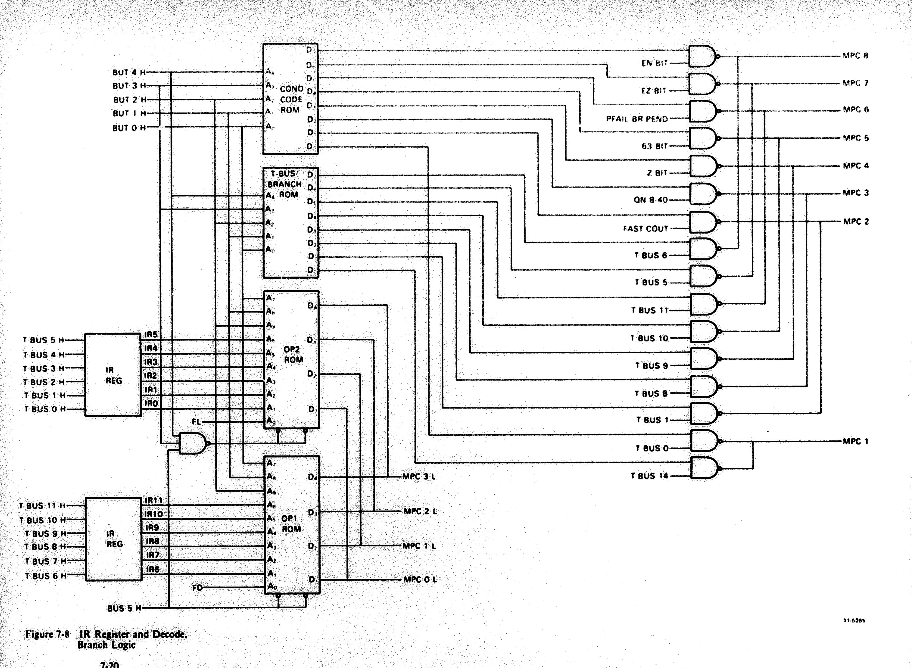

#### Table 7-12 — BUT Control Functions

##### Condition-code ROM only (`A5:A3 = X01`)

| A2:A0 | Test                      |
| ----- | ------------------------- |
| 000   | T-bus 0 (`Y8`)            |
| 001   | Unused                    |
| 010   | Exponent zero (`EZ`)      |
| 011   | Unused                    |
| 100   | Exponent negative (`EN`)  |
| 101   | `PFAIL BR PEND` / `BUSRQ` |
| 110   | Fraction negative (`FN`)  |
| 111   | Fraction zero (`FZ`)      |

##### T-bus ROM only (`A5:A3 = X00`)

| A2:A0 | Test                   |
| ----- | ---------------------- |
| 000   | T-bus 14 (`FID`)       |
| 001   | T-bus 9 (`FIV`)        |
| 010   | T-bus 6 (`Y62`)        |
| 011   | T-bus 5 (`Y61` / `FT`) |
| 100   | T-bus 10 (`FIU`)       |
| 101   | T-bus 11 (`FIUV`)      |
| 110   | T-bus 8 (`FIC`)        |
| 111   | Unused                 |

##### Both condition-code and T-bus ROMs (`A5:A3 = X10`)

| A2:A0 | Tests                                |
| ----- | ------------------------------------ |
| 000   | `Q8.Q40`                             |
| 001   | `COUT63`                             |
| 010   | `FZ`, T-bus 0 (`Y8`), T-bus 1 (`Y9`) |
| 011   | `FZ`, T-bus 0 (`Y8`)                 |
| 100   | `EN`, T-bus 0 (`Y8`)                 |
| 101   | `EN`, `FZ`, `FN`                     |
| 110   | `EN`, `XZ`                           |
| 111   | `EN`, `FZ`                           |

With `A5:A3 = X11`, neither ROM is enabled.

##### OP1 ROM (`A9:A7 = 0XX`)

| A2:A0 | Function       |
| ----- | -------------- |
| 000   | `NOP`          |
| 001   | `BUT Breakout` |
| 010   | `BUT FD`       |
| 011   | `OP1A`         |
| 100   | `OP1B`         |
| 101   | `OP1C`         |
| 110   | `OP1D`         |
| 111   | `OP1E`         |

##### OP2 ROM (`A9:A7 = 111`)

| A2:A0 | Function    |
| ----- | ----------- |
| 000   | `NOP`       |
| 001   | `FDST/FSRC` |
| 010   | `DST/SRC`   |
| 011   | `GR7`       |
| 100   | `GR7.FLBAR` |
| 101   | `FL`        |
| 110   | `FLBAR`     |
| 111   | `OP2A`      |

For example, with control-store bits CS71:CS72 equal to 0:1, the condition-code ROM decodes A0–A2. A2:A0 equal to 010 tests `EZ`. If CS71:CS72 equal 1:0, both the condition-code and T-bus ROMs generate branch enables.

#### Table 7-13 — FP11-A MPC BUT Bits

| MPC bit | KD11-EA | T-bus ROM | Condition ROM | OP1 ROM | OP2 ROM |
| ------: | ------- | --------- | ------------- | ------- | ------- |
|       0 | IR00    | —         | —             | OP10    | OP20    |
|       1 | ZBIT    | TS0       | TS14          | OP11    | OP21    |
|       2 | C05     | TS1       | XOUT          | OP12    | OP22    |
|       3 | SP15    | TS8       | Q8-40         | OP13    | OP23    |
|       4 | BX00    | TS9       | ZXBT          | —       | —       |
|       5 | BX01    | TS10      | XNBT          | —       | —       |
|       6 | NBIT    | TS11      | BUSRQ         | —       | —       |
|       7 | COUT    | TS5       | FZBT          | —       | —       |
|       8 | —       | TS6       | ENBT          | —       | —       |

#### Table 7-14 — FP11-A T-Bus Assignment

| T-bus test | Status bit | Internal name |
| ---------- | ---------- | ------------- |
| TS0        | —          | Y8            |
| TS1        | —          | Y9            |
| TS5        | FT         | Y61           |
| TS6        | —          | Y62           |
| TS8        | FIC        | —             |
| TS9        | FIV        | —             |
| TS10       | FIU        | —             |
| TS11       | FIUV       | —             |
| TS14       | FID        | —             |

### 7.6 ROM Flow Diagrams

#### Table 7-15 — Flow-Diagram Statement Mnemonics

| Mnemonic                 | Description                                                          |
| ------------------------ | -------------------------------------------------------------------- |
| `X`                      | RAM working register 10–14                                           |
| `F`                      | Fraction portion of a data word; RAM registers 10–12                 |
| `E`                      | Exponent portion of a data word; RAM registers 10–14                 |
| `AC`                     | RAM accumulator 0–5 selected by the FIR                              |
| `F#`, `E#`, `X#`         | Working storage X10–X17                                              |
| `(56,24)`                | Constant                                                             |
| `(F)` with no number     | Data placed on the AM2901 T-bus                                      |
| `T`                      | Place data on the T-bus                                              |
| `(AC)`                   | Accumulator specified by the instruction                             |
| `(AC)#`                  | Load the specified sector, not a register location                   |
| `X# (#)`                 | The second number specifies the sector to load                       |
| `SR0`                    | Shift right, inserting zero at the MSB                               |
| `SL0`                    | Shift left, inserting zero at the LSB                                |
| `AC.OR.1`                | Select accumulator 1 or 3 according to FIR bit 7                     |
| `AC.OR.1(#)`             | `AC.OR.1` with a selected sector                                     |
| `BA (KD11-EA)`           | Bus-address register                                                 |
| `UDATA`                  | UNIBUS data lines                                                    |
| `BUF`                    | FP11-A tri-state buffer                                              |
| `BX`                     | KD11-EA BX register                                                  |
| `SWAB`                   | Swap bytes in the KD11-EA data path                                  |
| `CC`                     | KD11-EA condition-code bits                                          |
| `FCC`                    | Floating-point condition-code bits in the buffer                     |
| `FCCR`                   | Floating-point condition-code bits in RAM                            |
| `CLEAR FDFL`, `SET FDFL` | Load an `FDFL` constant into the FPS register or RAM                 |
| `CLEAR FD`, `SET FD`     | Clear or set `FD`                                                    |
| `CLEAR FL`, `SET FL`     | Clear or set `FL`                                                    |
| `CLEAR FLAC`, `SET FLAC` | Clear or increment the KD11-EA `FLAC` counter                        |
| `CLEAR SIGN`, `SET SIGN` | Load a sign constant into a RAM register                             |
| `FDST`, `FSRC`           | Decode instruction mode to detect illegal mode 0, register 6 or 7    |
| `FEC`                    | RAM register 15                                                      |
| `FPS`                    | RAM register 17                                                      |
| `MAINT`                  | Enable KD11-EA maintenance-mode operation                            |
| `Q`                      | AM2901 Q-register                                                    |
| `TBUS`                   | FP11-A T-bus data path                                               |
| `EAC`                    | Exponent part of the selected accumulator                            |
| `ROTL/R`                 | Rotate left or right with LSB/MSB wraparound                         |
| `SLC63(Q)`               | Shift Q left and insert ALU carry-out into the selected LSB position |

The flow diagrams also use KD11-EA names such as `AIRs`, `B`, `DATI`, `DATO`, `CC`, `BX`, `MAINT`, and `PC`.

## Chapter 8 — Arithmetic Algorithms

### 8.1 Introduction

This chapter describes the FP11-A arithmetic algorithms. Addition and subtraction introduce the basic concepts used by multiplication and division. State diagrams and worked examples are provided for multiplication and division.

### 8.2 Floating-Point Addition and Subtraction

The AM2901 ALUs operate on a source and a destination operand. Their working registers are:

| Operand     | Exponent    | Fraction | Sign           |
| ----------- | ----------- | -------- | -------------- |
| Destination | EAC (X13)   | X11      | SD (AC bit 7)  |
| Source      | EFSRC (X14) | X12      | SS (X10 bit 8) |
| Result      | EAC (X13)   | X12      | SD (AC bit 7)  |

The source is an accumulator in mode 0 and a memory operand otherwise. A memory source is temporarily stored in X10 and X12, shifted left once.

#### 8.2.1 Operation of Sign Processing

`SS` is the source sign, `SD` the destination sign, and `ACD` and `ACS` their magnitudes. The result sign is stored in `SD`.

##### Table 8-1 — Add and Subtract Implementations

| Combination |  SS |  SD | Instruction | Hardware | Positive result | Negative result |
| ----------: | --: | --: | ----------- | -------- | --------------- | --------------- |
|           1 |   0 |   0 | `ACD ← +(   | ACD      | +               | ACS             | )`       | Add       | `SD ← SD`  | —   |
|           2 |   0 |   1 | `ACD ← -(   | ACD      | − 1ACS          | )`              | Subtract | `SD ← SD` | `SD ← ¬SS` |
|           3 |   1 |   0 | `ACD ← +(   | ACD      | − 1ACS          | )`              | Subtract | `SD ← SD` | `SD ← ¬SS` |
|           4 |   1 |   1 | `ACD ← -(   | ACD      | +               | ACS             | )`       | Add       | `SD ← SD`  | —   |
|           5 |   0 |   0 | `ACD ← +(   | ACD      | − 1ACS          | )`              | Subtract | `SD ← SD` | `SD ← ¬SS` |
|           6 |   0 |   1 | `ACD ← -(   | ACD      | +               | ACS             | )`       | Add       | `SD ← SD`  | —   |
|           7 |   1 |   0 | `ACD ← +(   | ACD      | +               | ACS             | )`       | Add       | `SD ← SD`  | —   |
|           8 |   1 |   1 | `ACD ← -(   | ACD      | − 1ACS          | )`              | Subtract | `SD ← SD` | `SD ← ¬SS` |

The microprogram can subtract the source from the destination, but not the destination from the source.

Addition of like signs and subtraction of unlike signs use an ALU add. Addition of unlike signs and subtraction of like signs use an ALU subtract; the larger magnitude determines the sign. For example, adding `+3` and `-5` yields magnitude 2 and changes `SD` to the source sign. Subtracting `-3` from `-5` yields magnitude 2 and keeps `SD` negative.

#### 8.2.2 Relative Magnitude

When exponents differ, their difference gives the number of right shifts needed to align the smaller fraction. A sufficiently small operand can be shifted completely out and no longer affect the result. The FP11-A therefore skips alignment when more than 25 shifts in single precision or 57 shifts in double precision would be required; the unshifted larger operand is then the answer.

#### 8.2.3 Testing for Normalization

A normalized number has bit 59 clear and bit 58 set. Addition always produces a positive fraction that can be normalized. Subtraction can produce a negative fraction or zero.

After an unaligned subtraction, X12 is tested. A negative X12 is nonzero and is converted to positive sign-and-magnitude form. A positive X12 is decremented: a sign change identifies zero; otherwise the original positive value is restored. Normalization then rounds or truncates according to `FT` and sets the floating condition codes.

#### 8.2.4 Floating-Point Addition

Floating-point addition and subtraction require equal exponents. Left-shifting the larger fraction would lose its most significant bits, so the FP11-A instead right-shifts the fraction with the smaller exponent and increments that exponent until the two match.

Like-sign addition and unlike-sign subtraction cause the ALU to add. Unlike-sign addition and like-sign subtraction cause it to subtract. Since the AM2901 implements subtraction as A minus B, zero and negative results require special handling.

##### 8.2.4.1 Hardware Implementation of Addition

X13 initially receives the destination exponent minus the source exponent. The destination fraction is loaded into X11 and the source fraction into X12.

##### 8.2.4.3 Normalize

A nonzero result is shifted left until nonsignificant leading zeros are removed. Each shift decrements the exponent. The number is normalized when its first two fraction bits differ (`01` or `10`), or when the first two fraction bits are both one for the value 6000.

##### 8.2.4.4 Truncate or Round

In truncate mode, when the shift-within-range flag is set, the fraction is shifted by the required count and stored in X12. In round mode, a one is inserted into bit 34 for single precision or bit 02 for double precision.

If rounding a fraction of all ones sets overflow bit 59, normalization shifts the result left once, clearing bit 59 and setting bit 58 before storing the destination accumulator.

##### 8.2.4.5 Adjusting the Exponent During Normalization

EAC holds the larger exponent and therefore the exponent of the answer. Normalization adds the number of right shifts, or subtracts the number of left shifts, directly from EAC.

#### 8.2.5 Floating-Point Subtraction

The source is loaded into X11 and the destination into X12, so the ALU computes `X12 - X11`. EAC receives the destination exponent minus the source exponent.

##### 8.2.5.1 Negative Exponent Difference

A negative exponent difference means the source in X12 is larger than the destination in X11. X11 is right-shifted to align the fractions. Their subtraction produces a two’s-complement negative result, which is complemented to a positive magnitude; the sign becomes the source sign.

##### 8.2.5.2 Determining a Zero Exponent Difference

For unlike-sign addition or like-sign subtraction, the ALU subtracts. The logic checks `BZ` to detect a zero exponent difference. Since neither fraction was shifted, the result may be negative, zero, or positive.

If bit 59 is set, the fraction is a two’s-complement negative value and is converted to positive sign-and-magnitude form. Otherwise the result is tested for zero by decrementing it. A borrow into bit 59 identifies zero and causes a zero destination to be stored. A positive result is incremented again to restore its original value.

##### 8.2.5.3 Positive Exponent Difference

A positive exponent difference means the destination is larger. X12, the source fraction, is right-shifted for alignment. The subtraction must then be positive, so the result can be normalized immediately.

### 8.3 Floating-Point Multiplication

#### 8.3.1 Basic Concepts

Binary multiplication is performed by examining each multiplier bit. A zero shifts the multiplicand; a one adds it to the partial product and then shifts. The FP11-A obtains the same result by shifting the partial product and multiplier right instead of shifting the multiplicand left.

#### 8.3.2 Hardware Implementation of Multiplication

The source exponent in X14 is added to the accumulator exponent in X13, then octal 200 is subtracted. Hidden and guard bits are inserted, the multiplier goes to the Q-register, and the sign goes to X10. X12 is cleared for the partial product.

Each loop tests the multiplier LSB. If it is one, the multiplicand is added to the partial product. The partial product and multiplier are then shifted right, discarding the old multiplier LSB. The loop runs for 56 shifts in double precision or 24 in single precision.

The Q-register holds the multiplier, X12 holds the partial product, and X11 holds the multiplicand.

### 8.4 Floating-Point Division

#### 8.4.1 Basic Concepts

The FP11-A uses normalized non-restoring division, a repeated subtraction/addition method whose initial remainder is the dividend. The Q-register receives the quotient, X11 the dividend, and X12 the divisor.

The exponent is computed by subtracting X13 (`EFSRC`) from X14 (`EAC`) and adding octal 200. Hidden and guard bits are inserted, the sign is routed to X10, and the division loop begins.

#### 8.4.2 Non-Restoring Division

The divisor is added to or subtracted from the partial remainder according to their signs. Equal signs select subtraction and produce a quotient bit of one. Different signs select addition and produce a quotient bit of zero. The new partial remainder is shifted and the process continues until the remainder is zero or enough quotient digits have been generated.

The worked example divides binary `0.1000` by `0.1010`. Twelve quotient digits give `0.1101` (13/16, or 0.8125); additional digits converge toward the exact value 0.8. The FP11-A implementation does not require the `-1 + 2^-n` correction otherwise associated with the indicated quotient.

## Chapter 9 — Maintenance

### 9.1 INTRODUCTION

This chapter describes some of the maintenance tools and techniques available for maintenance of the FP11-A floating-point option. Descriptions of the diagnostics, programmer’s console, display features, and documentation aids are also included.

### 9.2 FP11-A DIAGNOSTICS

Three diagnostics are available to validate and diagnose the FP11-A. However, since the KD11-EA data path is used extensively on floating-point instructions, CPU tests should be run prior to running floating-point diagnostics if there is any doubt about the CPU. Successful running of CPU tests does not rule out the possibility that a KD11-EA failure may cause only floating-point instructions to fail. The three FP11-A diagnostics are listed below with a short description of each. The diagnostics should be run in the same order as they are listed until preceding diagnostics have run successfully. Otherwise, faulty diagnosis of the failed micro-step and where the problem is located may result.

#### 9.2.1 MAINDEC DFFPAA

This diagnostic tests the following floating-point instructions.

```text
     LDFPS
     STFPS
     CFCC
     SETF, SETD, SETI, and SETL
     STST
     LDF and LDD (all source modes)
     STD (mode 0 and 1)
     ADDF, ADDD, and SUBD (most conditions)
```

#### 9.2.2 MAINDEC DFFPBA

This diagnostic tests the following floating-point instructions.

```text
     ADDF, ADDD, and SUBD (all conditions not listed in DFFPAA)
     CMPD and CMPF
     DIVD and DIVF
     MULD and MULF
     MODD and MODF
```

This diagnostic also makes use of a special testing module (M8267-TA), which allows the diagnostic to check the ability of the floating-point to abort an ADD, SUB, MVC, DIV, or MOD instruction if an interrupt request occurs during the initial portion of one of these instructions. The extra hardware tested using the special test module is minimal and it is expected to be used only during manufacturing for more complete testing. The diagnostic automatically checks for the test module, and only if present, performs the special instruction abort test. A message at the beginning of the program indicates the presence of the test module and its use by the diagnostic. If the module is not present, no message is generated.

#### 9.2.3 MAINDEC DFFPCA

This diagnostic tests the following floating-point instructions.

```text
        STF and STD (all modes)
        STCFD and STCDF
        CLRD and CLRF
        NEGF and NEGD
        ABSF and ABSD
        TSTF and TSTD
        NEGF, ABSF, and TSTF (all source modes)
        LDFBS (all source modes)
        LDCIF, LDCLF, LDCID, and LDCLD
        LDEXP
        STFPS (all destination modes)
        STCFL, STCFI, STCDL, and STCDI
        STEXP
        STST
```

### 9.3 KY11-LB PROGRAMMER’S CONSOLE

Normal console and maintenance features provided by the KY11-LB programmer’s console to debug and diagnose the KD11-EA processor are directly extendable in use to the FP11-A floating-point option. These features include the normal console functions of examining and depositing into memory and general registers, single-instruction stepping, the console maintenance features of single microinstruction stepping, and displaying MPC lines, UNIBUS data, and UNIBUS address lines.

The KY11-LB displays the additional MPC line (MPC 09 L) if the proper cable connections between the KY11-LB and FP11-A modules are made. Thus, single micro-stepping the machine through floating-point microcode is possible.

A change in the KD11-EA processor from the KD11-E processor enables the AMUX lines onto the UNIBUS data lines in the manual clock mode. (KY11-LB maintenance cables are attached, the console is in MAINT mode, and the HLT/SS key has been depressed.) The AMUX to UNIBUS drivers are not enabled, however, if the current micro-step is a DATI, at which time some other device (memory, I/O) will be driving the UNIBUS data lines. Since the console can display the UNIBUS data lines (EXAM key in MAINT mode), the AMUX lines are being indirectly displayed most of the time. This new feature is directly extendable to the FP11-A in that the AMUX lines are the data path link between the KD11-EA and the FP11-A. At any micro-step, the AMUX lines may be displayed and while running floating-point microcode, the T-bus lines of the FP11-A are defaulted onto the AMUX lines. This means that if the AMUX lines are not specifically being used in a floating-point micro-instruction, the T-bus will be enabled onto the AMUX, allowing the T-bus to be displayed. Also, whenever the T-bus is not being explicitly used, 2 bytes of the 64-bit data path are enabled onto the T-bus. The actual source of the data on the AMUX lines at any micro-step may be determined from the FP11-A flow diagrams. Refer to the KY11-LB Programmer's Console Maintenance Manual for more information on the use and operation of the KY11-LB for maintenance. Refer to the FP11-A print set for information regarding the proper installation of the FP11-A and KY11-B.

### 9.4 FP11-A FLOW DIAGRAMS

Each micro-step in the FP11-A flow diagrams denotes what will be displayed on the UNIBUS data lines when the manual clock is enabled. This information is given just below the dotted line in each block.

The information may be a constant (such as 100000) or may be defined in a general way such as Q(B7:BO), which indicates that bytes 7 and 0 of the Q-register will be displayed. Refer to Figure 9-1.

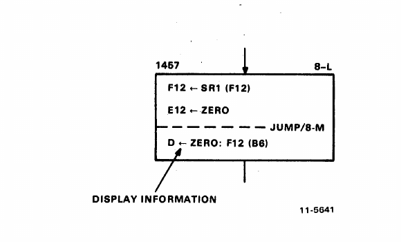

### 9.55 EXTENDER BOARD

A special extender board (W9042) and two extender cables are included with the FP11-A module on a hex extender module. The FP11-A print set shows the correct methods of using the W9042 extender board and the included cables.

## Chapter 10 — Installation And Checkout

### 10.1 SCOPE

This chapter provides the information necessary for unpacking, inspection, installation, and checkout of the FP11-A and FP11-AU Floating-Point Processors.

### 10.2 FP11-A FLOATING-POINT PROCESSOR INSTALLATION

The FP11-A Floating-Point Processor option for the PDP-11/34A CPU consists of the following parts:

```text
               M8267 - Floating-point module
               H8821 - 20-pin over-the-top connector
               54-12416 — 10-pin over-the-top connector
        Rw     W9042 - Bus extender module
```

Prior to the installation of the FP11-A option, the +5 Vdc current available to the PDP-11/34A CPU backplane must be calculated. The following procedure is designed to help you calculate +5 Vdc current drain and system configuration.

#### 10.2.1 FP11-A Add-On Installation Procedure

1. Verify system integrity by running the following diagnostics in the order given.

```text
               PDP-11/34         CPU Test                           DFKAA
                                 Traps Test (at least Rev. C)       DFKAB
                                 EIS Test                           FDKAC
               0-124K memory exerciser                              DZQMC
```

Is CPU a PDP-11/34A? (See serial name tag.)

```text
               Yes          No
                            An FP11-A cannot be installed on a PDP-11/34. To upgrade a PDP-11/34 to
                            use an FP11-A, an FP11-AU kit must be used. Refer to Paragraph 10.3.
```

Is CPU box 26.7cm (10.5 in)?

Yes No

Refer to Paragraph 10.2.2, BA11-L Box.

```text
                Calculate +5 Vdc current drain in the CPU backplane. Calculate +5 Vdc current drain for
                all other backplanes in box (Figure 10-1).
```

```text
 5.   Is the total current drain (all backplanes) greater than 57 A? (Does not include M8267
      current.)
```

No Yes

Is expander box available with room and current?

```text
                   Yes          No
                   |            Refer to step 17.
          |        Refer to step 6.
      '
 6.   Is the battery backup (BBU) option present?
```

No Yes

```text
                   All jumpers must be out of all backplanes in box. Refer to Figure 10-2 and step
                   9
```

7. Do backplane jumpers check as follows?

```text
      CPU backplane (DD11-PK).
      +5 VB to +5 V jumper     In
      +15 VB to +15 V jumper   In           See Figure 10-2.
      -15 VB to -15 V jumper   In
```

Refer to step 8.

8. All other backplanes in box (DD11-DK, CK).

```text
      +5 VB to +5 V jumper            Out
      +15 VB to +15 V jumper          In    See Figure 10-2.
      -15 VB to -15 V jumper          In
```

Refer to step 9.

9. Is slot 3 open in CPU backplane?

Yes No

Is cache (M8268) in slot 3?

No Yes

```text
                               Cache is placed in slot 3 only if FP is not present. When FP is
                               added, cache is moved to slot 5. Slots 4A and B are reserved for
                               M9301 /M9312 (Figure 10-1). Remove the over-the-top (OTT) con-
                               nectors and move cache module (M8268) to slot 5. H8822 (OTT) is
                               necessary to complete the installation (Figure 10-1). Refer to step
                   y
                               10.
```

```text
                  Refer to step 10.
      y
10.   Is the MOS memory installed in any backplane other than the CPU backplane?
```

No Yes

```text
                  Add 0.5 A at +5 Vdc for each MOS board not installed in the CPU backplane
                  (CPU box only) to the current drain total for the CPU backplane calculated in
                  step 4.
```

y Refer to step 11.

11. Is the CPU backplane current drain less than 25 A at +5 Vdc?

Yes No

```text
                   The devices must be moved from the CPU backplane to some other backplane
                   in the box in order to vacate slot 3 and to reduce the current drain at +5 Vdc to
                   25 A or less. This must be done without overloading the second +5 Vdc regu-
                   lator in the box.
```

```text
                   Is reconfiguring within the box possible?
                   Yes           No
```

```text
                                 Can the devices be moved to an expander box without overloading
                                 the expander box?
```

No Yes

```text
                                               Reconfigure the system until the current in the CPU
                                               backplane is less than 25 A at +5 Vdc.
                    +             Refer to step 17. _
                   Reconfigure within the box until the CPU backplane current drain at +5 Vdc is
                   less than 25 A.
```

```text
                   Refer to step 12.
       Y
12.   Install the FP11-A module (M8267) in slot 3 of the CPU backplane.
```

13. Is KY11-LB (M7859) present?

No Yes

```text
                   Remove the two 10-pin maintenance cables, if necessary, from the CPU
                   (M8266) and install them in the FP module (M8267) as shown in Figure 10-1.
                   Refer to step 14.
       \
```

```text
14.   Install the two over-the-top (OTT) connectors as shown in Figure 10-1. Use H8822 if the
      cache and FP are both present.
```

```text
15.   Turn power on and run the following diagnostics in the order given.
      PDP-11/34                 CPU Test                                  DFKAA
      PDP-11/34                 Traps Test              At least Rev. C   DFKAB
      PDP-11/34                 EIS Test                                  DFKAC
      PDP-11/34                 FPP Diagnostic          Part 1            DFFPA
      PDP-11/34                 FPP Diagnostic          Part 2            DFFPB
      PDP-11/34                 FPP Diagnostic          Part 3            DFFPC
```

16. End

```text
17.   When it is impossible to reconfigure the box to accommodate the FP11-A (M8267) without
      overloading the +5 V regulator, one alternative is to move some devices to an expander box.
      If an expander box is not present on the system, then there are two ways to proceed.
```

```text
      a.    Remove some number of devices from the box to compensate for the 7 A at +5 Vdc
            used by the FP11-A, and leave these devices out of the system.
      b.    Postpone installation until an expansion box can be added to the system.
            Refer to step 16.
```

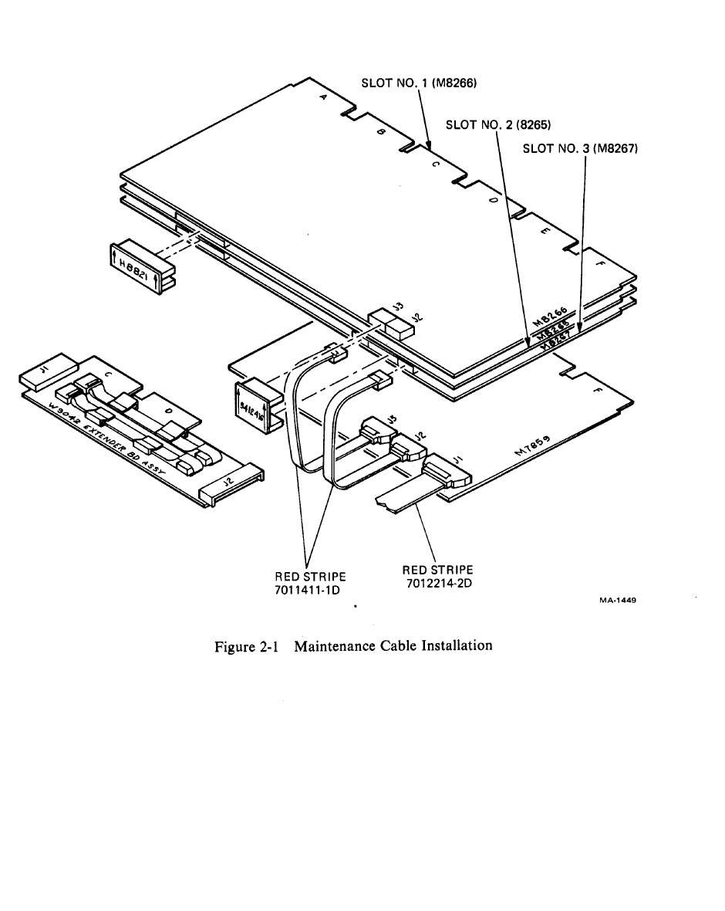

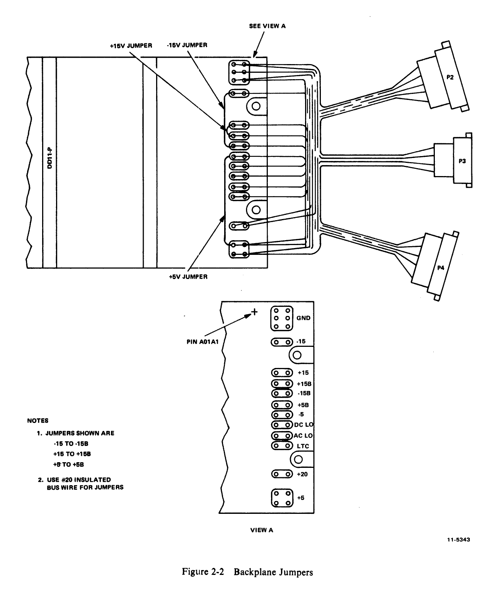

### 10.3 FP11-AU UPGRADE KIT

The FP11-AU upgrade kit contains power supply components necessary to increase the +5 Vdc current levels available from the 26.7 cm (10.5 in) mounting box. The purpose of the upgrade kit is to provide a method by which PDP-11/34 CPUs can use the floating-point (FP11-A) option. Since the FP11-A is an option for the PDP-11/34A CPU, additional hardware is required to upgrade the PDP-11/34 models to include the floating-point option. The following parts are required.

```text
                         M8265 - Data path module
                         M8267 - FP module
                         M8266 - Control module
                         H7441 - Regulator module
                         H8821 - 20-pin over-the-top connector
                         54-12416 - 10-pin over-the-top connector
                         W9042 - Bus extender module
        SPAHAASYWNS      54-10834YA - Power distribution board
```

The tools required are:

```text
        1.               Phillips screwdriver (medium and large)
        2.               Slot screwdriver (large)
        3.               90 degree offset Phillips screwdriver.
```

#### 10.3.1 FP11-AU Power Components Installation

```text
                                                             CAUTION
                                         Turn off computer system and disconnect it from
                                         power source before performing installation pro-
                                         cedure.
```

```text
                      1. Slide BAI1-K mounting box out of the cabinet assembly to the limits of the chassis slides.
                  2. Release and remove mounting box top cover to gain access to H765 power supply assembly.
                  3. Loosen and remove cable clamp that secures the cables that are routed across the top of the
                         power supply.
```

4. Loosen and remove power supply cover.

```text
                      5. Rotate the mounting box in such a manner that the bottom of the mounting box faces away
                         from the cabinet (box rotated 90 degrees).
```

```text
                      6. Loosen and remove mounting box bottom cover to gain access to the power distribution
                         board located between the power supply and the backplane.
                                                             CAUTION
                                         Do not remove the hinge screws (one on each side)
                                         located at the junction of the power supply and the
                                         module enclosure near the top side of the mounting
                                         box.
```

```text
                      7. Remove four flat-head screws (no washers) located approximately 10 cm (4 in) from the
                         bottom of the mounting box and at the junction of the power supply and the module enclo-
                         sure assembly. The power supply can now be swiveled away from the module enclosure.
```

```text
      Locate the H744 +5 Vdc regulator assembly. This regulator is the second module from the
      right when viewing the bottom of the mounting box from the wire-wrap side of the back-
      plane.
```

```text
      Locate and remove the two mounting screws and washers located just to the left of the H744
      Mate-N-Lok connector. There will be a green safety wire secured by one of these screws.
```

```text
                                          NOTE
                     A 90 degree offset Phillips-head screwdriver is re-
                     quired to remove these screws and attached hard-
                     ware.
```

```text
10.   Locate and remove the last retaining screw and washer located on the back of the power
      supply and to the left of the H744 decal.
```

11. Release and remove the H744 Mate-N-Lok connector.

```text
12.   Remove the H744 regulator by sliding it out through the top of the power supply assembly.
      (Note that the mounting box may have to be rotated to accomplish removal.)
```

13. Replace the H744 regulator with the H7441 regulator (included in the upgrade kit).

```text
14.   Replace mounting hardware removed in steps 9 and 10. Do not connect the H7441 Mate-N-
      Lok connector at this time.
```

```text
15.   Release and remove the three Mate-N-Lok connectors connecting the remaining regulators
      to the power distribution board assembly.
```

```text
16.   Locate and remove the black ground wire soldered to the power distribution board (located
      near J16). Remove this ground wire from the power supply and the module enclosure assem-
      bly.
```

17. Remove the +5 V and ground fastons from the power distribution board (located near J14).

18. Release and disconnect Mate-N-Lok connector from J8 on the power distribution board.

```text
19.   Locate and remove four flat-head screws securing the power distribution board to the mod-
      ule enclosure assembly. These screws are located (two on each side) 5 cm (2 in) from the
      bottom of the mounting box and near the junction of the power supply and the module
      enclosure.
```

```text
                                          NOTE
                    The removal of these four screws will allow the re-
                    moval of the power distribution panel which in turn
                    will allow removal of all backplane Mate-N-Lok
                    connectors.
```

20. Release and disconnect all backplane Mate-N-Lok connectors.

```text
21.   Release and disconnect two Mate-N-Lok connectors connecting the power distribution
      board to the power supply.
```

22. Remove the power distribution board.

```text
        23.   Replace the power distribution board with the new 5410834-YA power distribution board
              (included in upgrade kit).
```

```text
        24.   Reverse procedure (steps 22-14 and steps 7-1) to install the new power distribution board
              and to return system to normal.
```

#### 10.3.2 FP11-AU Logic Installation

Refer to Paragraph 10.2.1 and calculate +5 Vdc current drain and system configuration.

## Appendix A

OPTION POWER SPECIFICATIONS

A-!

**Table A-1 PDP-11 Family Models and Options Power Requirements**

Current Needed (Amperes) AC Line Current

Model/Option Description +5 V(CPU) | +5 V (Options)| -15 V] +20 V| -5 V |} +15 V_ | (Amperes)

```text
H765                            Power Supply
  (115/230 Vac)
```

Regulator Units ole

```text
15 V Regulator                  Power line monitor                                                                   4.
  (5411086)
```

```text
11/05-S                         KD11-B                                8.0                     0.25                   0.05
                                MM11-U                                5.4                            4.4      0.51
                                3 SPC                                 6.0
                                2 M930s                               2.5
                                Total Amperes                        16.6                     0.25 | 4.4      0.51 } 0.05          5.0
```

```text
11/35-S                         KD11-A                               10.5
                                KE11-F                                2.0
                                KE11-E                                3.0
                                KJ11-A (optional)                     0.5
                                KT11-D                                2.5
                                KWILI-L                               0.5
                                SPC                                   2.0
                                M981                                          1.25
                                MF11-U (16K)                                  6.1
                                M930                                          1.25
                                Total Amperes                        21       8.6                    4.4      0.51                 6.0
```

```text
MF11-U/MM1 1-U*                 16K sense
  (Active)                      core memory                                   6.1                    4.4      0.51                 2.2
  (Standby)                     (double SU)                                   5.4                    0.56     0.41                 0.8
```

```text
MF11-UP/MM11-UP                 16K sense
  (Active)                      core with parity                              7.3                    4.4      0.51                 2.3
  (Standby)                     (double SU)                                   5.4                    0.56     0.41                 0.8
```

```text
MF11-L (MM11-L)                 8K core
  (Active)                      memory                                        3.4             6.0                                  1.8
  (Standby)                     (double SU)                                   1.7             0.5                                  0.3
```

```text
MF11-LP (MM11-LP)               8K parity
  (Active)                      core memory                                   4.9             6.0                                  2.
  (Standby)                     (double SU)                                   1.7             0.5                                  0.3
```

*Noninterleaved. **Refer to appropriate appendix for regulator unit output current.

**Table A-1 PDP-11 Family Models and Options Power Requirements (Cont)**

```text
                                                           Current Needed (Amperes)                          AC Line Current
Model/Option   Description                  +5 V (CPU)   +5 V (Options)   -15V   +20 V   -5V      V
                                                                                                +15          (Amperes)
```

```text
MM11-S         Same as MM11-L                             Same as
               except in SU                               MF11-L
               configuration (1 SU)
```

```text
PDP-1 1/04     KD11-D                          5.0                                                           7.0
               M9301                           2.0
               M9302                           1.2
```

```text
               Memory:
               See individual
               memory listings.
```

```text
               DL11-W (optional)               2.0                        0.15                  0.05
               M7850 (optional)                1.0
               KY11-LA                         0.1
               KY11-LB (optional)              3.0                        0.06
```

PDP-11/34A 9.0

```text
PDP-11/34A     KD11-EA                        11.5                                                           9.0
               M9301                           2.0
               M9302                           1.2
```

```text
               Memory:
               See individual
               memory listings.
```

```text
               DL11-W (optional)               2.0                        0.15                  0.05
               M7850                           1.0
               KY11-LA                         0.1
               KY11-LB (optional)              3.0                        0.06
```

FP11A M8267 7.0

```text
MM11-CP        8K core
               memory                                     3.0                    3.5     0.2
```

```text
MM11-DP        16K core
               memory                                     3.0                    4.0     0.5
```

```text
MM11-WP        32K parity
  (Active)     core memory                                6.1                    3.4     0.74                2.1
  (Standby)    (double SU)                                5.5                    0.6     0.64                0.8
```

```text
MM11-YP        32K parity
  (Active)     core memory                                5.0                    3.5     0.4                 2.0
  (Standby)                                               5.0                    0.6     0.4                 0.8
```

**Table A-1 PDP-11 Family Models and Options Power Requirements (Cont)**

Current Needed (Amperes) AC Line Current

Model/Option Description +5 V (CPU) | +5 V (Options) |-15 V| +20 V | -S V | +15 V (Amperes)

```text
MS11-EP                          4K MOS                                           1.5 (+5)          0.1                             0.34
                                 MUD memory                                       0.5 (+5B)***
```

```text
MS11-FP                          8K MOS                                           1.5 (+5)          0.1                             0.36
                                 MUD memory                                       0.5 (+5B)***
```

```text
MS11-JP                          16K MOS                                          1.5 (+5)          0.1                             0.4
                                 MUD memory                                       0.5 (+5B)***
```

```text
M7850                            Parity control for                               1.0
                                 MUD memories
```

***Current from +5 Vb rail if Battery Backup Option is used. If there is no Battery Backup Option, then 2.0 A is drawn trom +5 V.

**Table A-2 PDP-11 Family Options Power Requirements**

```text
                                                                                                                                                     AC Line
                                                                                        Power                 Current Needed (Amperes)*              Current
```

Option Mounting Code Description Harness +5 V |[|-15V |-5V |+15V (Amperes)

AA11-D 1SU D/A converter subsystem 7009562 3.0 0.3

AR-11 SPC ADC and DACs N/A 5.0 0.5

BA614 (AA11-D) D/A converter 3.0 0.3

BM792-Y SPC Bootstrap loader 0.3 0.3

```text
CD11-A/B          1SU                       1000 cpm, 80-col.                           7010117            2.5                                        0.25
                                            card reader controller
```

```text
CD11-E            1SU                       1200 cpm, 80-col.                           7010117            2.5                                        0.25
                                            card reader controller
```

```text
CM11              SPC                       200 cpm, 80-col.                                               1.5                                        0.15
                                            card reader controller
```

*+20 V not used in this configuration.

**Table A-2 PDP-11 Family Options Power Requirements (Cont)**

```text
                                                                                      Power              Current Needed (Amperes)*                oo
Option            Mounting Code                Description                            Harness          +S V    | -1SV      [-SV     [+15 V        (Amperes)
```

```text
CR11              SPC                          300 cpm, 80-col.                                          1.5                                       0.15
                                               card reader controller
```

DA11-DB 1SU UNIBUS link 4.0 0.4

DA11-F 1SU UNIBUS window 7010117 5.0 0.5

DB11-AT 1 SU Bus repeater 7009562 3.2 0.31

DCII-A 1SU Dual clock and system unit 7010117 0.2 0.02

DC11-DA (DC11-A) Full duplex module set 2.0 0.2 0.2 0.2

DD11-B 1 SU Peripheral mounting panel 7010117

DH11-AA DLB SU Prog. async 16-line multiplexer 7010118 8.4 0.42 0.9

DH11-AD DLB SU @ Modern control — [ FOTOTTSTM 10.8 0.665 0.4 1.33

```text
DJ11-A            1SU                          Async 1 6-line MUX                     7010117           4.7       0.25              0.25           0.6
DJ11-AC           1SU                          Async 16-line MUX                                                  1.0                              0.25
```

DLI1 SPC Async interface 1.8 15 .016 0.21

DM11-B (DH11) 16-line modem control (DH11) 2.4 0.24

DNI1-A 1SU Auto calling system unit 7009562 2.6 2.5

DP11-D 1SU Half/full duplex sync interface 7009562 2.56 0.07 0.04 0.28

DP11-C (DP11-D) Data/sync register extender 0.77 0.08

DP11-K (DP11-D) Internal DP11 clock 0.18 0.02

DQ11-D 0.62

DQ11-D 1SU Full/half duplex sync interface 7010117 6.0 0.07 0.04 0.62

*+20 V not used in this configuration. t When installing a DB11-A bus repeater in a BA11-K 10.5 Inch Mounting Box, the AC LO and DC LO wires must be removed from the harnesses of all the options (located in the same box) after the DB11-A.

**Table A-2 PDP-11 Family Options Power Requirements (Cont)**

```text
                                                                              Power          Current Needed (Amperes)*         “ine
Option            Mounting Code          Description                          Harness      +5 V    | -ISV      {[-SV   |+15V   (Amperes)
```

DQII-E 1 SU Full/half duplex sync interface 7010117 6.0 0.07 0.04 0.62

DFC11-A (DU/DP CLOCK) Level converter clock recovery 0.4 0.02 0.02 0.05

DQ11-K (DQ11-D/A) Crystal clock 0.05 0.012

DRI11-B SPC General purpose DMA 7009562 3.3 0.32

DR11-C 1SU General purpose digital interface 1.5 0.15

DR11-K SPC Digital I/O N/A 0.15 0.6

DU11-D SPC Full/half duplex 2.2 2.5 0.05 0.27

DUI1-EA SPC Sync prog. interface 2.6 0.20 0.07 0.33

```text
DVI11             DBL SU                 Sync MUX                                           13.5         083           0.435    0.5
KGII-A            SPC                    Comm. arith unit                                    1.2                                0.12
```

KWI11-L (CPU) Line clock 0.8 0.08

KW11-P SPC Prog. line clock 1.0 0.1

LC11-A SPC LA30 control 1.5 0.15

LP11-R SPC 1200 LPM printer 1.0 0.1

LP11-S SPC 900 LPM printer 1.0 0.1

LP11-W SPC 240 LPM printer 1.5 0.15

LP11-V SPC 300 LPM printer 1.5 0.15

LS11-A SPC 60 LPM printer 1.5 0.15

LV11-B SPC Electrostatic printer, 500 LPM 1.5 0.15

MRI11-DB 2 SPC Bootstrap

*+20 V not used in this configuration.

**Table A-2 PDP-11 Family Options Power Requirements (Cont)**

```text
                                                                                                                          AC Line
                                                                              Power       Current Needed (Amperes)*       Current
```

Option Mounting Code Description Harness +5 V | -15V |] -5V1}+1SV | (Amperes)

```text
PCI               SPC                    Papertape                                           1.5          |                0.15
PR11              SPC                    Papertape (reader)
```

RH11 DBL SU 1.9 0.19

RK11-D SU Disk and control 7010115 8.0 0.8

TAI1-A SPC Dual cassette interface

VT1l SU Graphic processor 6.5 | 100. 0.8

VRII-A SPC . Pushbutton box 4. 0.4

*+20 V not used in this configuration.
