# FP11-A Floating-Point Processor Technical Manual

Source: `EK-FP11A-TM-002`, first edition, May 1978.

## Chapter 1 — Introduction

### 1.1 GENERAL

The FP11-A Floating-Point Processor is a hardware option that enables the PDP-11/34A central processor to execute floating-point arithmetic operations. The FP11-A performs all floating-point arithmetic operations and converts data between integer and floating-point formats. Floating-point representation permits a greater range of number values than is possible with the conventional integer mode. Thus, the FP11-A option provides a speedier alternative to the use of software floating-point routines, and system speed is increased without complex arithmetic coding routines that consume valuable CPU time. The FP11-A features both single- and double-precision (32- or 64-bit) capability and floating-point modes.

The FP11-A is an integral part of the central processor. It operates using similar address modes, and the same memory management facilities as the central processor. Floating-point processor instructions can reference the floating-point accumulators, the central processor’s general registers, or any location in memory.

### 1.2 FEATURES

The following paragraphs summarize the features of the PDP-11/34A floating-point instruction set and the FP11-A.

#### 1.2.1 Floating-Point Instruction Set Features

- 32-bit (single-precision) and 64-bit (double-precision) data modes
- Addressing modes compatible with existing PDP-11 addressing modes
- Special instructions that can improve input/output routines and mathematical subroutines
- Allows execution of in-line code (i.e., floating-point instructions and other instructions can appear in any sequence desired)
- Multiple accumulators for ease of data handling
- Can convert 32- or 64-bit floating-point numbers to 16- or 32-bit integers during the Store class of instructions
- Can convert 32-bit floating-point numbers to 64-bit floating-point numbers and vice-versa during the Load or Store class of instructions.

#### 1.2.2 FP11-A Features

- Performs medium-speed, floating-point operations on single- and double-precision data

- Has 17 (decimal) digit accuracy

- Contains its own microprogrammed control store

- Contains six 64-bit floating-point accumulators

- Contains error recovery aids

### 1.3 ARCHITECTURE

The FP11-A contains scratchpad registers, a floating exception address pointer (FEA), status and error registers, and six general-purpose accumulators (AC0-AC5).

Each accumulator is interpreted to be 32 or 64 bits long depending on the instruction and the status of the floating-point processor. For 32-bit instructions, only the left-most bits are used. The remaining bits are unaffected.

The six general-purpose accumulators are used in numeric calculations and interaccumulator data transfers. The first four registers (AC0-AC3) are also used for all data transfers between the FP11-A and the central processor’s general registers or memory.

### 1.4 PHYSICAL DESCRIPTION

The FP11-A consists of a single hex board [M8267 for the PDP-11/34A (KD11-EA)] and modifications to the M7265 and M7266 boards used in the PDP-11/34 central processor. (The modified boards are designated M8265 and M8266, and the modified processor is designated as the KD11-EA). Figure 1-1 shows the basic signal paths between the central processor and the FP11-A. The bidirectional data bus transfers instructions and data between the processors. An expanded control store in the KD11-EA accommodates floating-point requirements.

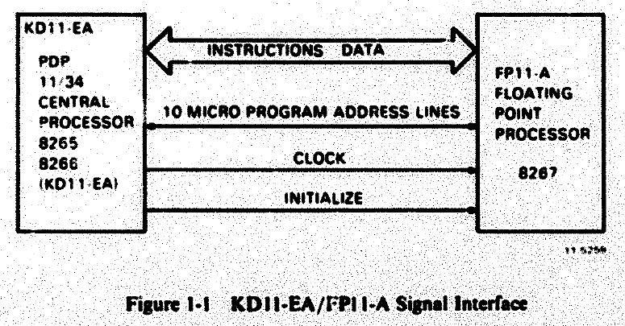

### 1.5 RELATED DOCUMENTATION

The following documents supplement this manual on the FP11-A Floating-Point Processor.

| Manual | Document Number |
|---|---|
| BA11-K Mounting Box Manual | EK-BA11K-MM |
| BA11-L Mounting Box Manual | EK-BA11L-MM |
| DL11-W Maintenance Manual | EK-DL11W-MM |
| KD11-E Processor Manual (PDP-11/34) | EK-KD11E-TM |
| M9301 Bootstrap Terminator Maintenance Manual | EK-M9301-MM |
| MM11-C/CP Core Memory Manual | EK-MM11B-TM |
| MM11-D/DP Core Memory Manual | EK-MM11D-TM |
| MS11-E-J MOS Memory Maintenance Manual | EK-MS11E-MM |
| PDP-11 Peripherals Handbook | EP-PDP11-HB |
| PDP-11/04, 34, 45, 55 Processors Handbook | EP-PDP11/04-HB |
| PDP-11/34 Processor Handbook | EP-11034-HB |
| KD11-EA Processor Manual (PDP-11/34A) | EK-KD1EA-MM |

## Chapter 2 — Review Of Floating-Point Numbers

### 2.1 INTRODUCTION

This chapter briefly outlines some fundamentals of floating-point arithmetic. It provides useful background for more advanced topics in later chapters. The reader already familiar with floating-point numbers and arithmetic may skip to Chapter 3 for a discussion of FP11-A data formats.

### 2.2 INTEGERS

All data within a computer system can be represented in integer form. The numbers that can be represented in a 16-bit machine range in magnitude from 000000₈ to 177777₈ (or from 0₁₀ to 65,536₁₀). However, there would be problems with integer representation. A number between 1 and 2 (for example) could not be represented. Thus, integer representation imposes an accuracy limitation. Furthermore, numbers greater than 65,536₁₀ could not be represented. This imposes a range limitation.

These limitations are imposed by the stationary position of the radix point (e.g., the decimal point in base 10 notation or the binary point in base 2 notation). An integer’s radix point is usually omitted in integer representation because it always marks the integer’s least significant place. That is, there are never any digits to the right of an integer’s radix point. For this reason, an integer is sometimes called a fixed-point number.

Integer notation, however, can be modified to overcome the range and accuracy limitations imposed by the fixed radix point. This is accomplished through the use of floating-point notation.

### 2.3 FLOATING-POINT NUMBERS

Floating-point numbers, unlike integers, have no position restrictions imposed on their radix points. A popular type of floating-point representation is called scientific notation. With scientific notation, a floating-point number is represented by some basic value multiplied by the radix raised to some power.

Example

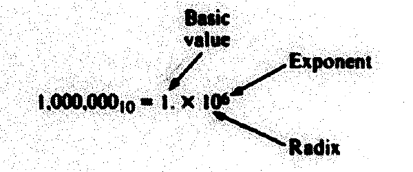

There are many ways to represent the same number in scientific notation, as shown in the example below.

```text
512 = 51200 × 10⁻²
    =  5120 × 10⁻¹
    =   512 × 10⁰
    =  51.2 × 10¹
    =  5.12 × 10²
    = 0.512 × 10³
```

The convention chosen for representing floating-point numbers with scientific notation in the FP11-A requires the radix point to always be to the left of the most significant digit in the basic value (e.g., .512 × 10³ in the above example). This modified basic value is called a fraction.

More examples of scientific notation are shown below.

| Decimal No. | Decimal Scient. No. | Octal Scient. No. | Binary Scient. No. |
| ----: | --------------------------- | ------------------------- | -------------------------- |
|    64 | `0.64 × 10²`                | `0.1 × 8³`                | `0.1 × 2⁷`                 |
|    33 | `0.33 × 10²`                | `0.41 × 8²`               | `0.100001 × 2⁶`            |
|   1/2 | `0.5 × 10⁰`                 | `0.4 × 8⁰`                | `0.1 × 2⁰`                 |
|  1/16 | `0.625 × 10⁻¹`              | `0.4 × 8⁻¹`               | `0.1 × 2⁻³`                |

Note that in each of the examples above, only significant digits are used in the final result and the radix point is always (by convention) to the left of the most significant digit. Establishing the radix point in a number whose basic value is greater than (or equal to 1) is accomplished by shifting the number to the right until the most significant digit is to the right of the radix point. Each right shift causes the exponent to be incremented by 1. Similarly, establishing the radix point in a number whose basic value is between 1 and 0 (i.e., a fraction) is accomplished by shifting the number to the left until all leading 0s are eliminated. Each left shift causes the exponent to be decremented by 1.

To summarize, the value of the number remains constant if its exponent is incremented for each right shift of the basic value and decremented for each left shift. The representation for floating-point fractions in the KD11-EA is one in which all nonsignificant leading 0s have been removed. The process used to obtain this representation is called normalization, which is explained in more detail in Paragraph 2.4.

### 2.4 NORMALIZATION

In digital computers, the number of bits in a fraction is limited. Retention of nonsignificant leading 0s decreases accuracy by taking places that could be filled by significant digits. For this reason, a process called normalization is used in the FP11-A. The normalization process consists testing the fraction for leading 0s and left-shifting it until it is in the form 0.1 . . . . The exponent is accordingly decremented by the number of left shifts of the fraction. This ensures that the normalized number retains equivalence with the original number. Since digits to the right of the binary point are weighted with inverse powers of 2 (i.e., 1/2, 1/4, 1/8 . . .), the smallest normalized fraction is 1/2 (0.10000 . . .). The largest normalized fraction is 0.11111 . . . . Figure 2-1 shows an unnormalized fraction that must be left-shifted six places to be normalized. The exponent is decremented by six to maintain equivalence with the original number.

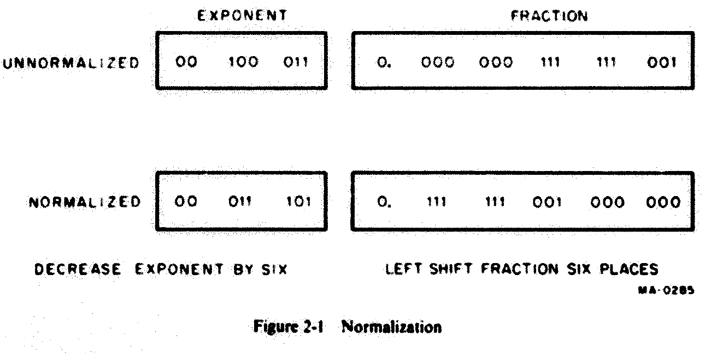

**Problem A - Represent the number 75₁₀ as a binary normalized floating-point number.**

1. Integer conversion

   75₁₀ = 1001011₂

2. Convert to floating-point form

   1001011.0 × 2⁰ = 0.1001011 × 2⁷

   Fraction = 0.1001011

   Exponent = 111

**Problem B - Represent the number 0.25₁₀ as a binary normalized floating-point number.**

1. Integer conversion

   0.25₁₀ = 0.01₂

2. Convert to floating-point form

   0.01 × 2⁰ = 0.1 × 2⁻¹

   Fraction = 0.1

   Exponent = -1

### 2.5 FLOATING-POINT ADDITION AND SUBTRACTION

In order to perform floating-point addition or subtraction, the exponents of the two floating-point numbers involved must be aligned or equal. If they are not aligned, the fraction with the smaller exponent is shifted right until they are. Each shift to the right is accompanied by an incrementation of the associated exponent. When the exponents are aligned or equal, the fractions can then be added or subtracted. The exponent value indicates the number of places the binary point is to be moved to obtain the integer representation of the number.

In the example below, the number 7₁₀ is added to the number 40₁₀ using floating-point representation. Note that the exponents are first aligned and then the fractions are added, the exponent value dictates the final location of the binary points.

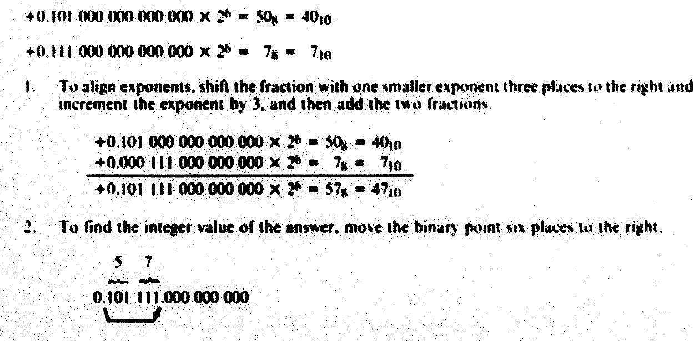

### 2.6 FLOATING-POINT MULTIPLICATION AND DIVISION

In floating-point multiplication, the fractions are multiplied and the exponents are added. For floating-point division, the fractions are divided and the exponents are subtracted.

There is no requirement to align the binary point in floating-point multiplication or division.

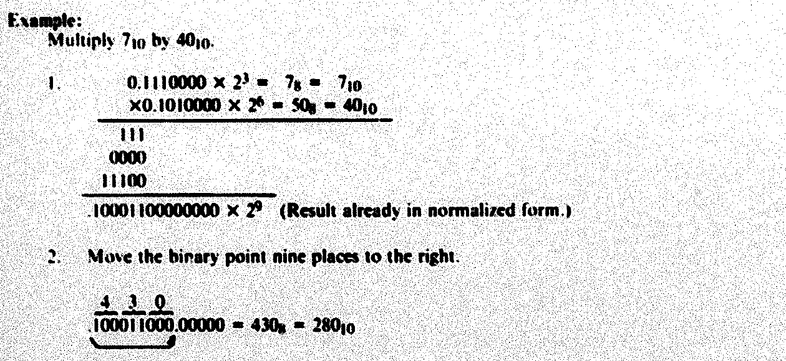

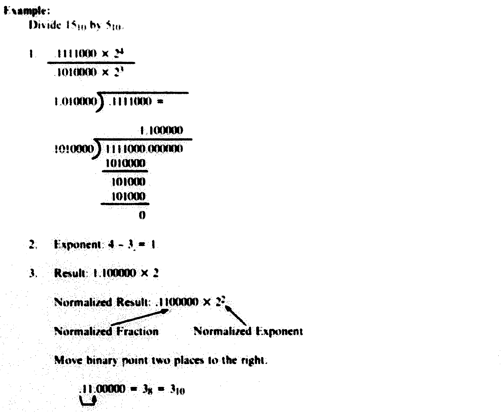

## Chapter 3 — Data Formats

### 3.1 INTRODUCTION

The FP11-A requires its input data (operands) to be formatted. Formatting allows the FP11-A to process operands in a meaningful way and produce correct results. There are four different formats for operands input to the FP11-A: short-integer format (I), long-integer format (L), single-precision format (F), and double-precision format (D).

Output data from the FP11-A is also formatted. This output data is in the form of:

1. FP11-A status information and FP11-A exception information required by the CPU
2. Data sent to memory (via the CPU), which must be in I, L, F, or D format.

This chapter describes the FP11-A data formats. It is assumed that the reader is familiar with 2’s complement notation.

### 3.2 FP11-A INTEGER FORMATS

There are two integer formats, short (I) and long (L). The short-integer format is 16 bits long and the long-integer format is 32 bits long. Data words (operands) in integer format are represented in 2’s complement notation. In both I and L formats, the most significant bit of the data word is the sign bit. Figure 3-1 shows the integers 5 and -5 in both I and L formats.

Figure 3-2 illustrates the formats in which integers are arranged in memory. Integers sent to memory must be in one of these formats. Integers received by the FP11-A are arranged and manipulated according to the type of instruction being executed. Refer to Paragraphs 4.3.11 and 4.3.12 for descriptions of the ways in which incoming integers are manipulated during the load exponent and load convert integer-to-floating instructions, respectively.

### 3.3 FP11-A FLOATING-POINT FORMATS

There are two floating-point formats, single-precision (F) and double-precision (D). The single-precision format is 32 bits long and the double-precision format is 64 bits long. Figure 3-2 shows that the most significant bit is the sign of the fraction (and the floating-point number being represented). The next 8 bits contain the value of the exponent, expressed in excess 200 notation (Paragraph 3.3.1.2). The remaining bits (23 for single-precision, 55 for double-precision) contain the fraction. The fraction and its associated sign bit are expressed in sign and magnitude notation (Paragraph 3.3.1.1).

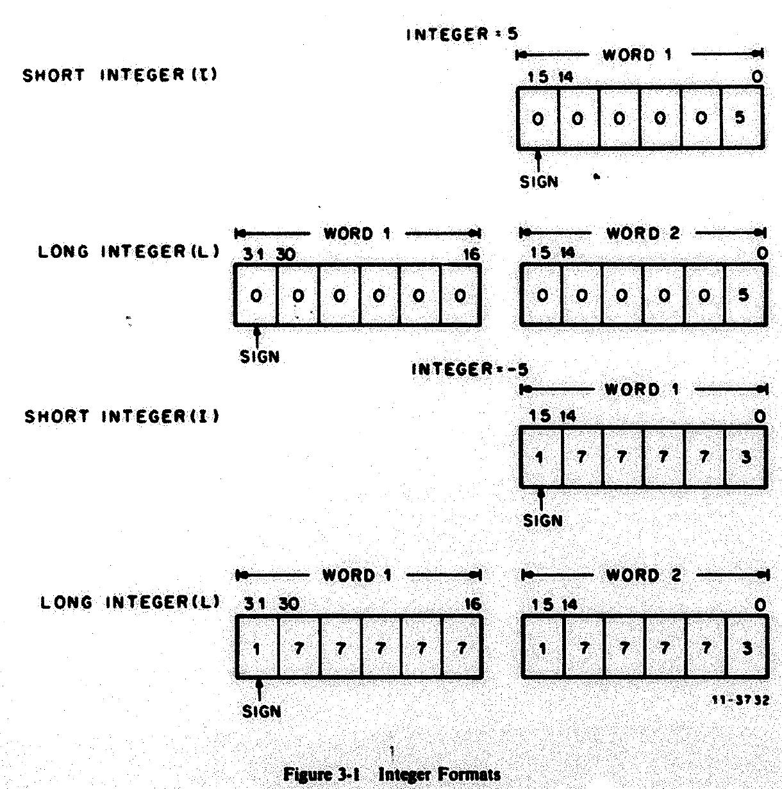

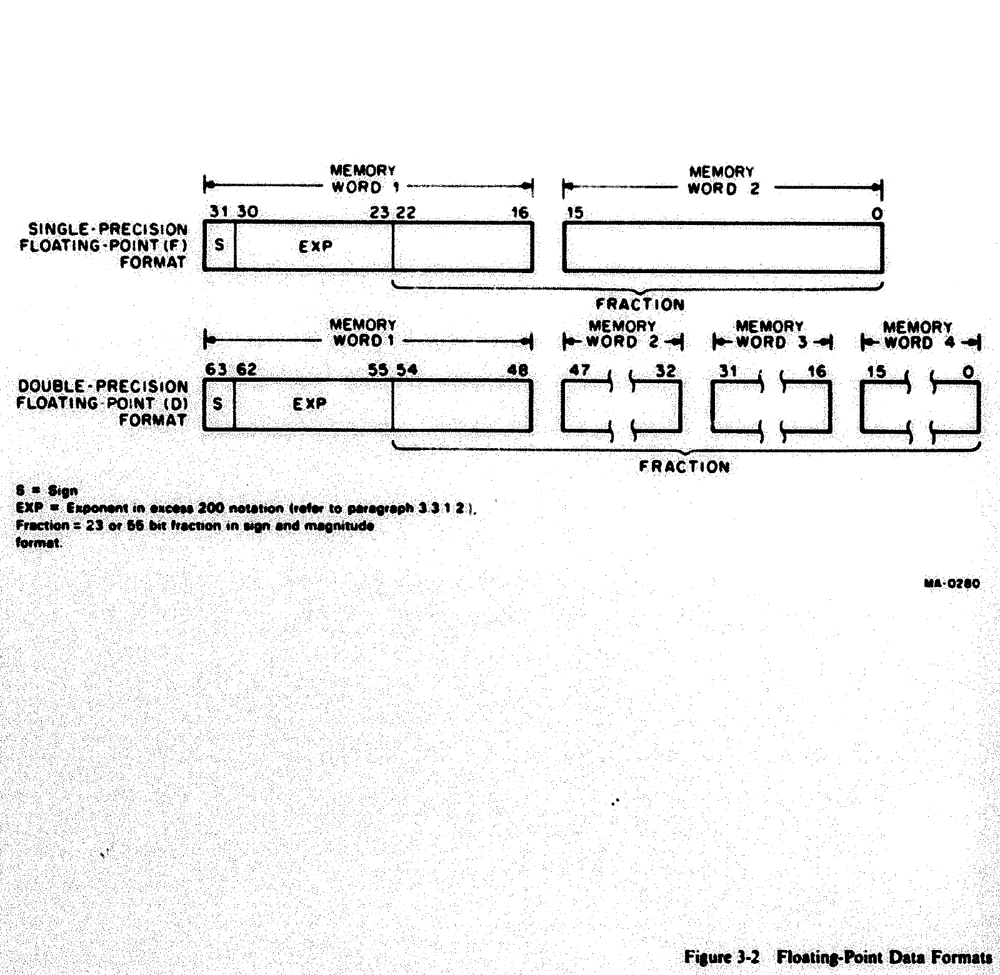

#### 3.3.1 FP11-A Floating-Point Data Word

Figure 3-3 illustrates the formats in which floating-point numbers are arranged in memory. Floating-point numbers sent to memory must be in one of these formats. Floating-point numbers received by the FP11-A are arranged as illustrated in Figure 3-4.

The sign bit, exponent bits, and fraction bits in the FP11-A data word have the same values as the data word in memory. Note, however, that the FP11-A data word has more bits than its counterpart in memory. This is because the FP11-A has provisions for generating an overflow bit and a “hidden” bit.

For purposes of discussion, the FP11-A data word can be thought of as being divided into two major parts:

1. A fraction, with its associated sign bit, hidden bit, and overflow bit.

2. An exponent.

##### 3.3.1.1 Floating-Point Fraction

The fraction is expressed in sign and magnitude notation. The following simple example illustrates the idea behind sign and magnitude notation.

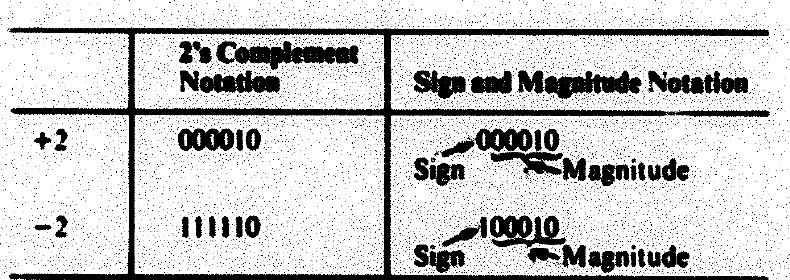

Only a change of sign bit is required to change the sign of a number in sign and magnitude notation. Note that a positive number is the same in both notations.

Unnormalized floating-point fractions have a range from approximately 0 through 2 as shown in Figure 3-5. The FP11-A, however, normalizes all unnormalized fractions. That is, the fractions are adjusted such that there is a 0 to the left of the binary point (bit 63) and a 1 to the right of the binary point (bit 62). Thus, normalized fractions range in magnitude from 0.1000... to 0.1111 or from 1/2 to approximately 1.

The fraction overflow bit (bit 63) is set during certain arithmetic operations. For example, during addition, certain sums will produce an overflow such as 0.1000... + 0.100... which yields 1.000.... This result must be normalized, so the FP11-A right-shifts the fraction one place and increases the exponent by one.

Bit 62 is called the hidden bit. Recall that since fractions are normalized by the FP11-A, the bit immediately to the right of the binary point (bit 62) is always a 1. This bit is dropped when a fraction is sent to memory and appended when a fraction is received from memory. This procedure allows one extra bit of significance in floating-point fraction representation.

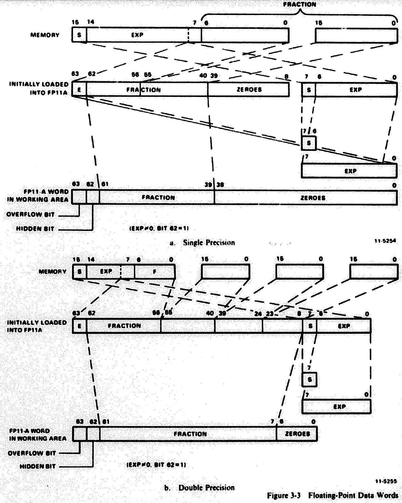

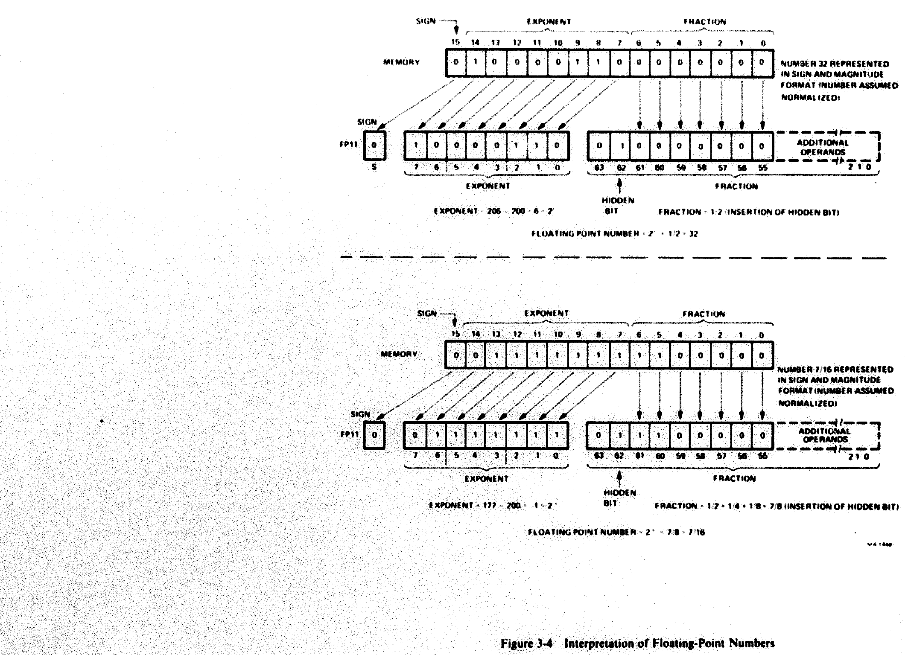

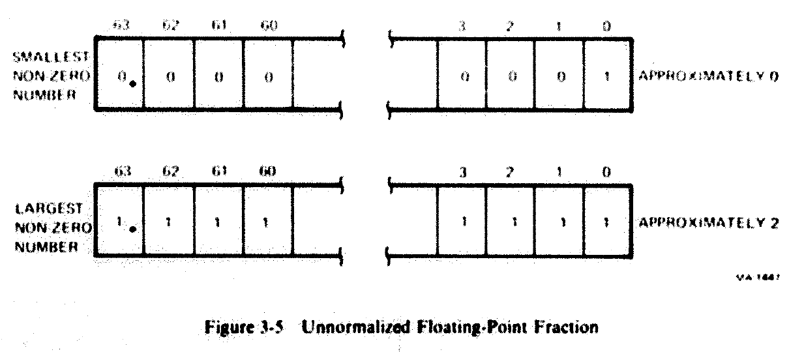

##### 3.3.1.2 Floating-Point Exponent

The 8-bit floating-point exponent is expressed in excess 200 notation. The chart below illustrates the relationship between exponents in 2’s complement notation and exponents in excess 200 notation.

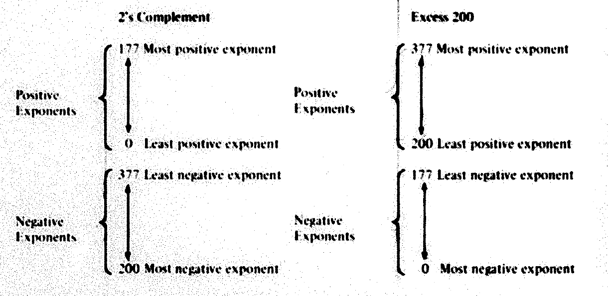

Note that an exponent in excess 200 notation is obtained by simply adding 200 to the exponent in 2’s complement notation. Thus, 8-bit exponents in excess 200 notation range from 0 to 377 (or from -200 to +177). A number with an exponent of -200 is treated by the FP11-A as 0.

For example, the number 0.1₂ is actually 0.1 × 2⁰, and the exponent is represented as 10 000 000 because 200₈ represents the exponent of zero. Figure 3-5 illustrates the range of floating-point numbers that can be handled by the FP11-A. For simplicity, a fraction length of only three bits is shown.

### 3.4 FP11-A PROGRAM STATUS REGISTER

The FP11-A contains a resident program status register that contains the floating-point condition codes (carry, overflow, zero, and negative) that can be copied into the central processor. In other words, FN, FZ, FV, and FC can be copied into the CPU’s N, Z, V, and C condition codes, respectively. The program status register also contains 3 mode bits and additional bits to enable various interrupt conditions. Figure 3-6 shows the layout of the program status register. Each bit shown in the figure is described in Table 3-1.

**NOTE**

The FP11-A has no Unibus addresses. All FP11-A registers are accessed by floating-point instructions only.

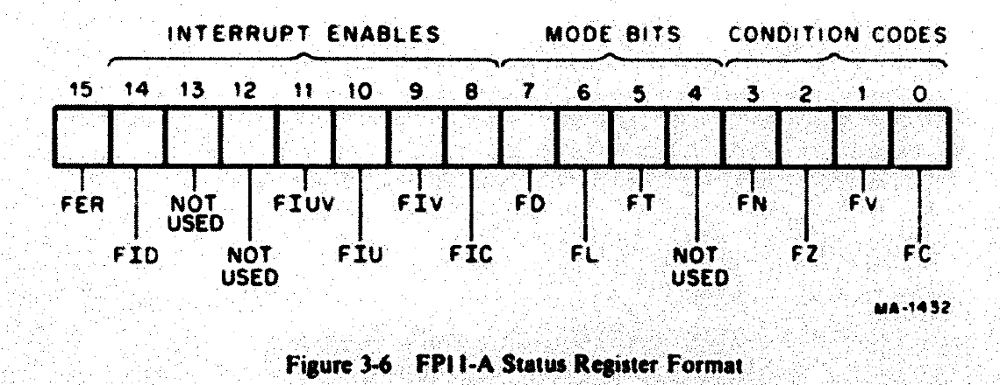

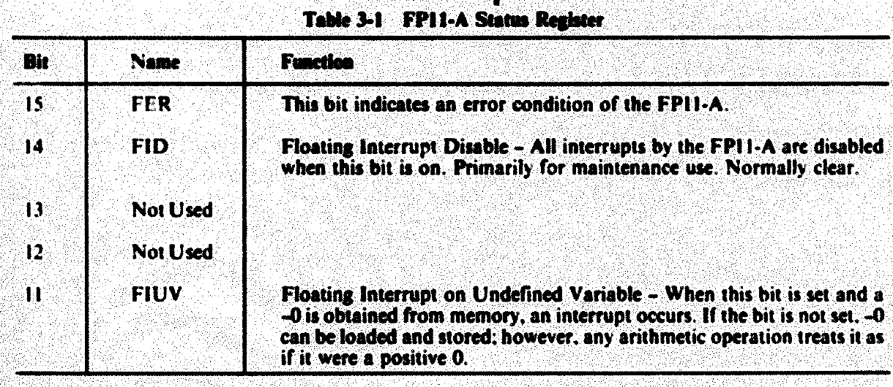

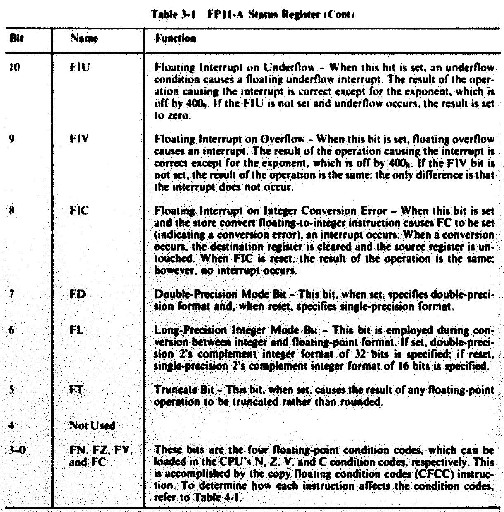

### 3.5 PROCESSING OF FLOATING-POINT EXCEPTIONS

Location 244 is the interrupt vector used to handle all floating-point interrupts. A total of six possible interrupts can occur. These possible interrupt exceptions are encoded in the FP11-A exception code (FEC) register. The interrupt exception codes represent an offset into a dispatch table, which routes the program to the right error handling routine. The dispatch table is a function of the software. The FEC for each exception is briefly described in Table 3-2.

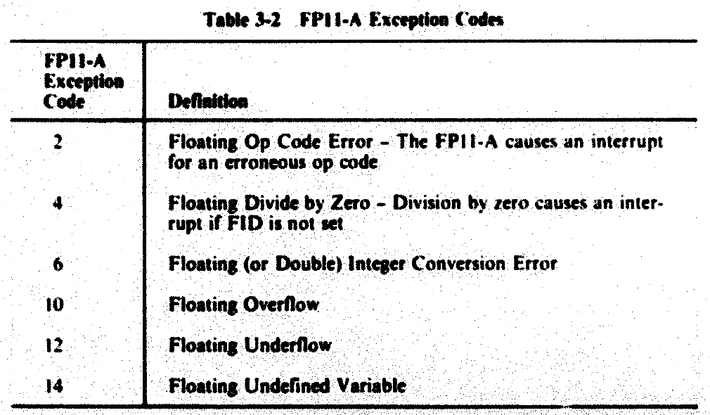

**NOTE**

The traps for exception codes 6, 10, 12, and 14, can be enabled in the FP11-A program status register. All traps are disabled if FID is set.

Refer to the PDP-11/04, 34, 45, 45 Processor Handbook for further details concerning FP11-A exceptions.

In addition to the FEC register, the CPU contains a 16-bit floating exception address (FEA) register, which stores the address of the last floating-point instruction that caused a floating-point exception.

## Chapter 4 — Floating-Point Instructions

### 4.1 FLOATING-POINT ACCUMULATORS

The FP11-A contains six general-purpose accumulators (AC0-AC5). These accumulators are 64-bit read/write scratchpad memories with non-destructive readout.

Each accumulator is interpreted as being either 32 or 64 bits long, depending on the instruction and the FP11-A status (Chapter 3). If an accumulator is interpreted as being 64 bits long, 64 bits of data occupy the entire accumulator. If an accumulator is interpreted as being 32 bits long, 32 bits of data occupy only the left-most 32 bits of an accumulator as shown in Figure 4-1.

The floating-point accumulators are used in numeric calculations and interaccumulator data transfers. AC0-AC3 are used for all data transfers between the FP11-A and the CPU or memory.

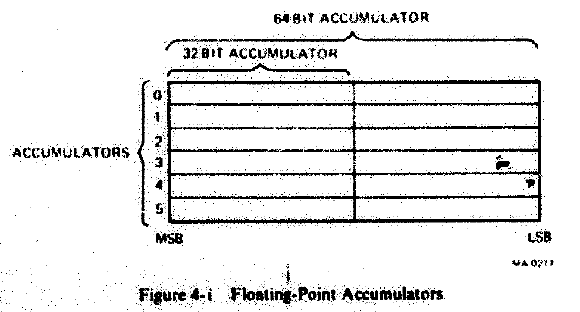

### 4.2 INSTRUCTION FORMATS

An FP11-A instruction must be in one of five formats. These formats are summarized in Figure 4-2.

The 2-bit AC field (bits 6 and 7) allows selection of scratchpad accumulators 0 through 3 only.

If address mode 0 is specified with formats F1 or F2, bits 2–0 are used to select a floating-point accumulator. Only accumulators 5–0 can be specified in mode 0. If 6 or 7 is specified in bits 2–0 in mode 0, the FP11-A traps if floating-point interrupts are enabled (FID = 0). The FEC will indicate an illegal op code error (exception code 2).

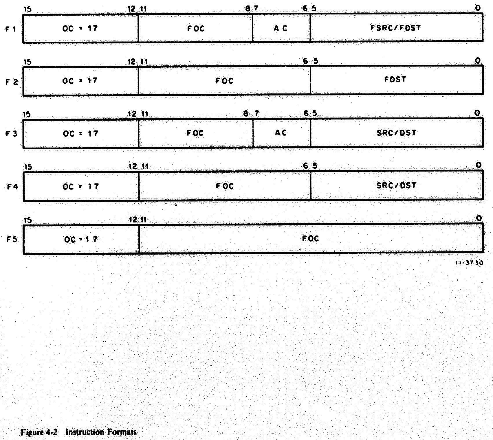

The fields of the various instruction formats (as summarized in Table 4-1) are interpreted as follows.

| Mnemonic | Description |
| --- | --- |
| OC | Operation Code - All floating-point instructions are designated by a 4-bit op code of 17₈. |
| FOC | Floating Operating Code - The number of bits in this field varies with the format; the code is used to specify the actual floating-point operation. |
| SRC | Source - A 6-bit source field identical to that in the PDP-11 instruction. |
| DST | Destination - A 6-bit destination field identical to that in a PDP-11 instruction. |
| FSRC | Floating Source - A 6-bit field used only in format F1. It is identical to SRC, except in mode 0 when it references a floating-point accumulator rather than a CPU general register. |
| FDST | Floating Destination - A 6-bit field used in formats F1 and F2. It is identical to DST, except in mode 0 when it references a floating-point accumulator instead of a CPU general register. |
| AC | Accumulator - A 2-bit field used in formats F1 and F3 to specify FP11-A scratchpad accumulators 0–3. |

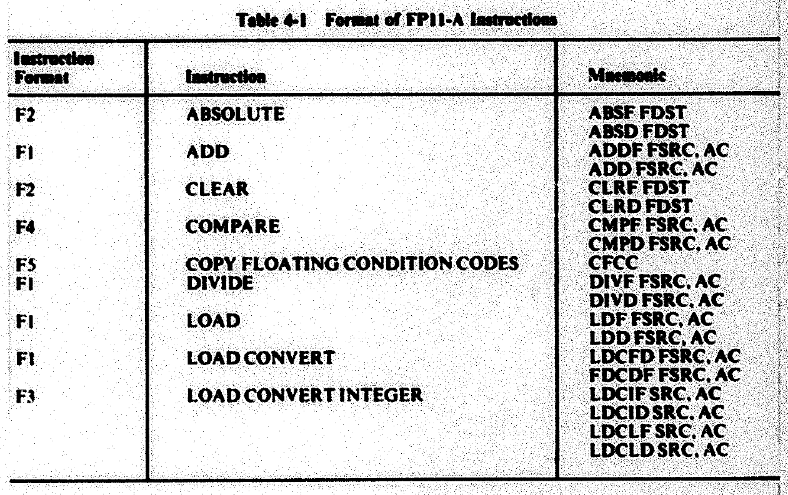

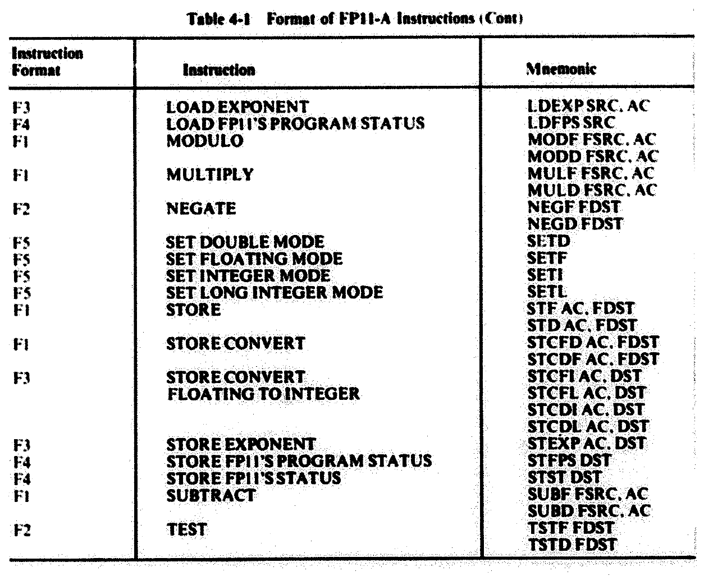

### 4.3 INSTRUCTION SET

Table 4-2 contains the instruction set of the FP11-A. Some of the symbology may not be familiar. Therefore, a brief description follows.

1. A floating-point flip-flop, designated FD, determines whether single- or double-precision floating-point format is specified. If the flip-flop is cleared, single-precision is specified and is designated by F. If the flip-flop is set, double-precision is specified and is designated by D. Examples are NEGF, NEGD, and SUBD.

   > **NOTE**
   >
   > Only the assembler or compiler differentiates between NEGF and NEGD or LDCID or LDCLD instructions. The Floating-point does not differentiate between the instructions but depends upon the value of FD and FL as usually controlled by SETD, SETF, SETC, and SETI instructions (i.e., LDCID → SETI → SETD → LDCLD).

2. An integer flip-flop, designated FL, determines whether short-integer or long-integer format is specified. If the flip-flop is cleared, short-integer format is specified and is designated by I. If the flip-flop is set, long-integer format is specified and is designated by L. Examples are SETI and SETL.

3. Several convert-type instructions use the symbology defined below.

   C<sub>IL,FD</sub> - Convert integer to floating

   C<sub>FD,IL</sub> - Convert floating to integer

   C<sub>F,D</sub> or C<sub>D,F</sub> - Convert single-floating to double-floating or convert double-floating to single-floating

4. UPLIM is defined as the largest possible number that can be represented in floating-point format. This number has an exponent of 377 (excess 200 notation) and a fraction of all 1s. Note the UPLIM is dependent on the format specified. LOLIM is defined as the smallest possible number that is not identically 0. This number has an exponent of 001 and a fraction of all 0s except for the hidden bit.

5. The following conventions are used when referring to address locations.

   ```text
   (xxxx) = the contents of the location specified by xxxx
   ABS (address) = absolute value of (address)
   EXP (address) = exponent of (address) in excess 200 notation
   ```

6. Some of the octal codes listed in Table 4-2 are in the form of mathematical expressions. These octal codes can be calculated as shown in the following examples.

   **Example 1: LDFPS Instruction**

   Mode 3, register 7 specified (F instruction format)

   ```text
   170100 + SRC
     SRC field is equal to 37
     Basic op code is 170100
     SRC and basic op code are added to yield 170137.
   ```

   **Example 2: LDF Instruction**

   AC2, mode 2, and register 6 specified (F1 instruction format).

   ```text
   172400 + C • 100 + FSRC

     AC = 2

     2 • 100 = 200

   172400 + 200 = 172600
     FSRC is equal to 26

   172600 + 26 + 172626
   ```

7. AC ∨ 1 means that the accumulator field (bits 6 and 7 in formats F1 and F3) is logically ORed with 01.

   Example:

   Accumulator field = bits 6 and 7 = AC2 = 10. AC ∨ 1 = 11.

The information in Table 4-2 is expressed in symbolic notation to provide the reader with a quick reference to the function of each instruction. The following paragraphs supplement the information in Table 4-2.

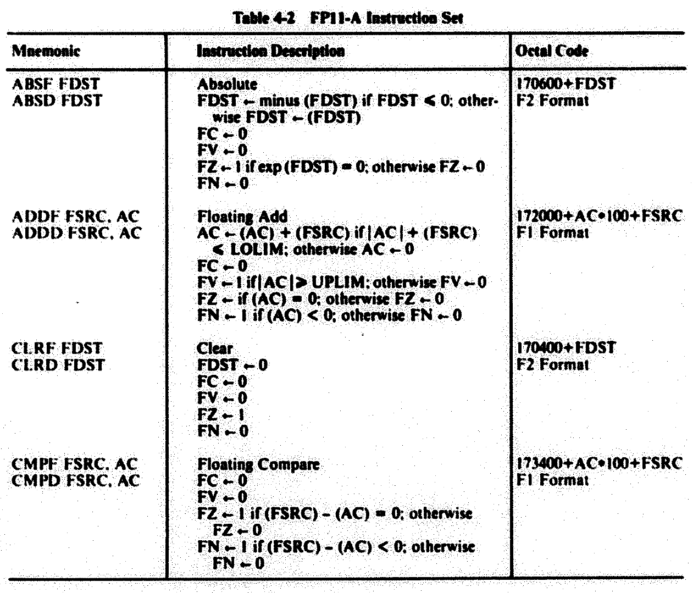

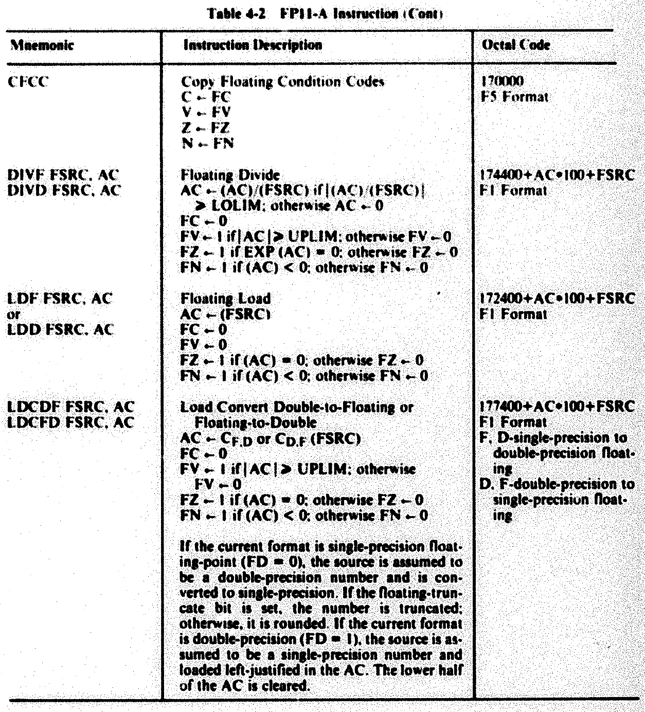

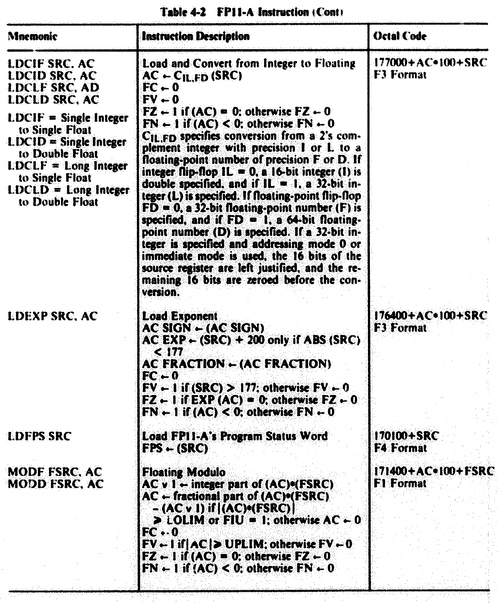

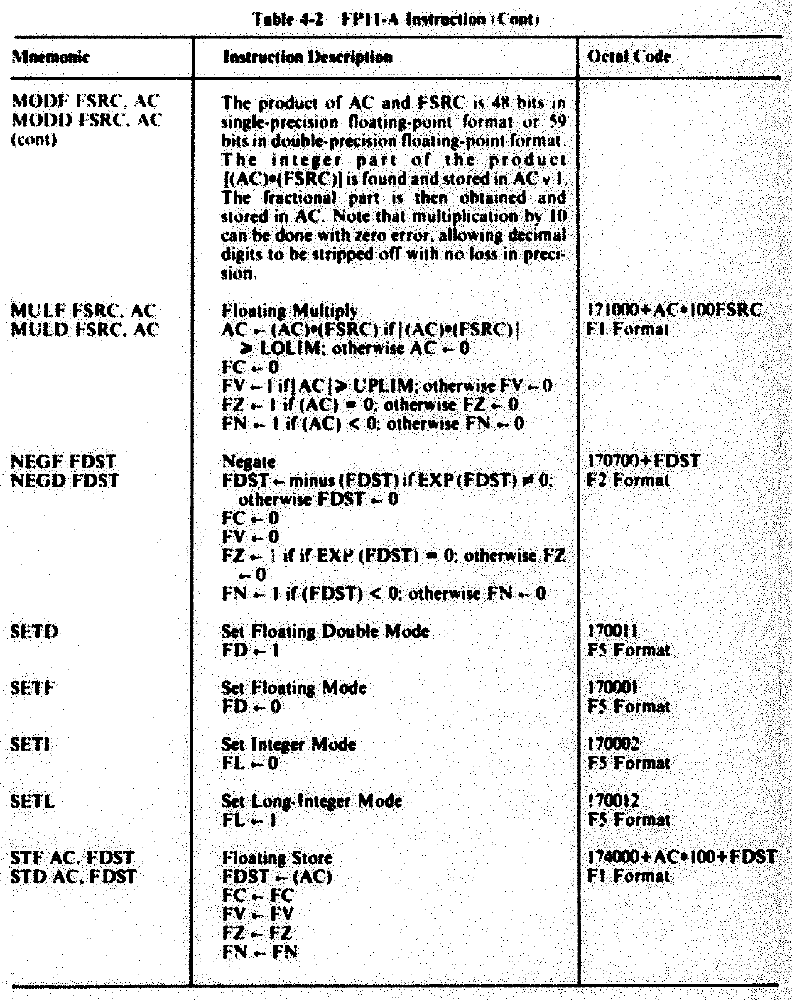

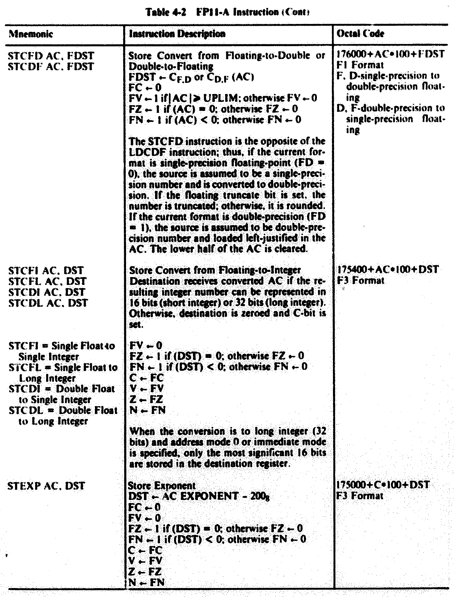

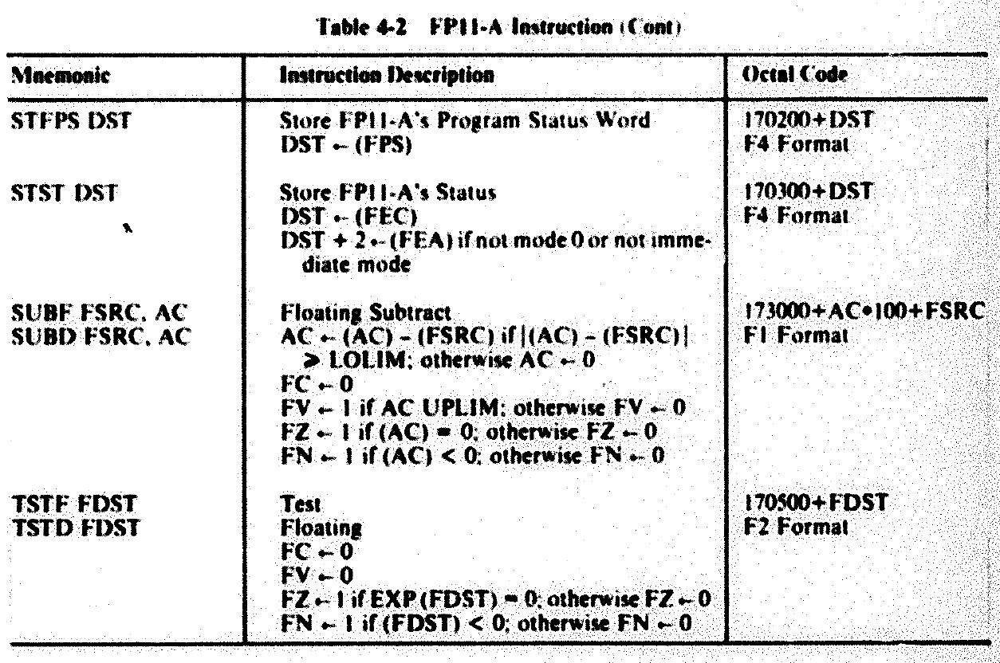

#### 4.3.1 Arithmetic Instructions

The arithmetic instructions (Add, Subtract, Multiply, Divide) require one operand in a source (a floating-point accumulator in mode 0, a memory location otherwise) and one operand in a destination accumulator. The instruction is executed by the FP11-A and the result is stored in the destination accumulator.

The Compare instruction also requires one operand in a source and one operand in a destination accumulator. However, the two operands remain in their respective locations after the instruction is executed by the FP11-A, and there is no transfer of the result.

#### 4.3.2 Floating-Modulo Instruction

The Floating-Modulo (MOD) instruction causes the FP11-A to multiply two floating-point operands, separate the product into integer and fractional parts, and store one or both parts as floating-point numbers. The whole-number portion goes into an odd-numbered accumulator and the fraction goes into an even-numbered accumulator.

The whole-number portion of the number, when expressed as a floating-point number, contains an exponent greater than 201 in excess 200 notation, which means that the whole number has a decimal value of some number greater than one and less than UPLIM, where UPLIM is the greatest possible number that can be represented by the FP11-A.

The fractional portion of the number, when expressed as a floating-point number, contains an exponent less than or equal to 201 in excess 200 notation. This means that the fraction has a value less than one and greater than LOLIM, where LOLIM is the smallest possible number that can be represented by the FP11-A.

#### 4.3.3 Load Instruction

The Load instruction causes the FP11-A to take an operand from a source and copy it into a destination accumulator. The source is a floating-point accumulator in mode 0 and a memory location otherwise.

#### 4.3.4 Store Instruction

The Store instruction causes the FP11-A to take an operand from a source accumulator and transfer it to a destination. This destination is a floating-point accumulator in mode 0 and a memory location otherwise.

#### 4.3.5 Load Convert (Double-to-Floating, Floating-to-Double) Instructions

The Load Convert Double-to-Floating (LDCDF) instruction causes the FP11-A to assume that the source specifies a double-precision floating-point number. The FP11-A then converts that number to single-precision, and places this result in the destination accumulator. If the floating-truncate (FT) status bit is set, the number is truncated. If the FT bit is not set, the number is rounded by adding a 1 to the single-precision segment if the MSB of the double-precision segment is a 1 depending on the prior conditions set up by the FD bit (Figure 4-3). If the MSB of the double-precision segment is 0, the single-precision word remains unchanged after rounding.

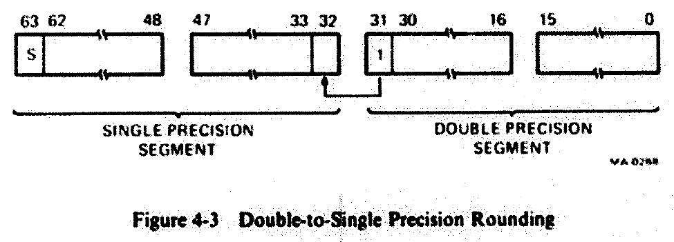

The Load Convert Floating-to-Double (LDCFD) instruction causes the FP11-A to assume that the source specifies a single-precision number. The FP11-A then converts that number to double-precision by appending 32 zeros to the single-precision word, and places this result in the destination accumulator.

Note that for both Load Convert instructions, the number to be converted is originally in the source (a floating-point accumulator in mode 0, a memory location otherwise) and is transferred to the destination accumulator after conversion.

#### 4.3.6 Store Convert (Double-to-Floating, Floating-to-Double) Instructions

The Store Convert Double-to-Floating (STCDF) instruction causes the FP11-A to convert a double-precision number located in the source accumulator to a single-precision number. The FP11-A then transfers this result to the specified destination. If the floating-truncate (FT) bit is set, the floating-point number is truncated. If the FT bit is not set, the number is rounded. If the MSB (bit 31) of the double-precision segment of the word is a 1, 1 is added to the single-precision segment of the word, depending on the prior conditions set up by the FD bit (Figure 4-3); otherwise, the single-precision segment remains unchanged.

The Store Convert Floating-to-Double (STCFD) instruction causes the FP11-A to convert a single-precision number located in the source accumulator to a double-precision number. The FP11-A then transfers this result to the specified destination. The single-to-double precision is obtained by appending zeros equivalent to the double-precision segment of the word (Figure 4-4).

Note that for both Store Convert instructions, the number to be converted is originally in the source accumulator and is transferred to the destination (a floating-point accumulator in mode 0, a memory location otherwise) after conversion.

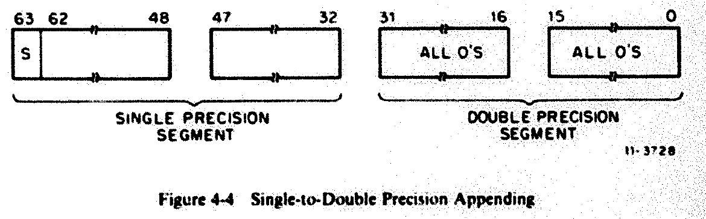

#### 4.3.7 Clear Instruction

The Clear instruction causes the FP11-A to clear a floating-point number by setting all its bits to 0.

#### 4.3.8 Test Instruction

The Test instruction causes the FP11-A to test the sign and exponent of a floating-point number and update the FP11-A status accordingly. The number tested is obtained from the destination (a floating-point accumulator in mode 0, a memory location otherwise). The FC and FV bits are cleared. The FN bit is set only if the destination is negative. The FZ bit is set only if the exponent of the destination is zero. If the FIUV status bit is set, a trap occurs (after the test instruction is executed) if a minus zero is encountered.

#### 4.3.9 Absolute Instruction

The Absolute instruction causes the FP11-A to take the absolute value of a floating-point number by forcing its sign bit to 0. If mode 0 is specified, the sign of the number in the floating-point destination accumulator is forced to 0. The exponent of the number is tested, and if it is 0, zeros are written into the accumulator. If the exponent is non-zero, the accumulator is unaffected.

If mode 0 is not specified, the sign bit of the specified data word in memory is zeroed. The exponent of this word is tested, and if it is 0, the entire data word in memory is zeroed. If the exponent is non-zero, the integer exponent is restored to memory.

Absolute and Negate instructions are the only instructions that can read and write a memory location.

#### 4.3.10 Negate Instruction

The Negate instruction causes the CPU (or the FP11-A, in mode 0) to complement the sign of an operand. If mode 0 is specified, the sign of the number in the floating-point destination accumulator is complemented. The exponent of the number is tested, and if it is 0, zeros are written into the accumulator. If the exponent is non-zero, the accumulator is unaffected.

If mode 0 is not specified, the sign bit of the specified data word in memory is complemented. This word is then transferred from memory to a floating-point accumulator. The exponent of this word is tested, and if it is 0, the entire data word is zeroed and transferred back to memory. If the exponent is non-zero, the original fraction and exponent are restored to memory.

#### 4.3.11 Load Exponent Instruction

The Load Exponent instruction causes the floating-point processor (FPP) to load an exponent from the source (a floating-point accumulator in mode 0, a memory location otherwise) into the exponent field of the destination accumulator. In order to do this, the 16-bit, 2’s complement exponent from the source must be converted to an 8-bit number in excess 200 notation. This process is described further below.

Assume that the 16-bit, 2’s complement exponent is coming from memory. The possible legal range of 16-bit numbers in memory is from 000000 to 177777₈. On the other hand, the possible legal range of exponents in the FP11-A falls into two classes.

1. Positive exponents (0 through 177) - When 200 is added to any of these numbers, the sum stays within the legal 8-bit exponent field (i.e., from 200 through 377).
2. Negative exponents (177601 through 177777) - When 200 is added to any of these numbers, the sum stays within the legal 8-bit exponent field (i.e., from 1 through 177).

Notice that all legal positive exponents coming from memory have something in common: their 9 high-order bits are all 0s. Similarly, all legal negative exponents from memory have their 9 high-order bits equal to 1. Therefore, to detect a legal exponent, only the 9 high-order bits need to be examined for all 1s or all 0s.

Any number from memory outside these ranges is illegal and will result in either an overflow or an underflow trap condition.

**Example 1: LDEXP 000034**

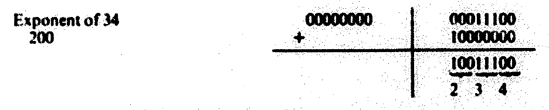

The upper 9 bits all equal 0, so this is a legal positive exponent. The number 234 is sent to the 8-bit exponent field of the specified accumulator.

**Example 2: LDEXP 201**

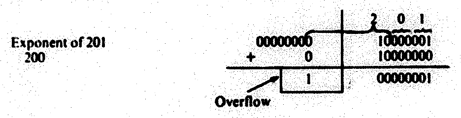

This is an illegal positive exponent. Notice that when 200 is added to the exponent, an overflow occurs.

**Example 3: LDEXP 100200**

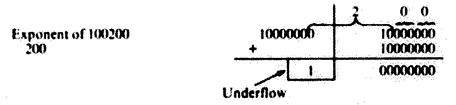

This is an illegal negative exponent. Notice that when 200 is added to the exponent, a result is produced that is more negative than can be expressed by the 8-bit exponent field. Thus, an underflow occurs.

**Example 4: Special Case - Exponent of 0: LDEXP 177600**

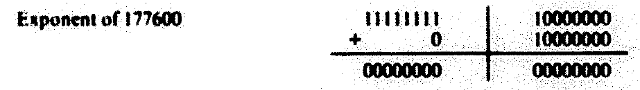

This is the one case where the 9 high-order bits are all equal, but the exponent is illegal. This is because 177600 represents an exponent of 0. This exponent causes an underflow condition to exist; that is, it is treated as an illegal negative exponent.

#### 4.3.12 Load Convert Integer-to-Floating Instruction

The Load Convert Integer instruction takes a 2’s complement integer from memory and converts it to a floating-point number in sign and magnitude format. If short-integer mode is specified, the number from memory is 16 bits and is converted to a 24-bit fraction (single-precision) or a 56-bit fraction (double-precision), depending on whether floating or double mode is specified. If long-integer mode is specified, the number from memory is 32 bits and is converted to a single- or double-precision number, depending on whether floating or double mode is specified. The integer is loaded into bits 55-40 if short integer is specified or into bits 55-24 if long integer is specified. It is then left-shifted eight places so that bit 55 is transferred to bit 63 (Figure 4-5).

The integer is then assigned an exponent of 217₈ short integer. This is the result of adding 200₈ (since the exponent is expressed in excess 200 notation) to 17₈, which represents 15₁₀ shifts. This number of shifts is the maximum number required to normalize a number. If long-integer mode is specified, the integer is assigned an exponent of 237₈, which represents 31₁₀ shifts.

The 2’s complement integer is tested by examination of bit 63 to see if it is a positive or negative number. The number is then normalized by left-shifting until bit 63 becomes a 1. If bit 63 is 1 (negative number), the integer is negative, the sign bit is set, the number is 2’s complemented, and then normalized.

To normalize a number, bit 63 (MSB) of the fraction must be equal to 0 and bit 62 must be made equal to 1. To do this, the integer is shifted the required number of places to the left and the exponent value is decreased by the number of places shifted (Figure 4-6).

```text
EXP = 217₈    Shift integer 15 places to the left to normalize.
      -17₈    Bit 59 = 0, bit 58 = 1
      200₈    Decrease exponent by 15₁₀ which is 17₈.
```

When loading a long integer with an FD = 0, if the long integer contains more than 24 significant digits, then less significant digits will be truncated with some loss of accuracy.

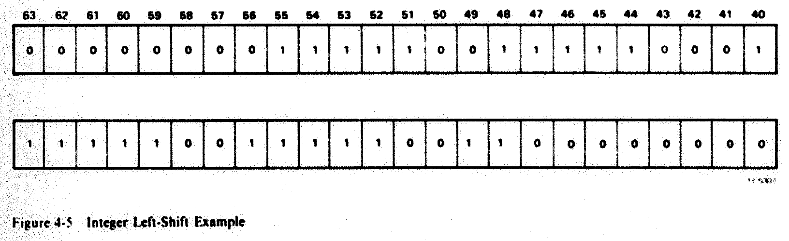

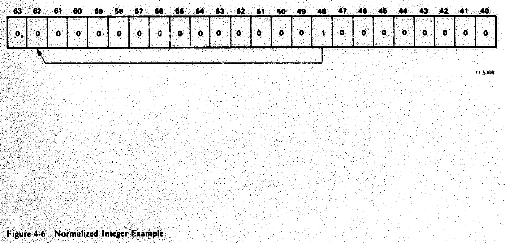

#### 4.3.13 Store Exponent Instruction

The Store Exponent (STEXP) instruction causes the CPU to access a floating-point number in the FP11-A, extract the 8-bit exponent field from this number, and subtract a constant of 200 (since the exponent is expressed in excess 200 notation). The exponent is then stored in the destination as a 16-bit, 2’s complement, right-justified number with the sign of the exponent (bit 07) extended through the 8 high-order bits.

The legal range of exponents is from 0 to 377, expressed in excess 200 notation. This means that the number stored ranges from -200 to 177 after the constant of 200 has been subtracted. The subtraction of 200 is accomplished by taking the 2’s complement of 200 and adding it to the exponent field (Figures 4-7 and 4-8).

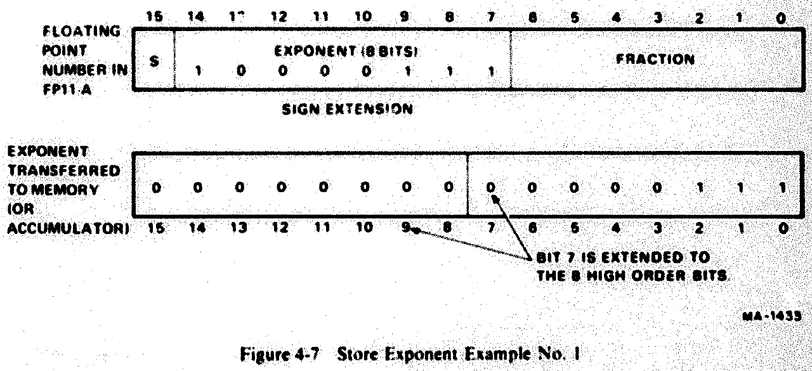

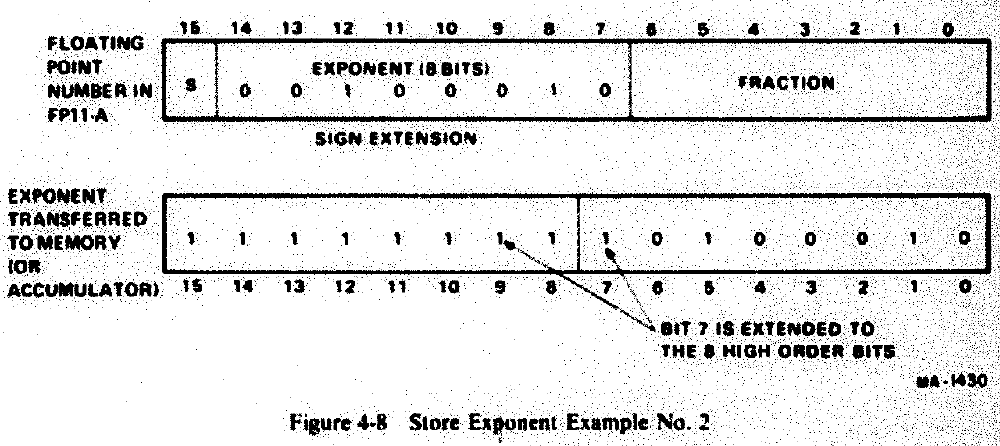

Two examples that illustrate the process follow: one using an exponent greater than 200 and the next using an exponent less than 200.

**Example 1: Exponent = 207**

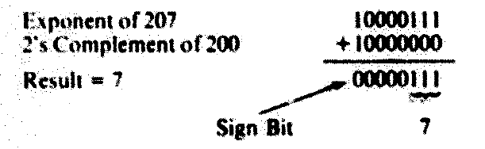

**Example 2: Exponent = 42**

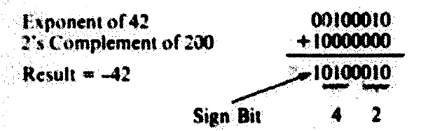

#### 4.3.14 Store Convert Floating-to-Integer Instruction

The Store Convert Floating-to-Integer instruction causes the FPP to take a floating-point number and convert it to an integer for transfer to a destination.

The four classes of this instruction are as follows.

1. STCFI - Convert single-precision, 24-bit fraction to a 16-bit integer (short-integer mode).
2. STCFL - Convert single-precision, 24-bit fraction to a 32-bit integer (long-integer mode).
3. STCDI - Convert double-precision, 56-bit fraction to a 16-bit integer (short-integer mode).
4. STCDL - Convert double-precision, 56-bit fraction to a 32-bit integer (long-integer mode).

The (normalized) floating-point number to be converted is transferred to the FPP. The FPP works with the sign bit and one of the following.

1. The 15 MSBs of the fraction for Floating-to-Integer and Double-to-Floating conversion
2. The 31 MSBs of the fraction for Double-to-Long conversion
3. The entire fraction for Floating-to-Long conversion.

The FPP subtracts 201 from the exponent to determine if the floating-point number is a fraction. If the result of the subtraction is negative, the exponent is less than 201, and the absolute value of the floating-point number is less than 1. When converted to an integer, the value of this number is 0; a conversion error occurs, the FZ bit is set, and 0s are sent to the destination. If the result of the subtraction is positive (or zero), it indicates that the exponent is greater than (or equal to) 201, and the floating-point number can be converted to a non-zero integer (Figure 4-9).

A second test is made by the FPP to determine if the floating-point number to be converted is within the range of numbers that can be represented by a 16-bit integer (I-format) or 32-bit integer (L-format).

Consider the range of integers that can be represented in I and L formats and their floating-point equivalents.

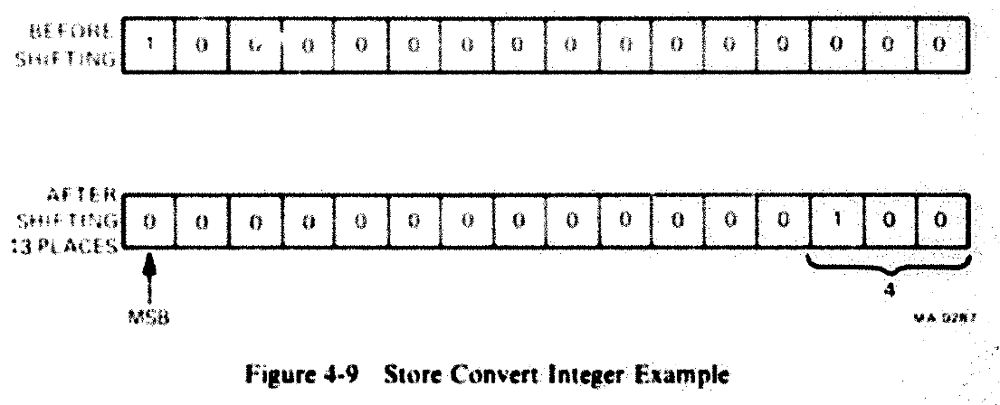

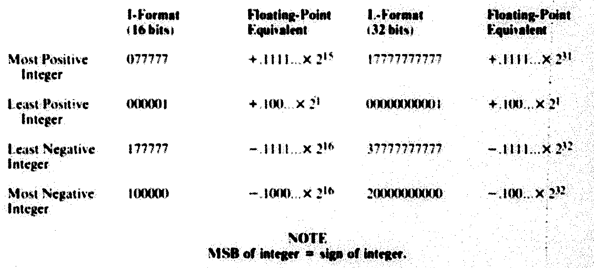

Thus, the exponent of a positive floating-point number to be converted must be less than 16₁₀ (220 in excess 200 notation) to convert to I-format or 32₁₀ (240 in excess 200 notation) to convert to L-format. The exponent of a negative number to be converted must be less than or equal to 16₁₀ or 32₁₀ to convert to I- or L-formats, respectively.

The FPP tests whether the floating-point number to be converted is within the range of integers that can be represented in I- or L-format by subtracting a constant of 20₈ (for short integers) or 40₈ (for long integers) from the result of the first test (result of first test = biased exponent − 201₈ = unbiased exponent − 1). If the result of the subtraction is positive or 0, it indicates that the floating-point number is too large to be represented as an integer. In that case, a conversion error occurs and zeros are sent to the destination. If the result of the subtraction is a negative number other than -1, the floating-point number can be represented as an integer without causing an overflow condition. If the result of the subtraction is -1, the exponent of the floating-point number is either 220 (short) or 240 (long), and conversion proceeds. However, the floating-point number is within range only if its sign is negative and its fraction is .100. . . (i.e., if it is the most negative integer; see table above). If, in this case, the number is not the most negative integer, it will be detected by a third conversion error test (see below) after conversion.

To convert the fraction to an integer, the FPP shifts it right a number of places as specified by the following algorithms.

```text
     Short integer:          No. of right shifts = 20₈ + 201₈ — biased exponent - 1
     Long integer:           No. of right shifts = 40₈ + 201₈ — biased exponent − 1
```

Regardless of the condition of the FT bit, the fractional part of the number is always truncated during this shifting process.

If the floating-point number is positive, the integer conversion is complete after shifting, and the number is transferred to the appropriate destination. If, however, the floating-point number is negative, the integer must be 2’s complemented before being sent to its destination.

After conversion, the FPP performs a third test for a conversion error by comparing the MSB of the (converted) integer with the sign bit of the original (unconverted) number. If these signs are not equal, there has been a conversion error and the FPP traps if the FIC bit is set. This test is performed to detect a floating-point number with an exponent of 220 (short) or 240 (long) that has not been converted to the most negative integer.

**Example 1: Store Convert Floating-to-Integer (STCFI)**

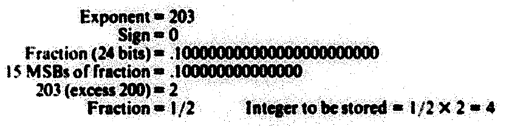

1. Test 1: Is the number to be converted a fraction?

   ```text
   Exponent:    203₈
               -201
   No             2
   ```

   Since this result is positive, the given floating-point number is not a fraction and conversion may proceed without error.

2. Test 2: Is the floating-point number to be converted within range? (We are working with a positive short integer.)

   ```text
   Result of Test 1:    2
                      -20
   Yes                -16
   ```

   Indicates that the number to be converted is within range and can be represented as a 16-bit integer. No conversion error occurs.

   How many right shifts? Use algorithm:

   20₈ + 201₈ - 203₈ - 1 = 20₈ - 3₈ = 15₈ = 13₁₀

   = 13 right shifts

   This example involves a positive number, so conversion is complete after 13 right shifts. If the number had been negative, the integer would have been 2’s complemented.

3. Test 3: The MSB of the converted integer and the sign bit of the original floating-point number are compared. Since they are equal, no conversion error occurs.

**Example 2: Store Convert Floating-to-Integer (STCDL)**

```text
Exponent = 240₈
Sign = 0
31 MSBs of fraction = .1000000000000000000000000000000
```

1. Test 1: Is the number to be converted a fraction?

   ```text
   Exponent:    240₈
               -201
   No            37₈
   ```

   Since this result is positive, the given floating-point number is not a fraction, and conversion may proceed (i.e., no conversion error occurs).

2. Test 2: Is the floating-point number to be converted within range? (We are working with a positive long integer.)

   ```text
   Result of Test 1:    37
                      -40
                       -1
   ```

   We know the number is out of range by examining the sign bit (in fact, this number is one greater than the most positive integer that can be represented). However, the FPP does not know this yet, and conversion proceeds without error at this point.

   How many right shifts? Use algorithm:

   40₈ + 201₈ - 240₈ - 1 = 0

   = No right shifts

   Converted 32-bit integer = 20000000000₈

   Since the number is positive, conversion is now complete (i.e., no need for 2’s complementing).

3. Test 3: The most significant bit of the converted integer (which is 1) and the sign bit of the original floating-point number (which is 0) are compared. Since they are not equal, a conversion error occurs, which we predicted in Step 2.

#### 4.3.15 Load FP11’s Program Status

This instruction causes the FPP to transfer 16 bits from the location specified by the source to the floating-point status (FPS) register. These 16 bits contain status information for use by the FP11-A in order to enable and disable interrupts, set and clear mode bits, and set condition codes (Paragraph 3.4).

#### 4.3.16 Store FP11’s Program Status

This instruction causes the FPP to transfer the 16 bits of the FPS register to the specified destination.

#### 4.3.17 Store FP11’s Status

The Store FP11’s Status (STST) instruction causes the FPP to read the contents of the floating exception code (FEC) and floating exception address (FEA) registers when a floating-point exception (error) occurs.

If mode 0 addressing is enabled, only the FEC is sent to the destination accumulator. If mode 0 addressing is not enabled, the FEC is stored in memory followed by the FEA. In memory, the FEA data occupies all 16 bits of its memory location, while the FEC data occupies only the lower 4 bits of its location.

When an error occurs and the interrupt trap in the CPU is enabled, the CPU traps to interrupt vector 244 and issues the STST instruction to determine the type of error.

> **NOTE**
>
> The STST instruction should be used only after an error has occurred, since in all other cases the instruction contains irrelevant data or contains the conditions that occurred after the last error.

#### 4.3.18 Copy Floating Condition Codes

The Copy Floating Condition Codes (CFCC) instruction causes the FPP to copy the four floating condition codes (FC, FZ, FV, FN) into the CPU condition codes (C, Z, V, N).

#### 4.3.19 Set Floating Mode

The Set Floating Mode (SETF) instruction causes the FPP to clear the FD bit (bit 07 of the FPS register) and indicate single-precision operation.

#### 4.3.20 Set Double Mode

The Set Double Mode (SETD) instruction causes the FPP to set the FD bit (bit 07 of the FPS register) and indicate double-precision operation.

#### 4.3.21 Set Integer Mode

The Set Integer Mode (SETI) instruction causes the FPP to clear the IL bit (bit 06 of the FPS) and indicate that short-integer mode (16 bits) is specified.

#### 4.3.22 Set Long-Integer Mode

The Set Long-Integer Mode (SETL) instruction causes the FPP to set the IL bit (bit 06 of the FPS) and indicate that long-integer mode (32 bits) is specified.

### 4.4 FP11-A PROGRAMMING EXAMPLES

This paragraph contains two programming examples using the FP11-A instruction set. In example 1, A is added to B, D is subtracted from C, the quantity (A + B) is multiplied by (C - D), the product of this multiplication is divided by X, and the result is stored. Example 2 calculates DX³ + CX² + BX + A, which involves a 3-pass loop.

**Example 1: [(A + B) • (C - D)]/X**

```text
        SET F
        LDF     A,AC0       ;LOAD AC0 FROM A
        ADDF    B,AC0       ;AC0 HAS (A + B)
        LDF     C,AC1       ;LOAD AC1 FROM C
        SUBF    D,AC1       ;AC1 HAS (C - D)
        MULF    AC1,AC0     ;AC0 HAS (A + D)•(C - D)
        DIVF    X,AC0       ;AC0 HAS (A + D)•(C - D)/X
        STF     AC0,Y       ;STORE (A + D)•(C - D)/X IN Y
```

**Example 2: DX³ + CX² + BX + A**

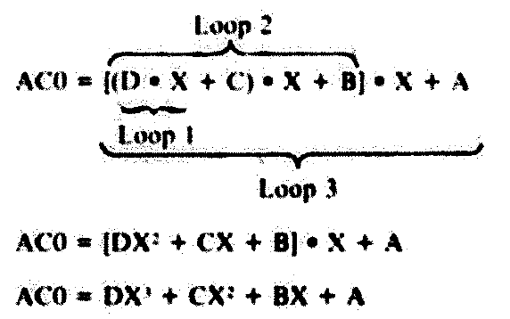

```text
        SET F
        MOV #3,%0          ;SET UP LOOP COUNTER
        MOV #D+4,%1        ;SET UP POINTER TO COEFFICIENTS
        LDF (6)+,AC1       ;POP X FROM STACK
        CLRF AC0           ;CLEAR OUT AC0
LOOP:   ADDF -(4),AC0      ;ADD NEXT COEFFICIENT
                           ;TO PARTIAL RESULT
        MULF AC1,AC0       ;MULTIPLY PARTIAL RESULT BY X
        SOB %0,LOOP        ;DO LOOP 3 TIMES
        ADDF -(4),AC0      ;ADD X TO GET RESULT
        STF AC0,-(6)       ;PUSH RESULT ON STACK
```

## Chapter 5 — Processor Organization

### 5.1 INTRODUCTION

The FP11-A Floating-Point Processor connects to the KD11-EA central processor via a tri-state bus (Figure 5-1). This interface allows addressing of floating-point memory utilizing the memory management option.

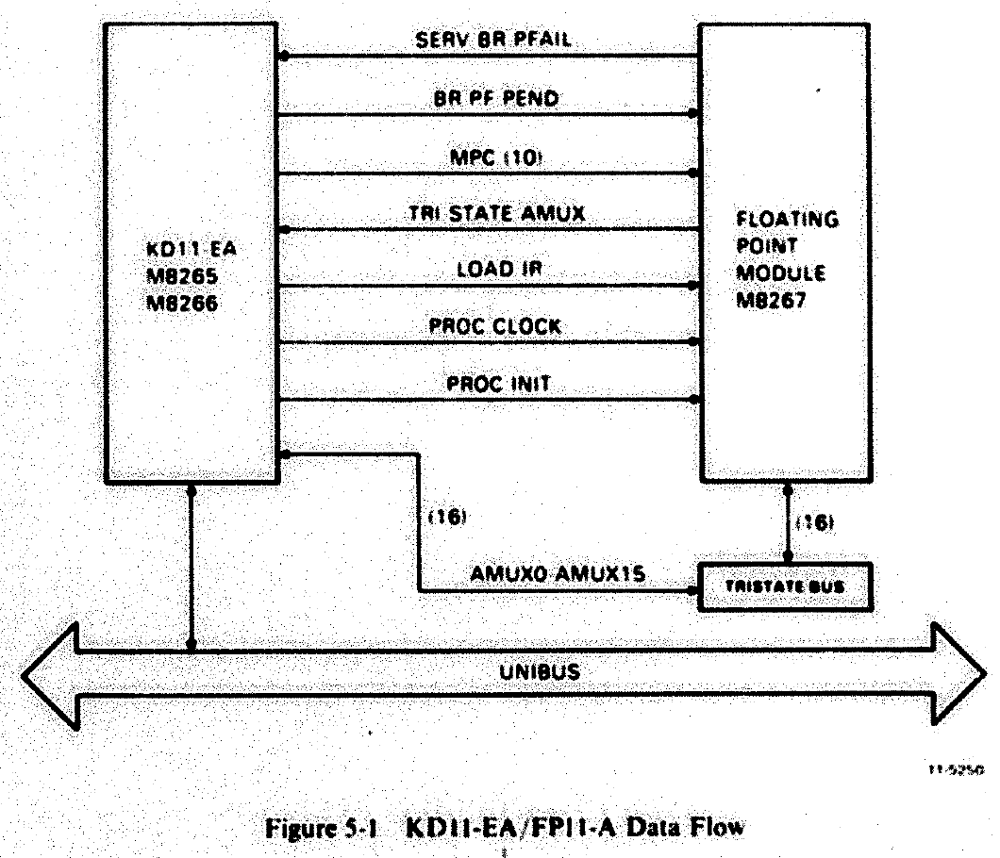

The CPU software must initiate floating-point operation and originate addresses and data since control of the FP11-A resides in the CPU.

The FP11-A depends on the CPU to fetch instructions and data from the memory in order to initiate floating-point operations. If the instruction is not a floating-point instruction, it is ignored by the FP11-A. If the decoded instruction is a floating-point instruction (i.e., contains an op code of 17XXXX), the FP11-A causes the CPU to branch to the FP11-A ROM (read-only memory) microstates associated with floating-point instructions.

The simplified block diagram illustrated in Figure 5-2 shows the major functions of the FP11-A.

### 5.2 MICROPROCESSOR DESCRIPTION

The principal data manipulation element in the floating-point processor is the AM2901 microprocessor (Figure 5-3). The basic microprocessor is 4 bits wide and 16 of these units are cascaded to make up a 16 by 64-bit word for the FP11-A. A general discussion of the microprocessor followed by a description of its integration into the overall floating-point processor is given in the following paragraphs.

#### 5.2.1 Microprocessor Organization

As shown in Figure 5-3, the major components of the microprocessor are the RAM, the arithmetic logic unit (ALU), and the Q-register.

Information contained in any of the 16 64-bit words of the RAM may be read from the A-port as controlled by the 4-bit A-word address (A₀–A₃) field. Similarly, data in any of the 16 words of the RAM as defined by the B-address (B₀–B₃) field input may be simultaneously read from the B-port of the RAM. It is also possible to apply the same address code to both the A and B select fields, in which case the identical file data will appear at both the RAM A-port and B-port simultaneously.

New data is always written into the file word specified by the B-address field of the RAM. The RAM data input field is driven by a 3-input multiplexer which permits shifting of the ALU output. The 3-input multiplexer allows data to be shifted right 1 bit position, left 1 bit position, or not shifted in either direction.

#### 5.2.2 Arithmetic/Logical Operations

The arithmetic logic unit (ALU) is capable of performing three arithmetic and five logical operations on the two 4-bit input words R₀–R₃ and S₀–S₃. The R-input field to the ALU receives its input from a 2-input multiplexer while S receives its signals from a 3-input multiplexer. The 2- and 3-input multiplexers both have an inhibit capability. This is the equivalent of an “O” source operand.

If the five data inputs to the ALU are combined into pairs, 10 combinations of registers are possible, i.e., AB, DA, AQ, OA, OB, BQ, BD, DO, DQ, and OQ, as illustrated in Table 5-1. The microprocessor uses eight of these operand pairs. Selection of the ALU source operand pairs is accomplished by the microinstruction inputs I0, I1, and I2.

The direct-data (D) source-operand input port is used to insert all data into the working registers inside the 2901 microprocessor. The D-input can also be used by the ALU to modify any of the internal data files of the RAM via the F outputs of the ALU.

The Q-register is a separate 4-bit register intended primarily for multiplication and division routines. This register can also be used as an accumulator or buffer register for certain applications.

The ALU performs three arithmetic and five logical functions as directed by the three control bits I3, I4, and I5 (Table 5-2).

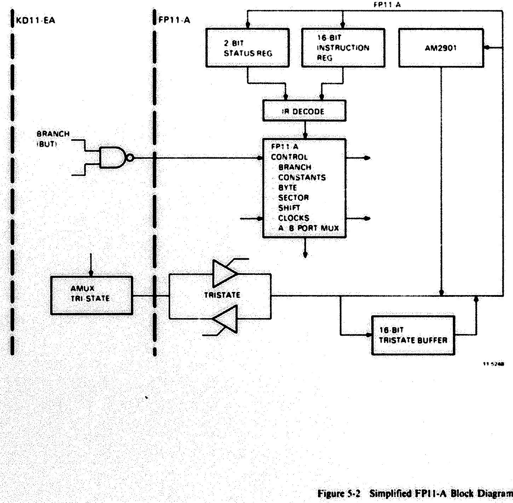

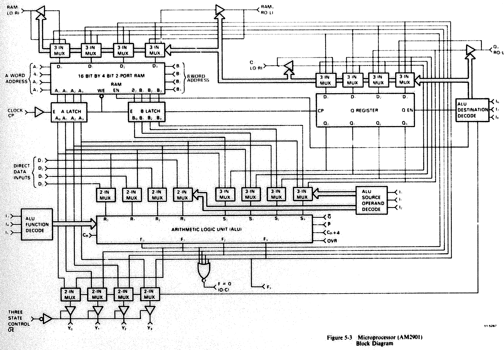

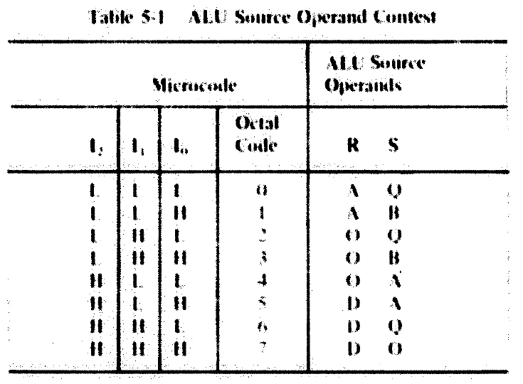

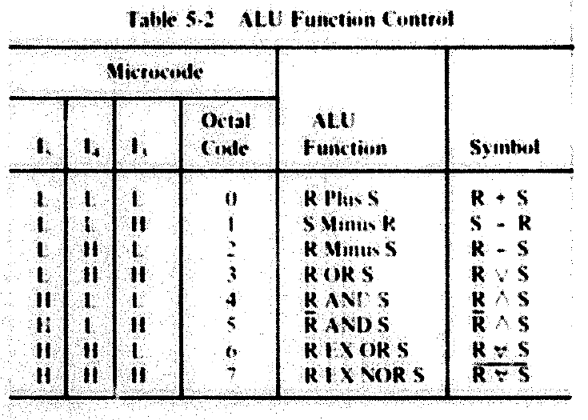

ALU output data may be routed to one of eight possible destinations as defined by control bits I6, I7, and I8. ALU output data may be a data output from the device or it may be stored in the RAM or the Q-register.

The data output of the microprocessor uses a 2:1 multiplexer whose inputs are the A-port of the RAM or the ALU outputs (F). Selection of these outputs is controlled by bits I6, I7, and I8 of the microinstruction control input (Table 5-3). Note that the left- and right-shift functions in Table 5-3 are reversed for the FP11-A application.

The FP11-A uses 16 AM2901 units connected in cascade with 3 levels of look-ahead carry logic. This configuration results in a 64-bit word. Carry generate (G), and carry propagate (P), are unit outputs for use with a look-ahead carry generator. Carry out (Cₙ₊₄) is also generated by the microprocessor and is available as an output carry flag in a status register. Cₙ and Cₙ₊₄ are both active-high.

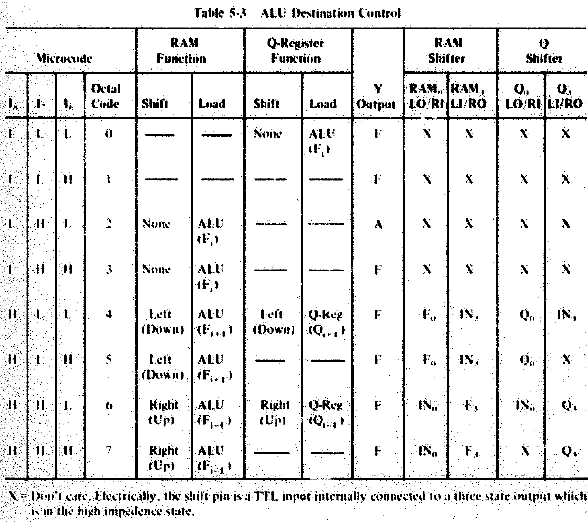

Three additional outputs are generated by the ALU. These are F3, F = 0, and overflow (OVR). F3 represents the most significant bit (sign) of the ALU and can be used to determine positive or negative results without enabling the 3-state outputs or while enabling the A-port to output. F3 is non-inverted with respect to the sign bit output Y3. F = 0 output is used for zero detect and is an open-collector output that can be wire ORed between microprocessor slices. F = 0 is high when all F outputs are low. OVR is a flag indicating an arithmetic operation exceeds the available range and is high when the overflow condition exists, i.e., when Cₙ and Cₙ₊₄ are not of the same polarity.

Inputs to the RAM are via a 3-input multiplexer. The multiplexer allows input data to be entered into the RAM in three modes:

- Shifted left one place
- Shifted right one place
- Unshifted.

The shifting is accomplished by two ports: RAM-LO/RI and RAM-RO/LI. Both ports consist of a buffer driver with a tri-state output and an input to the multiplexer. In the shift-up (X2) mode, the RO buffer is enabled and the RI multiplexer input is enabled. In the shift-down (÷2) mode, the LO buffer and LI input are enabled. In the no-shift mode, both the LO and RO buffers are in the high-impedance state and the multiplexer inputs are not selected. The microinstruction control bits I₆, I₇, and I₈ operate the shifter as shown in Table 5-3.

The Q-register is also driven from a 3-input multiplexer. In the no-shift mode, the multiplexer enters ALU data into the Q-register. Operation for the shift-up or shift-down modes is the same as for the RAM as indicated in Table 5-3.

The RAM, Q-register, and the A and B data latches are controlled by the clock input. When enabled, data latches are also controlled by the clock input and data is clocked into the Q-register on the positive-going transition of the clock. When the clock input is high, the A and B data latches are open and will pass any data that is present at the RAM outputs. When the clock is low, the latches are closed and will retain the last data entered. If the RAM-EN is enabled, new data is entered into the RAM file (word) defined by the B-address field when the clock input is low.

#### 5.2.3 RAM

The FP11-A RAM register usage is shown in Figure 5-4. This unit, located in the microprocessor, is the scratchpad area where the results of arithmetic and logical operations are temporarily stored. The contents of the RAM are read into the ALU under control of the FP11-A microcode. It consists of 16 64-bit words (each of the 16 microprocessors (AM2901) contains a 16 × 4-bit RAM).

Six of the 64-bit registers are allocated for the accumulators and are accessible to the programmer via the FP11-A instruction register. Registers 6 and 7 are unused while registers 10–17 are set aside for special functions. Registers 10–17 are accessed only by the control ROM. Registers 10–14 constitute a working storage area for the FP11-A microcode. Other functions included are the floating-point status register, condition codes, and exception codes.

#### 5.2.4 Arithmetic Logic Unit (ALU)

The ALU is the data path component that actually performs the arithmetic/logical operation under command of the microcode (Table 5-4). R-inputs are fed in via a 2-input multiplexer whose inputs are the direct data (D) inputs and the output of the A-port of the RAM. The S-inputs include the A- and B-ports of the RAM and the Q-register outputs.

ALU output data (F) may be routed to the Q-register or RAM, or may be multiplexed with the A-port output data from the RAM as Y₀–Y₃. The ALU function decode determines the arithmetic or logical function to be performed, while the ALU destination decode determines which of the indicated registers the data is routed to or whether it will be a data output of the device itself.

The ALU source operand decode performs the actual register selection. All three of these functions are controlled by bits I0–I8 of the control word.

#### 5.2.5 Q-Register

The Q-register is used primarily during multiply and divide operations to store multiplier or product operators. Its contents may be shifted left or right or remain unshifted and the register may route data to the ALU or receive input from that device.

#### 5.2.6 Source Operands and ALU Functions

This paragraph summarizes the arithmetic and logic functions performed by the ALU and presents ALU logic and arithmetic functions in separate tabulations.

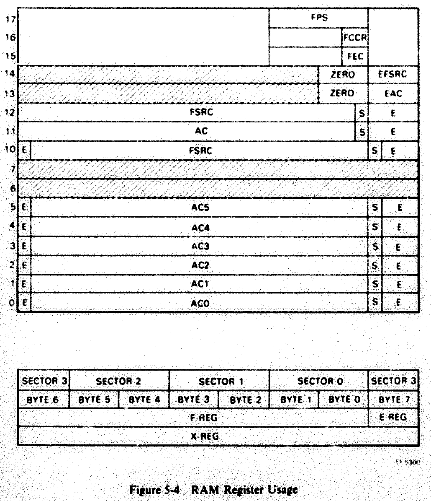


##### 5.2.6.1 Logical and Arithmetic Functions

The ALU performs five logical and three arithmetic functions on eight source operand pairs. ALU logic functions and appropriate control bit values (I0–I5) are shown in Table 5-5. The carry input (Cₙ) has no effect in logic mode but does affect operations in arithmetic mode (Table 5-6). Both carry-in LOW (Cₙ = 0) and carry-in HIGH (Cₙ = 1) are defined.

##### 5.2.6.2 Logical Functions for G, P, Cₙ₊₄, and OVR

The four signals, G, P, Cₙ₊₄, and OVR, as described in Paragraph 5.2 are designed to indicate carry and overflow conditions when the microprocessor is in the add or subtract mode. Table 5-7 indicates the logic equations for these four signals for each of the eight ALU functions. The R- and S-inputs are the two inputs selected according to Table 5-8.

#### 5.2.7 Summary of Pin Definitions

The AM2901 pin definitions are summarized in Table 5-7. Pin assignments for the AM2901 40-pin dual in-line package are shown in Figure 5-5.


### 5.3 INSTRUCTION STATUS REGISTERS AND DECODE

The FP11-A contains a 12-bit instruction register and two flip-flop’s that are bits of the status registers (FD;FL). The possible FP11-A instruction formats are presented in Chapter 2. One bit of the status register (FD) specifies double- or single-precision format and the other (FL) designates single- or double-precision integer format. The outputs of these registers are fed to the floating-point instruction decode register which consists of two 512- × 4-bit ROMS. The ROM outputs then generate microprocessor control (MPC) outputs to control the microprogram.

### 5.4 TRI-STATE TRANSCEIVERS AND BUFFER

The 8097 tri-state status gates are arranged as tri-state transceivers to communicate between the AMUX bus (KD11-EA) and the T-bus (FP11-A), which are 16-bit tri-state buses.

74S173s, which are tri-state flip-flops, are used to buffer Unibus data being passed to the AM2901s.

### 5.5 BRANCH LOGIC AND TRI-STATE CONTROL

This logic is controlled by condition code and T-bus branch ROMs in the FP11-A. Branch (BUT) bits are routed to the ROMs whose outputs condition a group of gates. These gates are enabled by the various branch conditions that may arise during floating-point operations and direct (point) the microprogram counter to the appropriate code in the microprogram to service the branch function. The BUT conditions include the condition codes, exponent negative, exponent zero, carry, overflow, and T-bus bits 0, 1, 5, 6, 8, 9, 10, 11, and 14. These functions include items such as fraction Z-bit, fraction negative, bus request, and the like.

### 5.6 CONSTANTS, BYTE AND SECTOR CONTROL, SHIFT CONTROL

The constant ROMs contain the fixed-value numbers required for certain floating-point functions. The magnitude of some of the constants depends on whether the floating-point numbers are single- or double-precision and short or long integer. Thus, FD and FL are used as ROM-gating signals for proper constant selection.

The BYTE control lines enable AM2901 outputs onto the T-bus by 8-bit bytes. Any high-byte/low-byte combination may be enabled.

Sector control is used to independently select one of four 16-bit sectors of the AM2901. Each sector clock clocks four AM2901 slices (16 bits) which are used internally to load the RAM or Q-register.

Shift and rotate signals are generated to operate the input multiplexers to the RAM and Q-registers of the AM2901. These registers may be left and right shifted and controls are provided for injection of 1s or 0s into the bit stream as shifts are carried out.

## Chapter 6 — FP11-A Logic Descriptions

### 6.1 AM2901 ORGANIZATION - GENERAL

The 16 AM2901 microprocessor slices in the FP11-A are organized as illustrated in Figure 6-1.

As shown in Figure 6-1, the 16 AM2901s are connected in parallel to form a 64-bit processor. E90 processes the 4 most significant bits, while E61 processes the 4 least significant bits. Note that the AM2901 slices are also grouped in bytes, in sectors, and in terms of a fraction and an exponent. Figure 6-1 also illustrates the hardware implementation of this grouping. As shown in the figure, the 16 AM2901 slices are paired off to form 8 bytes. The output of each byte is enabled by an appropriate control signal: byte 6, for example, is enabled by the signal BYTE 6 ENB L. The output of the 16 AM2901 slices are also grouped in sectors. As shown in Figure 6-1, each sector consists of four commonly clocked slices. The signal SECTOR 2 CLK H, for example, clocks sector 2 which consists of E86, E85, E83, and E88. Finally, the 16 AM2901 slices are partitioned in terms of a fraction and an exponent. Figure 6-1 shows that slices E62 and E61 are associated with a floating-point exponent, while the other slices are associated with a floating-point fraction. Note that the I₀–I₈ lines for the fraction slices are controlled separately from the I₀–I₈ lines for the exponent slices.

### 6.2 DATA PATH BYTES 0–7, CS-M8267 (FP1–FP4)

These schematics show the 16 AM2901 bipolar microprocessor units comprising the principal FP11-A data path. The elements are connected in parallel to make up a single 64-bit word (Figure 6-2). As explained above, the 64-bit word is further subdivided into 4 sectors of 16 bits each and 8 bytes of 8 bits each. This arrangement permits separate manipulation of desired portions of the data word via the control word.

Chapter 7 explains that the contents of a microprocessor slice’s Q-register as well as its RAM input can be shifted. To allow shifting across slices, RAM0 must be connected to RAM3 and Q0 must be connected to Q3. Figure 6-3 illustrates the gates added to the RAM and Q-register data paths to allow special shift operations as well as to allow the basic shift and rotate functions for the RAM and shift functions for the Q-register. Note that the RAM functions include provision for rotating an entire 64-bit input word for initial setup and for inserting 1s or 0s into the bit stream as required during the rotate or shift operation (Q-register has no rotate operation).

A rotate right results in a wraparound through the LSB; rotate left causes wraparound through the MSB. The signal F Insert 0 is used during shift-left operations of the fraction only and ensures that a zero is inserted into the fraction LSB. A shift function performed on the Q-register also causes a corresponding shift in the RAM. The RAM may be shifted by itself but not the Q-register.

COUT H is inserted during DIVIDE. Insertion is determined by whether a single- or double-precision operation is being performed.


Connections to the various stages are identical except for these rotate and shift functions and the exponent source, ALU function, and destination signals for byte 0 (bits 0–7) which is the exponent field [see CS-M8267-0-1(FP1)]. Separate signals for the exponent field permit the microcode to perform different functions in that portion of the data path and allow independently operable fraction and exponent fields. For example, prior to a floating-point add or subtract operation, the difference in the exponent values must be equalized and the fraction field adjusted. This requires that the appropriate register have independent exponent and fraction controls because the addressing scheme of the RAM cannot distinguish between the two. Two registers may not be addressed simultaneously. This means that addressing a given RAM register for the exponent may require disregarding the fraction component in certain circumstances or vice-versa.

The FP11-A AM2901 signal interface is indicated in Table 6-1.


#### 6.2.1 Carry Lookahead

As shown in Figure 6-4, two levels of carry lookahead are used to allow maximum performance in addition and subtraction.

### 6.3 TRI-STATE TRANSCEIVERS [CS-M8267-0-1 (FP 5, 6)]

Tri-state transceivers are composed of 8097s (tri-state gates) assembled to drive the T-bus with AMUX bus data or to drive the AMUX bus with T-bus data.


#### 6.3.1 74S173 Buffer

The 74S173 (Figure 6-5) is a quad D-type bus flip-flop. The output presents a high impedance to the bus when disabled and active drive when enabled. When both the inputs and outputs are enabled, the output follows the data input when clocked. If the input is disabled while the output is enabled, the output remains in the state it exhibited before the clock pulse.

The floating condition codes are loaded into the lower 4 bits of the 74S173 buffer and may be loaded separately from the upper 12 bits.

The units either buffer data from the Unibus during floating-point instructions or hold the floating-point status between instructions. The floating condition code of the RAM (FCCR) is different from that in the 74S173.

#### 6.3.2 AMUX Line

Enable signals FP7 IN L ENB L, FP7 IN H ENB L, and FP7 OUT ENB L, generated by E17, control 74S173 operation. Control line FP7 AMUX IN L, also generated by E17, causes the AMUX to be read onto the T-bus. FP9 T BUS OUT H, a control output from ROM E53, is inverted, and as FP7 T BUS OUT L, causes the T-bus to be transferred to the AMUX. The latter signal, generated at E93-10, as TRI-STATE AMUX L also turns off the KD11-EA AMUX drivers.

A delay circuit is incorporated in the above logic (FP9) to prevent both the KD11-EA and the FP11-A from driving an AMUX bus line simultaneously. A simplified schematic of the AMUX lines is shown in Figure 6-6 with a timing diagram showing the relation between the signals and delays. The logic essentially delays assertion of T BUS OUT L and TRI-STATE AMUX L.


### 6.4 IR REGISTER AND DECODE, BRANCH LOGIC [CS-M8267-0-1 (FP7)]

Logic in this group includes the following functional units.

- Miscellaneous field ROM (E17)
- Instruction register (E65, E67)
- Condition code ROM (E21)
- T-bus branch ROM (E19)
- OP2 ROM (E64)
- OP1 ROM (E66)
- Condition and status gates (E32, E23, E11, E20)

Control functions on this logic diagram may be grouped broadly into three categories.

- Instruction register (FIR) decode
- Branch control (BUT)
- Miscellaneous control

#### 6.4.1 Instruction Register (FIR) Decode

The instruction register (E65, E67) has its data clocked in from the T-bus by the LOAD IR L signal from the KD11-EA (J4–F). Outputs from the hex latches are sent to the OP2 ROM (upper part of IR) and OP1 ROM (lower part of IR). FP9 BUT 5 activates OP1 when low.

The data path is primed to load the 12-bit FIR via the transfer AMUX DATA → T-bus. Floating-point instruction data bits (D15 - D12 = 17) are decoded at E10(FP8), ANDed with LOAD IR, and loaded into latches (E27). This in turn asserts MPC 09 and 08 to branch to 1400 as the next microprogram address. Instructions are decoded under microprogram control via the BUT field. Note that the fields in the IR are also used to determine RAM addresses (accumulators) in the AM2901 RAM.

#### 6.4.2 Branch Control (BUT)

The BUT control bits FP9 BUT 0–5 originate in the BUT field latches (E31) on CS-M8267-0-1 (FP9). BUT field bits are routed to all four primary decode ROMs: condition code, T-bus/branch, the instruction register ROM, OP1, and OP2. The instruction register outputs are sent to the OP1 and OP2 ROMs only to generate MPC 0–MPC 3.

BUT bits are input to the condition code and T-bus ROMs for decoding; the selected outputs are then sent to the Condition/Status gates for NANDing with various floating-point condition and status bits to assert MPC lines.

Two other flip-flops (E13) on FP8 store the conditions FL and FD to make hardware decisions instead of the microcode.

#### 6.4.3 Miscellaneous Control

The miscellaneous ROM (E17) controls input and output functions and also generates FP7 SERVICE BR PFAIL. The latter signal, when asserted, causes the processor to service bus request or power-fail interrupts during the BUT service state. Other signals generated by E17 from the control word miscellaneous field are as follows.


#### 6.4.4 Shift Control

ROM (E54) controls the fraction and exponent destination field (controls shifting in AM2901). ROM (E55) controls the shifting gates shown in Figure 6-2. Both ROMs decode the shift control field of the control store. ROM (E55) has the FD bit as an input to determine when a single- or double-precision decision must be made. Refer to Chapter 7 for signal output definition.

#### 6.4.5 A-Port Multiplexer, B-Port Multiplexer

The A-port multiplexer is a quad 2:1 multiplexer while the B-port multiplexer is a dual 4:1 multiplexer. The A-port selects between the control store ROM A-field and the FIR field bits IR 6 and IR 7 (AC). The B-port selects between control store ROM B-field, FIR fields IR 6 and IR 7 (AC), IR 0, IR 1, IR 2 (FSRC, FDST). The B-port creates AC∨1 (accumulator-ORed with 1) by asserting B PORT 0 H. Decoding on these bits is shown below.


#### 6.4.6 Constant ROMs and Byte Control

The byte control ROM (E76) and the constant ROMs (E68 and E75) are shown on FP10. These elements are decoded from the same field because either constant ROMs are enabled or AM2901s are enabled (byte control) but not both.

Byte control enables the AM2901 outputs onto the T-bus by bytes. Any high-byte/low-byte combination may be enabled.

The FD and FL signals going to the constant ROM allow for hardware selection of the proper constants between single- and double-precision and short integer and long integer.

The constant ROM (E68) has an input (A1) which is the NANDed combination of IR 0, IR 1, and IR 2 to allow hardware selection of a special constant when general register 7 is used.

#### 6.4.7 Sector CLK Control (E49, E60)

There are four sector clocks independently controlled. Control selects any combination of sector clocks (see Chapter 7). Each sector clocks four AM2901s which internally loads the RAM or Q-register.

#### 6.4.8 Control Store

The relation between the control store and its immediate units is shown in Figure 6-7. When the system is running KD11-EA base machine microcode (i.e., non-floating-point instructions) the floating-point control store ROMs track the MPC addresses. The signal FPX L, however, holds the control store latches clear so that the incorrect microcode is not loaded into the floating-point control store latches.

When a floating-point instruction is loaded and decoded and microcode control is transferred to MPC location 1400, the FPX L signal is released to allow the control store latches to load the outputs of the ROMs.


## Chapter 7 — Floating-Point Processor Control

### 7.1 INTRODUCTION

An overall block diagram of the FP11-A and the KD11-EA is shown in Figure 7-1. The principal components of the FP11-A are:

- AM2901 Bipolar Microprocessor
- Instruction Register (12 bits)
- Floating-Point Status Register (2 bits)
- Floating-Point IR Decode (two 512 × 4 ROMs)
- Constant Store ROM (256 × 8)
- Control Store (twelve 512 × 4 ROMs)
- Branch and Tri-state Control
- Tri-state Buffers.

Major elements of the KD11-EA are also indicated to show the interrelation of FP11-A/KD11-EA operation. Brief descriptions of the FP11-A components follow.

#### 7.1.1 AM2901 Bipolar Microprocessor

Details on this unit have been presented in Chapter 5. Its data path functions for all data processing operations are controlled by the microprogram in the FP11-A control store.

#### 7.1.2 Instruction Register

This 12-bit register receives the floating-point instruction from the PDP-11/34 memory via the tri-state bus. Its outputs are fed to the IR decode ROMs in conjunction with the FP status (FPS) register outputs.

#### 7.1.3 FD, FL Bits (Floating-Point Status Register)

This 2-bit register designates whether the floating-point mode is double- or single-precision format (FD) or single- or double-precision integer format (FL). Its outputs are routed to the IR decode ROMs, and in conjunction with the instruction register outputs, generates command signals for the control store.

The rest of the FPS register is stored either in the AM2901 register or in the 74S173 buffer.

#### 7.1.4 Floating-Point IR Decode

This element, consisting of two 512 × 4 ROMs, decodes the instruction from the FP instruction register and FPS register. Outputs of the IR decode ROMs are sent to the control store to generate appropriate command lines.

#### 7.1.5 Constant ROMs

These two 256 × 8-bit ROMs contain the constants utilized for floating-point operations. The constants include such items as the number 200₈ which must be subtracted from or added to the exponent during arithmetic operations.


#### 7.1.6 Control Store

This unit consists of twelve 512 × 4-bit ROMs and contains the microprogram sequences that control the FP11-A processor.

#### 7.1.7 Branch and Tri-State Control

This logic responds to the various branch (BUT) conditions that may arise during internal FP11-A processing and alters the MPC lines accordingly. It also controls the T-bus (tri-state bus) during input/output operations.

#### 7.1.8 Tri-State Buffers

These elements buffer the 16-bit words transferred between the FP11-A and the KD11-EA. The tri-state buffers consist of sixteen 8097 elements which buffer the data to the KD11-EA, and four 4-bit 74S173s which constitute a 16-bit register internal to the FP11-A.

### 7.2 FP11-A SIGNAL INTERFACE

The FP11-A signal interface is shown in Figure 7-2. These signals are brought into the board through connectors J1–J5. J2–J5 is physically a single connector with four sections. The signals and their functions are tabulated in Table 7-1.


### 7.3 FP11-A RAM

Prior to discussing the FP11-A control elements, manipulation of data in the AM2901 RAM is described. These rotating and shifting functions are usually performed initially on entering arithmetic and data move operations.

Figure 7-3 shows the FP11-A data word as it appears when initially loaded, and after it has been adjusted to conform to the floating-point ALU requirements. For example, during the ADD operation, it is necessary to look at the exponent first to determine the number of shifts required to align the fractions prior to the actual addition. It is therefore convenient to have the exponent at the low-order end of the ALU so that it may be examined first.


The least significant bit position of the 64-bit word is to the right in Figure 7-3. Data is laid out somewhat differently in the RAM via a preliminary setup operation to accommodate the processing of exponents. Normally, the exponent and sign occupy the upper 9 bits (most significant) of the data word. To facilitate processing and to conform to FP11-A ALU requirements, it is necessary to shift the exponent into the low-order bit positions as shown.

The shift operation is performed during the setup of the accumulator and the source operand. A setup sequence normally involves loading the operands into a working register, rotating it, stripping off the sign and exponent, and inserting the hidden bit and guard bit. A general sequence for the several arithmetic operations is indicated in Figure 7-4.

As shown in Figure 7-5, the RAM scratchpad registers 10, 11, 12, 13, and 14 provide basic working storage for processing. Accordingly, registers are provided for fraction (F-register), exponent (E-register) and sign processing. Data is transferred from the accumulator to X11, usually for subsequent handling by the microcode, while the source operand is normally routed to X12. (Table 7-14 defines X11 and X12.)

Essentially, operations performed on data in the RAM for setup prior to processing, such as rotating the 64-bit data word, must be reversed after results have been obtained for proper formatting to permit gating onto the T-bus and subsequent routing to the KD11-EA. This function, like the original data transformation, is performed by the FP11-A microcode.

### 7.4 FP11-A CONTROL WORD

A complete control word for the CPU and FP11-A consists of 96 bits. As indicated previously, a complete floating-point processor control word consists of the 48-bit control word normally used by the CPU, plus an additional 48 bits of control for the floating-point option. Since the FP11-A microflow diagrams are written for the CPU as well the FP11-A, the control word bit configurations for both elements are shown for ready reference (Figures 7-6 and 7-7).

The FPP control store ROM consists of twelve 512 × 4 ROMs containing the sequences of microinstructions which control the floating-point processor. The KD11-EA control store consists of twelve 1K × 4-bit ROMs. Both control stores utilize a 48-bit control word. The control stores for floating-point and the base machine operate in parallel and yield an effective 96-bit word to control the KD11-EA/FP11-A operation. The floating-point processor depends upon the base machine for its data (instructions and operands). During a floating-point operation, control may be shifted back and forth from the base machine control store to the floating-point control store as required.


Floating-point and normal KD11-EA instructions are sent to both the KD11-EA and FP11-AR instruction register (IR) decoders. If a floating-point instruction is indicated, the FP11-A will pull the MPC lines so that the microprogram begins at 1400 (the starting code block for FP11-A microcode). The KD11-EA normally decodes floating-point instructions as reserved instructions and goes to service (000) to trap. However, the FP11-A intercedes, setting the MPC lines to 1400, instead.

Control word bit assignments for the FP11-A control word are contained in Tables 7-2 through 7-11.

Fraction and exponent control field definitions are indicated in Table 7-3.

Tables 7-4 and 7-5 give the outputs for the shift and destination control ROMs for the various destination control (DCTL) fields of the control store word. The field mnemonics in Table 7-4 are followed by the octal code for the mnemonic and a generalized data transfer operation. For example, SLALU0Q has an octal value of 15 in the control store field. It affects both the fraction and exponent. The operation B ← SL0(ALU) F → Y, Q ← SLC63 (Q) is interpreted as the B-port of the ROM and gets the value of the ALU shifted left one position with a 0 inserted into the LSB. The ALU output is selected to Y, and the Q-register, loaded with the Q-register shifted left one position with the carry-out bit, is inserted into the LSB of the Q-register.

Table 7-5 gives the field mnemonic (SLALU0Q) followed by its octal value (15), followed by the ROM output values. FDST value (6) is the value applied to I6–I8 of the AM2901’s fraction data path; EX DST value (6) is applied to I6–I8 of the exponent data path, causing both sets of AM2901s to perform a shift left (up) and load the RAM and Q-registers.

Highs on signals ROTATE R L, SHIFT R L, ROTATE L L, and F INSERT 0 L cause those gates to go to the high impedance state (Figure 7-2). The low on SHIFT L L causes a 0 to be inserted into the LSB of the RAM shift path. The values of SHIFT L DOUB L and SHIFT L SING L depend upon the FD bit value. One of these two signals would be low, enabling the carry-out bit to be inserted into the Q-register shift path.

The ROM output definitions for ROMs E54 and E55 are given in Table 7-5.

Table 7-6 gives the mnemonics and octal values of the control store word BUT field, followed by the definition of the bits (or bits that are being tested). For example, EZBT.Y8.Y9 corresponds to a field value of 62 and indicates that branching is on the three possible values of the exponent zero bit, T-bus 0 bit (corresponding to Y8) and the T-bus 1 bit (corresponding to Y9). The X.Y nomenclature does not mean that a branch on the ANDed value is occurring, but that a simultaneous branch is occurring on the two values. In other words, a branch to one of four locations is possible with X.Y.

Some of the branches are branches on T-bus bits but are indicated by other mnemonics. A T-bus bit value depends upon what device is enabled onto the T-bus; the mnemonic thus reflects what is being enabled onto the T-bus at that time. Table 7-14 may be referenced for the possible bits that are branched on by enabling onto the T-bus. For example, a branch on T-bus 5 is actually occurring on a branch of the FT bit or Y61.

Table 7-7 indicates the constant values and bytes (of AM2901s) that are enabled by the various values of the constant fields of the control store word. Either a constant is enabled or a byte(s) of the AM2901s, but not both. Field codes of >40 indicate that the constant ROMs are in use. Those constants where two values are indicated (143,159) correspond to one value that will be selected by the value of the FD or the FL bit, depending upon usage. Values not indicated as octal are decimal. The constant indicated with the asterisk (56,24)* will appear on the T-Bus on a byte-swapped basis. The constant FDFLBAR corresponds to the complemented values of FD and FL. The constants where three values are indicated depend upon the value of FD and whether or not immediate mode (GR7) is being used.

The byte enable nomenclature indicates which bytes are being enabled onto the T-bus. (For example, BYTE 43 indicates bytes 4 and 3 are enabled).

Tables 7-9 and 7-10 define the codes and mnemonics used by the A and B ROM address fields. The hardware automatically inserts a fourth bit into the A- and B-port address whenever the ROM address field is selected. For example, AR11 → octal code 1 → A-port address 11. FEC, FCCR, and FPS are mnemonics that correspond to registers 15, 16, and 17 of the RAM.


ROM output definitions for E55 and E54


**NOTE**

In the above definitions, under the data transfer column, B ← ALU means that the B RAM gets the ALU output. F → Y indicates that the ALU F outputs are routed to Y.

The expression B ← SLn (ALU) designates that the register in the B RAM receives the contents of the ALU shifted left, with n octal inserted in the appropriate order bit position (MSB).


Table 7-11 indicates the sectors that are clocked under control of the control store sector field. The sector is a 4-bit field with each bit corresponding to a sector clock. A 1 in the bit position enables a clock for that sector and 0 indicates no clock.

**NOTE**

A zero octal code corresponds to no sectors being clocked.


### 7.5 IR REGISTER AND DECODE, BRANCH (BUT) LOGIC

A simplified logic representation of the IR register and the IR decode ROMs is shown in Figure 7-8. The four IR decode ROMs are:

- Condition Code
- T-Bus Branch
- OP2
- OP1

The BUT field is 6 bits long as indicated in Figure 7-8. Outputs from the IR register are routed to the OP2 and OP1 ROMs to specify MPC0–3. Outputs from the BUT field are sent to all four ROMs as shown.

The bit configurations for the various functions are summarized in Table 7-12. The table is arranged to indicate BUT field combinations and the conditions that are tested. The BUT field, which is 6 bits in length, is indicated at the top (5–0) corresponding to control store bits CS70–CS75. An X in the leading column indicates a don’t care condition for that BUT set; the bits indicated with Zs are decoded to generate the particular branch tests. Four ROMs are used to perform branching: T-bus BUT ROM (E19), CC BUT ROM (E21), OP1 ROM (E66), and OP2 ROM (E64). The ROMs may be operating in parallel, depending upon the particular branch conditions being tested. The A0–A5 designation corresponds to the address line of the ROM.


Example

If bits 4 and 3 (CS71 and CS72) are 0 and 1, respectively, the CC BUT ROM will decode bits A0, A1, and A2 to generate a particular branch condition (e.g., A2=0, A1=1, A0=0 corresponds to branch on EZ bit). The T-bus BUT ROM decodes A4 and A3 and for the same combination does not enable a branch condition. If 4=1 and 3=0, then both T-bus BUT ROM and CC BUT ROM are generating branch test enables.

MPC BUT bits and tri-state bus assignments are summarized in Tables 7-13 and 7-14. Table 7-13 also lists the MPC BUT OFF bits for the FP11-A microcode. FP11-A tri-state bus assignments are indicated in Table 7-14.

### 7.6 ROM FLOW DIAGRAMS

Table 7-15 describes the mnemonics used in the FP11-A microcode flow diagrams.


## Chapter 8 — Arithmetic Algorithms

### 8.1 INTRODUCTION

This chapter describes the arithmetic algorithms associated with the FP11-A. Addition and subtraction are described first. Several basic concepts are described before multiplication and division to familiarize the reader with the concepts utilized in the FP11-A. State diagrams and examples of the multiplication and division algorithms are provided.

### 8.2 FLOATING-POINT ADDITION AND SUBTRACTION

Floating-point addition and subtraction are performed in the ALUs of the AM2901s. The operands are designated source and destination. The following chart lists the register associated with the exponent, fraction, and sign of each operand.


For example, the exponent of the result of an addition or subtraction is found in the EAC, the fraction is found in X12, and the sign is found in X10.

The source operand is located in an AC if mode 0 is specified; it is located in memory if mode 0 is not specified. In the latter case, the operand in memory is transferred to the FP11-A and temporarily stored in X10 and X12 (shift left one place).

#### 8.2.1 Description of Sign Processing

To understand how the hardware implements sign calculations for floating-point addition and subtraction, refer to Table 8-1. The following text attempts to educate the reader in the use of this table. Normally, SS (sign of source) represents the sign associated with the source operand (ACS) and SD (sign of destination) represents the sign of the destination operand (ACD). The sign of the result is stored in SD.


**NOTE**

The microprogram is implemented such that the source can be subtracted from the destination, but the destination cannot be subtracted from the source.

When addition with quantities having like signs is specified, or subtraction with unlike signs is specified, the hardware performs an add operation. The sign of the result is positive if the quantities are positive and is negative if the quantities are negative.

Example 1

```text
 +8       -8
 +7       -7
---      ---
+15      -15
```

When subtraction is specified with quantities having unlike signs, the hardware actually performs an add operation. The sign of the result is the sign of the minuend.

Example 2

```text
  +8       -8
-(-7)    -(+7)
-----    -----
 +15      -15
```

When addition is specified with quantities having unlike signs, the quantities are subtracted and the sign of the result is the sign of the quantity with the larger magnitude.

Example 3

```text
 +8     -8     +7     -7
 -7     +7     -8     +8
---    ---    ---    ---
 +1     -1     -1     +1
```

When subtraction is specified with quantities having like signs, the quantities are subtracted. This is accomplished by changing the sign of the subtrahend and adding. The sign of the result is then the sign of the quantity with the larger magnitude.

Example 4

```text
  +8       -8       +7       -7
-(+7)    -(-7)    -(+8)    -(-8)
-----    -----    -----    -----
  +1       -1       -1       +1
```

The above concepts form the basis for determining the sign as shown in Table 8-1. Combinations 1 through 4 are for the add instruction and 5 through 8 for the subtract instruction. In combination 1, the operands have positive like signs (SS=0, SD=0); in combination 4, the quantities have negative like signs (SS=1, SD=1). Consequently, the hardware performs an addition. In combination 2, the source operand is positive (SS=0) and the destination operand is negative (SD=1), while in combination 3 the source operand is negative and the destination operand is positive. Consequently, the hardware performs a subtraction since the operands are of unlike signs. The sign of the result is the sign of the quantity with the larger magnitude.

Combinations 5 through 8 define the subtract instruction. Combinations 6 and 7 deal with operands of unlike signs, which means that the hardware performs an add operation. Combination 5 specifies positive operands (SS=0, SD=0) and combination 8 specifies negative operands. Thus, the hardware performs a subtraction, with the result getting the sign of the destination if that is the larger quantity, or the complement of the source sign if that is the larger quantity. The source and destination operands (ACS and ACD) are added or subtracted with respect to magnitude only as indicated by the absolute value signs (|ACD| + |ACS|). Several examples illustrate this.

Example 1

Assume an add instruction is specified.

```text
ACD = +3, SD = 0
ACS = -5, SS = 1

ACD ← + (|ACD| - |ACS|) = +(3 - 5) = -2
```

SD ← SS because the quantity in parentheses is negative. Therefore, ACD is loaded with a 2 and SD is loaded with a 1.

Example 2

Assume a subtract instruction is specified.

```text
ACD = -5, SD = 1
ACS = -3, SS = 1

ACD ← -(|ACD| - |ACS|) = -(5 - 3) = -2
```

SD ← SD if the quantity in parentheses is positive.

SD ← -SS if the quantity in parentheses is negative.

The quantity in parentheses is positive, so SD remains a 1.

#### 8.2.2 Relative Magnitude

During fraction alignment (which occurs when the exponents are unequal), the relative magnitude of the operands is detected by subtracting the exponents; the difference is the number of right shifts the smaller number is to be shifted to effectively equalize the exponents. If the exponent of this number is very small compared to the other number, it can be completely shifted out of the register in which it is stored. Thus, it will have no significance in the operation. To avoid unnecessary shifting in these cases, the relative magnitude of the numbers is tested. If the number of shifts required to align the fractions is greater than 25 (single-precision) or 57 (double-precision), the FP11-A hardware will not attempt to align the operands. In these cases, the unshifted operand is the answer.

#### 8.2.3 Testing for Normalization

All floating-point numbers must be normalized. In order to normalize a number, bit 59 must be a 0 and bit 58 must be a 1. The result of any arithmetic operation must be normalized. In addition, the fraction of the result is always positive; therefore, the hardware will simply normalize the number. In subtraction, the fraction may be negative or 0, neither of which can be normalized. After a subtraction operation has been performed in which X12 was not aligned, the result in X12 is tested to assure that it can be normalized. If the number in X12 is negative, it indicates that the number cannot be 0 and cannot be normalized. If the number in X12 is positive, it may be 0. Consequently, 1 is subtracted from the X12 and if the result is negative (change of sign), the number in X12 is known to be 0, which cannot be normalized. If there is no sign change in the subtraction, X12 contains a positive number, which can be normalized.

During normalization, the result is rounded or truncated, depending on the setting of the FT bit in the program status register. The floating condition codes are also set.

#### 8.2.4 Floating-Point Addition

For floating-point addition and subtraction, the exponents must be equal. In general, there are two methods of accomplishing this. One is to left-shift the fraction of the larger number and decrease its exponent accordingly. Each left shift represents multiplication by a power of 2, and consequently the exponent must be decreased by 1. The disadvantage of this method is that the most significant bits of the fraction are shifted out of the register they are stored in and are lost.

A second method and the one used by the FP11-A is to right-shift the fraction with the smaller exponent and increase the exponent accordingly. Each right shift corresponds to division by a power of 2, and consequently the exponent must be increased by 1. When the exponents have been made equal,

Addition with Like Signs

```text
 +3     -3      -4
 +3     -4      -6
---    ---     ---
 +6     -7     -10
```

Subtraction with Unlike Signs

```text
  +3       -3       +6
-(-4)    -(+4)    -(-2)
-----    -----    -----
  +7       -7       +8
```

In all examples, the two quantities are actually added. Paragraph 8.2.5 describes floating-point subtraction, which consists of the addition of two numbers with unlike signs or the subtraction of two numbers with like signs. Several examples demonstrate this point.

Addition with Unlike Signs

```text
 +3     +6     -3
 -4     -7     +5
---    ---    ---
 -1     -1     +2
```

Subtraction with Like Signs

```text
  -3       +6       -7
-(-4)    -(+2)    -(-5)
-----    -----    -----
  +1       +4       -2
```

In these cases, a subtraction operation is actually taking place. The operation of the data path for floating-point subtraction is similar to that of floating-point addition, except that the following point must be kept in mind.

The AM2901 ALU is performing A minus B for subtraction; therefore, the result must be examined for the possible cases of 0 or negative results that require special treatment by the FP11-A hardware.

##### 8.2.4.1 Hardware Implementation of Addition

The difference between the two exponents is initially stored in X13 and represents the destination exponent minus the source exponent. The destination fraction is loaded in X11 and the source fraction is loaded in X12.

##### 8.2.4.3 Normalize

A non-zero floating-point number is normalized by shifting the fraction to the left until nonsignificant leading zeros are eliminated; each shift is accompanied by a subtraction from the exponent. The number is normalized when the first 2 bits are different (i.e., 0,1 or 1,0) or when only the first 2 bits of the fraction are 1s (i.e., the number is 6000).

##### 8.2.4.4 Truncate or Rounding

If the FP11-A is in truncate mode and the shift-within-range flag is asserted, the result is shifted the required number of shifts, routed through ALU, and stored in X12. If the FP11-A is in round mode, a 1 is inserted in bit 34 (single-precision) or bit 02 (double-precision). The result is now a normalized, rounded fraction. However, if the fraction contained all 1s, adding the round bit to it causes an arithmetic overflow (bit 59=1). This condition is detected by the normalization shift logic which now left-shifts the result by 1, causing bit 59 to go to 0 and bit 58 to go to 1 as the fraction is stored in the destination accumulator.

##### 8.2.4.5 Adjusting Exponent During Normalization

When the result of the addition is being normalized, it is necessary to keep track of the number of shifts required to normalize so that the exponent of the result may be properly adjusted. The EAC contains the larger of the two exponents, i.e., the exponent of the answer. This exponent is updated during normalization by adding the number of right shifts (or conversely, subtracting the number of left shifts) directly.

Example


#### 8.2.5 Floating-Point Subtraction

In floating-point subtraction, the source operand is subtracted from the destination operand. The source operand is loaded into X11 and the destination operation is loaded in X12, which means that the ALU will perform X12 - X11.

The EAC is loaded with the destination exponent minus the source exponent, which represents the exponent difference between the two operands.

##### 8.2.5.1 Negative Exponent Difference

If the exponent difference is negative, it means that the source operand in X12 is greater than the destination operand in X11. Since X11 is the smaller number, it is right-shifted to align the fractions. When the fractions are aligned and then subtracted, the difference will be a 2’s complement negative number. This number is 2’s complemented to make it a positive number and the sign is adjusted to be the sign of the source operand. A simple example to demonstrate this point follows.

Example


The answer must be 2’s complemented to acquire the proper result.


##### 8.2.5.2 Determining Exponent Difference

During addition of unlike signs or subtraction of like signs, the ALU performs a subtract. To determine if the exponent difference is 0, the FP11-A logic checks the branch condition codes and checks BZ. If BZ is asserted, this indicates an exponent difference of 0. In this case, neither X12 nor X11 were shifted and the subtraction of the fractions could result in a zero difference, a negative difference, or a positive difference. If bit 59=1, the resultant fraction is a 2’s complement negative number and must be converted to a positive sign and magnitude number.

If bit 59=0, the result of subtracting the fractions is either 0 or positive. The test for a result of 0 is done by decrementing the result. If the result is 0, decrementing it will cause bit 59 to go to a 1, due to the borrow rippling all the way through the result. The FP11-A will then store 0s in the destination accumulator. If decrementing the result causes bit 59 to remain a 0, the result of subtracting the fractions was positive. With a positive result, the FP11-A will add 1 to the result to restore it to its original value before storing it.

##### 8.2.5.3 Positive Exponent Difference

If the exponent difference is positive (X11 - X12), it indicates that the destination operand is larger than the source operand. Since X12 is the source operand and is smaller than the destination operand, it means that X12 is right-shifted to align the fractions. The fractions are then subtracted. This subtraction must result in a positive number in X12; therefore, the FP11-A does not have to test it for 0 or negative, but instead normalizes it immediately.

### 8.3 FLOATING-POINT MULTIPLICATION

#### 8.3.1 Basic Concepts

The FP11-A uses a straightforward multiplication scheme. In effect, the method employs a series of shifts and additions to generate the final product.

The pencil and paper procedure for the multiplication of two binary numbers generally illustrates the method.


The multiplier is examined on a bit-by-bit basis. If the bit is a 0, the multiplicand is shifted left one place. If the bit is a 1, the multiplicand is added to the partial product and shifted left one place.

Example


The same result is obtained in the FP11-A by shifting the partial product and the multiplier right, as opposed to shifting the multiplicand left.

#### 8.3.2 Hardware Implementation of Multiplication

Multiplication begins with the calculation of the exponent. The exponent of the source in X14 is added to the exponent of the accumulator in X13. The constant 200 is then subtracted to get the exponent into proper form; the hidden and guard bits are inserted, the multiplier is routed to the Q-register, and the sign is routed into X10. After clearing X12, which is used for the accumulation of the partial product, the multiplication loop is entered. During each cycle the LSB of the multiplier is tested. If the bit is a 1, the multiplicand is added to the partial product to generate a new partial product. The partial product is then shifted one place toward the LSB (shifted right) and the multiplier is also shifted one place toward the LSB. The old LSB of the multiplier is discarded and the cycle repeats until the shift count (56 or 24) is reduced to 0.

The multiplier is in the Q-register of the AM2901, the partial product is in X12 of the AM2901 RAM, and the multiplicand is in X11 of the RAM.

### 8.4 FLOATING-POINT DIVISION

#### 8.4.1 Basic Concepts

Floating-point division in the FP11-A is accomplished by a normalizing non-restoring division method. The non-restoring method is a repeated subtraction-addition method. The initial remainder is the dividend itself.

The quotient is formed in the Q-register with the dividend in X11 and the divisor in X12.

The exponent is computed by subtracting X13 (EFSRC) from X14 (EAC). The constant 200 is then added to X13 to complete the exponent calculation; hidden and guard bits are inserted, the sign is routed to X10, and the divide loop is then entered.

#### 8.4.2 Non-Restoring Division (Hardware Method)

In the non-restoring method, the divisor is either added to or subtracted from the partial remainder, depending on the sign of the divisor and that of the partial remainder. If the signs agree, a subtraction is performed and the quotient bit is a 1. If the signs do not agree, an addition is performed and the quotient bit is 0. In both cases, a new partial remainder is next formed by a proper shift and the process continues until the remainder is 0 or the desired number of quotient digits is obtained.

Example


The algorithm as implemented in the FP11-A does not require the correction of -1 +2ⁿ to the indicated quotient Q. In this example, the 12/16 answer requires more quotient digits to converge on the actual answer of 0.80.

## Chapter 9 — Maintenance

### 9.1 INTRODUCTION

This chapter describes some of the maintenance tools and techniques available for maintenance of the FP11-A floating-point option. Descriptions of the diagnostics, programmer’s console, display features, and documentation aids are also included.

### 9.2 FP11-A DIAGNOSTICS

Three diagnostics are available to validate and diagnose the FP11-A. However, since the KD11-EA data path is used extensively on floating-point instructions, CPU tests should be run prior to running floating-point diagnostics if there is any doubt about the CPU. Successful running of CPU tests does not rule out the possibility that a KD11-EA failure may cause only floating-point instructions to fail. The three FP11-A diagnostics are listed below with a short description of each. The diagnostics should be run in the same order as they are listed because succeeding diagnostics have been run successfully. Otherwise, faulty diagnosis of the failed micro-step and where the problem is located may result.

#### 9.2.1 MAINDEC DFFPAA

This diagnostic tests the following floating-point instructions.

```text
     LDFPS
     STFPS
     CFCC
     SETF, SETD, SETI, and SETL
     STST
     LDF and LDD (all source modes)
     STD (mode 0 and 1)
     ADDF, ADDD, and SUBD (most conditions)
```

#### 9.2.2 MAINDEC DFFPBA

This diagnostic tests the following floating-point instructions.

```text
     ADDF, ADDD, and SUBD (all conditions not listed in DFFPAA)
     CMPD and CMPF
     DIVD and DIVF
     MULD and MULF
     MODD and MODF
```

This diagnostic also makes use of a special testing module (M8267-TA), which allows the diagnostic to check the ability of the floating-point to abort an ADD, SUB, MVC, DIV, or MOD instruction if an interrupt request occurs during the initial portion of one of these instructions. The extra hardware tested using the special test module is minimal and it is expected to be used only during manufacturing for more complete testing. The diagnostic automatically checks for the test module, and only if present, performs the special instruction abort test. A message at the beginning of the program indicates the presence of the test module and its use by the diagnostic. If the module is not present, no message is generated.

#### 9.2.3 MAINDEC DFFPCA

This diagnostic tests the following floating-point instructions.

```text
        STF and STD (all modes)
        STCFD and STCDF
        CLRD and CLRF
        NEGF and NEGD
        ABSF and ABSD
        TSTF and TSTD
        NEGF, ABSF, and TSTF (all source modes)
        LDFBS (all source modes)
        LDCIF, LDCLF, LDCID, and LDCLD
        LDEXP
        STFPS (all destination modes)
        STCFL, STCFI, STCDL, and STCDI
        STEXP
        STST
```

### 9.3 KY11-LB PROGRAMMER’S CONSOLE

Normal console and maintenance features provided by the KY11-LB programmer’s console to debug and diagnose the KD11-EA processor are directly extendable in use to the FP11-A floating-point option. These features include the normal console functions of examining and depositing into memory and general registers, single-instruction stepping, the console maintenance features of single microinstruction stepping, and displaying MPC lines, UNIBUS data, and UNIBUS address lines.

The KY11-LB displays the additional MPC line (MPC 09 L) if the proper cable connections between the KY11-LB and FP11-A modules are made. Thus, single micro-stepping the machine through floating-point micro-code is possible.

A change in the KD11-EA processor from the KD11-E processor enables the AMUX lines onto the UNIBUS data lines in the manual clock mode. (KY11-LB maintenance cables are attached, the console is in MAINT mode, and the HLT/SS key has been depressed.) The AMUX to UNIBUS drivers are not enabled, however, if the current micro-step is a DATI, at which time some other device (memory, I/O) will be driving the UNIBUS data lines. Since the console can display the UNIBUS data lines (EXAM key in MAINT mode), the AMUX lines are being indirectly displayed most of the time. This new feature is directly extendable to the FP11-A in that the AMUX lines are the data path link between the KD11-EA and the FP11-A. At any micro-step, the AMUX lines may be displayed and while running floating-point micro-code, the T-bus lines of the FP11-A are defaulted onto the AMUX lines. This means that if the AMUX lines are not specifically being used in a floating-point micro-instruction, the T-bus will be enabled onto the AMUX, allowing the T-bus to be displayed. Also, whenever the T-bus is not being explicitly used, 2 bytes of the 64-bit data path are enabled onto the T-bus. The actual source of the data on the AMUX lines at any micro-step may be determined from the FP11-A flow diagrams. Refer to the KY11-LB Programmer's Console Maintenance Manual for more information on the use and operation of the KY11-LB for maintenance. Refer to the FP11-A print set for information regarding the proper installation of the FP11-A and KY11-B.

### 9.4 FP11-A FLOW DIAGRAMS

Each micro-step in the FP11-A flow diagrams denotes what will be displayed on the UNIBUS data lines when the manual clock is enabled. This information is given just below the dotted line in each block.

The information may be a constant (such as 100000) or may be defined in a general way such as Q(B7:B0), which indicates that bytes 7 and 0 of the Q-register will be displayed. Refer to Figure 9-1.


### 9.5 EXTENDER BOARD

A special extender board (W9042) and two extender cables are included with the FP11-A module on a hex extender module. The FP11-A print set shows the correct methods of using the W9042 extender board and the included cables.

## Chapter 10 — Installation And Checkout

### 10.1 SCOPE

This chapter provides the information necessary for unpacking, inspection, installation, and checkout of the FP11-A and FP11-AU Floating-Point Processors.

### 10.2 FP11-A FLOATING-POINT PROCESSOR INSTALLATION

The FP11-A Floating-Point Processor option for the PDP-11/34A CPU consists of the following parts.

1. M8267 - Floating-point module
2. H8821 - 20-pin over-the-top connector
3. 54-12416 - 10-pin over-the-top connector
4. W9042 - Bus extender module

Prior to the installation of the FP11-A option, the +5 Vdc current available to the PDP-11/34A CPU backplane must be calculated. The following procedure is designed to help you calculate +5 Vdc current drain and system configuration.

#### 10.2.1 FP11-A Add-On Installation Procedure


#### 10.2.2 BA11-L Box


### 10.3 FP11-AU UPGRADE KIT

The FP11-AU upgrade kit contains power supply components necessary to increase the +5 Vdc current levels available from the 26.7 cm (10.5 in) mounting box. The purpose of the upgrade kit is to provide a method by which PDP-11/34 CPUs can use the floating-point (FP11-A) option. Since the FP11-A is an option for the PDP-11/34A CPU, additional hardware is required to upgrade the PDP-11/34 models to include the floating-point option. The following parts are required.

1. M8265 - Data path module
2. M8267 - FP module
3. M8266 - Control module
4. H7441 - Regulator module
5. H8821 - 20-pin over-the-top connector
6. 54-12416 - 10-pin over-the-top connector
7. W9042 - Bus extender module
8. 54-10834YA - Power distribution board

The tools required are:

1. Phillips screwdriver (medium and large)
2. Slot screwdriver (large)
3. 90 degree offset Phillips screwdriver.

#### 10.3.1 FP11-AU Power Components Installation

**CAUTION**

Turn off computer system and disconnect it from power source before performing installation procedure.

1. Slide BA11-K mounting box out of the cabinet assembly to the limits of the chassis slides.

2. Release and remove mounting box top cover to gain access to H765 power supply assembly.

3. Loosen and remove cable clamp that secures the cables that are routed across the top of the power supply.

4. Loosen and remove power supply cover.

5. Rotate the mounting box in such a manner that the bottom of the mounting box faces away from the cabinet (box rotated 90 degrees).

6. Loosen and remove mounting box bottom cover to gain access to the power distribution board located between the power supply and the backplane.

   **CAUTION**

   Do not remove the hinge screws (one on each side) located at the junction of the power supply and the module enclosure near the top side of the mounting box.

7. Remove four flat-head screws (no washers) located approximately 10 cm (4 in) from the bottom of the mounting box and at the junction of the power supply and the module enclosure assembly. The power supply can now be swiveled away from the module enclosure.

8. Locate the H744 +5 Vdc regulator assembly. This regulator is the second module from the right when viewing the bottom of the mounting box from the wire-wrap side of the backplane.

9. Locate and remove the two mounting screws and washers located just to the left of the H744 Mate-N-Lok connector. There will be a green safety wire secured by one of these screws.

   **NOTE**

   A 90 degree offset Phillips-head screwdriver is required to remove these screws and attached hardware.

10. Locate and remove the last retaining screw and washer located on the back of the power supply and to the left of the H744 decal.

11. Release and remove the H744 Mate-N-Lok connector.

12. Remove the H744 regulator by sliding it out through the top of the power supply assembly. (Note that the mounting box may have to be rotated to accomplish removal.)

13. Replace the H744 regulator with the H7441 regulator (included in the upgrade kit).

14. Replace mounting hardware removed in steps 9 and 10. Do not connect the H7441 Mate-N-Lok connector at this time.

15. Release and remove the three Mate-N-Lok connectors connecting the remaining regulators to the power distribution board assembly.

16. Locate and remove the black ground wire soldered to the power distribution board (located near J16). Remove this ground wire from the power supply and the module enclosure assembly.

17. Remove the +5 V and ground fastons from the power distribution board (located near J14).

18. Release and disconnect Mate-N-Lok connector from J8 on the power distribution board.

19. Locate and remove four flat-head screws securing the power distribution board to the module enclosure assembly. These screws are located (two on each side) 5 cm (2 in) from the bottom of the mounting box and near the junction of the power supply and the module enclosure.

   **NOTE**

   The removal of these four screws will allow the removal of the power distribution panel which in turn will allow removal of all backplane Mate-N-Lok connectors.

20. Release and disconnect all backplane Mate-N-Lok connectors.

21. Release and disconnect two Mate-N-Lok connectors connecting the power distribution board to the power supply.

22. Remove the power distribution board.

23. Replace the power distribution board with the new 5410834-YA power distribution board (included in upgrade kit).

24. Reverse procedure (steps 22-14 and steps 7-1) to install the new power distribution board and to return system to normal.

#### 10.3.2 FP11-AU Logic Installation

Refer to Paragraph 10.2.1 and calculate +5 Vdc current drain and system configuration.

## Appendix A

### OPTION POWER SPECIFICATIONS


