# Unibus Specification (1979)

## Contents

- [Preface](#preface)
- [Section 1 — Introduction](#section-1-introduction)
- [Section 2 — Signals](#section-2-signals)
- [Section 3 — Protocol](#section-3-protocol)
- [Section 4 — Interface Design Guidelines](#section-4-interface-design-guidelines)
- [Section 5 — Unibus Configuration](#section-5-unibus-configuration)
- [Appendix A — Glossary](#appendix-a-glossary-of-unibus-terms)
- [Appendix B — Unibus Hardware](#appendix-b-unibus-hardware)

<!-- Source PDF page 9 -->

## Preface

This document consists of five sections: Introduction, Signals, Protocol, Interface Design Guidelines, and Unibus Configurations, as well as two appendices, one being a Glossary of Terms, and the other a list of Unibus Hardware.

Section 1 includes Unibus definitions, architecture, and protocol. Section 2 contains signal information about different types of signal lines and signal transmission, followed by an analysis of priority arbitration, data transfer, and initialization. Section 3 is an expanded treatment of Unibus protocols — definitions and concepts, priority arbitration and data transfer transactions, and initialization. Section 4 describes the guidelines for designing interfaces. It contains paragraphs on general information, preferred chips, unit loads, PC etches, backplanes, grounding, logic design guidelines, and master devices. Section 5 is a thorough-going description of the Unibus configuration. It contains a general introduction, definitions, and configuration rules.

<!-- Source PDF page 10 -->

## Section 1: Introduction

This section defines the Unibus in terms of its components, the arrangement of these components into systems, and the various types of operations that are transacted in a system.

### 1.1 Unibus Definition

A bus is a set of electrical circuits that interconnect the various parts of a computing system. The Unibus is a type of bus that is defined by its architecture, its protocol, and its electrical characteristics. The Unibus is defined by this specification. The word “bus," when used in this specification, is synonymous with the word “Unibus."

### 1.2 Unibus Architecture

The Unibus is a linear bus that consists of a transmission medium to which the component parts of a system are attached at various points as shown below:

The elements of the Unibus and their interconnection are described in the following subparagraphs of this section.

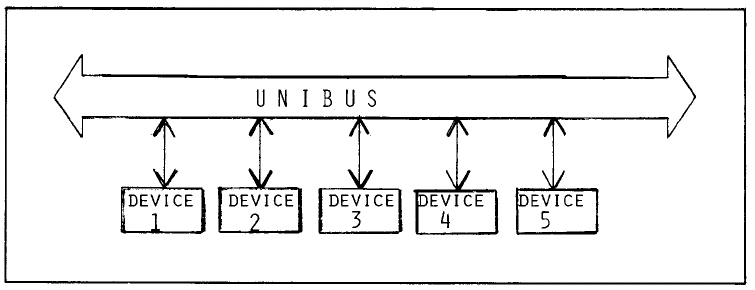

#### 1.2.1 Unibus Elements

##### 1.2.1.1 Unibus Transmission Medium

The Unibus transmission medium interconnects the component parts, called “bus devices," of a system. The transmission medium consists of the following elements:

- **a.** Drivers and receivers for the signals transmitted on the 56 signal lines. A “driver" or “bus driver" is a circuit used by a device to transmit signals to the Unibus; a "receiver" or “bus receiver" is a circuit used by a bus device to receive signals from the Unibus. These drivers <!-- Source PDF page 11 --> and receivers are physically located in the bus devices, but are electrically part of the Unibus. A bus device contains drivers and/or receivers only for the bus signals that it uses.

- **b.** A flat cable containing 56 signal lines and corresponding ground lines.

- **c.** The wiring that connects the cable to the output of the drivers and to the input to the receivers.

The 56 signal lines are grouped logically into three sections:

- Initialization, which controls power-up, power-down and initialization sequences of the bus devices;

- Data, which is used for data transfer between devices;

- Priority Arbitration, which is used to decide which device will be allowed to control the data section next.

##### 1.2.1.2 Bus Terminator

The transmission medium described above is in effect a transmission line. As such, it has a characteristic impedance and must be properly terminated. A Unibus is terminated at both ends by a bus terminator.

##### 1.2.1.3 Bus Segment

A bus segment is that portion of a Unibus system between two terminators. A system may consist of one or more segments. The number of devices that may be connected to a segment is limited, as is the length of its cable.

##### 1.2.1.4 Bus Repeater

A bus repeater is a device used to interconnect two segments of a multi-segment Unibus system. A repeater receives the signals from one segment and retransmits them to the other segment. Its purpose is twofold:

- **a.** It prevents signal levels from becoming degraded if too many devices are connected to a bus. (The original prints “converted”; “connected” is intended.)

- **b.** By receiving and then retransmitting all signals going between one segment and the next, the bus repeater ensures that the proper timing relationship between signals is maintained.

##### 1.2.1.5 Bus Master

The bus master is the device or processor currently permitted to use the data section of the Unibus. Only one device may be master at a given time. Typically, a master uses the data section of the bus to transfer data between itself and another device which is called “slave.”

##### 1.2.1.6 Bus Slave

The bus slave is the device that communicates with the bus master. Only one device may be slave at a given time.

<!-- Source PDF page 12 -->

Some devices may become both master and slave (at different times), while other devices may become only master or only slave.

##### 1.2.1.7 Bus Arbitrator

The bus arbitrator is a logic circuit that compares priorities from devices requesting the use of the data section of the bus (see Paragraph 1.2.2.2) in order to determine which device is to be granted control of the data section of the bus next (i.e., becomes next bus master). The arbitrator may or may not be part of a processor. There must be one and only one arbitrator on a Unibus, although a system may have more than one Unibus, each with its own arbitrator.

##### 1.2.1.8 Processor

A processor is a bus device that includes the circuits that control the interpretation and execution of instructions. A processor does not include the Unibus, main memory, or peripheral devices. A processor may become master or slave,

##### 1.2.1.9 Interrupt Fielding Processor

There may be more than one processor connected to a Unibus. Typically, however, there is only one “interrupt fielding processor." An interrupt fielding processor is a processor that has special connections to the arbitrator.

These special connections permit the interrupt fielding processor to service interrupt transactions on the Unibus. “interrupt" and “interrupt fielding" are discussed in Paragraphs 1.3.3, 2.4.7, 3.2.2.3, and 3.2.2.4.

#### 1.2.2 Unibus Systems

The elements of the Unibus defined in Paragraph 1.2.1 are interconnected to constitute a computing system. The function of the Unibus in the system is to allow data to be exchanged between devices as directed by the program. A program is a sequence of instructions as interpreted by a processor.

Data is transmitted on the bus either as a 16-bit word or as an 8-bit byte. The data is exchanged between a master and a slave. There can be only one master and one slave on the bus at any given time. The master determines which device will become slave by putting the address of the desired slave device on the bus. In order to become bus master, a device must request and obtain the use of the data section. This request may be made at any time that the device is ready for a data transfer. Any number of devices may be asserting a request at the same time. The priority scheme determines which of these requests is honored (i.e., which device will obtain the use of the data section when this section becomes free).

Since several devices may be ready to transfer data at the same time, and since only one of these devices obtains the use of the data section, the other requesting devices will have to wait before they are allowed to transfer their data. If the wait is too long, some devices may lose data. The wait is known as latency.

<!-- Source PDF page 13 -->

In this paragraph, concepts of signal lines, priority structure, address space and latency are discussed. These concepts are all taken into consideration when arranging devices on a Unibus. A discussion of the arrangement of devices ends this paragraph.

##### 1.2.2.1 Signal Lines

Previous literature has defined Unibus signal lines as being either "bidirectional" or “unidirectional.” These terms are ambiguous and are not used in this specification. They are only mentioned in this paragraph because of the previous usage.

Unibus signal may be divided into two general categories with respect to the manner in which they are transmitted. The majority of signals use lines that are, in effect, wired-OR circuits to which the inputs to the bus receivers and the outputs of the bus drivers are connected. These lines are thus available along the length of the Unibus to any device which needs to receive or to assert/negate the signals transmitted on the lines. These lines were in the past called "bidirectional lines" because a signal asserted or negated at any point on the line may be received at any other point on the bus. It should be noted, however, that some of the signals transmitted on lines of this type are logically, if not electrically, “unidirectional." For example, requests for permission to use the data section of the bus are asserted on a line of this type by devices that need to become bus master, but are received only by the arbitrator. This request signal is, in effect, "unidirectional", although transmitted on a "bidirectional" line.

The sketch below shows these wired-OR lines schematically. The shared line connects the bus terminators and the drivers and receivers in the arbitrator and bus devices.

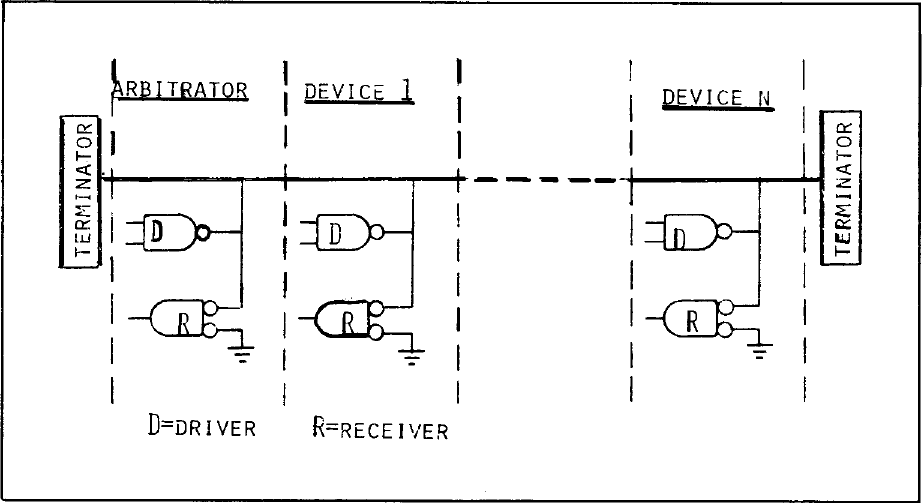

_D = driver; R = receiver._

<!-- Source PDF page 14 -->

Five Unibus signals use lines in which the signal is received only by the device that is closest on that line to the origin of the signal; this receiving device, in turn, either retransmits the signal to the next device on the line ("passes" the signal) or does not retransmit it ("blocks" the signal). The transmission process continues until either a device blocks the signal or the end of the line is reached. These lines have been called "unidirectional lines." They are used only by the arbitrator to grant bus access permission to devices requesting the use of the data section of the bus.

The sketch below shows this type of line schematically. The arbitrator sends grant signals along separate lines through the devices; each device can pass or block a grant. Terminators and pull-up resistors are shown at the bus ends and device connections.

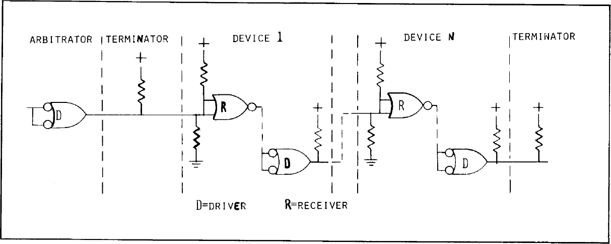

_D = driver; R = receiver._

##### 1.2.2.2 Priority Structure

The use of the data section of the bus is granted to requesting devices according to a priority scheme. The priority of a device is a function of (1) the priority level assigned to the device, and (2) its position on the bus with respect to other devices of the same priority level.

All devices, with the exception of the interrupt fielding processor, may be assigned to one (or more) of five priority levels. A signal line is dedicated to each of these levels. Each of these lines is driven by all bus devices assigned to the priority level. These five lines are referred to as “request lines" and are monitored by the arbitrator. A device that requires the use of the data section of the bus asserts a request on one of these lines. This request is received by the arbitrator. The arbitrator also monitors the priority level of the interrupt fielding processor. There are five relevant interrupt fielding processor levels.

If no request at a level higher than the current interrupt fielding processor level is being received at the arbitrator, the data section of the bus is available to the processor. The arbitrator, however, may issue a grant at the level of the highest priority active request if the interrupt fielding processor is not at a higher priority level.

<!-- Source PDF page 15 -->

A grant is a signal that informs a requesting device that it may become bus master after the current master releases the data section of the bus.

A grant asserted by the arbitrator is received by the first device on the bus assigned to the same priority level as the grant. If this device is requesting the use of the data section of the bus, it accepts and acknowledges receipt of the grant (see Paragraph 2.3) and blocks the grant. If the device is not requesting the use of the data section, it passes the grant to the next device on the same grant line. This procedure is repeated until a device accepts the grant or until the end of the bus is reached. In this last case, the grant is cancelled by the arbitrator and the arbitration process is re-started. Priority is discussed in detail in Paragraph 3.1.3 and shown in Figure 3-2. It can be seen from the preceding discussion that each device on a Unibus is assigned a discrete position in the priority scheme. This position is determined:

- **a.** By the priority level assigned to the device, and

- **b.** By the position of the device on the grant line (with respect to the other devices of the same priority level).

All devices assigned a given priority level have higher priority than any device at a lower level. Within a given priority level, the device closest to the origin of the grant signal has the highest effective priority.

##### 1.2.2.3 Address Space

A location is a word or byte of memory, or a register. An address is the name of a location, i.e., a number which specifies a location; this number is transmitted on 18 address lines during a Unibus data transfer transaction. Bus devices can address 131,072 16-bit words or 262,144 8-bit bytes via these address lines, which are of the wired-OR type described in Paragraph 1.2.2.1. A device must be bus master in order to use the address lines.

Unibus devices may contain one or more locations: a simple device such as a line clock may contain only one, while a random-access or a read-only memory may contain thousands. A device may be able to store many words and yet have only three or four locations: an example of this is a secondary memory such as a disk or tape controller. A location may be used for storage of data or for control of a device. (See Paragraph 1.3.3.3.)

NOTE The “I/O Page” is a PDP-11 system convention which defines the use of certain addresses on the Unibus.

An address put on the address lines by a master is received by all bus devices that are capable of becoming slaves: one of these devices recognizes its address and becomes the slave; the slave <!-- Source PDF page 16 --> does not know which device is master, nor where the master is physically located on the bus. The master does not know the physical location of its slave.

##### 1.2.2.4 Latency

Latency is the delay between the time that a device initiates a transaction and the time that it receives a response. Non-processor request (NPR) or bus request (BR) latency are the total time consumed by all the operations that occur between the instant a device makes a request and the moment it becomes bus master. NPR and BR are device requests. They are defined in Paragraph 2.3. Because of the architecture of the Unibus, the responding unit is the rest of the computer system. As a result, the actual delay encountered is a function of current bus activity, the types of other devices in the system, and the arrangement or configuration of the equipment along the bus.

Maximum tolerable latency is the longest time that a device can wait for service before losing data. The service time is measured from the assertion of a request by the device to the time that the device's requested data transfer is complete.

##### 1.2.2.5 Unibus Device Arrangement

The arrangement of devices on the Unibus is a function of the following four factors:

- **a.** Any device can communicate with any other device on the data section of the bus: relative physical position of the devices is logically of no concern.

- **b.** Grants are issued by the arbitrator and received and reissued by each device of the same level. Thus, all devices capable of becoming bus master must be on one side of the arbitrator.

- **c.** The maximum tolerable latency for each device must not be exceeded. This depends on the priority level assigned to the device, its position on its grant line relative to other devices of same priority level, and the effect of the other devices of all other priority levels on the bus.

- **d.** The length of the bus must be kept as short as possible.

NOTE The interrupt fielding processor is typically next to the arbitrator on the bus. For convenience, an arbitrator is usually built into a PDP-11 processor.

A typical Unibus configuration is shown in Figure 1-1. The bus is terminated at both ends by a terminator; the arbitrator and the interrupt-fielding processor are at one end of the bus. Various devices, such as memories, disk memories, input/output devices, are connected between the arbitrator and the other end of the bus.

NOTE For Configuration Rules, see Paragraph 5.3.

<!-- Source PDF page 17 -->

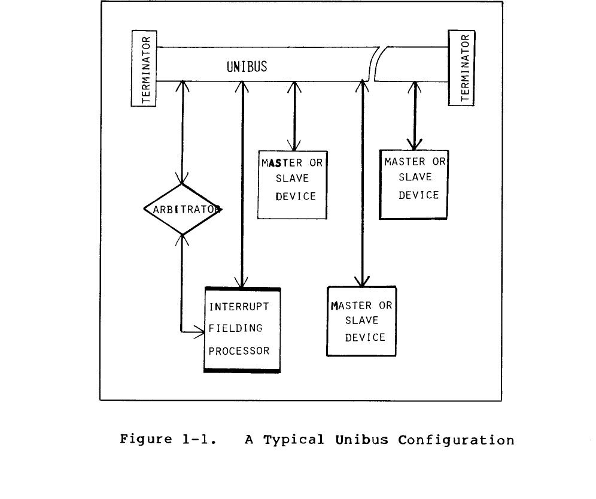

##### 1.2.2.6 Other Unibus Device Arrangements

If a system exceeds the limitations set forth in this document, the bus must be divided into segments connected by a bus repeater. The limitations apply to the maximum number of devices on a segment (loading) and to the length of the bus cable. Figure 1-2 (A) shows such a configuration.

Since a device that can only be a slave and is never a master (such as a memory) never requests nor receives grants, it may be physically located on either side of the arbitrator. Such an arrangement is shown in Figure 1-2 (B).

<!-- Source PDF page 18 -->

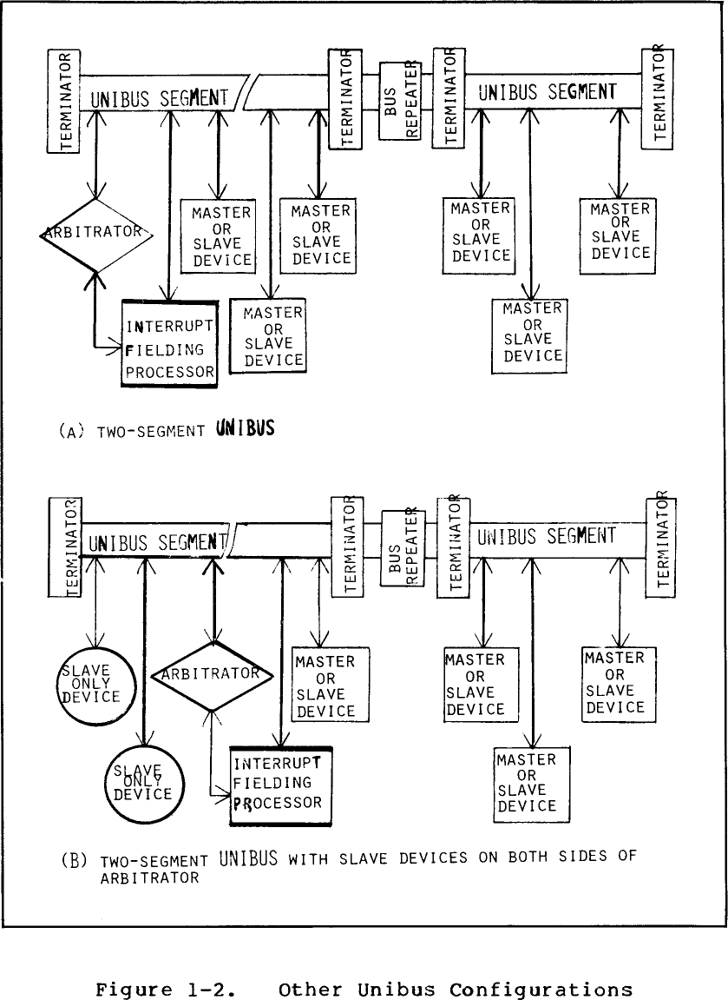

### 1.3 Protocol

The Unibus interconnects the various devices that comprise a computing system to allow communication between these devices. Communication between devices is in the form of transactions: a transaction is a sequence of signals which complete a logical unit of activity on the Unibus. The Unibus protocol defines the procedures that are used during bus transactions.

<!-- Source PDF page 19 -->

#### 1.3.1 Transaction Types

There are three types of Unibus transactions: priority arbitration, data transfer, and initialization, each of which is transacted on a separate section of the Unibus.

This structure allows simultaneous priority arbitration and data transfer transactions, i.e., the next master is being selected while the current master is executing its data transfer.

#### 1.3.2 Priority Arbitration Transactions

To transfer data on the data section of the bus, a device must become bus master, i.e., obtain control of the data section.

The arbitration scheme determines which device obtains control of the bus next. This determination occurs during a priority arbitration sequence. No actual transfer of bus mastership occurs during this sequence, only the designation of the device that can become master when the current master releases the data section of the bus. Any number of devices may request the use of the data section at one time. The one device selected is the one with the highest effective priority. (See Paragraph 1.2.2.2.) The highest priority device grant is called a non-processor grant (NPG) because it is used by a device which does not require processor time. It may be used by devices only for data transfers other than interrupts. When requested, a grant is issued on this level.

When no request or grant is active at this priority level, and if there is no bus master, the interrupt fielding processor may assert bus mastership. The four lower priority device grants are used for interrupts but may also be used for all other types of data transfers.

These grants are issued by the arbitrator only when the interrupt fielding processor is able to receive an interrupt command and the device request is at a higher priority level than the current interrupt fielding processor level.

#### 1.3.3 Data Transfers

##### 1.3.3.1 Data Transfer Definition

Data transfer is defined as the transmission of data between a master and a slave. It can be accomplished between any two devices without program intervention or supervision.

The device that has been granted the use of the bus waits for the Unibus to be released by the previous bus master. When a device becomes bus master, it asserts bus mastership and causes one or more words of data to be transferred between itself and a slave device, The particular slave and the direction of transfer are determined by the information issued by the bus master to the Unibus. When the transfer is finished, the master releases the bus, at which time a new device may assume mastership. A device in control of the bus can transfer data at the maximum rate allowed <!-- Source PDF page 20 --> by the combination of the master, the slave, and the bus. An interrupt is a special type of data transaction to which only the interrupt fielding processor can respond as slave (Paragraph 1.3.3.2).

##### 1.3.3.2 Data Transfer Types

There are four types of data transfer transactions on the Unibus: data-in, data-out, read/modify/write, and interrupt.

"Data-in" is defined as the transfer of one word from a slave to a master.

"Data-out" is defined as the transfer of one word of data from a master to a slave; "data-out, byte" is defined as the transfer of one byte of data from a master to a slave.

"Read/modify/write" is defined as a transaction in which data is transferred from a slave location to a master, modified by the master, and transferred back to the same slave location. A read/modify/write consists of a “data-in, pause" followed by a data-out or by a data-out, byte. The data-in, pause is identical to the data-in, but, it also informs the slave that a data-out transaction to the same location will follow the data-in. If the slave is a destructive readout device, e.g., a core memory, it will automatically restore the data after a data-in; after a data-in, pause, however, it might not restore the data but may wait for the modified data from the following data-out.

An "interrupt" transaction is defined as the transfer of one word, called the "interrupt vector," from the master to the interrupt fielding processor.

##### 1.3.3.3 Data Transfer

The fact that data transfers may be executed without program intervention or supervision permits operations such as a disk directly refreshing a CRT display or transfers between the memory and a mass storage device.

Processors may use data transfers for instruction fetch and for control of other devices by modification of their control registers, as well as for the manipulation of information.

#### 1.3.4 Initialization

The initialization section of the Unibus continuously monitors the ac power input to the bus power supplies and controls the orderly power-up and power-down of all bus devices.

Devices may also be initialized under program control. Initialization stops all bus operations and puts all bus devices in a known, well-defined state.

### 1.4 Electrical Characteristics

Due to the high speed at which it operates, the Unibus is in effect a high frequency transmission line. This fact must be taken into consideration when choosing components and designing circuits, to ensure optimum performance.

<!-- Source PDF page 21 -->

## Section 2: Signals

### 2.1 Signals And Signal Lines

#### 2.1.1 Introduction

The Unibus consists of 56 signals. Simplified and standardized control logic is made possible by using separate dedicated lines for all signals. For example, in a data transfer, the master device provides the address of the location which it wishes to access. The device which responds is the slave device. Control and timing signals are provided. Address, control and data and timing functions are each transmitted on a distinct set of bus lines.

All bus activity is asynchronous and depends on interlocked control signals. In every case, a control signal transmitted by the initiator of a transaction is positively acknowledged by the receiver of that signal, and vice-versa.

#### 2.1.2 Unibus Sections

Although the Unibus is a single communication path for all devices in a PDP-11 computer system, the bus actually consists of three interrelated parts. These parts may be referred to as the priority arbitration section, the data transfer section, and the initialization section. These sections use the signal lines listed in Table 2-1.

All transactions on the priority arbitration section and on the data transfer section are interlocked dialogs between devices. On the priority arbitration section, the devices are the requesting devices and the arbitrator. On the data transfer section, the devices are the bus master and the bus slave.

The signals that delimit data and priority arbitration operations are:

- **a.** Data Transfer: MSYN, SSYN, (Interrupt: INTR, SSYN)

- **b.** Priority Arbitration: [NPR, NPG] or [BRn, BGn], SACK, BBSY

#### 2.1.3 Unibus Signal Lines Use

In all bus transactions, the assertion and the negation of a signal used in the interlocking dialog have different meanings. A device may assert a signal to indicate the initiation of a process and negate the same signal to note the completion of the same process.

<!-- Source PDF page 22 -->

**Table 2-1 — Data Transfer, Priority Arbitration, and Initialization Signal Lines**

| Signal                   | Mnemonic            | Lines | Function                                    | Asserted level |
| ------------------------ | ------------------- | ----: | ------------------------------------------- | -------------- |
| **Data transfer**        |                     |       |                                             |                |
| Address                  | A<17:00>            |    18 | Selects slave device and/or memory address  | Low            |
| Data                     | D<15:00>            |    16 | Information transfer                        | Low            |
| Control                  | C0, C1              |     2 | Type of data transfer                       | Low            |
| Master Sync              | MSYN                |     1 | Timing control for data transfer            | Low            |
| Slave Sync               | SSYN                |     1 | Timing control for data transfer            | Low            |
| Parity                   | PA, PB              |     2 | Device parity error                         | Low            |
| Interrupt                | INTR                |     1 | Interrupt                                   | Low            |
| **Priority arbitration** |                     |       |                                             |                |
| Bus Request              | BR4, BR5, BR6, BR7* |     4 | Requests use of bus (usually for interrupt) | Low            |
| Bus Grant                | BG4, BG5, BG6, BG7* |     4 | Grants use of bus (usually for interrupt)   | High           |
| Non-Processor Request    | NPR                 |     1 | Requests use of bus for data transfer       | Low            |
| Non-Processor Grant      | NPG                 |     1 | Grants use of bus for data transfers        | High           |
| Selection Acknowledge    | SACK                |     1 | Acknowledges grant                          | Low            |
| Bus Busy                 | BBSY                |     1 | Indicates that the data section is in use   | Low            |
| **Initialization**       |                     |       |                                             |                |
| Initialize               | INIT                |     1 | System reset                                | Low            |
| AC Low                   | AC LO               |     1 | Power monitoring                            | Low            |
| DC Low                   | DC LO               |     1 | Power monitoring                            | Low            |

*BRn and BGn indicate that one pair of BR and BG lines is used; the particular pair is not important to the discussion.

<!-- Source PDF page 23 -->

The important event is the transition from one state to the other. For example, in a data-in operation, the bus master asserts MSYN to request data from the slave, and negates MSYN to acknowledge receipt of the data from the slave. Therefore, the assertion and the negation of MSYN can be thought of as two different signals issued by a bus master on a single line.

In this specification, the terms “the assertion of . . ." or "at the assertion of . . ." signify the transition of a signal from the negated state to the asserted state; the term "while ... is asserted" refers to the interval between the assertion and the negation of a signal. While asserted, a signal is in the logically true state.

The terms "the negation of . . ." or "at the negation of ..." signify the transition from the asserted state to the negated state; the term "while . . . is negated" refers to the interval between the negation and the assertion of the signal. While negated, a signal is in the logically false state.

In tables and diagrams, a 0 may be used in place of "while negated" and a 1 in place of "while asserted".

### 2.2 Signal Transmission

Two of the factors which affect signal transmission are bus transmission delay time and skew.

#### 2.2.1 Bus Transmission Delay

Bus transmission delay is defined as the length of time taken by a signal to travel from one device on the bus to another. The delay is measured from the time of the assertion or negation of the signal at the input to the driver of the sending device to the time at which the assertion or negation arrives at the output of the receiver of the receiving device.

#### 2.2.2 Skew

##### 2.2.2.1 Skew Definition

When two separate signals are sent from one device to another device, starting at the same time, there can be a time difference in the receipt of these signals by the second device, even if similar circuitry and transmission medium are used. This time difference (or time uncertainty) is called skew. It is caused mainly by the variation in the transmission delay <!-- Source PDF page 24 --> time through the Unibus drivers and receivers, and by non-uniform loading by devices connected to the Unibus. (See the sketch below.)

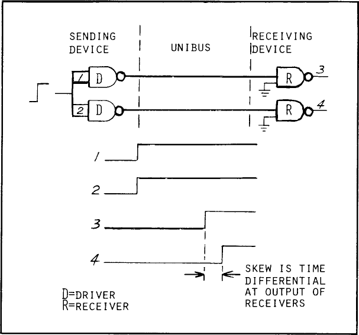

Skew is defined, for the purposes of this specification, as the maximum possible difference of time of arrival at the output of any two bus receivers in a device of a single signal applied to the inputs of two corresponding bus drivers in another device.

Maximum skew on the Unibus is defined to be 75 nanoseconds. This includes the effects of drivers, receivers, and cables. The drawing below illustrates the definition of skew.

##### 2.2.2.2 Deskew Definition

To deskew is to introduce a delay in a circuit to compensate for skew.

A master is responsible for deskewing on all data transfer transactions with the exception of interrupt. The arbitrator and interrupt fielding processor are responsible for deskewing on interrupt transactions. The arbitrator is responsible for deskewing on priority arbitration transactions. The amount of logic elements required is thus minimized, since slave devices are generally more numerous than master devices in a system. Also, there are only one arbitrator and one interrupt fielding processor on a bus, but, typically, more than one master device.

All delays specified in this document refer to assertions or negations at the input to Unibus drivers, and not to a signal that may be one or more gate delays away inside the device.

<!-- Source PDF page 25 -->

The following sketch shows an example of correct gating of data lines and a delayed control signal (MSYN); part B is an example of incorrect gating, because the inverters will not all have the same propagation delay, thus introducing additional skew.

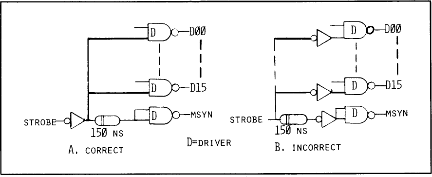

#### 2.2.3 Types Of Unibus Signal Lines

Three types of signal lines are used on the Unibus and are defined below. (See Figure 2-1.)

NOTE The drivers and receivers are considered part of the Unibus and NOT part of the device or processor in which they are physically located.

##### 2.2.3.1 Type-1 Line

A Type-1 line is the transmission medium to which device and processor outputs are connected in a wire-OR configuration by bus drivers; device and processor inputs are also connected to the wired-OR by bus receivers. A line of this type is terminated at both ends of the Unibus by a resistor to +5 Vdc and another to ground. A device or processor may have both drivers and receivers; only drivers or only receivers connected to a Type-1 line.

Type-1 lines are used by all Unibus signals with the exception of NPG, BG7, BG6, BG5, BG4, AC LO and DC LO.

##### 2.2.3.2 Type-2 Line

A Type-2 line is a transmission medium in which a signal asserted or negated by the arbitrator is received only by the device electrically closest to it on that line. This device, in turn, depending upon its internal condition, either transmits or does not transmit the signal to the next device on the same line. Each segment of a Type-2 line is terminated at the receiver end by resistors to ground and to +5 Vdc.

Type-2 lines are used by Unibus grant signals: NPG, BG7, BG6, BG5, and BG4.

<!-- Source PDF page 26 -->

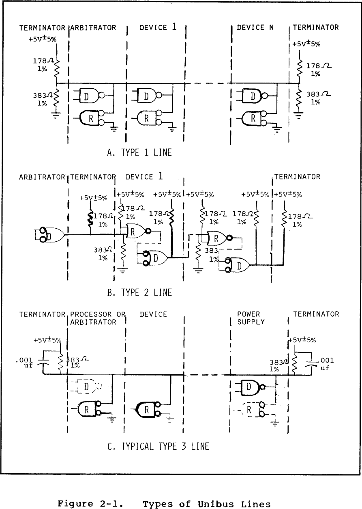

<!-- Source PDF page 27 -->

##### 2.2.3.3 Type-3 Line

A Type-3 line is a transmission medium used by AC LO and DC LO signals. Power supply and processor outputs are connected in a wired-OR configuration, terminated at both ends of the Unibus by a resistor and a capacitor in parallel to +5 Vdc. The power supply uses special drivers for AC LO and for DC LO.

### 2.3 Priority Arbitration Section

Twelve signal lines are used on the priority arbitration section of the Unibus. Transactions on this section of the bus are between the priority arbitration network and devices that need to become bus master. A request (NPR or BRn) is asserted by one or more of these devices. The arbitrator issues a grant (NPG or BGn) for the highest priority device requesting the bus, and the requesting device physically closest to the arbitrator at this priority level accepts and acknowledges the grant by asserting SACK. When the current data transaction is ended, the master releases the bus by negating BBSY, the new master asserts BBSY and starts its data cycle(s).

Requests are transmitted on Type-1 lines and grants on Type-2 lines (Paragraph 2.2.3).

A device that receives a grant and does not require the use of the data section of the bus retransmits the grant to the next device on the same grant line. This is known as “passing the grant." Both the assertion and the negation of a grant are passed by a device.

A device that receives a grant and does require the use of the data section of the bus accepts the grant and does not retransmit it. This is called "blocking the grant."

If a grant is not acknowledged by any device, the grant is cancelled. This is done either by the arbitrator after a time out delay, or by a terminator at the opposite end of the bus from the arbitrator. This terminator asserts SACK if it receives a grant. Upon receipt of SACK, the arbitrator negates the grant. SACK is negated by the terminator upon receipt of this negation. In both cases, a new arbitration cycle is started. If a grant is cancelled due to the assertion of INIT, arbitration is not resumed until receipt of the negation of INIT.

#### 2.3.1 Non-Processor Request (NPR)

NPR is an asynchronous signal requesting the use of the data section of the bus, sent to the arbitrator by a device that requires the use of the bus to execute data transfers. These transfers are made without active participation by the processor. The signal is asynchronous and may be asserted at any time that the device is ready to start a data transfer. NPR has a higher priority than processor data transfers or any of the BR lines.

<!-- Source PDF page 28 -->

NPR is transmitted on a Type-1 line.

NOTE PDP-11/15 and PDP-11/20 data transfers occur prior to NPR or BR service.

#### 2.3.2 Non-Processor Grant (NPG)

NPG is a signal generated by the arbitrator. The assertion and the negation of NPG are received and optionally retransmitted by each device capable of asserting NPR.

NPG is transmitted on a Type-2 line.

##### 2.3.2.1 NPG Assertion

The assertion of NPG by the arbitrator informs the first device on the NPG line that has NPR active that it may become bus master after it has received the negation of BBSY, indicating that the data section of the bus has been released.

If a device intends to assert SACK, it blocks the grant. If a device does not intend to assert SACK, it passes the grant.

Priority arbitration is disabled while NPG is asserted.

##### 2.3.2.2 NPG Negation

The arbitrator acknowledges receipt of the assertion of SACK by negating NPG.

A device that is asserting SACK may not negate SACK until it has received the negation of NPG.

A device that is not asserting SACK passes the negation of NPG on to the next device on the NPG line.

##### 2.3.2.3 NPG Uses

One or more data transfers (commonly called "NPR transfers") may be executed while the device is bus master. An interrupt must not be attempted by a device which became bus master by the authority of an NPG.

#### 2.3.3 Bus Request (BR4, BR5, BR6, BR7)

A bus request is an asynchronous signal, requesting the use of the data section of the bus. This signal is sent to the arbitrator by a device that requires the use of the data section of the bus to execute data transfers (commonly called “NPR transfers"), or an interrupt transaction, or both of these. Only one interrupt transaction may be executed under a single grant. This interrupt transaction must be the last data transfer under that grant.

BR4, BR5, BR6, and BR7 are transmitted on Type-1 lines.

#### 2.3.4 Bus Grants (BG4, BG5, BG6, BG7)

A bus grant is a signal generated by the arbitrator. The assertion and the negation of this signal are received and optionally retransmitted by each device capable of asserting the <!-- Source PDF page 29 --> corresponding BR line (BRn). The arbitrator guarantees that a BG is never asserted unless the processor that receives interrupts is ready to accept an interrupt vector at that level.

BG4, BG5, BG6 and BG7 are transmitted on Type-2 lines.

##### 2.3.4.1 BG Assertion

The assertion of BGn by the arbitrator informs the first device on the BGn line which has BRn active that it may become bus master after it has received the negation of BBSY, indicating that the data section of the bus has been released.

If the device intends to assert SACK, it blocks the grant. If the device does not intend to assert SACK, it passes the grant.

Priority arbitration is disabled while BGn is asserted.

##### 2.3.4.2 BG Negation

The arbitrator acknowledges receipt of the assertion of SACK by negating BGn.

A device that is asserting SACK may not negate SACK until it has received the negation of BGn.

A device that is not asserting SACK passes the negation of BGn onto the next device on the BGn line.

#### 2.3.5 Selection Acknowledged (SACK)

SACK is a signal sent to the arbitrator by a device that has received a grant.

SACK is transmitted on a Type-1 line.

##### 2.3.5.1 SACK Assertion

The assertion of SACK is the acknowledgment by a device that it has accepted a grant. Priority arbitration is disabled while SACK is asserted.

##### 2.3.5.2 SACK Negation

The negation of SACK allows the start of a new priority arbitration cycle. The negation of SACK signifies that the master has almost finished using the data section of the bus.

#### 2.3.6 Bus Busy (BBSY)

BBSY is a signal sent by a bus master to all other bus devices.

BBSY is transmitted on a Type-1 line.

##### 2.3.6.1 BBSY Assertion

While asserted, BBSY informs all devices on the Unibus that a master exists. During this time no device other than the master may assert BBSY, MSYN, INTR, or use the A or C lines. The D lines may be used only by the master or by the slave designated by the A lines. SSYN may be asserted only by the slave, although it may or may not be negated before the master negates BBSY. Other devices, however, may use other signal lines in the priority arbitration section of the bus.

<!-- Source PDF page 30 -->

##### 2.3.6.2 BBSY Negation

While negated, BBSY means that the data section of the bus is not being used (that there is no bus master).

### 2.4 Data Transfer Section

Forty-one signal lines are used for data transfer. In a data transfer, one device is a bus master and controls the transfer of data to or from a slave device.

All signals in the data transfer section are transmitted on Type-1 lines.

#### 2.4.1 Data Lines

(D<15:00>) The 16 data lines contain the word of information that is being transferred between the master and the slave devices. A word consists of two eight-bit bytes. The low order byte contains bits 00 through 07 and the high order byte, bits 08 through 15.

The bit format is as follows:

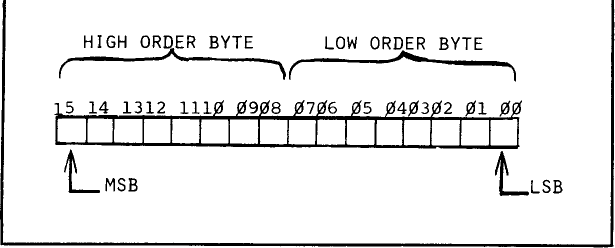

#### 2.4.2 Address Lines (A<17:00>)

The 18 address lines carry the 18 A bits from the master during a data transfer transaction. These bits specify a location. The device which contains the specified location responds as the slave for this data transaction.

The address format is as follows:

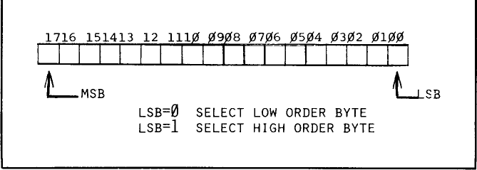

The 17 address lines A<17:01> specify a unique location. All locations contain a 16-bit word which is at an even address. A byte is half a word. In byte operations, bit A00 specifies which byte is being addressed. If a word is located at address X where X is even (i.e., its LSB=0), the low order byte is addressed at X, and the high order byte at X plus 1.

<!-- Source PDF page 31 -->

#### 2.4.3 Control Lines (C0, C1)

These signals are sent by the master to the slave and indicate one of four possible data transfer operations. They are shown in the following chart.

| Name           | Mnemonic | C1  | C0  | Function                                                                                                                          |
| -------------- | -------- | --- | --- | --------------------------------------------------------------------------------------------------------------------------------- |
| Data In        | DATI     | 0   | 0   | One word of data from slave to master.                                                                                            |
| Data In, Pause | DATIP    | 0   | 1   | Same as DATI, but inhibits restore cycle in destructive read-out devices. Must be followed by DATO or DATOB to the same location. |
| Data Out       | DATO     | 1   | 0   | One word of data from master to slave.                                                                                            |
| Data Out, Byte | DATOB    | 1   | 1   | One byte of data from master to slave. Data transferred on D<15:08> for A00=1; D<07:00> for A00=0.                                |

_The notations "DATI/P" and "DATO/B" are equivalent to "DATI or DATIP" and "DATO or DATOB."_

NOTE The direction of data transfer is always specified with reference to the master device; data-in is from slave to master, and data-out is from master to slave.

##### 2.4.3.1 Data-In Transactions

The DATI and DATIP transactions request transfer of data from a slave to a master. Both transactions use the D lines to carry the data. These transactions are always a full word transfer, i.e., the slave places the data on D<15:00>. If the master wants only one byte, it must retrieve the data from the proper lines: low order byte from D<07:00>; high order byte from D<15:08>. For these byte operations, the master should not assert, and the slave should ignore, bit A00.

##### 2.4.3.2 Datip Transaction

The DATIP operation is identical to the DATI, except that DATIP informs the slave device that the present transfer is the first part of a read/modify/write cycle.

<!-- Source PDF page 32 -->

A pause flag is set in a destructive readout device (e.g., core memory) which inhibits the restore cycle. The DATIP must be followed by a data-out cycle (DATO or DATOB) to the same word address.

Since address bit A00 may change between a DATIP and a DATOB, the slave must check the bus address at the beginning of the DATOB. The master must retain bus control until this DATO/B is completed, i.e., he must remain bus master (assert BBSY) without interruption from the start of the DATIP cycle to the end of the DATO/B cycle. No other data transfer transaction may be executed between the DATIP and the DATO/B cycles.

In nondestructive readout devices (i.e., flip-flops), the DATI and DATIP are treated identically by the slave.

NOTE In the case of locations which can be accessed by more than one Unibus or other bus (e.g., the PDP-11/45 semiconductor memory), a DATIP on one bus must prevent the slave from responding on any other bus until the DATO/B cycle has been completed. This is necessary to avoid problems in multiple processor systems.

NOTE If a DATIP is followed by a DATO/B, and the device is destructive readout, then the device takes the responsibility of restoring the other byte.

##### 2.4.3.3 Data-Out Transactions

The DATO and DATOB operations transfer data from the master to the slave. A DATO is used to transfer a word to the address specified by A<17:01>. The slave ignores A00 and the master places data on D<15:00>. A DATOB is used to transfer a byte of data to the address specified by A<17:00>. Line A00=0 indicates the low order byte, and the master places the data on lines D<07:00>; A00=1 indicates the high order byte, and the master places the data on lines D<15:08>.

#### 2.4.4 Parity Error Indicators (PA, PB)

PA and PB are generated by a slave and received by a master. They indicate parity error in a device. The slave negates PA and asserts PB to indicate a parity error on a DATI/P; PA and PB both negated indicates no parity error. PA asserted and PB asserted or negated are conditions reserved for future use. PA and PB are not defined in a DATO transaction. PA and PB may be used by the bus master's parity error logic.

The chart below is a summary of the possible combinations of the parity error indicators.

<!-- Source PDF page 33 -->

| PA  | PB  | Meaning                       |
| --- | --- | ----------------------------- |
| 0   | 0   | No error in a slave in DATI/P |
| 0   | 1   | Error in slave in DATI/P      |
| 1   | x   | Reserved                      |

The protocol for PA and PB is the same as that for D<15:00>.

#### 2.4.5 Master Sync (MSYN)

MSYN is a signal issued by a bus master and received by a slave. It has two functions, depending on whether it is being asserted or negated.

##### 2.4.5.1 MSYN Assertion

The assertion of MSYN requests that the slave defined by the A lines perform the function required by the C lines.

##### 2.4.5.2 MSYN Negation

The negation of MSYN indicates to the slave that the master considers the data transfer concluded.

#### 2.4.6 Slave Sync (SSYN)

SSYN is a signal issued by a slave and received by a master. SSYN has two functions, depending on whether it is being asserted or negated, It should be noted that, in an interrupt transaction, the interrupt fielding processor is the slave and the interrupting device is the master.

##### 2.4.6.1 SSYN Assertion

In a master-slave data transfer, the assertion of SSYN informs the bus master that the slave has concluded its part of the data transfer, i.e., for a DATI or DATIP that the requested data has been put on the D lines, and for a DATO or DATOB that the data on the D lines has been accepted.

In an interrupt operation, SSYN is asserted by the interrupt fielding processor. In this case, SSYN signifies that the interrupt vector has been accepted by the interrupt fielding processor.

##### 2.4.6.2 SSYN Negation

The negation of SSYN informs all bus devices that the slave has concluded the data transfer. In a DATI/P the negation of SSYN signifies that the negation of MSYN has been received and the data removed from the D lines. In a DATO/B, the negation of SSYN means that the negation of MSYN has been received. In an interrupt, the negation of SSYN signifies that the negation of INTR has been received by the processor.

#### 2.4.7 Interrupt Request (INTR)

INTR is a signal asserted by an interrupting device after it becomes bus master to inform the interrupt fielding processor that an interrupt is to be performed and that the interrupt vector is present on the D lines.

<!-- Source PDF page 34 -->

INTR is negated upon receipt of the assertion of SSYN from the interrupt fielding processor at the end of the transaction. INTR may only be asserted by a device which obtained bus mastership under the authority of a BG4, BG5, BG6, or BG7.

### 2.5 Initialization Section

Three signals are used in the initialization section of the Unibus: INIT, AC LO, and DC LO.

#### 2.5.1 Initialize (INIT)

INIT may be generated by processors or arbitrators. A console operation may cause a processor to assert INIT. INIT may be received by any Unibus device. Its purpose is to stop all bus operations and to put all bus devices in a known, well defined state.

INIT is transmitted on a Type-1 line.

#### 2.5.2 AC LO

AC LO is generated by all power supplies whose failure may affect Unibus transactions and is received by processors and arbitrators.

AC LO is transmitted on a Type-3 line.

##### 2.5.2.1 AC LO Assertion

The assertion of AC LO informs Unibus devices that the AC power input to a power supply, whose failure might make the bus inoperable, has ceased to be within specifications.

##### 2.5.2.2 AC LO Negation

The negation of AC LO informs Unibus devices that all power supplies, whose failure might make the bus inoperable, can maintain DC power within specifications long enough for a complete power-up/power-down sequence.

#### 2.5.3 DC LO

DC LO may be generated by any Unibus device or power supply, but is generally issued by a processor or by a power supply, or by both of these. No device should issue DC LO except in correct sequence with AC LO.

DC LO may be received by any bus device. It is typically received by core memories, which use it to disable their internal operations.

DC LO may be used to initialize devices.

DC LO is transmitted on a Type-3 line.

##### 2.5.3.1 DC LO Assertion

The assertion of DC LO informs the bus devices that DC power to any bus drivers, receivers or terminators, whose failure would make the Unibus inoperable, is about to fail.

##### 2.5.3.2 DC LO Negation

The negation of DC LO informs the receiving devices that DC power to all bus drivers, receivers and terminators, whose failure would make the Unibus inoperable, is within specifications.

<!-- Source PDF page 35 -->

## Section 3: Protocol

### 3.1 Definitions And Concepts

#### 3.1.1 Definitions

##### 3.1.1.1 Protocol

The Unibus protocol is a specification that defines the procedures that must be used during all bus transactions.

##### 3.1.1.2 Transaction

A transaction is a sequence of signals which completes a logical unit of activity on the Unibus.

##### 3.1.1.3 Bus Cycle

A bus cycle, or data transfer cycle, is the transfer of one word between a master and a slave. The cycle starts at the time that the master puts the address and control bits on the A and C lines, and ends when the master removes these bits from the lines.

##### 3.1.1.4 Multiple Cycle Transaction

A transaction may consist of one or more bus cycles. For example; a data-in bus cycle (DATI) is a transaction, and a read/modify/write sequence (DATIP-DATO/B) is a single transaction consisting of two bus cycles.

##### 3.1.1.5 Priority Arbitration Sequence

A priority arbitration sequence is a transaction during which a device is selected as next bus master. No actual bus transfer is performed, only selection of the next bus master. Priority arbitration is controlled by the arbitrator.

#### 3.1.2 Unibus Operation (Figure 3-1)

Three facts must be taken into account to understand the operation of the Unibus:

- **a.** A device that has been designated as next bus master controls the operation of the arbitrator, i.e., SACK, while asserted, disables the arbitrator.

- **b.** In the same manner, a bus master controls the data section of the bus, i.e., no other device may control this section until the master releases it. BBSY, while asserted, prohibits any device with the exception of the master and the designated slave from using the data section of the bus.

<!-- Source PDF page 36 -->

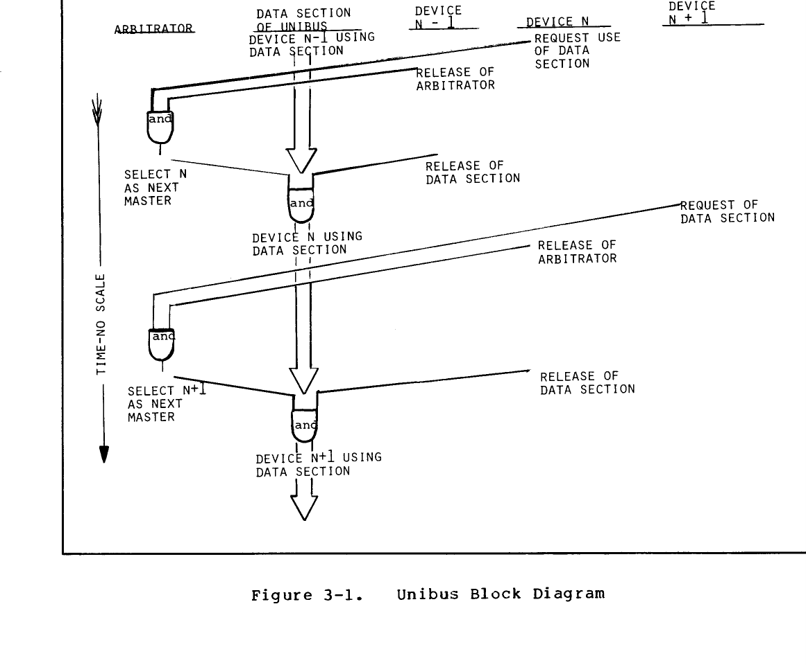

<!-- Source PDF page 37 -->

- **c.** Priority arbitration and data transfer may be executed simultaneously on the Unibus. This is shown in Figure 3-1. Device N requests the use of the data section of the bus. (A device may do this at any time.) No action will be taken on this request until such time as device N-1, the current bus master, releases the arbitrator. When this is done, if no requests of a priority level higher than that of device N are pending, device N is selected as next master. At this time, device N controls the arbitrator and device N-1 still controls the data section of the bus.

The arbitration sequence begins at the time of the release of the arbitrator by device N-1 and ends with the selection of device N as next bus master. The arbitration sequence can take place while the data transfer by device N-1 is still being executed.

Device N-1 releases the data section of the bus when its data transfer is complete. Device N then becomes bus master and starts its own data transfer. Device N now controls both the arbitrator and the data section of the bus.

NOTE To ensure optimal operation of the Unibus, the next master should be selected before the current master releases the data section. The current master should release the arbitrator before it releases the data section. Enough time should be allowed between the release of the arbitrator and the release of the data section to permit the selection of the next master.

#### 3.1.3 Priority Structure

The use of the data section of the bus is granted to requesting devices in accordance with the priority assigned to each one. The priority of a device is a function of (1) the priority level assigned to the device, and (2) its electrical position on the bus with respect to other devices of the same priority level (Figure 3-2).

##### 3.1.3.1 Bus Device Priority Levels

Five priority levels are available for assignment to all bus devices capable of becoming bus master, with the exception of the interrupt fielding processor. These levels are called: Level NPR, Level 7, Level 6, Level 5, and Level 4.

<!-- Source PDF page 38 -->

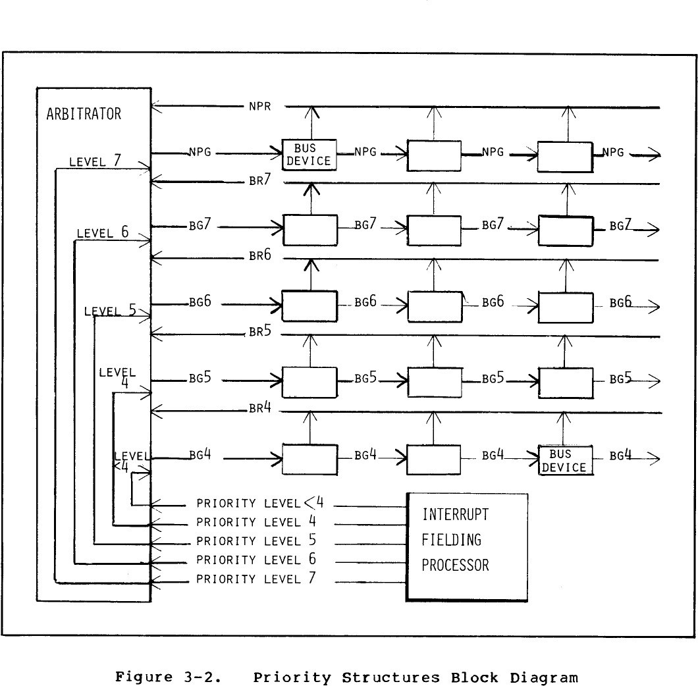

<!-- Source PDF page 39 -->

NOTE The PDP-11/15 and PDP-11/20 processors have only two priority levels: NPR and BR. An option (KF11) allows these processors to use all four BR priority levels.

##### 3.1.3.2 Request Lines

Five Type-1 signal lines, called "request lines," correspond to these priority levels: NPR, BR7, BR6, BR5, and BR4. A device that requires the use of the data section of the bus asserts a request on one of these lines. This request is received by the arbitrator.

A device may be assigned to more than one priority level. A typical combination is a device which uses NPR to transfer data and a BR to interrupt the processor at the end of a data block.

##### 3.1.3.3 Interrupt Fielding Processor Priority Levels

The arbitrator monitors the priority level of the interrupt fielding processor. There are five relevant interrupt fielding processor levels: Levels 7 through 4 and Level <4.

##### 3.1.3.4 Grants

If no request at a level higher than the current interrupt fielding processor level is being received at the arbitrator, the data section of the bus is available to the processor; the arbitrator, however, may issue a grant at the level of the highest priority active request if the interrupt fielding processor is not at a higher priority level. A grant is a signal that informs a requesting device that it may become bus master after the current master releases the data section of the bus. An NPG (Non-Processor Grant) may be issued in response to an NPR, a BG7 (Bus Grant 7) in response to a BR7, a BG6, BG5 or BG4 in response to BR6, BR5 or BR4. The order of priorities is as follows:

From highest to lowest priority:

1. Level NPR
2. Interrupt Fielding Processor Level 7
3. Level 7
4. Interrupt Fielding Processor Level 6
5. Level 6
6. Interrupt Fielding Processor Level 5
7. Level 5
8. Interrupt Fielding Processor Level 4
9. Level 4
10. Interrupt Fielding Processor Level <4

NOTES

1. The interrupt fielding processor may, at certain times, prevent the granting of BG7 through BG4 (Paragraph 3.2.2.4).

2. PDP-11/15 and PDP-11/20 data transfers occur prior to NPR or BR service.

<!-- Source PDF page 40 -->

##### 3.1.3.5 Transmission Of Grants

A grant asserted by the arbitrator is received by the first device on the bus assigned to the same priority level as the grant. If this device is requesting the use of the data section of the bus at that level, it acknowledges receipt of the grant by asserting SACK and blocks the grant. If the device is not requesting the use of the data section, it passes the grant on to the next device of the same priority level. This procedure is repeated until a device accepts the grant or until the end of the bus is reached. In this last case, the grant is cancelled.

##### 3.1.3.6 Cancellation Of Grants

If a device asserts a request, then negates it before receiving a grant, and no other device at the same priority level accepts the grant, the grant will be cancelled by the arbitrator. (See Notes 1 and 2 to step 6, Paragraph 3.2.2.2.)

This may be caused by a program which enables, then disables a device. It may also be caused by a hardware interface which does not provide the means to latch a request, which may then be lost.

NOTE Programming and hardware design practices which result in cancellation of grants are not recommended, since these practices slow down the operation of the Unibus.

##### 3.1.3.7 Summary

- **a.** The priority of a device on the Unibus is determined by two factors: (1) the priority level assigned to the device, and (2) its electrical position relative to the other devices of the same priority level on the bus.

The first of these factors is more important because no device may use the bus until it has received a grant, and a grant is issued only to the highest priority level request line that is asserting a request for the use of the bus. Only the devices at the priority level of this grant may obtain the use of the bus. Thus, the priority level assigned to a device is the primary factor in determining whether or not this device obtains the use of the bus.

Only after the grant has been issued by the arbitrator may a device obtain this grant. The requesting device electrically closest to the arbitrator on this grant line accepts, acknowledges and blocks the grant, thus preventing the other devices on this grant line from using this grant. Thus, electrical proximity to the arbitrator is the secondary factor in determining the priority of a device.

<!-- Source PDF page 41 -->

- **b.** The arbitrator does not know which devices are requesting grants, nor their physical position on the bus: the requests that it receives on the five request lines may be asserted by more than one device on each line at the same time,

- **c.** The arbitrator does not know which of the devices at the level at which a grant is issued is using this grant, nor the physical position of this device on the bus.

- **d.** To receive grants, all devices capable of becoming bus master must be physically located on the same side of the arbitrator on the bus, due to the requirement that such a device receive and retransmit all grants at its priority level.

Paragraph 3.1.3.8 gives an example of priority arbitration.

##### 3.1.3.8 Example of Priority Arbitration

In Figure 3-3 devices A through E are assigned to the several priority levels as follows:

- Device A to Level 6
- Device B to Level 4
- Devices C, E to Level 5
- Device D to Level NPR and Level 5

Their physical position on the bus is as shown on the drawing, with device A closest to the arbitrator and device E the farthest away from the arbitrator. The effective priority level of devices A through E is as follows:

1. Device D, Level NPR

2. Device A, Level 6

3. Device C, Level 5, 1st in line

4. Device D, Level 5, 2nd in line

5. Device E, Level 5, 3rd in line

6. Device B, Level 4

It should be noted that device D has the highest priority at its NPR level, but is fourth at its Level 5. Also, device B is in the second physical position on the bus but has the lowest priority.

<!-- Source PDF page 42 -->

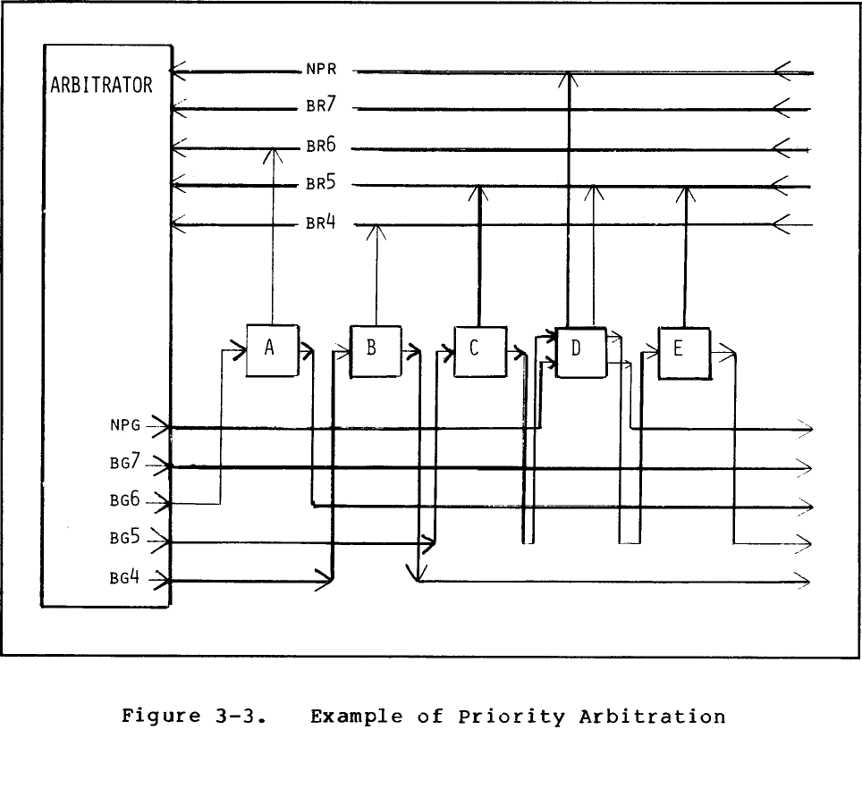

#### 3.1.4 Note On Timing Diagrams

Arrows on the timing diagrams show causal relationships between signals. A timing specification may be inserted into an arrow. For example, an arrow with the notation: "75 ns min." inserted into it, pointing from signal A to signal B signifies that signal B follows signal A, but not before a minimum delay of 75 nanoseconds has elapsed.

LEGENDS: "asserted," "negated," and "either asserted or negated" are self-explanatory. "Defined" refers to the A, C and D lines received by a device after having been asserted in a valid <!-- Source PDF page 43 --> configuration by another device; the slanted lines at the beginning and/or end of the undefined periods represent skew time. "Undefined" and "irrelevant" are used only in Paragraph 5.4 [sic; see §3.4]. "Undefined" means that the line may be either asserted, negated, or be in some intermediate state because the DC power is coming up or going down. "Irrelevant" signifies that the state of the line is of no concern at the time.

All the timing diagrams that follow in this section show timing at more than one device. With the exception of Figure 3-13 (Typical Power Up/Down Sequence), these device timing diagrams should be considered independent of each other.

### 3.2 Priority Arbitration Transactions

#### 3.2.1 Introduction

Paragraph 3.2.1.1 describes priority arbitration transactions in general terms. Paragraph 3.2.2 describes NPR, and BR7, BR6, BR5, BR4 interrupt transactions in detail.

It is assumed in all the descriptions in this paragraph that the arbitrator is allowed to issue a grant of the level at which the request is made. This implies: (1) that no device request having a priority level higher than the level of the request under consideration is present at the arbitrator, and (2) that the present priority level of the interrupt fielding processor is lower than the priority level of the request under consideration. Priority arbitration is discussed in Paragraph 3.1.3 of this specification.

##### 3.2.1.1 General Description (Figure 3-4)

At the start (top) of Figure 3-4, device 1, having been granted the use of the data section of the bus, asserts BBSY and becomes bus master. After a time, device 1 negates SACK. The arbitrator is enabled when it receives the negation of SACK, and a new priority arbitration sequence starts. When the request from device 2 reaches the arbitrator, a grant of the same priority level as the request is asserted. The assertion of this grant disables the arbitrator, and the request from device 3 is ignored. Device 2 acknowledges the grant by asserting SACK. Receipt of the assertion of SACK keeps the arbitrator disabled. Device 2 is now designated as next bus master.

The arbitrator acknowledges the receipt of the assertion of SACK by negating the grant. This action signals the end of the arbitration sequence.

Device 1 ends its data transfer and relinquishes the bus by negating BBSY.

As soon as device 2 has received the negation of BBSY, device 2 becomes bus master, asserts BBSY, and starts its data transfer cycle.

<!-- Source PDF page 44 -->

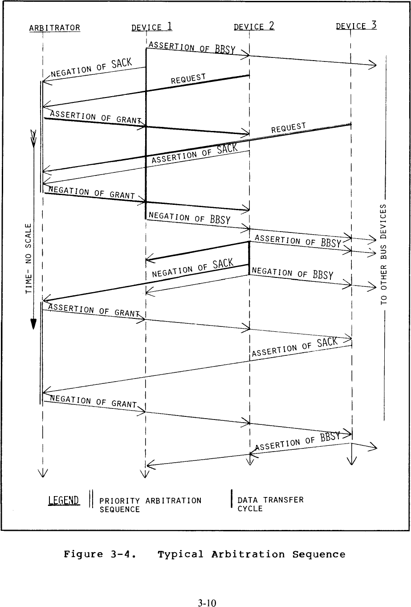

<!-- Source PDF page 45 -->

Requests are not honored by the arbitrator while a grant is asserted, nor while the assertion of SACK is seen at the arbitrator. The request from device 3 is an example of this.

A priority arbitration sequence may or may not occur at the same time as a data transfer cycle. In the case of devices 1 and 2 above, it does. The arbitration sequence for device 3, however, does not start until the data transfer by device 2 is almost ended.

All Unibus signals used in the above sequence are transmitted on Type-1 lines, with the exception of the grants, which are transmitted on Type-2 lines. Thus, a grant asserted by the arbitrator is received by the first device on the bus wired to this particular grant line. If this device requires the use of the data section of the bus at this time, it blocks the grant and asserts SACK. If the device does not require the use of the data section of the bus upon receipt of the assertion of a grant, it asserts (passes) the grant, which is then received by the next device of the same priority level on the bus. A device may not accept a grant (assert SACK) after it has passed the grant.

#### 3.2.2 Detailed Description: Priority Arbitration Transactions

##### 3.2.2.1 Preliminary Conditions

The arbitrator responds to signals from bus devices requesting the use of the data section of the Unibus, and to enabling signals from the interrupt fielding processor.

The signals from the bus devices that need to become bus master are defined in Section 2 of this specification.

The interrupt fielding processor prohibits the arbitrator from issuing BGs during an interrupt transaction and for such time after this transaction that the interrupt fielding processor is determining its new priority level. The interrupt fielding processor cannot service, and the arbitrator may not grant, any more BGs until the interrupt fielding processor has established what this new level is and saved the old level. This sequence typically requires four bus cycles, after which the arbitrator is again allowed to grant BGs at a level higher than that of the new interrupt fielding processor level.

The "Grant Status" lines on the timing diagrams show which types of grants may be issued by the arbitrator at any given time during the arbitration sequence.

##### 3.2.2.2 Detailed Description: NPR Arbitration Sequence

The numbers of the steps in this paragraph correspond to the numbers on Figure 3-5.

1. The requesting device asserts NPR.

2. After a propagation delay, the assertion of NPR is received by the arbitrator.

<!-- Source PDF page 46 -->

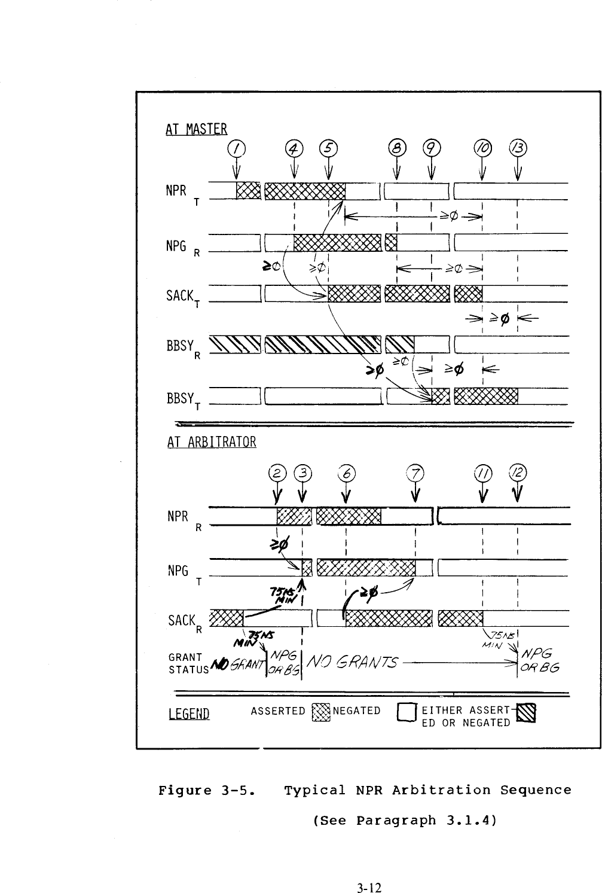

<!-- Source PDF page 47 -->

**3.** If the negation of SACK from the previous priority arbitration sequence has been received by the arbitrator for at least 75 nanoseconds, the arbitrator asserts NPG and the arbitration process is stopped.

NOTES

1. No grants may be issued by the arbitrator while SACK is asserted, and for a minimum of 75 nanoseconds after receipt of the negation of SACK.

The delay ensures that the negation of NPR or BR from the previous arbitration sequence has arrived at the arbitrator before arbitration is resumed. This prevents the issue of a grant in response to the request from the previous arbitration sequence in the case that the request is negated at the same time as SACK. (See Step 5.)

In the case of a single word transfer, the master typically negates SACK immediately after asserting BBSY. The SACK delay ensures, in this case, that the assertion of BBSY is sensed before the negation of SACK. This prevents the interrupt fielding processor from asserting BBSY upon seeing the bus free,

2. No other grant (NPG or BG) may be issued by the arbitrator while an NPG is asserted.

**4.** After a propagation delay, NPG is received at the requesting device.

**5.** The requesting device then asserts SACK. In the case of a single word transfer, NPR must be negated by the requesting device after the assertion of SACK, but before SACK is negated. If another transfer is required after the current one, NPR may remain asserted.

**6.** After a propagation delay, the assertion of SACK is received at the arbitrator.

<!-- Source PDF page 48 -->

NOTES

1. If the assertion of SACK is not received by the arbitrator during a specified time after its assertion of NPG (timeout delay), NPG is negated and arbitration resumes. (See Paragraph 3.1.3.6.) The timeout delay is typically 5 to 10 microseconds.

2. Systems may avoid the timeout delay by having, at the end of the bus opposite to the arbitrator, a terminator that asserts SACK if it receives the assertion of NPG.

The arbitrator, upon receipt of the assertion of SACK, negates NPG. The negation of NPG is propagated along the bus to the terminator, which negates SACK upon receipt of the negation of NPG. Steps 11 and 12 below are then executed.

**7.** The arbitrator then negates NPG.

**8.** After a propagation delay, the requesting device receives the negation of NPG.

**9.** After receiving the negation of BBSY the requesting device asserts BBSY. The requesting device becomes bus master at the time of its assertion of BBSY, and starts its data transfer cycle(s). (See Paragraph 3.3.)

**10.** After it has asserted BBSY and at some time before it has finished transferring data, the bus master may negate SACK, if it has received the negation of BGn [sic].

> Source note: Step 10 on PDF page 48 prints BGn in this NPR sequence; the interlock in Note 2 immediately below requires the negation of NPG.

NOTES

1. If a single word transfer is intended, a device typically asserts BBSY and negates SACK at the same time.

2. The master must not negate SACK prior to its receipt of the negation of NPG. This provides the interlock that ensures that the arbitrator has received the assertion of SACK.

**11.** After a propagation delay, the arbitrator receives the negation of SACK.

12. The arbitrator waits a minimum of 75 nanoseconds, then resumes arbitration. See Note 1, step 3.

<!-- Source PDF page 49 -->

13. At the end of its last data transfer cycle, the master waits at least 75 nanoseconds after negating MSYN, then removes any A, C, D, bits it has put on the bus. It then negates BBSY, thus releasing the bus. SACK must be negated before BBSY may be negated.

##### 3.2.2.3 General Description: Interrupt Transaction

A bus master that has obtained control of the data section of the Unibus through a BRn-BGn arbitration transaction may issue an interrupt command to the interrupt fielding processor. This forces entry into a subprogram whose vector is given to the interrupt fielding processor by the bus master. The vector is asserted on the D lines.

Figure 3-6 shows the interaction between master, interrupt fielding processor, and arbitrator for a typical interrupt transaction. A bus master puts the vector on the D lines and, if SSYN is negated, asserts INTR and negates SACK if BGn is negated.

The interrupt fielding processor, upon receipt of the assertion of INTR, delays to deskew the D lines, then strobes the vector and asserts SSYN.

Upon receipt of the assertion of SSYN, the master removes the vector from the D lines and negates INTR and BBSY.

When the interrupt fielding processor receives the negation of INTR, it negates SSYN.

Upon receipt of the assertion of INTR, the arbitrator ceases to issue BGs. It grants no BGs until authorized to do so by the interrupt fielding processor. NPGS, however, may be granted during this time,

##### 3.2.2.4 Detailed Description: BR Interrupt Arbitration Sequence

The numbers of the steps in this paragraph correspond to the numbers on Figure 3-7.

**1.** The requesting device asserts BRn.

2. After a propagation delay, the assertion of BRn is received by the arbitrator.

3. If the negation of SACK from the previous priority arbitration sequence has been received by the arbitrator for at least 75 nanoseconds and if the interrupt fielding processor is ready to accept an interrupt vector at the level of the interrupting device, the arbitrator asserts BGn and the arbitration process is stopped.

<!-- Source PDF page 50 -->

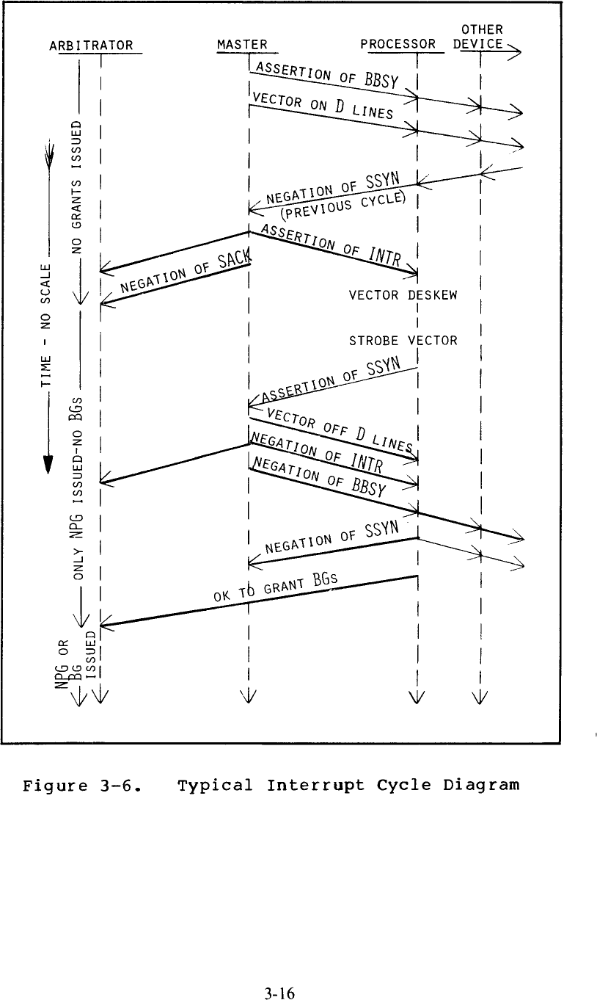

<!-- Source PDF page 51 -->

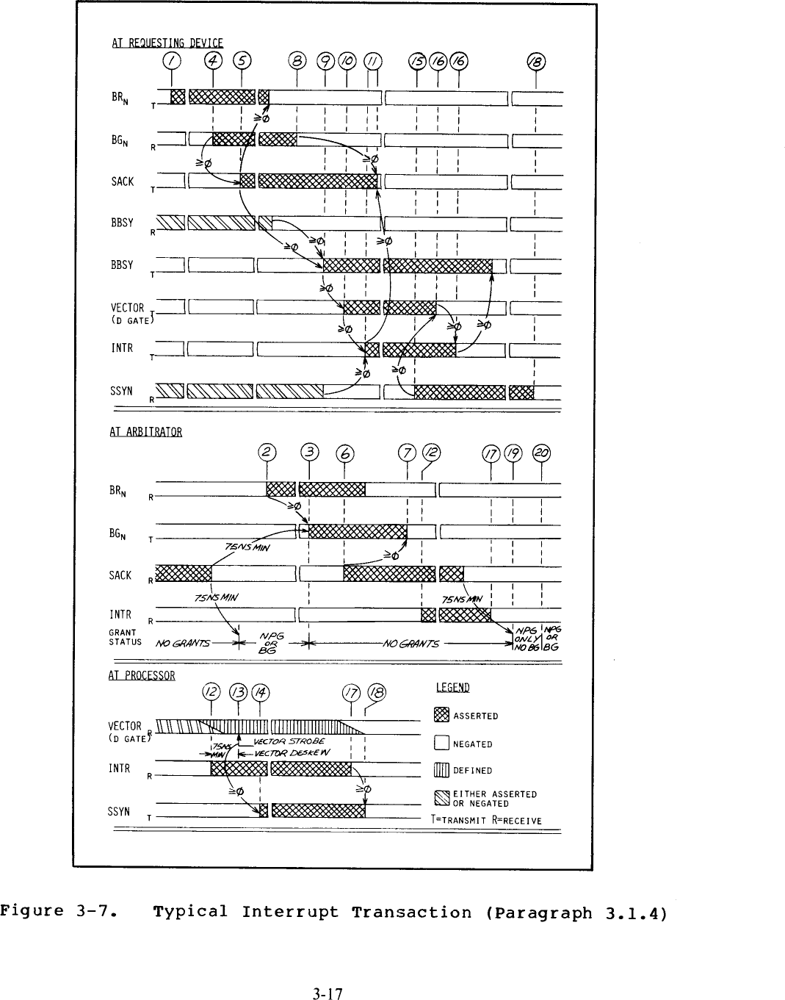

<!-- Source PDF page 52 -->

NOTES

1. No grants may be issued by the arbitrator while SACK is asserted, and for a minimum of 75 nanoseconds after receipt of the negation of SACK.

The delay ensures that the negation of NPR or BR from the previous arbitration sequence has arrived at the arbitrator before arbitration is resumed. This prevents the issue of a grant in response to the request from the previous arbitration sequence in the case that the request is negated at the same time as SACK. See Step 5.

In the case of a single word transfer, the master typically negates SACK immediately after asserting BBSY. The SACK delay ensures, in this case, that the assertion of BBSY is sensed before the negation of SACK. This prevents the interrupt fielding processor from asserting BBSY upon seeing the bus free.

2. No other grant (NPG or BG) may be issued by the arbitrator while a BG is asserted.

**4.** After a propagation delay, BGn is received at the requesting device.

**5.** The requesting device then asserts SACK. In the case of a single transaction, BRn must be negated by the requesting device after the assertion of SACK, but before SACK is negated. If another transaction is required after the current one, BRn may remain asserted.

**6.** After a propagation delay, the assertion of SACK is received at the arbitrator.

NOTES

1. If the assertion of SACK is not received by the arbitrator during a specified time after its assertion of BGn (timeout delay), BGn is negated and arbitration resumes (Paragraph 3.1.3.6). The timeout delay is typically 5 to 10 microseconds.

<!-- Source PDF page 53 -->

2. Systems may avoid the timeout delay by having, at the end of the bus opposite to the arbitrator, a terminator that asserts SACK if it receives the assertion of BGn. The arbitrator, upon receipt of the assertion of SACK, negates BGn. The negation of BGn is propagated along the bus to the terminator, which negates SACK upon receipt of the negation of BGn. Steps 11 and 12 of Paragraph 3.2.2.2 (NPR Sequence) are then executed.

**7.** The arbitrator then negates BGn.

**8.** After a propagation delay, the requesting device receives the negation of BGn.

**9.** The requesting device, after receiving the negation of BBSY, asserts BBSY. The requesting device becomes bus master at the time of its assertion of BBSY.

**10.** The bus master, which must have been granted the use of the data section of the Unibus by a BG but not by an NPG, puts the interrupt vector on the D lines.

**11.** After the master receives the negation of SSYN (which is typically already negated), it asserts INTR. After the master has asserted INTR and received the negation of BGn it negates SACK,

NOTES

1. INTR must be asserted before SACK is negated to ensure receipt of the assertion of INTR before the end of the SACK delay at the arbitrator.

The SACK delay compensates for skew between INTR and SACK at the arbitrator.

2. The master must not negate SACK prior to its receipt of the negation of BGn. This provides the interlock that ensures that the arbitrator has received the assertion of SACK.

3. The master may already have negated INTR or BBSY (Step 16 below) by the time it receives the negation of BGn (not typical, but possible). In this case, the master negates SACK when the negation of BGn is received.

<!-- Source PDF page 54 -->

12. After a propagation delay, the arbitrator and the interrupt fielding processor receive the assertion of INTR.

13. The interrupt fielding processor waits for at least 75 nanoseconds (vector deskew), then strobes the vector from the D lines.

NOTE The vector deskew compensates for the skew between INTR and the D lines at the interrupt fielding processor.

14. The interrupt fielding processor asserts SSYN.

15. After a propagation delay, the master receives the assertion of SSYN.

16. The master then removes the vector from the D lines and then negates INTR. The master then typically negates BBSY. This constitutes active release of the data section of the bus by the master.

17. After a propagation delay, the arbitrator and the interrupt fielding processor receive the negation of INTR.

18. The interrupt fielding processor then negates SSYN.

19. After receiving the negation of SACK (Step 11 above), the arbitrator waits for 75 nanoseconds (SACK delay), then may resume issuing NPGs, but not BGs.

NOTE Typically, the interrupt fielding processor reads a new program counter and status word from memory the locations designated by the interrupt vector. This is done immediately following the interrupt transaction. From this the interrupt fielding processor determines its new priority level. (See Paragraph 3.2.2.)

20. The interrupt fielding processor informs the arbitrator that it may start issuing BGs.

NOTES

1. Data may be transferred by a device that has become bus master through a BRn-BGn sequence. In this case, the procedure is the same as that described for NPR in Paragraph 3.2.2.2.

<!-- Source PDF page 55 -->

2. A master may only execute one INTR transaction per BG.

3. If a master does data transfer(s) but no interrupt transaction under the authority of a BG, then releases the data section, this release constitutes passive release of the data section of the bus.

### 3.3 Data Transfer Transactions

#### 3.3.1 Data-In, DATI or DATIP

##### 3.3.1.1 General Description: Data-In Transaction

Data-in is defined as a data transfer from a slave to a master. DATI and DATIP are similar data-in operations, and are defined in Paragraph 2.4.3 of this specification.

Figure 3-8 shows the interaction between master and slave for a typical DATI or DATIP. A bus master (BBSY asserted) places the slave address and the required control bits on the A and C Unibus lines. All devices decode A and C to see if they are selected as the slave for this transaction.

The master waits after putting the address and control bits on the A and C lines. This delay allows for deskewing of the A and C lines, and for their decoding by the bus devices. Then, if the previous slave has ended its part of the preceding data cycle by negating SSYN, the master asserts MSYN.

The selected slave, after receiving the assertion of MSYN, places the requested data on the D lines and asserts SSYN.

The master deskews the D lines after receiving the assertion of SSYN, strobes the data, and negates MSYN.

The receipt of the negation of MSYN informs the slave that the master has accepted the data. The slave then removes the data from the D lines and negates SSYN. This ends the slave's part of the data transfer cycle.

The master, after negating MSYN, deskews the A and C lines. This ensures that the negation of MSYN is received by all devices before the A and C lines become invalid, and thus prevents false selection by another device. After the deskew, the master ends its part of the data transfer by removing the address and control bits from the A and C lines.

If the master is not going to use the bus for another data transfer at this time, it negates BBSY. This releases the data section of the bus for possible use by another device. If there is to be another transfer (e.g., a DATO or DATOB after a DATIP), BBSY is held asserted by the current master.

<!-- Source PDF page 56 -->

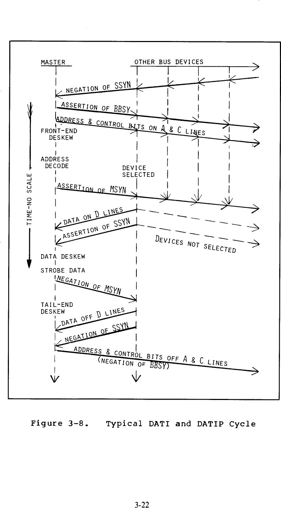

<!-- Source PDF page 57 -->

##### 3.3.1.2 Detailed Description, DATI and DATIP

The numbers of the steps in this paragraph correspond to the numbers on Figure 3-9.

**1.** The bus master (BBSY asserted) puts the address and the control bits on their respective Unibus lines.

2. After a propagation delay, each device on the bus receives the address and control bits, and decodes them.

**3.** The master waits for at least 150 nanoseconds after putting the address and control bits on the A and C lines (front-end deskew); then, if SSYN is negated, it asserts MSYN. This means that the master must not assert MSYN at the driver input until 150 nanoseconds have elapsed since the A, C, and enable lines have become valid at the A and C driver inputs.

NOTE The front-end deskew lasts 75 nanoseconds to compensate for the skew of the A and C lines at the slave, plus 75 nanoseconds to allow the slave to decode these lines.

**4.** After a propagation delay, each device on the bus receives the assertion of MSYN. One of them has decided, after having decoded the address, that it is the slave for this transaction.

**5.** Some time after receiving the assertion of MSYN, the slave puts the requested data on the D lines, then asserts SSYN. This means that the slave must not assert SSYN at the driver input before the data and enable lines are valid at the D driver inputs.

NOTE SSYN must not be asserted before the data is put on the D lines. This is to insure that the master will be able to deskew the data with respect to SSYN and then strobe it while it is valid.

**6.** After a propagation delay, the assertion of SSYN arrives at the master.

NOTES

1. If the assertion of SSYN is not received by the master during a specified time after its assertion of MSYN (timeout delay), Step 7 below may be executed, and Steps 8 and 9 must be executed by the master. An error bit may be set.

<!-- Source PDF page 58 -->

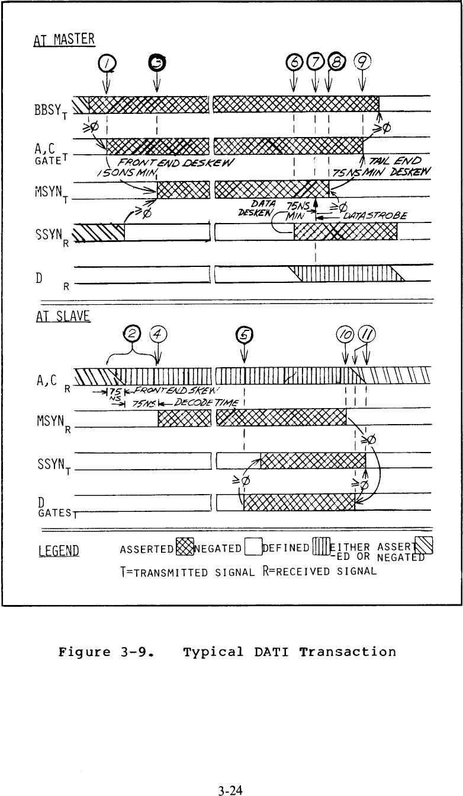

<!-- Source PDF page 59 -->

2. The timeout delay is typically 10 to 20 microseconds in processors. The use of some devices (e.g., bus window (DA11), data link (DL16)) require much longer times, which can be up to several hundreds of microseconds. These devices are used in multi-processor or multi-bus systems.

**7.** After waiting for at least 75 nanoseconds after the receipt of the assertion of SSYN (data deskew), the master strobes in the data.

NOTE The data deskew compensates for the skew of the D lines at the master.

**8.** The master negates MSYN.

**9.** After a 75 nanosecond minimum wait, called tail-end deskew, the master removes the address and control bits from the A and C lines. If this is the last data transfer under the current grant, the master then negates BBSY.

NOTE The tail-end deskew guarantees that the A lines will not change at any bus device while the device is receiving the assertion of MSYN. This prevents false selection of a device due to changing A lines while MSYN is asserted.

**10.** After a propagation delay, the slave receives the negation of MSYN.

**11.** The slave removes the data from the D lines, and then negates SSYN.

NOTE SSYN must not be negated before the data is removed from the D lines. This ensures that the negation of SSYN is a valid indication of the fact that the data bits have been removed from the D lines.

#### 3.3.2 Data-Out, DATO or DATOB

##### 3.3.2.1 General Description: Data-Out Transaction

Data-Out is defined as a data transfer from a master to a slave. DATO and DATOB are data-out operations, and are defined in Paragraph 2.4.3 of this specification. The timing and protocol for both of these operations is identical.

<!-- Source PDF page 60 -->

Figure 3-10 shows the interaction between master and slave for a typical DATO or DATOB. A bus master (BBSY asserted) places the slave address, the required control bits, and the data on the A, C and D Unibus lines. All devices decode A and C to see if they are selected as the slave for this transaction.

The master asserts MSYN after two conditions are met:

- **a.** An appropriate delay is allowed for deskewing of the A, C and D lines, and for address and control decoding by the slave.

- **b.** An appropriate delay is allowed after the receipt of the negation of SSYN, to ensure that the previous slave is no longer driving the D lines.

The device selected as slave, after receiving the assertion of MSYN, strobes the data on the D lines and asserts SSYN.

The master, after receiving the assertion of SSYN, negates MSYN, then deskews the A and C lines. This ensures that the negation of MSYN is received by all devices before the A and C lines lose their validity, and thus prevents false selection by another device. After the deskew, the master ends its part of the data transfer by removing address and control bits from the A and C lines.

Data may be removed from the D lines by the master at any time after its receipt of the assertion of SSYN, but no later than its removal of the address and control bits from the A and C lines.

The slave, upon receipt of the negation of MSYN, ends its part of the data transfer cycle by negating SSYN.

If the master is not going to use the bus for another data transfer after removing the address and control bits from the A and C lines, it then negates BBSY. This releases the data section of the bus for possible use by another device. If there is to be another transfer, BBSY is held asserted by the current master.

##### 3.3.2.2 Detailed Description, DATO and DATOB

The step numbers in this paragraph correspond to the numbers on Figure 3-11.

**1.** The bus master (BBSY asserted) puts the address, control, and data bits on their respective Unibus lines.

2. After a propagation delay, each device on the bus receives the address and control bits, and decodes them.

<!-- Source PDF page 61 -->

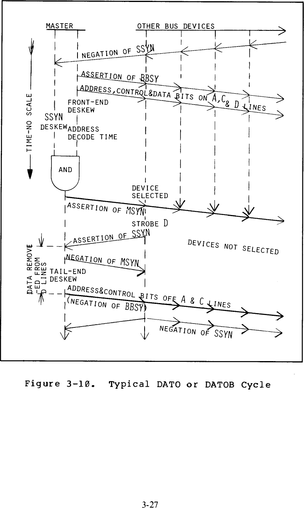

<!-- Source PDF page 62 -->

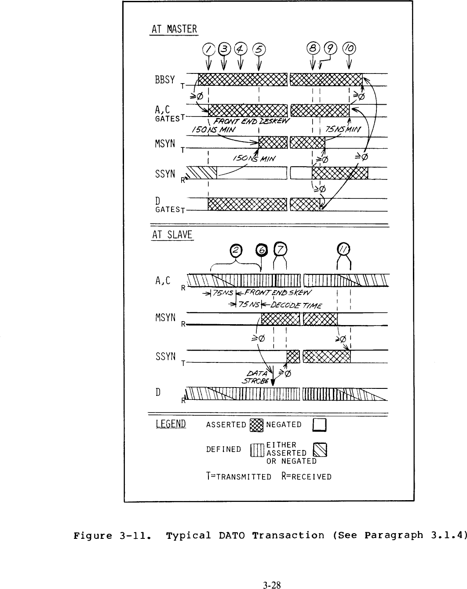

<!-- Source PDF page 63 -->

**3.** After putting the address, control, and data bits on the A, C and D lines, the master waits for at least 150 nanoseconds (front end deskew). This means that the master must not assert MSYN at the driver input until 150 nanoseconds have elapsed since the A, C, D, and enable lines have become valid at the A, C and D driver inputs. (See Note 1 to Step 5 below.)

**4.** The master waits for a minimum of 150 nanoseconds after receiving the negation of SSYN (SSYN deskew). (See Note 2, Step 5 below.)

**5.** After the conditions in Steps 3 and 4 above have been met, the master asserts MSYN.

NOTES

1. The front-end deskew consists of 75 nanoseconds to compensate for the skew of the A and C lines at the slave, plus 75 nanoseconds to allow the slave to decode these lines.

2. The 150-nanosecond SSYN deskew consists of: (1) 75 nanoseconds to ensure that the data from a previous DATI or DATIP transaction has been removed from the D lines and (2) 75 nanoseconds to allow set-up time for such devices as may require it.

**6.** After a propagation delay, each device on the bus receives the assertion of MSYN. One of them has decided, after having decoded the address, that it is the slave for this transaction.

**7.** Upon receiving the assertion of MSYN, the slave strobes the data from the D lines and asserts SSYN.

NOTE The data must be strobed by the slave either at the same time as, or previous to, the assertion of SSYN. This is required because the master may remove the data from the D lines upon receipt of the assertion of SSYN.

8. After a propagation delay, the master receives the assertion of SSYN.

<!-- Source PDF page 64 -->

NOTES

1. If the assertion of SSYN is not received by the master during a specified time after its assertion of MSYN (timeout delay), the steps that follow are executed and an error bit may be set.

2. The timeout delay is typically 10 to 20 microseconds in processors. The use of some devices (e.g., bus window (DA11), data link (DL10)) require much longer times which can be up to several hundreds of microseconds. These devices are used in multi-processor or multi-bus systems.

**9.** Upon receipt of the assertion of SSYN, the master negates MSYN, and may remove the data from the D lines.

**10.** After a 75 nanosecond minimum wait, called tail-end deskew, the master removes the address and control bits from the A and C lines. If this is the last transfer under the current grant, the master then negates BBSY. If the data has not previously been removed from the D lines, it must be removed: (a) if another transfer is to be done under the current grant, no later than the removal of the A and C bits from the bus, or, (b) if this is the last transfer under the current grant, before the negation of BBSY.

NOTE The tail-end deskew guarantees that the A lines will not change at any bus device while the device is receiving the assertion of MSYN. This prevents false selection of a device due to changing A lines while MSYN is asserted.

**11.** After a propagation delay, the slave receives the negation of MSYN and then negates SSYN.

#### 3.3.3 Read/Modify/Write, Datip-Dato/B

##### 3.3.3.1 Description, Read/Modify/Write Transaction

A read/modify/write transaction consists of a DATIP followed immediately by a DATO or DATOB. These transactions are defined in Paragraph 2.4.3, and the protocol relating to them in Paragraphs 3.3.1 and 3.3.2.

<!-- Source PDF page 65 -->

Figure 3-12 shows a typical DATIP-DATO/B transaction. The following rules must be followed:

1. All protocol rules set forth in Paragraph 3.3.1.2 (DATIP), and 3.3.2.2 and Figure 3-11 (DATO/B) must be obeyed.

2. The master must make sure that no other device becomes bus master from the start of the DATIP to the end of the DATO/B. BBSY must be held asserted from the start of the DATIP to the end of the DATO/B.

3. The same word location must be accessed during both data transfer cycles, i.e.: address bits A<17:01> must not change.

4. The DATO/B must follow the DATIP immediately: no other data transfer cycle may be executed between them.

#### 3.3.4 Multiple Word Transfers

A multiple word transfer is one during which more than one word or byte is transferred between master and slave on the authority of a single grant. The bus is not released by the master between word transfers. The several types of data transfers may be executed in any order, and to various locations if required, providing that all rules for each type are obeyed, (e.g., those for DATIP-DATO/B if more than one location is addressed).

NOTE Multiple word transfers are used by high speed devices that may lose data because of bus latency.

#### 3.3.5 Interrupt (INTR)

The interrupt transaction is explained in Paragraph 3.2.2.4 and Figure 3-7.

### 3.4 Initialization Section

The initialization section of the Unibus controls the initialization, power-up and power-down sequences of all bus devices. Three Unibus signals (INIT, AC LO and DC LO) are used for this purpose.

#### 3.4.1 Initialization (INIT)

INIT is caused by some console operations, the RESET instruction, and DC LO. Only a processor or the arbitrator may assert INIT.

##### 3.4.1.1 Processor Requirements

A processor must become bus master, then wait for 5 microseconds, before it may assert INIT. No bus cycles may be executed during these 5 microseconds. This delay ensures that all memory cycles in progress are properly completed before the assertion of INIT.

<!-- Source PDF page 66 -->

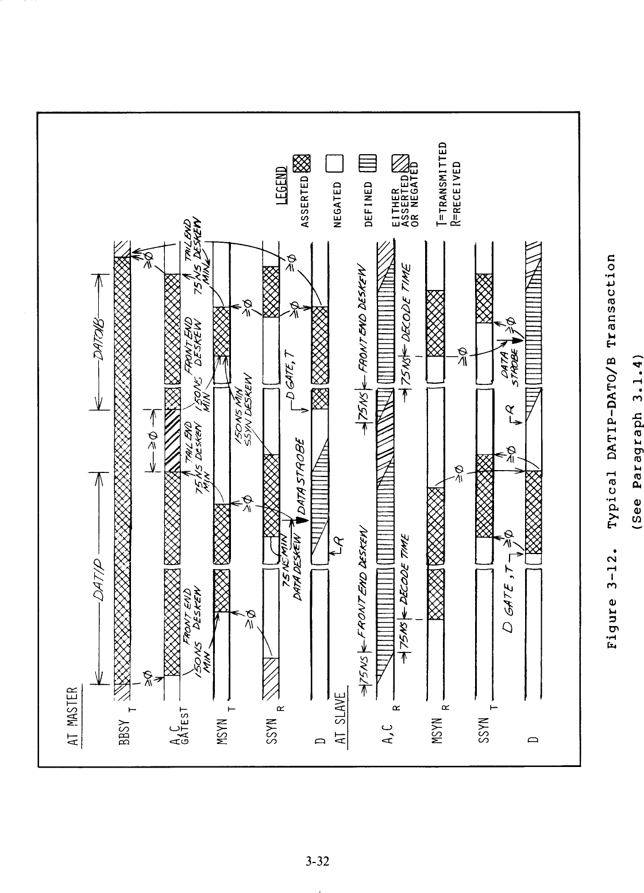

<!-- Source PDF page 67 -->

However, if a processor that wants to assert INIT cannot obtain the use of the data section of the bus after trying for 100 microseconds, it may then assert INIT without becoming bus master. Processors that obtain the use of the data section of the bus through a grant sequence must not negate SACK until after their assertion of INIT. This ensures that the arbitrator receives the assertion of INIT before the negation of SACK, and thus cannot start arbitration until it receives the negation of INIT.

Any processor, after negating INIT, must wait 75 nanoseconds before asserting any signal except AC LO, DC LO or INIT. This ensures that the negation of INIT reaches all bus devices before any signals asserted on the data section of the bus by the processor.

##### 3.4.1.2 Arbitrator Response

Upon receipt of the assertion of INIT, the arbitrator negates all grants, and may not issue any as a result of events that occurred before the assertion of INIT. No grants may be issued while INIT is asserted.

##### 3.4.1.3 Master/Slave Device Response

When a master/slave device receives the assertion of INIT:

- **a.** It completes in normal fashion the bus cycle in process, if any. If the device is bus master, it then negates BBSY. If the bus cycle in progress is a DATIP, the master must complete the DATO/B. The memory must be capable of completing the DATO/B or must restore itself and treat any following DATO/B as a new transaction.

- **b.** It negates any of the following signals that it may be asserting: SACK, NPR, BR4, BR5, BR6, BR7; it passes all grants.

- **c.** It clears the Interrupt Enable bit. It may assert AC LO, DC LO and any signals required by (a) above. It may not assert NPR, BR, SACK, or BBSY.

After receipt of the negation of INIT, a device must be programmable in its normal manner. If the device is not ready to receive commands at this time, the device may set a Busy bit until its internal initialization sequence is finished. The device may have an error condition set. Some of the device registers may contain new or old values. The content of these registers after receipt of the negation of INIT must be defined in the device specification; it is recommended that devices retain as much status information as possible in order to make error analysis easier.

A device is not required to buffer commands received during its internal initialization sequence, provided it sets a bit indicating that it is not ready to accept commands (Busy bit).

<!-- Source PDF page 68 -->

#### 3.4.2 Power-Up And Power-Down Sequences

The purpose of the power-up and power-down sequences is to guarantee sufficient time for the program to store (on power-down) and then retrieve (on power-up) the parameters required for continued operation.

The numbers of the steps in the descriptions in Paragraphs 3.4.2.1 and 3.4.2.2 correspond to those on Figure 3-13, Typical Power-Up/Down Sequence, and on Figure 3-14.

The term "DC power" is used in this Paragraph (3.4.2) to mean only that DC power which may cause Unibus drivers, receivers, and terminators to cease to meet their electrical specifications, thus making the Unibus non-operable.

##### 3.4.2.1 Power-Up Sequence

1. When power is off in any Unibus device, AC LO and DC LO are asserted and all other Unibus signals are undefined.

2. When the DC voltage to the processor rises to a level at which the logic elements will operate, the presence of the assertion of DC LO initializes the processor to a state having BBSY and INIT asserted.

3. DC LO is negated by the power supply 5 microseconds after DC power is within specifications.

4. INIT remains asserted by the processor for a minimum of 10 milliseconds after receipt of the negation of DC LO. This is to ensure proper initialization of all bus devices.

5. The processor waits for a minimum of 70 milliseconds after the receipt of the negation of DC LO to allow bus devices to complete their internal initialization operations.

6. INIT must be negated before or at the end of this 70 millisecond delay. The processor then tests AC LO. When it senses the negation of AC LO, the processor starts its power-up sequence and the arbitrator is enabled. AC LO must not be negated by the power supply for less than 1 microsecond. At this time, and while AC LO is negated, DC power is guaranteed to be within specifications for a minimum of 5 milliseconds plus 5 microseconds. (See Step 14, Note 2.)

7. The processor waits a minimum of 2 milliseconds, before testing AC LO again. These 2 milliseconds are used by the program for the power-up sequence.

<!-- Source PDF page 69 -->

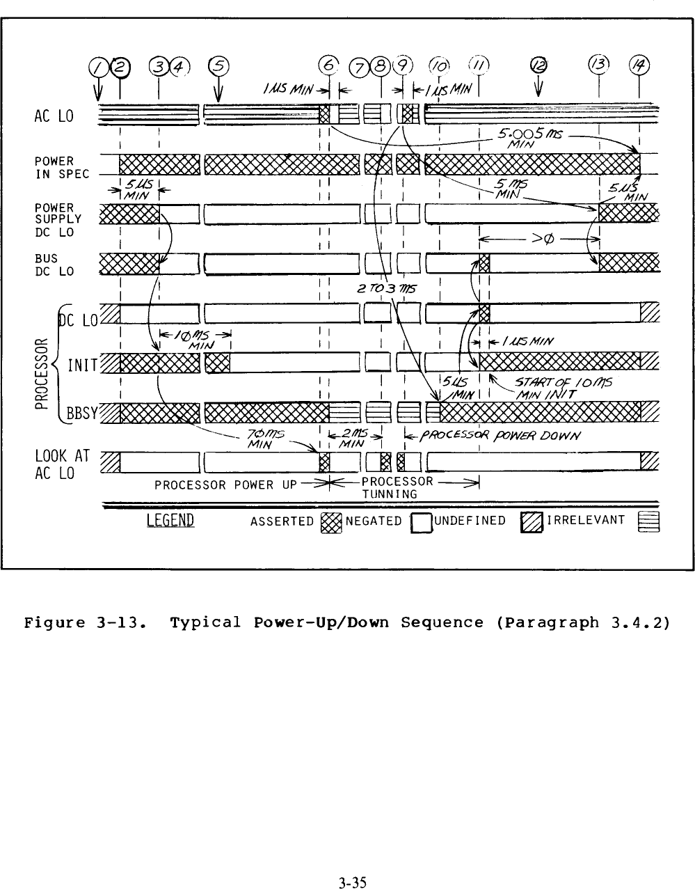

<!-- Source PDF page 70 -->

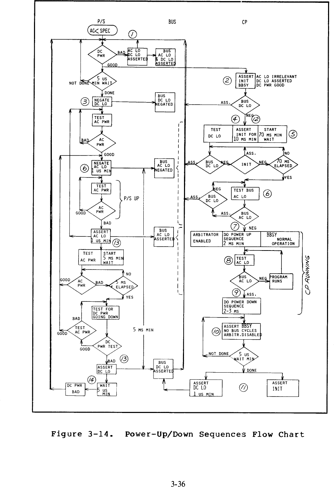

<!-- Source PDF page 71 -->

##### 3.4.2.2 Power-Down Sequence (Figure 3-13)

8. Having completed its power-up sequence and the wait in Step 7 above, the processor starts monitoring AC LO.

**9.** Upon receipt of the assertion of AC LO, a processor starts its power-down routine. AC LO must not be asserted by the power supply for less than 1 microsecond. The processor does not test AC LO again until its next power-up sequence. (See Step 6 above.)

**10.** After a time of 2 milliseconds minimum, 3 milliseconds maximum, the processor asserts BBSY and does not use the data section of the bus (i.e., stops execution of programs).

**11.** A minimum of 5 microseconds later, the processor asserts DC LO for at least 1 microsecond. This, in turn, causes INIT to be asserted for the same length of time.

12. The subsequent negation of DC LO by the processor is the beginning of a power-up sequence (see Step 3), unless DC LO is held asserted by a power supply or by another bus device.

13. DC LO must not be asserted by the power supply until a minimum of 5 milliseconds has elapsed after its assertion of AC LO. This ensures that enough time is available for a complete power-up and power-down cycle.

14. DC power must be within specifications for a minimum of 5 microseconds after the assertion of DC LO by the power supply.

NOTES

1. Since the power-up sequence starts at the negation of AC LO that follows (after a 70-millisecond delay) the negation of DC LO (Steps 3 through 7, Paragraph 3.4.2.1), and since AC LO is not tested during the 2 milliseconds allotted to the power-up sequence then if AC LO is reasserted before the end of the power-up sequence (2 milliseconds), the power-down sequence (2 to 3 milliseconds) must be performed immediately following the power-up sequence. This requires a minimum of 5 milliseconds of guaranteed DC power at the negation of AC LO. This also implies that 5 milliseconds of guaranteed DC power are available at any time while AC LO is negated.

<!-- Source PDF page 72 -->

2. A “BROWN OUT" condition occurs when AC LO is asserted, DC power is within specifications and DC LO is negated. The processor, in this case, waits for the negation of AC LO as explained in Step 6 above.

<!-- Source PDF page 73 -->

## Section 4: Interface Design Guidelines

### 4.1 General

This section presents some interface guidelines for reliability and compatibility with the Unibus; they are not restricted to a specific type of Unibus device. The examples given in this section are intended to demonstrate concepts only, and are not intended to be logic designs that can be directly implemented.

### 4.2 Preferred Unibus Interface Chips

The following chips are recommended for use in new Unibus interface designs. No other chips should be used to interface to the Unibus.

1. 8640 — Quad NOR gate (receiver). Pin-compatible replacement for DEC380.

2. 8641 — Quad transceiver (receiver/driver). Pin-compatible replacement for DEC8838.

3. 8881 — Quad NAND gate (driver).

The following chips are not recommended for new Unibus interface designs: 314, 5314, 6314, 7314, 380, 5380, 6380, 7380, 11380, 384, 5384, 7384, 8838, 74H01-1, 7438, 8647, 8837, 8136 or any other chips not in the preferred list above. (These have all been used in past designs.)

Customers may purchase the 8641, 8881, and 8640 chips from Digital Equipment Corporation (option numbers 964, 957, and 956, respectively). These three chips are the only ones that DIGITAL approves for customer-designed Unibus interfaces at this time. Figures 4-1 through 4-3 illustrate the circuit schematics of these approved Unibus interface chips.

<!-- Source PDF page 74 -->

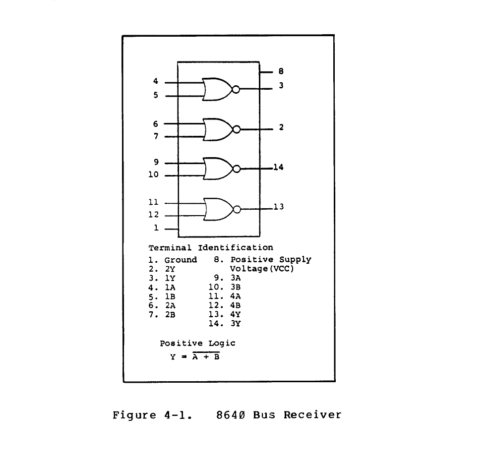

### 4.3 Unit Load

A unit load is to be defined as a maximum of one driver and one receiver, or one transceiver, per Unibus line. Therefore, if a new design is to be rated as one unit load, each Unibus line must be loaded with one and only one of the following:

1. Nothing

2. One receiver

3. One driver

4. One transceiver

5. One driver and one receiver

If a choice between (4) and (5) exists, (4) is preferred.

The purpose of this newly defined unit load is to minimize capacitive loading on the Unibus. Too much capacitive loading concentrated at one point causes excessive reflections which, in turn, cause system failures.

<!-- Source PDF page 75 -->

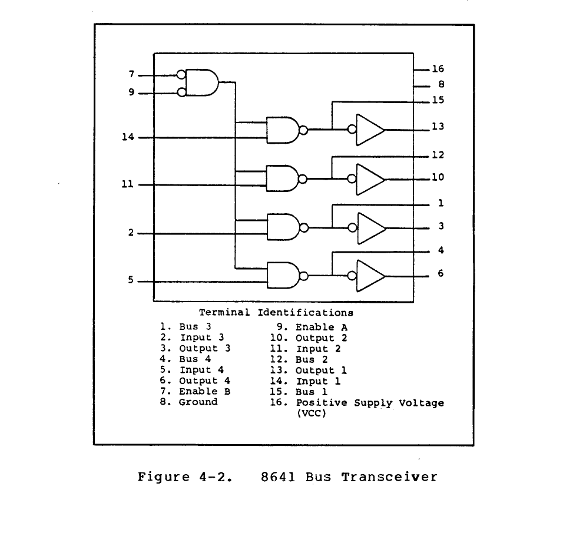

The traditional method of wire-ORing the interrupt vector and data lines onto the Unibus is no longer acceptable, since it violates the above definition. The examples in Paragraphs 4.8.3 and 4.8.4 show how to accomplish multiplexing before the Unibus without introducing skew.

### 4.4 Module PC Etch

It is important to keep the interface chips as close to the module fingers as possible, preferably in rows one and two (where row one is defined as those ICs located nearest the module fingers). The etch runs from the fingers to the chips should be made as short as possible. In particular, etch runs on BUS SSYN L, BUS BBSY L, and BUS MSYN L should not exceed two inches if the module is double-layer, and one inch if the module is multi-layer.

If there is a choice between placing either a driver or a receiver closer to the module fingers, the driver should be chosen. This provides the driver with a shorter ground return path.

<!-- Source PDF page 76 -->

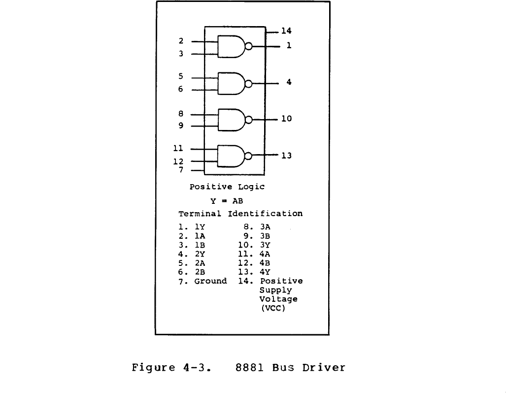

### 4.5 Backplanes

Backplanes for non-SPC (small peripheral controller) modules should have the Unibus signals routed between the Unibus-in and Unibus-out slots with either PC etch or number thirty wirewrap. The signals required by modules should be tapped off from rows A and B. (Refer to Figure 4-4, design of backplanes which do not accommodate SPC's.)

Backplanes for SPC modules should not have stubs on BUS SSYN L, BUS BBSY L, and BUS MSYN L. To prevent stubs, wires have to be routed so that Unibus signals travel through rather than by signal interfaces. This concept is illustrated in Figure 4-5, design of critical signal runs in backplanes which accommodate SPC's. The BUS SACK L must also be routed in this manner so that its run length is the same as that of BUS BBSY L. This prevents skew buildup between BUS SACK L and BUS BBSY L signals. Similarly, BUS MSYN L should be routed in this manner along with BUS A<00:17>L and BUS C0/C1 L, again to prevent skew buildup.

<!-- Source PDF page 77 -->

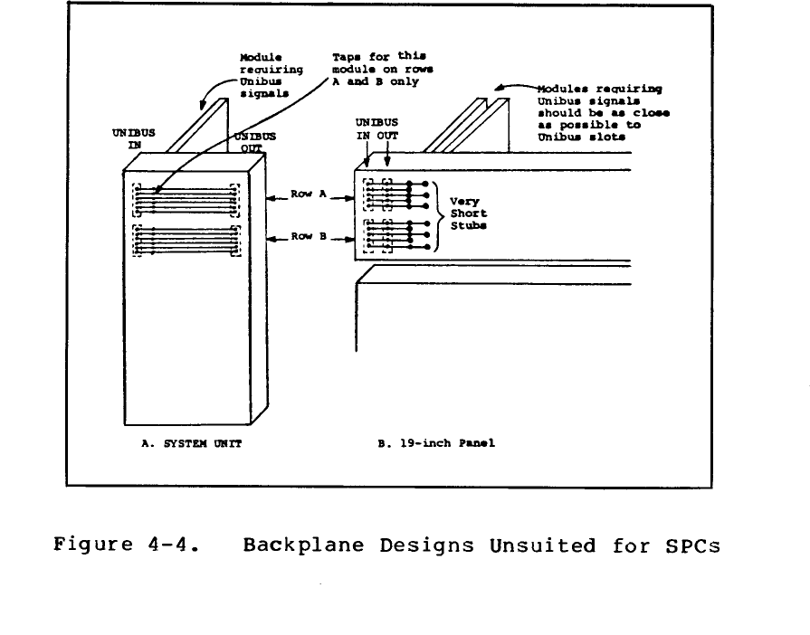

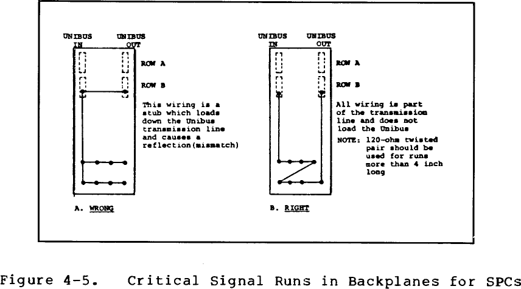

<!-- Source PDF page 78 -->

Excessive backplane crosstalk onto the Unibus signals may cause system failures. For this reason, it is recommended that the following Unibus signals use 120-ohm twisted pair (part number 91-07773) for any backplane wire which exceeds four inches in length:

| Signal     | Signal       |
| ---------- | ------------ |
| BUS INIT L | BUS BR<4:7>L |
| BUS INTR L | BUS BG<4:7>H |
| BUS BBSY L | BUS SSYN L   |
| BUS SACK L | BUS MSYN L   |
| BUS NPR L  | BUS AC LO L  |
| BUS NPG H  | BUS DC LO L  |

PC etch or number thirty wirewrap may be used for other wire runs. Twisted pairs other than the type mentioned above should not be used to route Unibus signals, because their impedance differences may contribute significantly to reflections.

System units (SU) should be designed to accommodate no more than four unit loads. This restriction limits the maximum capacitive loading at any point on the Unibus. This allows those who configure systems to use the M9202 24-inch jumpers to distribute capacitance and to resolve failures caused by reflections. Each new Unibus interface should be designed with all of these rules kept in mind to maintain the integrity of the bus.

### 4.6 Grounding

Noise on backplane and module ground return paths may cause subtle system failures; these may be avoided by providing all ground returns with a low-impedance path to a common ground plane.

Multi-layer modules with internal VCC and ground planes solve this problem automatically. The double-layer modules should have mutually perpendicular ground and VCC runs with 0.01 mfd decoupling capacitors at each intersection (normally at each IC). This forms a low-impedance ground reference plane.

Module areas with many Unibus drivers and receivers should have a wider-than-normal etch path on VCC and ground because of the very large, high-speed switching currents in those areas. The ground path connecting these Unibus drivers and receivers should tie to a dedicated ground pin and be separated from all other grounds on the module. The same applies to the VCC of the same areas.

The PC etch on backplanes should have one side devoted to a ground plane. Backplanes without a PC-etch ground plane are not recommended for new designs.

### 4.7 Logic Design Guidelines For Unibus Interfaces

It is very important to adhere rigidly to the timing restrictions given in this specification, particularly with respect to skew considerations.

<!-- Source PDF page 79 -->

Table 4-1, Unibus events requiring deskew, lists Unibus events where excessive skew can cause a failure. The events listed in the table are a summary of those critical situations when a transmitted signal is timing-dependent on another transmitted signal of the same device. The purpose of listing these events is to provide designers a convenient checklist for verifying the interface timings. If a design involves any of these events, be sure that the relevant portions of this specification are understood and that the worst-case propagation delays in the circuit do not violate the specification. For example, insure that the interrupt vector gets placed at the driver inputs at the same time as, or before, the BUS INTR signal. Skew is defined in Paragraph 2.2.2 of this specification.

A good design philosophy is to keep the Unibus "clean." For example, it is preferable to prevent unasserted data line drivers from "glitching" the Unibus before the assertion of SSYN in a DATI transaction. Even though the spike does not violate the Unibus specification, reflections from it may cause a failure on a heavily loaded Unibus. In general, try to prevent placing any signal on the Unibus that is not needed for the transaction in progress.

### 4.8 Master Devices

#### 4.8.1 Introduction

A bus master is defined in Sections 1 through 3 of this specification as a device that is currently permitted to use the data section of the bus, or as a device which is asserting BUS BBSY L. A master device in this section, however, is defined as a device which is capable of becoming bus master.

A master device must obtain the bus through the arbitration process and execute one or more data transfers. The master must also be able to receive commands relating to these functions. These commands are generally received from a processor. The timing requirements for arbitration and data transfer cycles are specified in Section 3; they will not be repeated in this section.

The design of devices which are capable of becoming bus master is described in this section. Paragraph 4.8.2 discusses the operation of an example implementation of the Unibus priority transfer logic. Paragraph 4.8.3 describes a suggested implementation of a Unibus interface for a device which interrupts at one priority level, while Paragraph 4.8.4 discusses a similar interface for a device which has two independent interrupt vectors. The design of the Unibus interface for an NPR device is discussed in Paragraph 4.8.5 and a typical implementation is shown.

The examples in this section are typical of existing Unibus interface designs; they are presented here so that the implementation of the protocol described in this specification may be understood. They are not “model" or “ideal" designs; they do not “stretch” the protocol to its limits. They do, however, conform to the requirements of this specification.

<!-- Source PDF page 80 -->

**Table 4-1 — Unibus Events Requiring Deskew**

**NPR arbitration sequence (§3.2.2.2)**

| Event too soon | Event too late | Transmitting device | Receiving device(s)          | Device that must deskew      | Deskew name |
| -------------- | -------------- | ------------------- | ---------------------------- | ---------------------------- | ----------- |
| NPR negation   | SACK assertion | Master              | Arbitrator                   | Arbitrator                   | —           |
| BBSY assertion | SACK assertion | Master              | Arbitrator                   | Arbitrator                   | —           |
| SACK negation  | NPR negation   | Master              | Arbitrator                   | Arbitrator                   | —           |
| SACK negation  | BBSY assertion | Master              | Interrupt fielding processor | Interrupt fielding processor | —           |
| BBSY negation  | SACK negation  | Master              | Arbitrator                   | Arbitrator                   | —           |

**Interrupt transaction** (the scan references §3.2.2.5; see §3.2.2.4).

> Source note: Table 4-1 prints D<02:08> for the interrupt vector lines. This is retained below; the circuit description in §4.8.3 instead specifies D<02:09>.

| Event too soon | Event too late  | Transmitting device | Receiving device(s)          | Device that must deskew      | Deskew name   |
| -------------- | --------------- | ------------------- | ---------------------------- | ---------------------------- | ------------- |
| SACK negation  | INTR assertion  | Requesting device   | Interrupt fielding processor | Interrupt fielding processor | —             |
| INTR assertion | D<02:08> gating | Requesting device   | Slave (CPU)                  | Slave (CPU)                  | Vector deskew |

<!-- Source PDF page 81 -->

**Table 4-1 — Unibus Events Requiring Deskew (continued)**

**Interrupt transaction (continued)**

| Event too soon  | Event too late     | Transmitting device | Receiving device(s)                                                        | Device that must deskew | Deskew name |
| --------------- | ------------------ | ------------------- | -------------------------------------------------------------------------- | ----------------------- | ----------- |
| BBSY negation   | D<02:08> releasing | Requesting device   | Next master (for BBSY) and next device (master or slave) receiving D lines | Next master             | —           |
| BBSY negation   | INTR negation      | Requesting device   | Next master (for BBSY) and CPU receiving INTR                              | CPU                     | —           |
| INTR negation   | D<02:08> releasing | Requesting device   | CPU                                                                        | CPU                     | —           |
| D<02:08> gating | BBSY assertion     | Requesting device   | CPU                                                                        | CPU                     | —           |

**DATI/DATIP transaction (§3.3.1.2)**

| Event too soon | Event too late | Transmitting device | Receiving device(s) | Device that must deskew | Deskew name      |
| -------------- | -------------- | ------------------- | ------------------- | ----------------------- | ---------------- |
| MSYN assertion | A and C gating | Master              | Slave               | Master                  | Front-end deskew |
| SSYN assertion | D gating       | Slave               | Master              | Master                  | Data deskew      |

<!-- Source PDF page 82 -->

**Table 4-1 — Unibus Events Requiring Deskew (continued)**

**DATI/DATIP transaction (continued)**

| Event too soon            | Event too late    | Transmitting device | Receiving device(s)                                                                     | Device that must deskew  | Deskew name     |
| ------------------------- | ----------------- | ------------------- | --------------------------------------------------------------------------------------- | ------------------------ | --------------- |
| SSYN negation             | D releasing       | Slave               | Master of next bus cycle (for SSYN) and next device (master or slave) receiving D lines | Master of next bus cycle | SSYN deskew     |
| A and C releasing         | MSYN negation     | Master              | Slave                                                                                   | Master                   | Tail-end deskew |
| BBSY negation (DATI only) | A and C releasing | Master              | Next master (for BBSY) and next slave (for A and C)                                     | Next master              | —               |
| A and C gating            | BBSY assertion    | Master              | Slave                                                                                   | Master                   | —               |

**DATO/B transaction (§3.3.2.2)**

| Event too soon    | Event too late | Transmitting device | Receiving device(s) | Device that must deskew | Deskew name      |
| ----------------- | -------------- | ------------------- | ------------------- | ----------------------- | ---------------- |
| MSYN assertion    | A and C gating | Master              | Slave               | Master                  | Front-end deskew |
| MSYN assertion    | D gating       | Master              | Slave               | Master                  | —                |
| A and C releasing | MSYN negation  | Master              | Slave               | Master                  | Tail-end deskew  |

<!-- Source PDF page 83 -->

**Table 4-1 — Unibus Events Requiring Deskew (continued)**

**DATO/B transaction (continued)**

| Event too soon    | Event too late    | Transmitting device | Receiving device(s)                                 | Device that must deskew            | Deskew name |
| ----------------- | ----------------- | ------------------- | --------------------------------------------------- | ---------------------------------- | ----------- |
| BBSY negation     | A and C releasing | Master              | Next master (for BBSY) and next slave (for A and C) | Next master                        | —           |
| A and C gating    | BBSY assertion    | Master              | Slave                                               | Master                             | —           |
| A and C releasing | D releasing       | Master              | Next slave                                          | This master, during next bus cycle | —           |
| BBSY negation     | D releasing       | Master              | Next master (for BBSY) and next slave (for D)       | Next master                        | —           |

**Initialization (§3.4.1.1)**

| Event too soon                                           | Event too late | Transmitting device | Receiving device(s) | Device that must deskew | Deskew name |
| -------------------------------------------------------- | -------------- | ------------------- | ------------------- | ----------------------- | ----------- |
| Assertion of any signal other than AC LO, DC LO, or INIT | INIT negation  | CPU                 | All Unibus devices  | CPU                     | —           |

<!-- Source PDF page 84 -->

#### 4.8.2 Unibus Control Logic Example

The functional logic diagram is given in Figure 4-6; it should be referred to in reading the description of circuit operation which follows. The reason for this diagram is to give an example of the logical sequence of events and is not intended to be implemented.

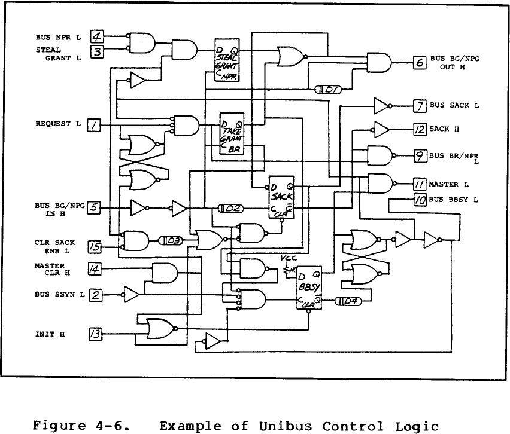

In the circuit description below, the following connections are assumed:

The following signals are connected to their respective Unibus signal lines:

- BUS NPR L
- BUS SACK L
- BUS REQUEST L
- BUS BBSY L
- BUS GRANT IN H
- BUS SSYN L
- BUS GRANT OUT H

<!-- Source PDF page 85 -->

The following signals are connected as described below:

- STEAL GRANT L
- INIT H
- REQUEST L
- SACK H
- CLR SACK ENB L
- MASTER L
- MASTER CLR H

REQUEST L, generated by the master device, is a signal which is asserted to initiate a priority transfer sequence. The latch which it is "ANDed" with is used to insure that only one priority transfer sequence is initiated for each assertion of REQUEST L. (Once the latch is set, REQUEST L must be negated and asserted again before another cycle may begin, provided that MASTER CLR H is not grounded.) If the device is not asserting BUS BBSY L (if it is not already the bus master), the D input to the TAKE GRANT flop will be asserted and one input to the BUS REQUEST L driver will be enabled.

BUS REQUEST L is asserted while the SACK flop is in the reset state at the same time that REQUEST L is asserted by the device. The device, therefore, cannot initiate a priority transfer sequence if it has already been granted the use of the bus (since both BUS BBSY L and BUS SACK L must be negated before BUS REQUEST L may be asserted) and it will negate BUS REQUEST L when it asserts BUS SACK L.

NOTE Paragraphs 3.2.2.2 and 3.2.2.4 specify that BUS SACK L shall be asserted at the driver input at the same time that, or before, BR or NPR is negated at its driver input. For discrete designs, the approved Unibus drivers (8881) have a maximum skew of 35 nanoseconds. Thus, if the assertion of BUS SACK L is skewed at the driver output no more than 35 nanoseconds from the negation of BUS REQUEST L, this timing requirement is met.

BUS BBSY is an input to the grant section circuit so that the state of BUS BBSY L determines whether or not the received BUS GRANT IN H will be passed or blocked; when an assertion of BUS GRANT IN H is received, while this device is asserting BUS BBSY L, it will be passed to another device of the same priority level as an assertion of BUS GRANT OUT H. Conversely, if the device is not asserting BUS BBSY L when an assertion of BUS GRANT IN H is received, it will be blocked from passing to another device; it intends to become the next bus master.

<!-- Source PDF page 86 -->

The TAKE GRANT and STEAL GRANT flops are clocked by the assertion of the BUS GRANT IN H. If the device is asserting BUS REQUEST L, the next assertion of BUS GRANT IN H will cause the TAKE GRANT flop to become set, or if STEAL GRANT L is asserted and some device is asserting BUS NPR L (while BBSY flop is reset), the STEAL GRANT flop will be set. Either flop being set disables an input to the BUS GRANT OUT driver, preventing the grant from being passed and enables the D input to the SACK flop. If the TAKE GRANT and SACK flops are set, one input to the clock of BBSY flop will be asserted.

If the device is not requesting the bus, REQUEST L from the previous grant has not been negated and reasserted, or if the device is already asserting BUS BBSY L, then the TAKE GRANT flop will be cleared by the next assertion of BUS GRANT IN H. If the STEAL GRANT flop is also cleared by the assertion of BUS GRANT IN H, then the grant will be passed as an assertion of BUS GRANT OUT H. The delay D1 at the input to the BUS GRANT OUT driver insures that the TAKE GRANT and STEAL GRANT flops have had time to settle before any grants are passed to the next device of the system.

The assertion of the BUS GRANT IN H is also used to clock the SACK flop. Delay D2 at the clock input of the SACK flop is used to insure that the TAKE GRANT and STEAL GRANT flops have had time to respond to the assertion of BUS GRANT IN H before the SACK flop is clocked. If either the TAKE GRANT or STEAL GRANT flops are set when the SACK flop is clocked, then the SACK flop will become set. When the SACK flop is set, BUS SACK L is asserted (which allows the arbitrator to negate the grant after a minimum of 75 nanoseconds delay), and BUS REQUEST L is negated. If the TAKE GRANT flop is set when the SACK flop is set, one input to the clock input of the BBSY flop is asserted. The SACK H output signal will also be asserted. It is available to the device as inversion of the BUS SACK L signal.

The SACK flop may be reset by asserting CLR SACK ENB L at the same time as BUS BBSY L is asserted and BUS GRANT IN H is negated. Delay D3 at the output of the BUS BBSY L and CLR SACK ENB L gate insures that the BUS INTR (external signal) which is driven by MASTER L signal is asserted before SACK flop is cleared. If SACK flop was set because the STEAL GRANT flop was set, the SACK flop may be reset as soon as BUS GRANT IN H is negated. While CLR SACK ENB L is negated, SACK flop will remain set. This keeps the arbitrator disabled and allows the device to assert BUS BBSY L and to perform data and/or interrupt transfers at will. The CLR SACK ENB L is typically grounded (asserted).

The BBSY flop will be set when the clock input conditions are satisfied; that is, TAKE GRANT and SACK flops are set and BUS GRANT IN H, BUS SSYN L and BUS BBSY L (not necessarily in this order) are all negated. BUS BBSY L is asserted when BBSY flop is set. The BUS BBSY L driver input is used to enable MASTER output, <!-- Source PDF page 87 --> to disable D inputs to TAKE GRANT and STEAL GRANT flops, and to allow the SACK flop to be cleared. MASTER L is a signal which may be used by the master device to initiate a data transfer or an interrupt sequence. The MASTER L signal is asserted when BUS BBSY L has been asserted and is negated before the negation of BUS BBSY L. Once BUS BBSY L has been asserted, the device has gained control of the Unibus and the data transfer or interrupt sequence may proceed. The MASTER L signal is available to drive external gatings; for example, it may be used to enable the appropriate data lines and BUS INTR in an interrupt sequence. When the requesting device has completed its transfer, it asserts MASTER CLR H. When both BUS SSYN L and MASTER CLR H are asserted (signifying that the transfer is completed), BBSY flop is reset and the latch on REQUEST L signal is returned to the state which disables the REQUEST L input to the chip. The MASTER L signal is negated as soon as BBSY flop is reset. Delay line D4, connected to Q output of the BBSY flop, insures that the negation of BUS BBSY L is delayed from the negation of MASTER L, which is used to drive BUS INTR. This delay is guaranteed to be at least 80 nanoseconds.

An assertion of INIT H signal will clear BBSY flop and SACK flop (provided that BUS GRANT IN H is negated).

This circuit has capability to improve the overall system NPR latency. If a device which has asserted STEAL GRANT L signal and it is not requesting the bus itself receives an assertion of BUS NPR L followed by a BG, it blocks the BG and asserts BUS SACK L. This grant was intended for a device farther down the bus at the same BR priority level. The arbitrator, upon receipt of the assertion of BUS SACK L, negates the BG and stops arbitrating. The negation of BUS GRANT IN H causes SACK to be reset (if TAKE GRANT flop is reset). This enables the arbitrator, which then grants an NPG in response to the assertion of NPR.

The NPR device may then use the data section of the bus before the BR device which has asserted its request first. Upon completion of all NPRs present and all higher priority BRs, the arbitrator will again issue a BG to the device that made the original request.

#### 4.8.3 BR Device (One Vector)

The circuit schematic shown in Figure 4-7 shows a Unibus interface for a device with one interrupt vector. This interface utilizes the Unibus control logic example (Figure 4-6; the original incorrectly says 4-5) described in Paragraph 4.8.2 and demonstrates how this can be used in a typical application. The circuit shows how the interrupt vector should be multiplexed with the device's data lines by multiplexing before the Unibus drivers, the total Unibus loading of the device can be significantly reduced. (Refer to Paragraph 4.3) Also shown are gating features. This insures that the device operates within the timing constraints specified in Paragraph 3.2.2.4 of this specification.

<!-- Source PDF page 88 -->

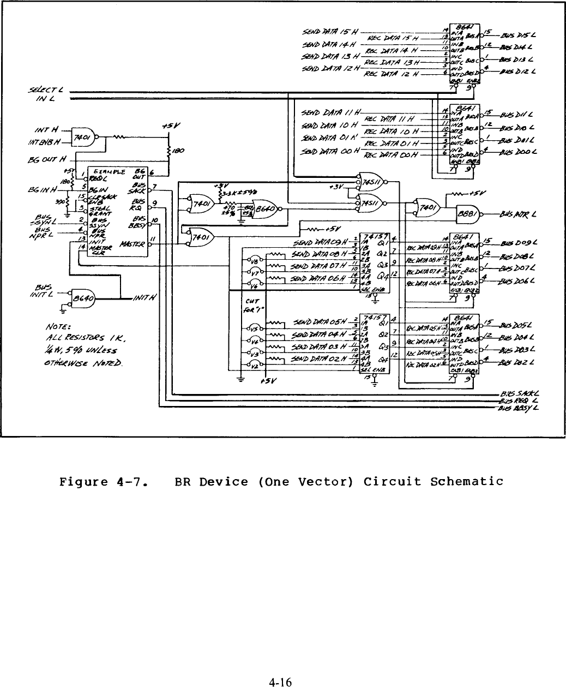

<!-- Source PDF page 89 -->

In this circuit, a bus request is initiated by the device whenever an interrupt is necessary. When the INT ENB H signal is asserted (INT ENB is normally a bit in the control and status register of the device) and INT H becomes enabled, the REQUEST L input of the circuit in Figure 4-6 is asserted, initiating a priority transfer sequence on the Unibus.

Some time later, when the device has been granted bus mastership (see Paragraph 4.8.2), the MASTER L signal is asserted. The interrupt sequence can now begin.

The device is not engaged in a data transfer as a slave, therefore, both REG SELECT L and IN L signals are negated and the Unibus transceivers associated with data lines (D<00:01> and D<10:15>) are disabled.

The outputs of the multiplexers (74157) assume the states of the corresponding "A" inputs, since the SEL inputs of the 74157s are disabled. The jumper-to-ground/resistor-pull-up arrangement allows the desired interrupt vector to be determined by cutting appropriate jumpers.

The assertion of MASTER L enables one input to BUS INTR L driver (8881) and activates SEL inputs of the multiplexers and ENB 2 lines of the transceivers which drive D<02:09>. After additional delay, the same assertion of MASTER L enables other input of BUS INTR driver and causes BUS INTR L to be asserted after the transceivers have been enabled. Thus, the interrupt vector is asserted before BUS INTR L is asserted in compliance with timing constraints specified in Paragraph 3.2.2.4 of this specification.

The processor, when it receives the assertion of BUS INTR L, strobes the vector from D lines and then issues a BUS SSYN L. When the device receives the assertion of BUS SSYN L (and since MASTER CLR H has been asserted), it will negate MASTER L and after a delay of at least 80 nanoseconds, BUS BBSY L. The negation of MASTER L terminates the vector and BUS INTR L signals. The use of Schottky-series logic insures that both BUS INTR L and D<02:09> have been negated within 80 nanoseconds of MASTER L negation; thus, all asserted lines have been negated when BUS BBSY L is negated. This insures that the termination of the interrupt sequence is in compliance with timing constraints specified in Paragraph 3.2.2.4 of this specification.

Note that the CLR SACK ENB L and STEAL GRANT L signals have been grounded (asserted). (See Paragraph 4.8.2.)

#### 4.8.4 BR Device (Two Vectors)

The circuit shown in Figure 4-8 shows a Unibus interface for a device which has two interrupt vectors. This circuit which utilizes two copies of the Unibus control logic example illustrates another typical BR application.

<!-- Source PDF page 90 -->

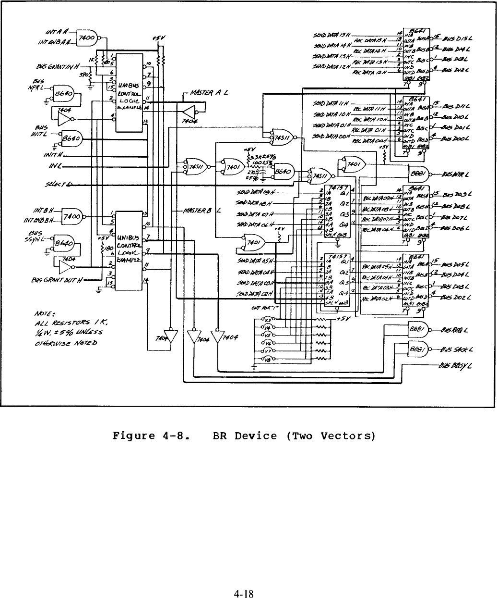

<!-- Source PDF page 91 -->

A typical application of this circuit might be a teletype controller where separate "send" and "receive" vectors would be useful. By using two complete circuits, an interrupt request for either vector may be initiated regardless of whether or not an interrupt sequence is in progress for the other vector.

Note that the two REQUEST L inputs have been driven by signals labelled "A" for top circuit and "B" for the bottom. The circuit driven by INT A H will be referred to as the "A" circuit and the other as the "B" circuit in the discussion which follows. The CLR SACK ENB L and STEAL GRANT L signals have been grounded on both A and B circuits.

The output of the MASTER L signal in circuit A is directly connected to DATA 2 input of the multiplexer so that two independent vectors may be implemented; vector XX0 and XX4 will be used by circuits A and B, respectively, where XX are determined by cutting appropriate jumpers on DATA 03 through DATA 08 lines.

An interrupt sequence is initiated by either circuit when the INT signal for that circuit is asserted while the INT ENB signal for that circuit is enabled. For example, when INT A H is asserted while INT ENB A H is enabled, a BR sequence will be initiated by circuit A. Note that the BUS GRANT IN H input of circuit A is connected to the Unibus, the BUS GRANT OUT H output of A is connected (with a pull-up resistor) to the BUS GRANT IN H input of B, and the BUS GRANT OUT H output of B drives the Unibus line of the same level. Thus, A and B form two links in the grant chain for whatever priority level is selected. Because the two circuits are daisy-chained in this fashion, they must both request at the same BR level.

Some time later, when the device has been granted bus mastership, the MASTER L output of one of the circuits will become asserted. The state of MASTER L is used to determine which vector is placed on the data lines during the interrupt sequence.

It is possible to have a dual BR application with two different BR levels used. When this is done the BUS BG IN, BUS BG OUT and BR levels must be the same for each circuit and cannot be connected to the other circuit's BUS BG IN, BUS BG OUT and BR level.

#### 4.8.5 NPR Device

The circuit shown in Figure 4-9 illustrates a typical NPR Unibus interface using the Unibus control logic example from Paragraph 4.8.2.

When an NPR transfer is required, NPR REQ L is asserted by the requesting device. The arbitrator recognizes this request and issues an NPG. The requesting device blocks the grant from passing through to the next device and acknowledges with a BUS SACK. The BUS SACK will allow the arbitrator to negate the grant and to stop <!-- Source PDF page 92 --> arbitrating.

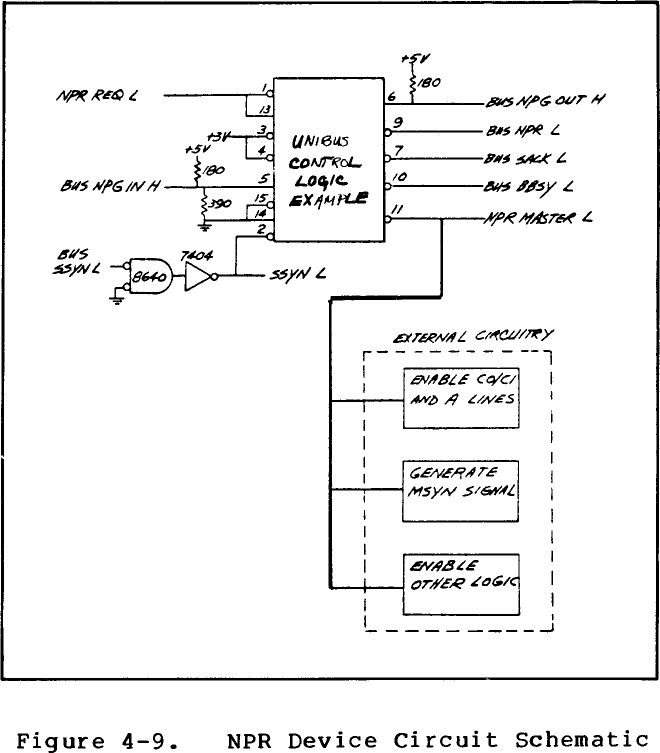

The requesting device after receiving the negations of BUS BBSY L, BUS SSYN L and BUS NPG H, asserts BUS BBSY L and becomes bus master and then starts data transfer(s).

The NPR MASTER L signal which is asserted at the same time as BUS BBSY L is asserted is used to drive external circuitry (not shown). For example, the NPR MASTER L can be used to enable the data and address lines and to generate MSYN L signal and other control logic. When the data transfer is completed, the bus mastership is terminated by negating the NPR REQ L signal. The NPR REQ L must be asserted again if another transfer is required. Note that NPR REQ L is directly connected to INIT H signal. Once the request is asserted, it must remain asserted until the data transfer is completed, otherwise bus mastership will be prematurely terminated.

Note that the STEAL GRANT circuit is disabled by connecting BUS NPR L and STEAL GRANT L to a logic "1" level. The Unibus control logic example has capability of preventing the negation of BUS SACK for devices that do more than one data cycle each time it becomes master. This is done by holding CLR SACK ENB L to logic "1" <!-- Source PDF page 93 --> until the beginning of the last bus cycle; for example, if 100 NPR data cycles are to be transferred, this signal should be held to a logic "1" until the completion of 99 data cycles. This insures that the bus will be given to the highest priority requesting device on the bus at the end of the 100 transfers. The CLR SACK ENB signal is grounded (asserted) so only one bus cycle is done for each request as shown in Figure 4-9.

An interrupt cannot be done by a device which becomes bus master under an NPG. In most NPR applications, the completion of the current set of NPRs is usually followed by an interrupt (now shown). This interrupt may be used to notify the processor that the NPR transfers have completed or an error has occurred during the data transfers.

<!-- Source PDF page 94 -->

## Section 5: Unibus Configuration

### 5.1 General

After the Unibus option configuration (based on NPR latency, physical location, etc.) is determined, these options must be interconnected using the correct procedure and techniques.

The definitions, rules, and guidelines outlined in this section are designed to aid you in configuring an electrically reliable Unibus. These rules and guidelines are intended for new systems and are not to be considered as a justification for any changes in existing systems, unless Unibus-related problems are encountered and cannot be resolved in any other way.

The configuration rules (Paragraph 5.3) ensure, with reasonable confidence, that Unibus segments will be electrically reliable, i.e., resulting dc bus levels will guarantee an adequate noise margin, and reflections from lumped loads will not be excessive.

To configure a Unibus system, the required order of options on the Unibus, based on NPR latency, physical location, etc., should first be determined. The rules will then determine the length of the Unibus cable interconnecting the options and the number and location of bus repeaters. If the number of bus repeaters is excessive, total cable length can sometimes be reduced by rearranging the order of options on the bus (again, paying close attention to NPR latency, etc.) Then, after reapplying the rules in this guide, one or more bus repeaters may be eliminated or located further down the bus to optimize system speed. For large systems, more than one pass of this procedure may be necessary to achieve satisfactory results.

A reasonable effort should always be made to ensure that the total cable length is as short as possible, particularly if one or more bus repeaters can be eliminated in the process. Bus repeaters are costly and slow down the system. Before implementing configuration rules, the user should carefully read and understand the definitions that follow.

### 5.2 Unibus Definitions

Prior to configuring the Unibus, review the definitions outlined in Paragraphs 5.2.1 through 5.2.9.

<!-- Source PDF page 95 -->

#### 5.2.1 Bus Segment

The bus segment is defined as that portion of a Unibus system between and including two terminators. A bus segment consists of a terminator, a 120-ohm transmission path (cable) with options containing drivers and receivers attached to it, and another terminator in that order. A single bus system is one which has one bus segment. A multiple bus system is one which has more than one bus segment, usually separated by bus repeaters (DB11s) or bus switches (DT03s which contain bus repeaters).

#### 5.2.2 Bus Cable

A bus cable is defined as cable connecting two backplanes which acts as a 120-ohm transmission line with a length of two feet or more. A BC11A cable is defined to be both a cable and a bus element. For our purposes, the cable is a subset of the bus element and should be treated as such. The following bus elements are Unibus cables:

| Element  | Description                 | Metric length as printed |
| -------- | --------------------------- | ------------------------ |
| BC11A-2  | 2-foot Unibus cable         | 60.96 cm                 |
| BC11A-3  | 3-foot Unibus cable         | 91.44 cm                 |
| BC11A-5  | 5-foot Unibus cable         | 1.52 m                   |
| BC11A-6  | 6-foot Unibus cable         | 1.82 m                   |
| BC11A-8F | 8.5-foot Unibus cable       | 2.59 m                   |
| BC11A-10 | 10-foot Unibus cable        | 3.04 m                   |
| BC11A-15 | 15-foot Unibus cable        | 4.57 m                   |
| BC11A-20 | 20-foot Unibus cable        | 6.07 m                   |
| BC11A-25 | 25-foot Unibus cable        | 8.60 m                   |
| BC11A-30 | 30-foot Unibus cable        | 9.14 m                   |
| M9202    | 24-inch folded Unibus cable | 60.96 m [sic]            |

> Source note: PDF page 95 prints 6.07 m, 8.60 m, and 60.96 m in the last rows. These appear to be source errors: 20 ft = 6.096 m, 25 ft = 7.62 m, and 24 in. = 60.96 cm.

The M9207 is considered to be a cable (for the purpose of this specification) because it contains two feet of 120-ohm cable.

#### 5.2.3 Bus Element

A bus element is defined as any module, backplane, cable, or group of these items that has a common designation with a direct electrical connection to one or more Unibus signal lines (other than AC LO L or DC LO L). For example, an M930 terminator, an M7821 module, a DD11 backplane, a BC11 cable, and an RK11 controller are Unibus elements. An H720 power supply, an LA36 DECwriter, and a BA11 expander box are not Unibus elements.

#### 5.2.4 Lumped Load

A lumped load is defined as a group of Unibus elements, other than cables or jumpers, which are interconnected via Unibus jumpers and direct wiring (backplane wire, PC etch) only. The group is not a lumped load if it uses a Unibus cable to interconnect the Unibus elements or if the elements are separated by a bus repeater. (Be certain the difference between "jumper" and "cable" is understood.) (Refer to Figures 5-1 and 5-2).

<!-- Source PDF page 96 -->

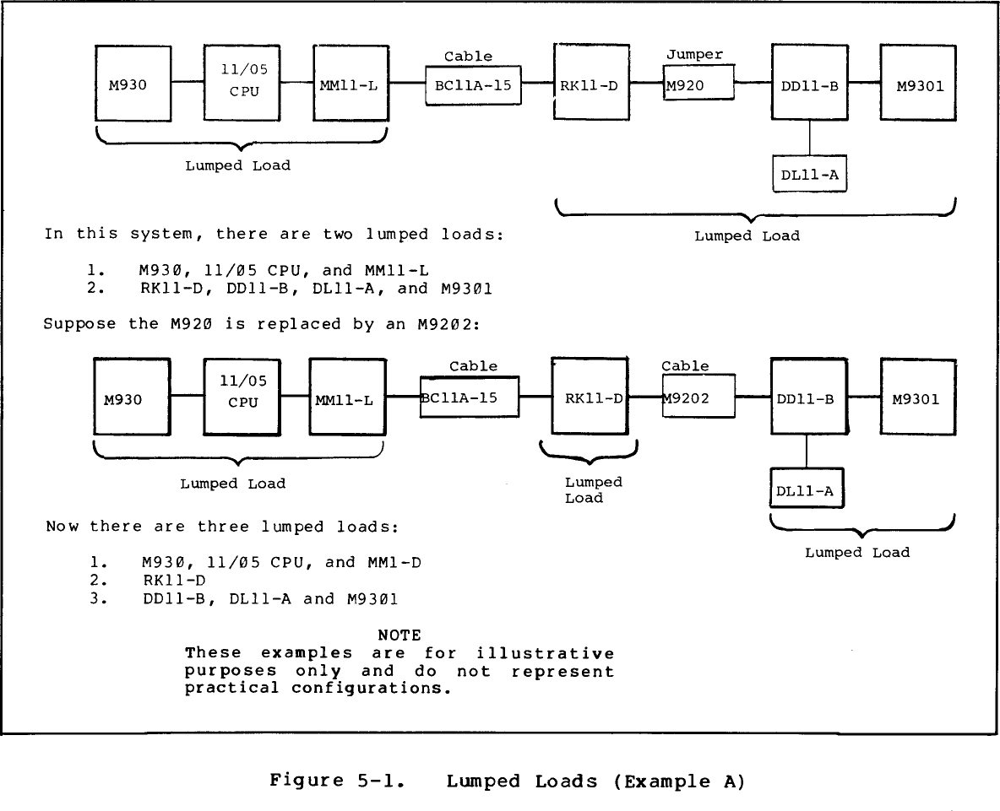

<!-- Source PDF page 97 -->

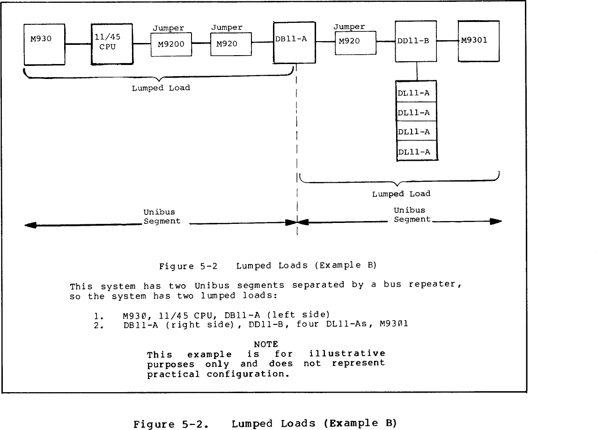

<!-- Source PDF page 98 -->

#### 5.2.5 Bus Terminator

A bus terminator is defined as a Unibus element or part of an element containing a resistive network which connects to the end of a Unibus segment and matches the 120-ohm characteristic impedance of the Unibus transmission path. The M930 and M9306 are Unibus terminators if they connect to the Unibus. The following bus elements contain Unibus terminators:

| Element   | Description                               |
| --------- | ----------------------------------------- |
| M981      | Jumper/terminator                         |
| M9300     | Unibus B terminator (M930 + NPR logic)    |
| M9301     | Bootstrap/terminator                      |
| M9302     | M930 with SACK return                     |
| DT03      | Bus switch                                |
| DB11-A    | Bus repeater                              |
| PDP-11/04 | CPU (other CPUs also contain terminators) |

A Unibus segment must always have a Unibus terminator at each end of its 120-ohm transmission path.

#### 5.2.6 Semi-Lumped Load

A semi-lumped load is defined as a group of lumped loads interconnected by 91.44 cm (3 ft) or less of cable (M9202, BC11-2 or BC11-3) and not separated by a bus repeater. (Refer to Figure 5-3.)

#### 5.2.7 AC Unit Load

An ac unit load is defined as a number related to the impedance that a Unibus element presents to a Unibus signal line (due to backplane wiring, PC etch runs, receiver input loading, and driver output loading). This impedance load on a transmission line causes a “reflection” to occur when a step is sent down the line. This reflection shows up on an oscilloscope as a spike occurring shortly after asserting or unasserting edge. Nine lumped ac loads reflect 20 percent, and 20 lumped ac loads reflect 40 percent of a 25 ns risetime step.

AC loads must be distributed on the Unibus in the manner described by the rules in this section to provide bus operation with reflections guaranteed to be at or less than a tolerable level.

The ac unit load rating of Unibus elements is usually based on the greatest of the mismatches that the element presents to the BBSY, SSYN, and MSYN Unibus signal lines.

#### 5.2.8 DC Unit Load

A dc unit load is defined as a number related to the amount of dc leakage current that a Unibus element presents to a Unibus signal line which is high (undriven). A dc unit load is nominally 105 uA (80 uA - receiver, plus 25 uA - driver). However, the dc unit load rating of a bus element is not strictly based on the element's signal line that has the greatest leakage, (e.g., dc leakage is less important on D lines than it is on SSYN).

<!-- Source PDF page 99 -->

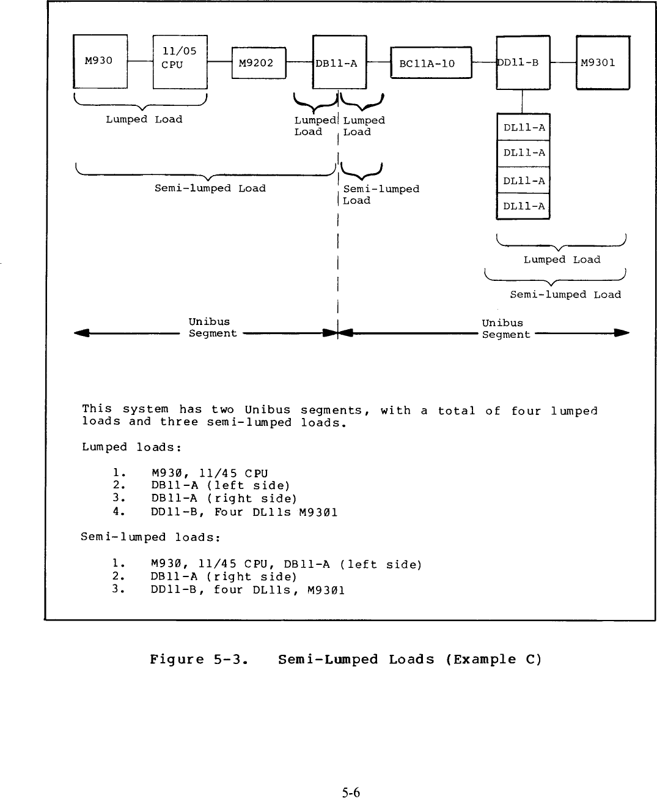

<!-- Source PDF page 100 -->

#### 5.2.9 Unibus Length And Loading

The Unibus is a transmission line on which data transfers are delay-asynchronous and interlocked. Unnecessarily long Unibus cables can cause electrical problems that affect system operation.

With ribbon cable, the maximum length is 15.24 m (50 ft). Tap and stub lengths should be minimized. Unibus receivers and transmitters should be located together, near the Unibus cable, to buffer the cable from signal lines within the equipment. Individual taps, including printed-circuit etches, should be less than 5.08 cm (2 in.) long, and loading should not exceed one standard bus load. One bus load consists of one transmitter and one receiver.

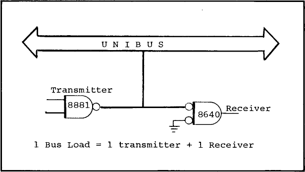

The Unibus is limited to a maximum of 20 bus loads to maintain a sufficient noise margin. For more than 20 loads, use a Unibus repeater option (DB11-A).

### 5.3 Unibus Configuration Rules

The following rules and guidelines are intended to be used for new systems and/or existing systems that experience Unibus problems. The seven rules are listed below for quick reference. A more detailed description, comments, and suggestions are described in the following paragraphs.

Rule No. 1 (Maximum cable length) - The total length of Unibus cable in a Unibus segment should not exceed 15.24 m (50 ft).

Rule No. 2 (Maximum dc loading) - The total number of dc unit loads on a Unibus signal line should not exceed 20.

Rule No. 3 (Maximum lumped loading) - No lumped load on a Unibus segment should contain more than 20 ac unit loads unless the entire segment consists of one lumped load.

<!-- Source PDF page 101 -->

Rule No. 4 (Skewed cable lengths) - If (a) a lumped load (called the “affected lumped load") has 2.59 m (8.5 ft) or longer cables connected to both bus in and bus out and (b) the sum of the ac unit loads in the two lumped loads connected to the opposite ends of the cables exceeds 18, or (c) the sum of the ac unit loads in the two semi-lumped loads connected to the opposite ends of the cables exceeds 36, then the lengths of these cables should differ by 1.52m (5 ft) or more with the longer cable being on the end with the greatest number of ac unit loads (if there is a practical choice).

Rule No. 5 (Skewed cable lengths, supplement) - If the length of one of the cables connected to the affected lumped load in Rule No. 4 must be increased because of that rule, then the longer cable should have at its opposite end, the semi-lumped load with the greater number of ac unit loads. This rule should be implemented only if it is practical to do so, i.e., in cases where its implementation will not increase total cable length more than 1.52 m (5 ft).

Rule No. 6 (Violation of Rules No. 1 through No. 5) - Rules No. 1 through No. 5 should not be grossly violated. If a bus segment violates a rule slightly, and for practical reasons reconfiguring is undesirable, then the segment must pass voltage-margin tests (a) when the system is originally configured and (b) when any Unibus element is added, deleted, or swapped (including the swapping of a defective module or backplane).

Rule No. 7 (System acceptance) - Even if Rules No. 1 through No. 5 are implemented, all Unibus segments of a system should be voltage margined after the system is configured.

#### 5.3.1 Maximum Cable Length (Rule No. 1)

If Rule No. 1 is violated, (a) the dc drop across the bus, when driven at one end and received at the other, may be excessive, and (b) far-end crosstalk may be excessive. In calculating lengths, the M920 should be considered as zero feet, the M9202 as 60.96 cm (2 ft), and the BC11A-0 as 15.24 cm (6 in.).

If the length of a segment exceeds 15.24 m (50 ft) reconfiguring (changing the order of bus elements) may reduce the length. If that fails, a DB11-A bus repeater will be necessary.

> Source note: PDF page 101 prints “15.24cm (50 ft)”; the unit is corrected to metres here, consistent with Rule No. 1.

#### 5.3.2 Maximum DC Loading (Rule No. 2)

If too many dc loads are put on a Unibus segment, the quiescent undriven voltage may be lowered to a level where bus receivers become susceptible to reflections from lumped loads and the overall noise margin on the high end (bus undriven) may become too small. DB11 bus repeaters should be used (as required) to implement this rule.

#### 5.3.3 Maximum Lumped Loading (Rule No. 3)

If a lumped load is too large, it may generate a reflection on the Unibus large enough to create a false logic signal and cause a <!-- Source PDF page 102 --> failure. Refer to Paragraph 5.3.4, Rule No. 3 Violation (Block Diagram) and Paragraph 5.3.5, Rule No. 3 Violation (Waveform Example). M9202 folded cables (or BC11A-2s, if M9202 is unavailable) should be used in place of M920s to separate large lumped loads. The effect of the M9202 is to cause the peak reflections from the lumped loads it separates to occur at slightly different times. The implementation of Rule No. 3 is illustrated in Paragraph 5.3.6, Rule No. 3 Implementation, (Block Diagram) and Paragraph 5.3.7, Rule No. 3 Implementation (Waveform Example).

Rule No. 3 states that there is a limit to the number of ac unit loads on a Unibus segment unless the entire segment consists of one lumped load. The reason for this statement is that there is no 120-ohm cable in the segment on which reflections can travel. An example of this paragraph is shown in Paragraph 5.3.8, Multiple Bus System.

#### 5.3.4 Rule No. 3 Violation (Block Diagram)

The system shown in the sketch below violates Rule No. 3. When the driver on the affected bus element unasserts the bus, the receiver in that element will see the waveform as shown in Paragraph 5.3.5.

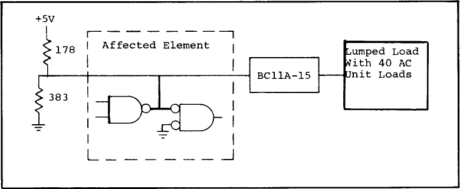

#### 5.3.5 Rule No. 3 Violation (Waveform Example)

The reflection may cause the threshold of the 8640 receiver to be crossed a second time, and a failure may result.

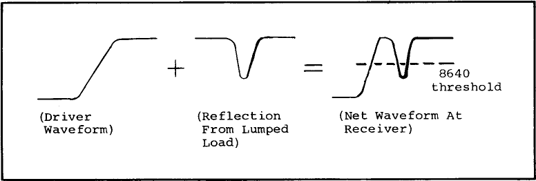

<!-- Source PDF page 103 -->

#### 5.3.6 Rule No. 3 Implementation (Block Diagram)

To implement Rule No. 3, the lumped load must be split into two equal loads by adding an M9202 in place of an M920.

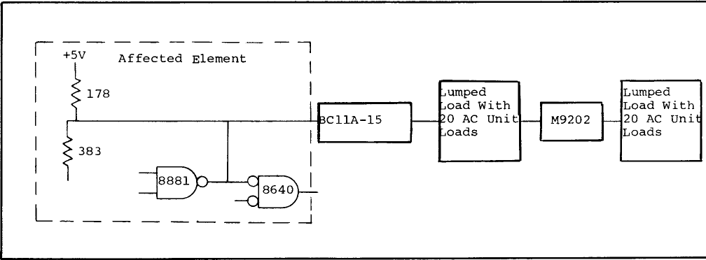

#### 5.3.7 Rule No. 3 Implementation (Waveform Example)

The conditions to satisfy Rule No. 3 are now implemented. When the driver in the affected bus element unasserts the bus, the receiver in that element will see the following waveform.

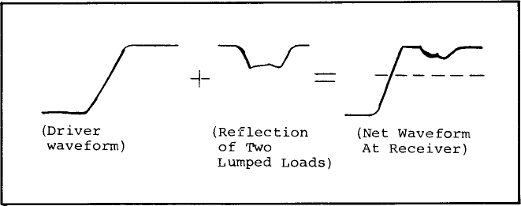

Now the 8640 threshold is not crossed and the danger of a failure is reduced.

<!-- Source PDF page 104 -->

#### 5.3.8 Multiple Bus System (Example)

The segment shown in the sketch below obeys all configuration rules. It has zero (0) feet of cable, 20 dc unit loads, and an irrelevant number of ac loads. In this configuration, none of the M920s have to be replaced by M9202s.

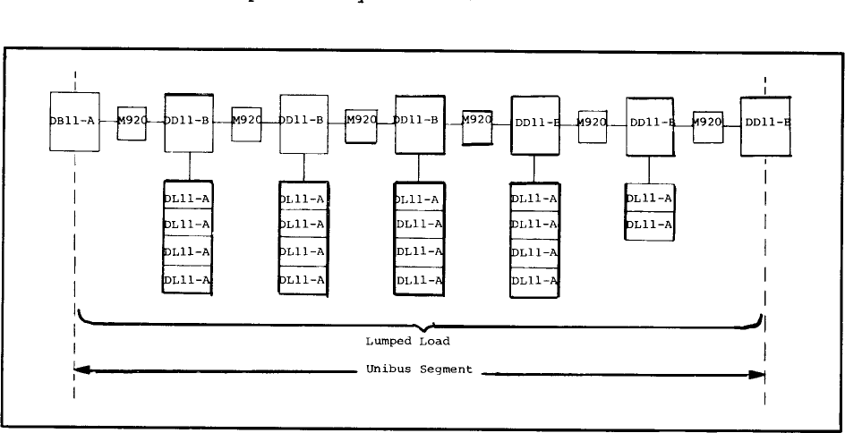

#### 5.3.9 Skewed Cable Lengths (Rule No. 4)

There may be several ways to implement Rule No. 4. Consider the following bus segment.

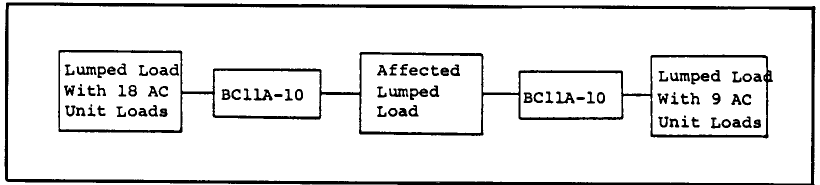

This segment violates Rule No. 4 because the sum of the lumped loads that are connected to the opposite ends of the cables exceed 18 unit loads. AC unit loads equal 27 (18 + 9 = 27) lumped at the ends of the BC11As of equal length.

When this rule is violated and when a driver in the affected lumped load unasserts the bus, reflections from the ends of its bus in and bus out cables will arrive at the affected lumped load simultaneously and superimpose. The net reflection may cross the 8640 threshold and cause a failure as shown in the following waveform.

<!-- Source PDF page 105 -->

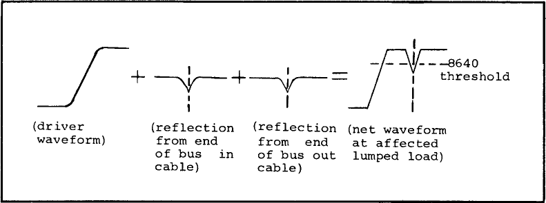

One method to implement Rule No. 4 is to increase the length of one cable to 4.57 m (15 ft) as shown in Paragraph 5.3.10, Rule No. 4 Implementation (Example A), Block Diagram and another method is to shift the lumped load on the left into two lumped loads using an M9202 as shown in Paragraph 5.3.11, Rule No. 4 Implementation (Example B), Block Diagram. When this rule is implemented by making the lengths of the bus in and bus out cables different, the reflections will arrive at slightly different times as shown in Paragraph 5.3.12, Rule No. 4 Implementation, (Waveform Example). The reflection does not cross the 8640 threshold and the danger of a failure is reduced.

The configuration in Paragraph 5.3.11 does not violate Rule No. 4 because the sum of the ac unit loads lumped at the ends of the BC11A-10 cables is 18 (9 + 9 = 18) and the sum of the ac unit loads in the semi-lumped loads at the BC11A-10's ends of the cables is 9 plus the lumped loads (18) for a total of 27 unit loads (9 + 18 = 27).

The methods shown in Paragraphs 5.3.10 and 5.3.11 could be used to implement Rule No. 4 but the method in Paragraph 5.3.11 is more desirable because it minimizes the total cable length of the segment.

#### 5.3.10 Rule No. 4 Implementation (Example A)

The following sketch illustrates this rule.

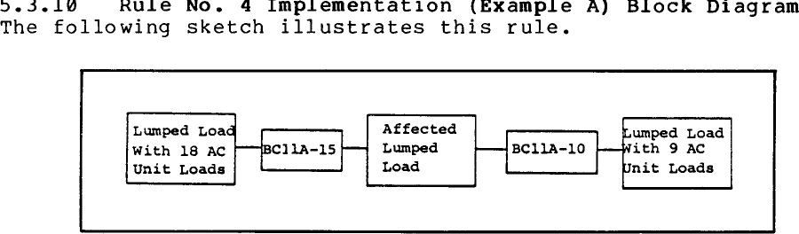

<!-- Source PDF page 106 -->

#### 5.3.11 Rule No. 4 Implementation (Example B)

The following diagram illustrates this rule.

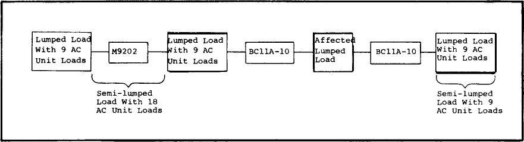

#### 5.3.12 Rule No. 4 Implementation (Waveform Example)

The following waveform is an example of this rule.

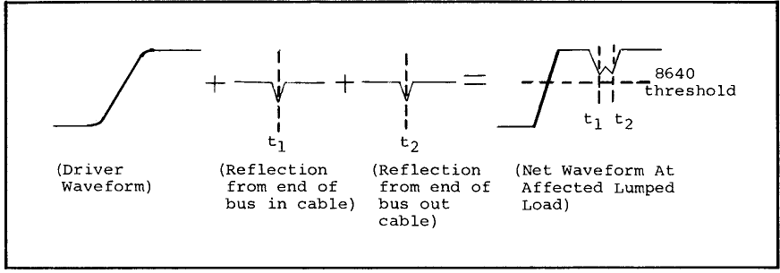

#### 5.3.13 Skewed Cable Lengths, Supplement (Rule No. 5)

To understand why this rule is necessary, consider the example in Paragraph 5.3.14, Skewed Cable Length Violation Example.

Suppose that the length of Cable No. 1 equals the length of Cable No. 2. This violates Rule No. 4. In this case, the affected lumped load will see the waveform shown in Paragraph 5.3.15, Skewed Cable Length Violation, Waveform Example, when its driver unasserts the bus.

The reflection in this waveform crosses the 8640 threshold and may cause a failure. The best way to implement Rule No. 4 in this example is to increase the length of either Cable No. 1 or Cable No. 2 by 1.52 m (5 ft). Suppose the length of Cable No. 2 is increased by 1.52m (5 ft). (This violates Rule No. 5 because this is the end with the smaller lumped load.) In this case, the affected lumped load will see the waveform as shown in Paragraph 5.3.16, Violation of Rule No. 5, Waveform Example, when its driver unasserts the bus.

<!-- Source PDF page 107 -->

The reflection in this waveform also crosses the 8640 threshold and may cause a failure.

Now suppose the length of Cable No. 1 is increased by 1.52m (5 ft) instead of Cable No. 2. This will implement Rule No. 5 correctly. In this case, the affected lumped load will see the waveform as shown in Paragraph 5.3.17, Rule No. 5 Implementation, Waveform Example when its driver unasserts the bus. The reflection from the ends of Cables No. 1 and No. 2 do superimpose somewhat, but not much. As a result, the 8640 threshold is not crossed.

#### 5.3.14 Skewed Cable Length Violation (Example)

The following block diagram is an example of this violation.

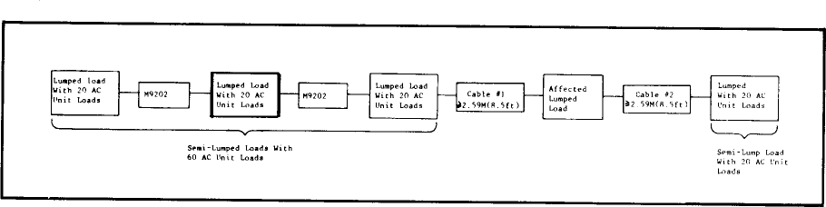

#### 5.3.15 Skewed Cable Length Violation (Waveform Example)

The following waveform is an example of this violation.

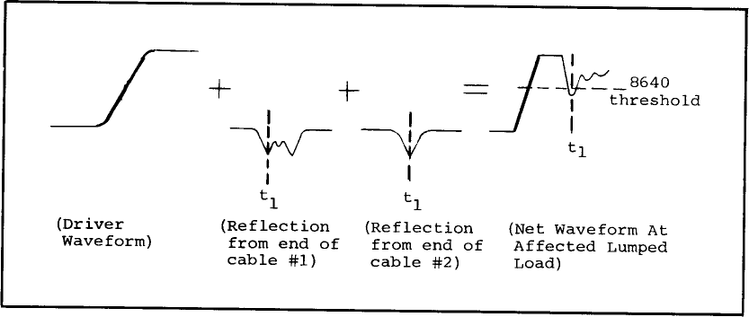

<!-- Source PDF page 108 -->

#### 5.3.16 Violation Of Rule No. 5 (Waveform Example)

The following waveform is an example of this violation.

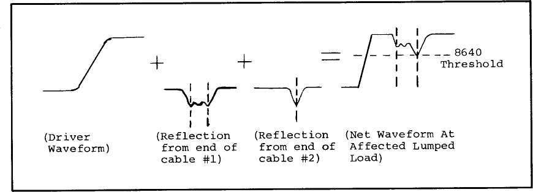

#### 5.3.17 Rule No. 5 Implementation (Waveform Example)

The following waveform is an example of this implementation.

#### 5.3.18 Rule Violation (Rule No. 6)

Rules No. 1 through No. 5 should be implemented if possible. On rare occasions it may not be practical to do so. For example, the last bus segment on a system may exceed the 15.24 m (50 ft) maximum length rule by 1.52m (5 ft), and implementing Rule No. 1 may require another DB11-A repeater, which may require another BA11-ES expander box, which may require another H969 cabinet. In this case, it is acceptable to violate Rule No. 1, providing that the system is tagged so that Rule No. 6 is always followed when the system undergoes change or corrective maintenance. Common sense has to be exercised if any of Rules No. 1 through No. 5 are violated.

<!-- Source PDF page 109 -->

#### 5.3.19 System Acceptance (Rule No. 7)

On rare occasions, Rules No. 1 through No. 5 may not be sufficient to eliminate all reflection problems. On these occasions, a field service support group should be called. The solution may be to replace an additional M920 in those surrounding options with an M9202 (or even a BC11A-3) to further spread out and reduce reflections.

<!-- Source PDF page 110 -->

## Appendix A: Glossary Of Unibus Terms

### A Lines

(See "Address Lines".)

### AC LO

The assertion of AC LO informs Unibus devices that a device may shortly lose power to its drivers and receivers, and thus may make the Unibus non operable.

The negation of AC LO informs the processor and the arbitrator that all power supplies to bus drivers and receivers are able to provide enough power for operation to resume (includes time for power-up/power-down sequence, if needed).

AC LO is transmitted on a Type-3 line.

### Access Time

The time interval, measured at the bus terminals of a slave, between receipt of assertion of MSYN and the assertion of SSYN.

### Active Release

Release of the bus (by negating BBSY) by a device which has caused an interrupt.

(See “Passive Release.")

### Address

A number which specifies a location (a register or a word or byte of memory) whose contents are to be transmitted in a Unibus data transaction. The address is the name of the location.

An address is transmitted on the Unibus as an 18-bit binary number.

### Address Lines (A lines)

Transmission medium used on the Unibus for an address represented as an 18 bit binary number.

A lines are Type-1 lines.

<!-- Source PDF page 111 -->

### Arbitration Network

(See "Priority Arbitration Network.")

### Arbitrator

(See "Priority Arbitration Network.")

### Assert

To put a signal in a logically true state.

### Assertion

The transition of a signal to the logically true state.

### Asynchronous (event)

An event logically related to, but having no fixed timing relationship to another event.

### BBSY (Bus Busy)

A signal asserted by a bus master.

The assertion of BBSY informs all devices on the Unibus that a master exists. No device may use the data section of the bus or assert BBSY while another device is asserting BBSY.

The negation of BBSY means that no master exists.

BBSY is transmitted on a Type-1 line.

### BG4, BG5, BG6, BG7 (Bus Grant n)

In response to BRn, the arbitrator asserts BGn. The first device on the BGn line that is asserting BRn is designated as the next bus master.

The arbitrator negates BGn to acknowledge receipt of the assertion of SACK by the device that has been designated as next bus master.

("BRn" and "BGn" are abbreviations used to designate the particular BR or BG line to which a device is connected).

BGs are transmitted on Type-2 lines.

### Binary

Pertaining to a number system with a radix of 2.

<!-- Source PDF page 112 -->

### Binary Digit

(1) One of the two states (0 or 1) of the binary number system. Usually referred to as a "bit."

(2) A character used to represent one of the two non-negative integers in binary notation, i.e., 0 or 1. Usually referred to as a "bit."

### Bit

A shortened form of "binary digit."

### Bit Position

A number that defines the relative position of a bit in a word or byte.

The least significant bit is defined as bit 0 in this specification.

### Block

A group of words located at sequential addresses.

### Block Transfer

Transfer of several words of data from/to sequential addresses.

Can be performed on the Unibus by either a series of single transfers or by a multiple transfer.

(See “Data Transfer.")

### BR4, BR5, BR6, BR7 (Bus Request n)

(1) Four signals, requesting the use of the bus on different priority levels, sent to the arbitrator by devices that require the use of the data section of the Unibus for the purposes of executing data transfers, an interrupt transaction, or both.

BR4 has the lowest priority, and BR7 the highest.

BRs are transmitted on Type-1 lines.

(2) Terms sometimes used instead of "Priority Level 4," "Priority Level 5," "Priority Level 6," and "Priority Level 7."

To avoid confusion, the terms "BR4," "BR5," "BR6," and "BR7" are not used in this specification to designate priority levels.

<!-- Source PDF page 113 -->

### Buffer (register)

Temporary storage.

### Bus

A transmission medium that interconnects the various parts of a computing system.

This term, as used in this specification, is synonymous with "Unibus.”

### Bus Busy

(See "BBSY.")

### Bus Cycle

The transfer of one word of data between a master and a slave. A bus cycle starts when the master puts the address and control bits on the A and C lines, and normally ends when the master removes these bits from the A and C lines.

Between a DATIP and a DATO or DATOB, the C lines must change, while the A lines may or may not change. In this case, the C lines delimit the two bus cycles.

### (Bus) Device

A unit of the computing system that is connected to the Unibus.

### (Bus) Driver

A circuit used by a bus device to transmit signals to the Unibus.

### Bus Grant

(See "BG4, BG5, BG6, BG7." See also "Grant.")

### Bus Load

A maximum of one driver and one receiver, or one transceiver. The Unibus is limited to a maximum of 20 line loads.

### (Bus) Master

(1) A device or a processor that is currently permitted to use the data section of the Unibus.

(2) A device which is asserting BBSY.

<!-- Source PDF page 114 -->

### (Bus) Receiver

(1) A circuit used by a device to receive signals from the Unibus.

(2) A circuit whose input is a Unibus signal and whose output is a standard logic signal.

### (Bus) Repeater

A device used to interconnect two segments of a multi-segment Unibus system. A repeater receives the signals from one segment and retransmits them on the other segment.

### Bus Request

(See "BR4, BR5, BR6, BR7." See also "Request.")

### (Bus) Segment

That portion of a Unibus system between two terminators. A system may consist of one or more segments. The number of devices that may be connected to a segment is limited, as is the length of its cable.

### (Bus) Slave

The device that communicates with the bus master.

### Bus Terminals

The bus terminals of a device are the outputs of its bus receiver(s) and the input(s) to its bus driver(s).

### (Bus) Terminator

A resistive or resistive-capacitive network at both ends of a continuous Unibus cable whose values are chosen to match the characteristic impedance of the cable.

### (Bus) Transaction

The sequence of signals which complete a logical unit of activity on the Unibus. For example, an interrupt transaction includes the sequence of signals which result in interrupting the processor.

### (Bus) Transceiver

A circuit containing a bus driver and a bus receiver.

<!-- Source PDF page 115 -->

### (Bus) Transmitter

(See “(Bus) Driver.")

### Byte

A group of eight binary digits that may be operated upon as a unit; a half word. (See "high-order byte" and “low-order byte.")

### C Lines

(See "Control Lines.")

### Clear

To ensure that a storage element contains 0.

### Clock

(1) A device that generates regular periodic signals.

(2) The periodic signals generated by a clock.

### Clock (verb)

To cause the transfer of information from the input to the output of a flip-flop.

### Control and Status Register (CSR)

A device register that contains information needed to communicate with the device. Such information may include device function, condition bits, done bit, enable bit, and error bits.

### Control Lines (C lines)

Unibus transmission medium used by a master to indicate to a slave which type of data transfer operation is required,

The C lines are Type-1 lines.

### Controller

Interface which allows a device to be attached to the Unibus and to be manipulated by Unibus transactions.

### Core Memory

A read/write random access memory using ferrite cores as storage elements.

<!-- Source PDF page 116 -->

### CP, CPU

(See "Processor.")

### Crosstalk

Electromagnetic or electrostatic coupling from one signal to another, due to physical closeness. Crosstalk is usually unwanted but unavoidable.

### CSR

(See "Control and Status Register.")

### D Lines

(See "Data Lines.")

### Data

Elements of information which can be processed or produced by a computer.

### Data Buffer Register

A register used within a device for temporary storage of data that is to be transferred into or out of a processor or other device.

### Data Lines (D lines)

Transmission medium used on the Unibus for the 16 data bits being transferred between the master and the slave devices.

The D lines are Type-1 lines.

### (Data) Transfer

The transmission of data from one device to another.

### DATI

Contraction of "data-in."

Transaction involving transfer of one word of data from slave to master.

### DATIP

Contraction of "data-in, pause."

Transaction involving transfer of one word of data from slave to master; the restore cycle is inhibited in destructive readout devices, since the DATIP must be followed by DATO or a DATOB to the same location.

<!-- Source PDF page 117 -->

### DATO

Contraction of "data-out."

Transaction involving transfer of one word of data from master to slave.

### DATOB

Contraction of “data-out, byte."

Transaction involving transfer of one byte of data from master to slave.

### DC LO

The assertion of DC LO informs bus devices that power to a device's drivers and receivers may be about to fail, thus making the Unibus non operable.

The negation of DC LO informs the receiving devices that power to all device drivers and receivers is within specifications.

### Dedicated Line

A signal path used for only one purpose.

### Delay

(1) The time required for a signal to pass through a circuit.

(2) A delay circuit.

### Delay Circuit

A circuit which deliberately introduces a delay in the propagation of a signal.

### Deskew

To introduce a delay in a circuit to compensate for skew.

### Deskew Time

The delay introduced into a circuit to compensate for skew.

### Device

(See "(Bus) Device.")

<!-- Source PDF page 118 -->

### Device Register

A register accessed via a Unibus address.

### Direct Memory Access (DMA)

Term inappropriate for the Unibus. In other systems, refers to the capability of transfer of data between memory and a device without program intervention on a word-by-word basis. (See "Non-Processor Transfer.")

### Disable

To render inoperative or to prevent from being used. Normally used with reference to hardware as opposed to "inhibit," which normally refers to signals.

### DMA

Direct memory access.

### Driver

(See "(Bus) Driver.")

### Enable

To set up conditions so that a specific device, circuit, or signal can be used.

### Flag

A storage element used to retain control information for future reference.

### Flow Chart

A graphical representation of the sequence of operations required to carry out a process.

### Grant

Generic term used for NPG as well as for BG7, BG6, BG5, and BG4. The term “Bus Grant" is used in this specification only in reference to BG7, BG6, BG5 and BG 4,

### High-Order Byte

The byte occupying bit positions 8 through 15 in a word. Bit A00 of the address of a high order byte is 1.

(See "Low-Order Byte.")

<!-- Source PDF page 119 -->

### Inhibit

The process of one signal preventing another from appearing at the output of a logic element.

### INIT (Initialize)

A Unibus signal received by all devices except processors. Its purpose is to stop all bus operations, and to put all devices in a known, well defined state.

### Initialize

To set storage elements to zero or to other starting values.

### Interface

(See "(Unibus) Interface.")

### Interlocked

A transaction in which a control signal transmitted by the initiator is positively acknowledged by the receiver of that signal.

### Interrupt

(1) Entry into a sub-program, triggered by an interrupt transaction from the Unibus.

(2) A signal to a computer that stops the execution of an ongoing program while a higher priority program is executed; also, a circuit that conveys such a signal (from “Webster's New Collegiate Dictionary).

### Interrupt Fielding Processor

(See "Processor, Interrupt Fielding.")

### Interrupt Transaction

A bus cycle during which an interrupt vector is transmitted to the processor.

### Interrupt Vector

A data word transferred by a device during an interrupt transaction.

Used by PDP-11s to point to memory locations containing new program counter and processor status word values.

<!-- Source PDF page 120 -->

### INTR (Interrupt)

Asserted by an interrupting device, after it becomes bus master, to inform the processor that an interrupt is to be performed, and that the interrupt vector is present on the D line.

### Latency

(1) LATENCY is the delay between the time that a device initiates a transaction and the time that it receives a response,

Thus, if a device requests the use of the data section of the bus, is granted the use of the bus, and then receives the negation of BBSY (signifying that the previous master has released the data section of the bus), then latency is the delay between the assertion of the request and the receipt of the negation of BBSY by the requesting device.

(2) MAXIMUM TOLERABLE NPR DATA TRANSFER LATENCY is the longest time that a device may be refused bus mastership before it loses data. It affects only devices that transfer data in a constant stream, e.g., a disk.

(3) MAXIMUM TOLERABLE BR INTERRUPT LATENCY is the longest time the computer may take to service an interrupt before the requesting device loses its data. The service time includes the execution of all higher priority interrupts and programs that may be pending, plus the time spent in the interrupt subroutine of the device in question.

### Least Significant Bit (LSB)

Bit 0 on the Unibus; the rightmost bit in a word or byte; represents the base 2 to the 0 power binary position.

(See "Word", "Most Significant Bit.")

### Line

A transmission medium. (See “Type-1 line," "Type-2 line," "Type-3 line.")

### Location

A word or byte of memory or a register. The address is the name of a location.

<!-- Source PDF page 121 -->

### Low-Order Byte

The byte occupying bit positions 0 through 7 in a word. Bit A00 of the address of a low order byte is 0. (See “High-Order Byte.")

### LSB

(See “Least Significant Bit.")

### Main Memory

A device which may be accessed directly by a Unibus cycle, in which programs and data can be stored and from which they can be retrieved.

### Master

(See "(Bus) Master.")

### Master Sync

(See "MSYN.")

### Memory

A device in which programs and data can be stored and from which they can be retrieved.

### Memory, Main

(See "Main Memory.")

### Most Significant Bit (MSB)

The leftmost bit in a number.

Represents the 2 to the 7th power binary position in a byte, the 2 to the 15th power binary position in a word, the 2 to the 17th power binary position in a Unibus address,

(See "Word," "Least Significant Bit.")

### MSB

(See "Most Significant Bit.")

### MSYN (Master Sync)

The assertion of MSYN requests that the slave defined by the A lines performs the function required by the C lines.

<!-- Source PDF page 122 -->

The negation of MSYN indicates to the slave that the master considers the data transfer concluded.

MSYN is transmitted on a Type-1 line.

### Multiple Transfer

(See "Transfer, multiple word.")

### Negate

To put a signal in a logically false state.

### Negation

The transition of a signal to the logically false state.

### Non-Processor Grant

(See "NPG.")

### Non-Processor Request

(See "NPR.")

### Non-Processor (NPR) Transfer

A data transfer between a device and an address (which, typically, is a device) without active program intervention or participation by the processor.

(See "Direct Memory Access.")

### NPG (Non-Processor Grant)

In response to an NPR, the arbitrator asserts NPG to inform a device that it has been designated as the next bus master.

The arbitrator negates NPG in response to the receipt of the assertion of SACK.

NPG is transmitted on a Type-2 line.

### NPR (Non-Processor Request)

(1) A signal asserted by a device in order to request the use of the data section of the Unibus.

NPR is transmitted on a Type-1 line.

(2) The term “Priority level NPR" refers to the highest priority level that may be assigned to a bus device.

<!-- Source PDF page 123 -->

### NPR Latency

(See "Latency.")

### NPR Transfer

(See "Non-Processor Transfer.")

### Octal

Pertaining to a number system using a radix of 8.

### PA, PB (Parity Indicator Lines)

Transmission medium used on the Unibus which indicates parity errors.

PA and PB are transmitted on Type-1 lines.

### Parity

A simple check on the validity of a number. A bit is appended to the number, which makes the sum of the 1s in the number (including the appended bit) odd for odd parity and even for even parity. The appended bit is called the “parity bit."

Parity is checked by adding up the 1's in the number (including the parity bit). If this sum is odd (for odd parity), or even (for even parity), no odd number of bits has changed.

A parity check detects only an odd number of errors in a number.

### Parity Bit

(See "Parity.")

### Parity Indicators

(See "PA, PB.")

### Passive Release

Release of the bus (by negating BBSY) by a device which obtained control by a BG and which has not caused an interrupt.

(See "Active Release.")

<!-- Source PDF page 124 -->

### Power Fail Features

Circuitry associated with AC LO and DC LO that allows the Unibus to stop properly on power failure, and to restart properly when power returns.

(See "AC LO“, "DC LO.")

### Priority

Order in which the use of the data section of the bus is allocated to bus devices.

### Priority Arbitration Network

A logic circuit that compares priorities of devices requesting the data section of the bus in order to determine which device is to be next granted control of the data section of the Unibus (become bus master). May or may not be part of a processor.

### Priority Arbitration Sequence

The signal sequence by which a device is selected as next bus master. No actual bus transfer is performed, only selection of the next bus master. Controlled by the arbitrator.

### Priority Interrupt

Automatic method of queuing interrupts in such a way as to relate speed of service to maximum tolerable interrupt latency of interrupting devices.

### Processor

A unit of a computing system that includes the circuits controlling the interpretation and execution of instructions. A processor does not include the Unibus, main memory, or peripheral devices.

### Processor, Interrupt Fielding

A processor that has special connections to the arbitrator. These special connections permit the interrupt fielding processor to process interrupt transactions on the Unibus. There may be only one interrupt fielding processor on a Unibus.

### Program

A sequence of instructions as interpreted by a processor.

<!-- Source PDF page 125 -->

### Propagation Delay

(See "Delay.")

### Read/Modify/Write

A transaction which involves reading, altering and restoring a word or byte of memory, e.g., incrementing the contents of a location may be done by performing a DATIP, modifying the data, then restoring it with a DATO or DATOB.

### Receiver

(See "(Bus) Receiver.")

### Register

A set of related storage elements capable of storing a specified amount of data, such as one word; usually refers to flip-flop storage.

(See also "Device Register.")

### Repeater

(See "(Bus) Repeater.")

### Request

Generic term used for NPR as well as for BR7, BR6, BR5, and BR4. The words "Bus Request" are used in this specification only in reference to BR7, BR6, BR5, and BR4.

### Reset

To ensure that a storage element is in the negated or false state.

### Restore

To return to its original condition. Normally refers to a core memory restore cycle. Since the state of a memory core is returned to zero when read, it must be restored to its original condition after each read cycle. Typically, this is done automatically for a DATI, but not for a DATIP.

### SACK (Selection Acknowledged)

A device asserts SACK to acknowledge that it has accepted a grant. The arbitrator is disabled while SACK is asserted.

<!-- Source PDF page 126 -->

The negation of SACK by a master signifies that it has almost finished transferring data; this allows the start of a new priority arbitration cycle.

SACK is transmitted on a Type-1 line.

### Segment

(See "(Bus) Segment.")

### Set

To ensure that a storage element is in the true state.

### Set To

To enter a value "x" in a storage device.

### Skew

(1) The difference of time of arrival at the output of any two bus receivers in a device, of a single signal applied to the inputs of two corresponding bus drivers in another device.

(2) The difference of the time of arrival at the outputs of bus receivers in one device, of signals applied at the same time to the inputs of corresponding bus drivers in another device.

### Slave

(See "(Bus) Slave.")

### Slave Sync

(See “SSYN.")

### SSYN (Slave Sync)

A slave asserts SSYN in order to inform the current master that the slave has performed its part of a data transfer operation.

In an interrupt operation, SSYN is asserted by the interrupt fielding processor to signify that it has accepted the interrupt data word.

The next bus master waits for the negation of SSYN before beginning the next data transfer operation.

SSYN is transmitted on a Type-1 line.

<!-- Source PDF page 127 -->

### Strobe

(See "Clock (Verb).")

### Synchronous Events

Events related by fixed time intervals.

### Terminator

(See "(Bus) Terminator.")

### Timeout

Action taken if an expected response is not received within a specified time; this time is referred to as the timeout interval.

### Transaction

(See “(Bus) Transaction.")

### Transceiver

(See “(Bus) Transceiver.”)

### Transfer (noun)

(See "(Data) Transfer," "Transfer, Multiple Word," "Transfer, Single Word.")

### Transfer (verb)

To transmit data from one device to another.

### Transfer, Multiple Word

More than one word or byte is transferred between master and slave on the authority of a single grant. The bus is not released by the master between word transfers.

### Transfer, Single Word

Only one word or byte is transferred between master and slave on the authority of a single grant.

### Transmitter

(See "(Bus) Transmitter.")

<!-- Source PDF page 128 -->

### Type-1 Line

A transmission medium to which device and processor outputs are connected in a wired-OR configuration by bus drivers; device and processor inputs are also connected to the wired-OR by bus receivers. A line of this type is terminated at both ends of the Unibus by a resistor to +5 Vdc and another to ground. Some devices or processors may have drivers and receivers, or only drivers or only receivers connected to a Type-1 line. Type-1 lines are used by all Unibus signals with the exception of the NPG, BG7, BG6, BG5, BG4, AC LO and DC LO.

### Type-2 Line

A transmission medium in which a signal transmitted (asserted or negated) by the arbitrator is received by the device physically closest to it on that line. This device, in turn, depending upon its internal condition, either transmits or does not transmit the signal to the next device on the same line.

A Type-2 line is terminated at the driver end by a resistor to +5 Vdc. It is also terminated at the receiver end by resistors to ground and to +5 Vdc.

Type-2 lines are used by the Unibus grant signals: NPG, BG7, BG6, BG5, and BG4.

### Type-3 Line

A transmission medium used by AC LO and DC LO signals. Power supply and processor outputs are connected in a wired-OR configuration, terminated at both ends of the Unibus by a resistor and a capacitor in parallel to +5 Vdc.

### Unibus

A type of bus defined by this specification.

### (Unibus) Interface

The hardware and logic needed to allow communication between devices over a Unibus.

### Vector

(See “Interrupt Vector.")

<!-- Source PDF page 129 -->

### Word

A 16-bit unit of data.

A word address is always an even number. A word has the same address as its low order byte.

<!-- Source PDF page 130 -->

## Appendix B: Unibus Hardware

### B.1 BC11A Cable

The BC11A-XX cable is constructed from two parallel 60-conductor flat 17-00002-1 cables separated by foam, with a connector card attached to each end. It is made in various lengths from 2 feet through 50 feet at 1-foot increments. The -XX suffix denotes the number of feet.

The cable contains 56 signal lines and 64 ground lines. The connector card has 56 fingers assigned to signals and 14 assigned to ground. The BC11A cables are used to connect system units that are not adjacent.

### B.2 M920 Jumper

The M920 jumper contains a short piece of 60-conductor cable carrying 56 Unibus signals and 4 grounds between two connector cards. The cards are held rigidly in parallel, one inch apart, by a handle. The M920 jumper is used to connect system units which are adjacent.

### B.3 M9202 24-Inch Jumper

The M9202 24-inch jumper has the same cable construction as the BC11A-2. The cable is folded inside the jumper. The connector cards are held rigidly in parallel, one inch apart, by a handle. The M9202 is sometimes used in place of the M920 to connect adjacent system units on distributed-load Unibus segments.

### B.4 Terminator Cards (M930, M981)

Terminator cards provide the matched termination that the Unibus signal lines need to prevent reflections. The M930 plugs into a slot that might normally be connected to a continuation of the Unibus segment (i.e., M930 is connected to each end of the segment).

There are 14 ground and 2 +5-volt connections, connected according to the connector block pin list (Refer to Paragraph B.6.)

The M981 is effectively an M930 placed on an M920 jumper.

### B.5 Drivers, Receivers and Transceivers

Listed below are the drivers, receivers, and transceivers used to interface with Unibus cable:

1. 8640, 956 — Quad NOR gate (receiver)
2. 8641, 964 — Quad transceiver (receiver/driver)
3. 8881, 957 — Quad NAND gate (driver)

<!-- Source PDF page 131 -->

### B.6 Unibus Connector Block Pin Assignments

Unibus cable normally plugs into rows A and B of a slot in a backplane. The Unibus signals (including grounds and +5 Volts) are listed in the following list by pin numbers and by signal names.

Note that +5 Volts is intended for terminator cards (M930, M981) only. +5 Volts should never be connected in the Unibus between system units.

**Assignments by pin**

| Pin | Signal       | Pin | Signal       |
| --- | ------------ | --- | ------------ |
| AA1 | INIT L       | BA1 | BG6 H        |
| AA2 | POWER (+5 V) | BA2 | POWER (+5 V) |
| AB1 | INTR L       | BB1 | BG5 H        |
| AB2 | GROUND       | BB2 | GROUND       |
| AC1 | D00 L        | BC1 | BR5 L*       |
| AC2 | GROUND       | BC2 | GROUND       |
| AD1 | D02 L        | BD1 | GROUND       |
| AD2 | D01 L        | BD2 | BR4 L        |
| AE1 | D04 L        | BE1 | GROUND       |
| AE2 | D03 L        | BE2 | BG4 H        |
| AF1 | D06 L        | BF1 | AC LO L      |
| AF2 | D05 L        | BF2 | DC LO L      |
| AH1 | D08 L        | BH1 | A01 L        |
| AH2 | D07 L        | BH2 | A00 L        |
| AJ1 | D10 L        | BJ1 | A03 L        |
| AJ2 | D09 L        | BJ2 | A02 L        |
| AK1 | D12 L        | BK1 | A05 L        |
| AK2 | D11 L        | BK2 | A04 L        |
| AL1 | D14 L        | BL1 | A07 L        |
| AL2 | D13 L        | BL2 | A06 L        |
| AM1 | PA L         | BM1 | A09 L        |
| AM2 | D15 L        | BM2 | A08 L        |
| AN1 | GROUND       | BN1 | A11 L        |
| AN2 | PB L         | BN2 | A10 L        |
| AP1 | GROUND       | BP1 | A13 L        |
| AP2 | BBSY L       | BP2 | A12 L        |
| AR1 | GROUND       | BR1 | A15 L        |
| AR2 | SACK L       | BR2 | A14 L        |
| AS1 | GROUND       | BS1 | A17 L        |
| AS2 | NPR L        | BS2 | A16 L        |
| AT1 | GROUND       | BT1 | GROUND       |
| AT2 | BR7 L        | BT2 | C1 L         |
| AU1 | NPG H        | BU1 | SSYN L       |
| AU2 | BR6 L        | BU2 | C0 L         |
| AV1 | BG7 H        | BV1 | MSYN L       |
| AV2 | GROUND       | BV2 | GROUND       |

*PDF page 131 prints “R5L” for BC1; the signal-sorted list on PDF page 132 confirms BR5 L.

<!-- Source PDF page 132 -->

**Assignments by signal**

| Signal  | Pin | Signal  | Pin |
| ------- | --- | ------- | --- |
| A00 L   | BH2 | D06 L   | AF1 |
| A01 L   | BH1 | D07 L   | AH2 |
| A02 L   | BJ2 | D08 L   | AH1 |
| A03 L   | BJ1 | D09 L   | AJ2 |
| A04 L   | BK2 | D10 L   | AJ1 |
| A05 L   | BK1 | D11 L   | AK2 |
| A06 L   | BL2 | D12 L   | AK1 |
| A07 L   | BL1 | D13 L   | AL2 |
| A08 L   | BM2 | D14 L   | AL1 |
| A09 L   | BM1 | D15 L   | AM2 |
| A10 L   | BN2 | GROUND  | AB2 |
| A11 L   | BN1 | GROUND  | AC2 |
| A12 L   | BP2 | GROUND  | AN1 |
| A13 L   | BP1 | GROUND  | AP1 |
| A14 L   | BR2 | GROUND  | AR1 |
| A15 L   | BR1 | GROUND  | AS1 |
| A16 L   | BS2 | GROUND  | AT1 |
| A17 L   | BS1 | GROUND  | AV2 |
| AC LO L | BF1 | GROUND  | BB2 |
| BBSY L  | AP2 | GROUND  | BC2 |
| BG4 H   | BE2 | GROUND  | BD1 |
| BG5 H   | BB1 | GROUND  | BE1 |
| BG6 H   | BA1 | GROUND  | BT1 |
| BG7 H   | AV1 | GROUND  | BV2 |
| BR4 L   | BD2 | INIT L  | AA1 |
| BR5 L   | BC1 | INTR L  | AB1 |
| BR6 L   | AU2 | MSYN L  | BV1 |
| BR7 L   | AT2 | NPG H   | AU1 |
| C0 L    | BU2 | NPR L   | AS2 |
| C1 L    | BT2 | PA L    | AM1 |
| D00 L   | AC1 | PB L    | AN2 |
| D01 L   | AD2 | +5 V    | AA2 |
| D02 L   | AD1 | +5 V    | BA2 |
| D03 L   | AE2 | SACK L  | AR2 |
| D04 L   | AE1 | DC LO L | BF2 |
| D05 L   | AF2 | SSYN L  | BU1 |
